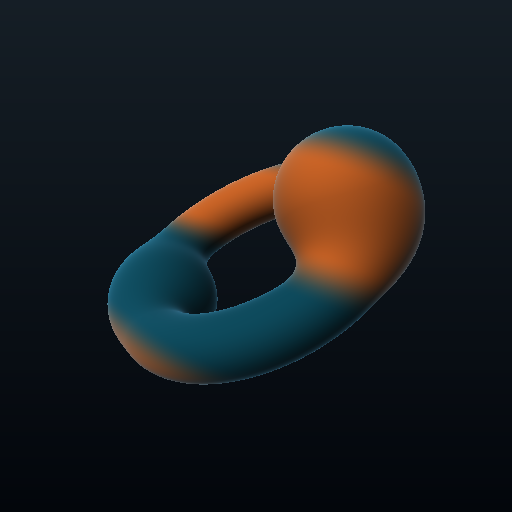
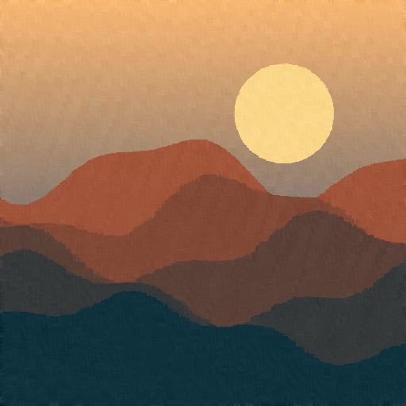
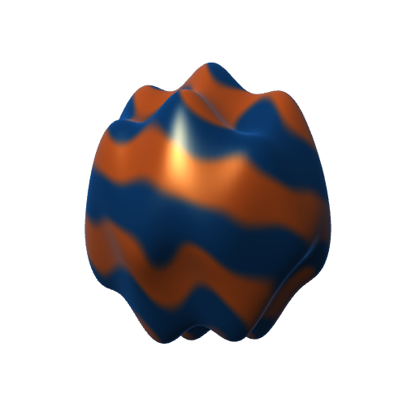
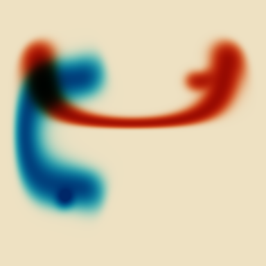

# Five complete TouchDesigner workflow tests

Each sample passes through **research → build → explain → review**, with a
`workflow.json` record and a readable research dossier. The five use different
mechanisms and include five teaching presets each.

| Sample and tutorial | Distinct mechanism | What the test challenges |
|---|---|---|
| [Orbital Relic](orbital-relic/article.md) | SDF surface raymarching | Analytic hit coverage, normals, budget limits and aspect. |
| [Lantern Fog](lantern-fog/article.md) | Volumetric integration | Step-length consistency, analytic transmission and separate light visibility. |
| [Pigment Census](pigment-census/article.md) | Neighborhood image statistics | Constant/identity cases, edge preservation and grain reduction. |
| [Resonant Foil](resonant-foil/article.md) | Vertex displacement + corrected normals | Real silhouette motion, Jacobian correction, rotation and scale. |
| [Tidal Ink](tidal-ink/article.md) | Persistent pigment advection | Initialization, periodic sampling, hold/reset, decay and transport bounds. |

## Native previews

### Orbital Relic

### Lantern Fog

### Pigment Census

### Resonant Foil

### Tidal Ink

Each sample folder contains `native/study.tox`, a source builder, GLSL, decisions,
experiments, an implementation-linked tutorial, native captures and scoped
validation. Drag the `.tox` into TouchDesigner and open `out`. The first four
saved studies use fixed-time presets; turn Pause off for motion. Tidal Ink
advances its state when the output cooks. Its tutorial explains reset and warmup.

All five were checked on TouchDesigner 2025.33230, macOS. The user also confirmed
that all five animated viewers were visible with no obvious problems.
See [the complete evidence scope](../validation/five-mechanisms/README.md) and
[the renewed archive audit](../maintainer/coverage-recheck.md).
The tests establish the named properties; they do not certify every native
mechanism, operating system, live input or future derivative shader.
