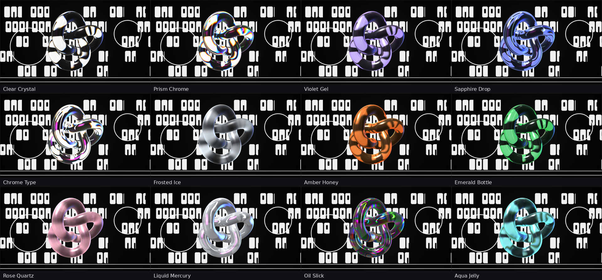
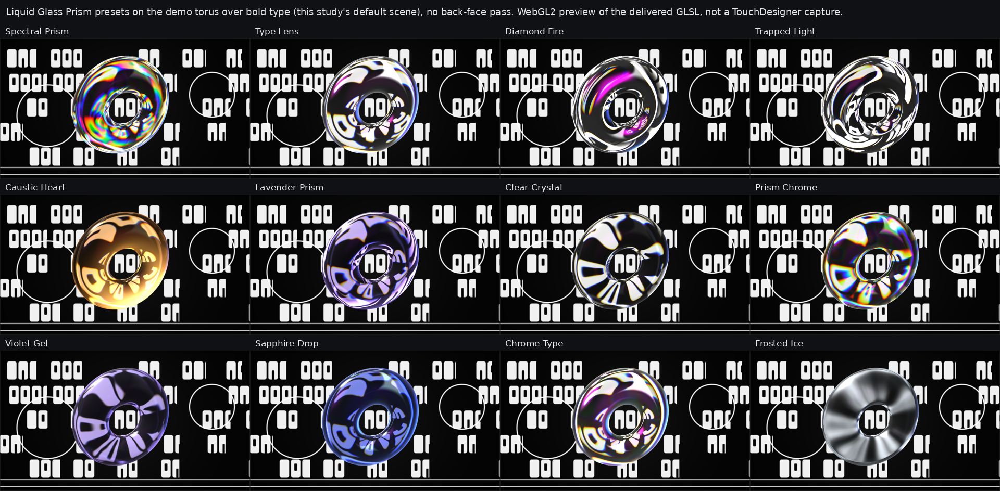
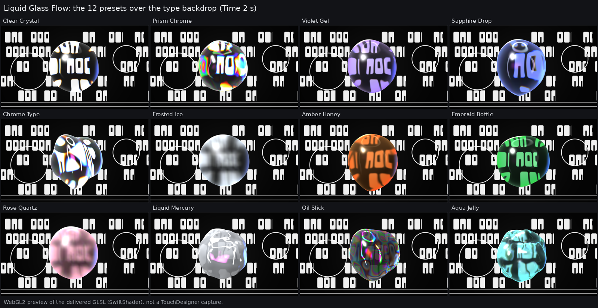
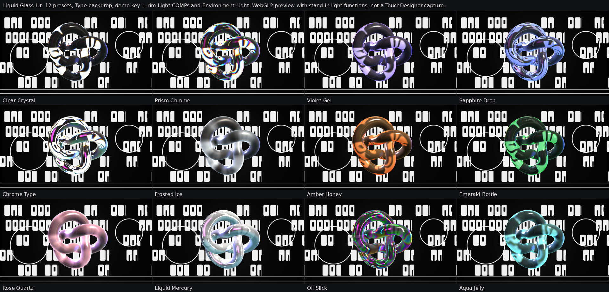
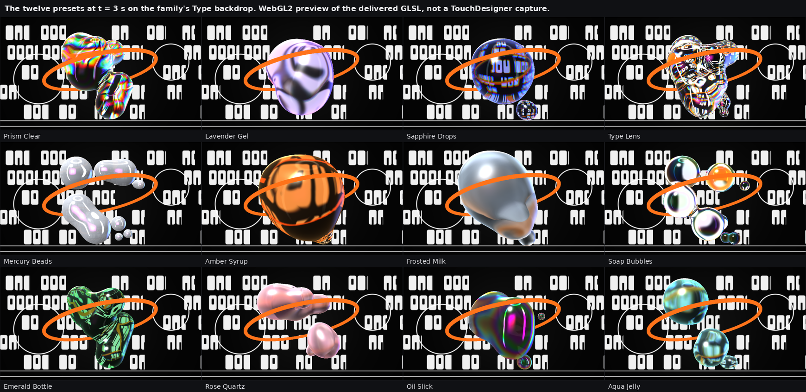

# Liquid Glass family for TouchDesigner

Five liquid-glass shaders for TouchDesigner 2025.x that share one glass look, one preset system and one set of conventions. Pick the one that matches how your glass must behave. Each folder is self-contained: GLSL shaders, a builder you run from the Textport, presets with an A/B morph, a usage guide, and a tutorial for TouchDesigner users who are new to GLSL.

**Status:** nothing here has run in TouchDesigner yet. Every image is a WebGL2 preview of the same GLSL files, and every native step is listed as pending in each study's `validation.json`. Run the native checks in each README before you rely on a study in production.

The family moved from `studies/` to `examples/` in commit 66b4eb8. Records written before the move cite `studies/...`, and some say `examples/` held only native exports, which was true then.

## Which one to use

Start with the core. Move to a member only when you need what it adds.

| Study | What it is | Use it when | Avoid it when |
| --- | --- | --- | --- |
| [Liquid Glass](liquid-glass/README.md) (core) | A glass material for any mesh. It bends the scene once, splits it into rainbow fringes, tints, reflects, frosts and ripples. Optional back-face pass for measured thickness. | You want one glass material for any mesh, in any scene, at the lowest cost. Light comes from typed values and a Reflection TOP. | The outline must move (Flow), you want cut-crystal optics (Prism), light must come from your Light COMPs (Lit), or the glass itself should merge and split (Blobs). |
| [Liquid Glass Flow](liquid-glass-flow/README.md) | The core's look on a mesh whose outline moves like liquid: swells, ripples, waves and gravity drops, with rebuilt normals. | The silhouette itself must move. At Amplitude 0 it renders exactly like the core. | The mesh has too few vertices (about 8 per smallest feature), or one component must fit several objects of different sizes. |
| [Liquid Glass Prism](liquid-glass-prism/README.md) | Bends light at both surfaces, per colour. Wide, correctly ordered rainbows, total internal reflection bands, optional caustic glow. | A mesh should look like cut crystal or a prism. Closest to reference images 1, 2 and 4. | GPU cost matters more than optics: it is heavier than the core. |
| [Liquid Glass Lit](liquid-glass-lit/README.md) | The core's glass, lit by your scene's Light COMPs and Environment Light COMP. One input to connect. | The glass must match the lighting already in your scene. | You want lighting that does not depend on the scene, or the back-face pass, which Lit does not have. |
| [Liquid Glass Blobs](liquid-glass-blobs/README.md) | Raymarched glass blobs that drift, merge, split and shed droplets, inside an ordinary box object that sorts in depth with your scene. | The glass itself is liquid. Closest to reference image 3. | You want glass on your own meshes: Blobs makes its own shapes. It is also the most expensive member. |

## How they were judged

Three independent judges scored the five studies with your priority, universality first. The weights were universality 0.4, match to the reference images 0.25, robustness and evidence 0.2, and cost 0.15. Scores are the mean of the three judges, out of 10.

| Study | Universality | Reference match | Robustness | Cost | Weighted |
| --- | --- | --- | --- | --- | --- |
| Liquid Glass (core) | 8.2 | 6.0 | 7.5 | 8.0 | **7.47** |
| Prism | 7.2 | 8.0 | 7.0 | 5.2 | **7.04** |
| Lit | 7.5 | 6.3 | 6.0 | 7.0 | **6.83** |
| Flow | 6.5 | 6.2 | 7.0 | 7.2 | **6.62** |
| Blobs | 4.7 | 7.8 | 6.7 | 3.2 | **5.63** |

The judges scored before the two rounds described next. Those rounds closed most of the robustness gaps the judges named, so read the robustness column as relative. The judges agreed on three points. The core is the best default. Prism and Blobs match the reference images best. Lit and the core are close, because Lit's only edge is scene lighting.

## What the family shares

After the judging, two rounds brought the five studies in line with each other, and an independent verifier checked each study after each round.

- **Core fixes into the members:** the drift clock that never jumps, the Render Pass TOP route that keeps foreground objects in front, experiments that reset cleanly, float back-face pass and shader hygiene.
- **Member fixes into the core:** the Refraction TOP's alpha, Render Pick and extra colour buffers, measured screen orientation, fog, a half-float-safe output and render diagnostics.

The shared conventions:

- **Inputs:** a Refraction TOP (the scene behind the glass, rendered without it). The core, Flow, Prism and Blobs also take an optional Reflection TOP: a 360 panorama or a flat image. Without one they use a built-in studio. Lit takes reflections from an Environment Light COMP instead.
- **Your own scene:** the mesh members draw the glass with a Render Pass TOP on your scene render, so objects in front of the glass stay in front. Blobs draws inside your own Render TOP instead.
- **Presets:** a Preset menu loads editable values, and Morph target with Morph blends toward a second preset. The core, Flow and Lit share the core's twelve looks. Prism and Blobs have twelve of their own.
- **Object size:** one rule for the whole family. Object size is the object's size in the world, over a reference radius of 1.45. Thickness, frost and tint density follow it, and so do the ripple and film patterns. **Fit to Glass geometry** sets it from the object's bounds, so a preset looks the same on a 0.1-unit and a 10-unit object.
- **No dithering:** blur and rainbow fringes are continuous, built from mipmaps. The recipes switch the Render TOPs' Dither off, and a unit test bans per-pixel noise in the shaders.
- **Shared controls:** Colour parameters (Auto, As typed, sRGB), Energy conserving, Flip screen V and a Demo backdrop menu (Checker or Type).
- **One name per thing:** the core README's *Names across the family* section lists each name and the few that differ.

## Contact sheets

All presets on the shared Type backdrop. These are WebGL2 previews, not TouchDesigner captures. Each study also has a Checker sheet (`captures/presets-sheet.png`).

| Core | Prism |
| --- | --- |
|  |  |
| **Flow** | **Lit** |
|  |  |
| **Blobs** | |
|  | |

## Get started

1. Download `shader.zip` from the [latest release](https://github.com/swisoft-gmbh/shaders-td/releases/latest): it holds all five studies and this overview. Or download one study's ZIP from the same release, or use its folder in this repository. The release builds the ZIPs from this repository, so they match it.
2. In TouchDesigner, open the Textport and build the component:

   ```python
   import runpy
   component = runpy.run_path('/path/to/liquid-glass/build.py')['build']()
   ```

3. Follow that study's README from *Use it on your own scene* onward.

## Open look questions

The shared Object size rule changed two demo looks, and Blobs keeps its own units in two places. Each question is written up with its options, measurements and a recommended option in that study's `co-design.json`, under `look_decisions_for_user`. Until you answer, the code stays as delivered, and a unit test keeps it there.

| Id | Question | In the code now (recommended) |
| --- | --- | --- |
| LOOK-F1 | Flow: which default Object size should the demo use? | 0.69, which is what Fit sets on Flow's demo sphere. The presets look thinner there than before. |
| LOOK-P1 | Prism: should the six core looks keep the core's values on Prism's flatter demo torus? | Keep them, so a preset name means the same glass in every member. |
| LOOK-P2 | Prism: should the film bands keep the family's count? | Keep it. The bands are 3.4% wider on Prism's demo. |
| LOOK-B1 | Blobs: which film count? | 2.5 per box radius. The family's count looks spotty on Oil Slick. |
| LOOK-B2 | Blobs: should the ripple follow Object size or the box? | The box, because the ripple is part of the blob shape. |

One wider question is also open. Today one Fit press sets one Object size for the whole component. That breaks in three cases: an animated Geometry COMP scale, several objects of different sizes, and instances scaled one by one. The alternative keeps Object size in SOP units and lets the shader follow the COMP and instance scale by itself. It would change what a typed Object size means in every member, so it waits for your decision.

## Known gaps

Found on 3 November 2026 while writing the plugin's skill notes; not fixed in 0.4.0.

- **Order Independent Transparency (OIT), an open question.** The core, Flow and Prism READMEs suggest it for Opacity below 1 or no Refraction TOP. All five pixel shaders call `TDCheckDiscard()`, which Derivative's [Write a GLSL MAT](https://docs.derivative.ca/Write_a_GLSL_MAT) page says is used for things such as order-independent transparency. None calls `TDCheckOrderIndTrans()`, the call that the page's Order Independent Transparency section names (both checked 3 November 2026). Whether OIT works without that second call stays unverified until a TouchDesigner run (see the pending `native_oit_discard` check in [Prism's validation.json](liquid-glass-prism/validation.json)). Until then, keep a Refraction TOP and Opacity 1, where the READMEs say OIT is not needed.
- **Resets write `Par.val`.** `apply()` in `native.py` and `presets.py` writes the constant value only, so a control driven by an expression, export or bind keeps that driver after a reset (Derivative's [Par Class](https://docs.derivative.ca/Par_Class) page, checked 3 November 2026). Lit's experiment reset skips such controls; its preset loader does not.

## How this was built and checked

Every study was built with this plugin's four skills (`research`, `build`, `explain` and `review`; named `shader-research` and so on at the time), and each records the steps in its `workflow.json`. The rounds were:

1. Build each study.
2. Two independent reviews per member.
3. Three audit rounds on the core.
4. A two-way sync between the core and the members.
5. A closing round for cross-study gaps.

Every change in rounds 4 and 5 has a test that fails on the code before it. Each study's `review.md` lists every finding, its verdict and the fix.

Checked here, outside TouchDesigner:

- glslang compiles (GLSL 4.60 and Vulkan) against stand-ins for TouchDesigner's built-ins, including picking and extra-colour-buffer variants, plus negative tests.
- WebGL2 property tests of the same shader files.
- Python unit tests of presets, recipes and helpers.
- The plugin's static study check and tutorial check.

Pending in TouchDesigner, for every study: compile, render, Render Pick, the Render Pass TOP route, fog, Fit, odd render sizes, export, and performance on Apple Silicon.
