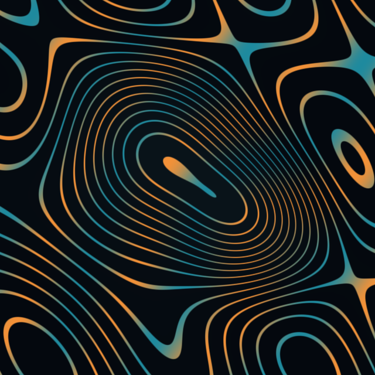
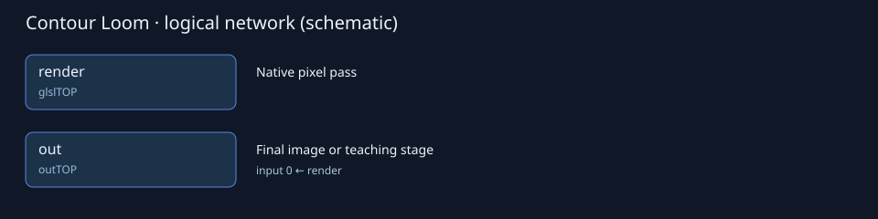

# Contour Loom: drawing a material from equal-height lines

Captured in TouchDesigner 2025.33230; see the stage receipts for settings.

The intended image is a dark field crossed by fine copper and blue threads.
Those threads trace a continuous surface, then take their color from a second,
diagonal signal. The result is a screen-space study of how one scalar field can
control structure while another controls its visual interpretation.

This original native study draws on Maxime Heckel's separation of sampling,
pattern and composition in [Post-Processing Shaders as a Creative Medium](https://blog.maximeheckel.com/posts/post-processing-as-a-creative-medium/)
and his incremental pattern experiments in [Shades of Halftone](https://blog.maximeheckel.com/posts/shades-of-halftone/).
The TouchDesigner network and code here are new adaptations.

Build with `runpy.run_path('/path/to/build.py')['build']()` inside TouchDesigner.
Keep the returned component in `component`. Its Study page exposes the controls.
The default image is 640 × 640; Pause fixes time to two seconds.

## What shape exists before the lines?

We need a scalar for each screen point. Two Gaussian hills provide a stable
large-scale shape; a lower-amplitude trigonometric fold introduces motion.
The exponent uses squared distance, so each hill fades smoothly without a hard
boundary. The second hill is narrower because its exponent coefficient is larger.
This choice gives the contour lines an asymmetric structure without sampling
noise or an external image.

{{code:shader.frag:field}}

{{experiment:field}}

The field's brightness reveals its height. Increasing Warp should move the
level sets; it does not simply recolor them. Gaussian hills were chosen over a
full noise field because they make this relationship easier to predict. For a
new artwork, a signed distance field, image luma or audio-driven potential could
replace them, provided its range and derivatives are understood.

## How do equal values become threads?

The screen coordinates span roughly −1 to +1. Multiplying X by width/height
keeps the field's geometry consistent on a rectangular output.

{{code:shader.frag:coordinates}}

Multiply the field by the contour count. The fractional part repeats once per
unit of phase. Measuring distance to its nearest integer gives a periodic line
mask, so a contour is a set of points with the same underlying field value.

{{code:shader.frag:contours}}

{{experiment:lines}}

The `fwidth` of the unwrapped phase estimates how quickly it changes across a
pixel. It sets a transition width for antialiasing. Taking that derivative
before the fractional wrap avoids interpreting a periodic seam as a large
signal jump. The small floor prevents equal smoothing edges.

The line half-width is in phase units, not constant screen pixels. Threads can
therefore appear wider where the field changes slowly. This is a deliberate
level-set treatment; a constant-pixel stroke would require a different width
model and testing near zero gradients.

## What happens when the pattern becomes dense?

{{code:shader.frag:contours}}

{{experiment:dense}}

Compare this with the previous preset at the same time and Warp. Only Bands
changes from 18 to 36. The height field stays fixed while the number of selected
levels increases. At enough density, neighboring antialiasing transitions can
overlap and the pattern loses contrast. Antialiasing reduces unstable edges; it
cannot preserve arbitrary detail below the pixel scale.

A practical quality test compares the two counts at fixed resolution, then
increases resolution without changing the field. Do not infer performance from
how quickly a still image appears. Record the native build, pixel format and
timing method when measuring.

## How does a diagram become a material?

{{code:shader.frag:compose}}

{{experiment:final}}

The same line mask now mixes a dark base with a blue-to-copper pigment signal.
The diagonal color oscillation is intentionally independent of contour
thresholding, which makes the image resemble intersecting threads without
pretending to simulate fibers or light transport.

This separation is useful for teaching and art direction: changing ink cannot
move a contour. The field and lines stages let us verify that claim directly.
The finished palette is an artistic choice; it is not a physically measured
metal response. Native output color also depends on the project's color
settings, which should accompany captures.

## Evidence and limits

See `validation.json` and any native capture receipts for what was actually
tested. Predictions above are experiment instructions, not fabricated
observations. The package includes source and a native builder; native exports
and captures are valid only when produced by TouchDesigner. User acceptance and
performance measurements are separate from shader compilation.
