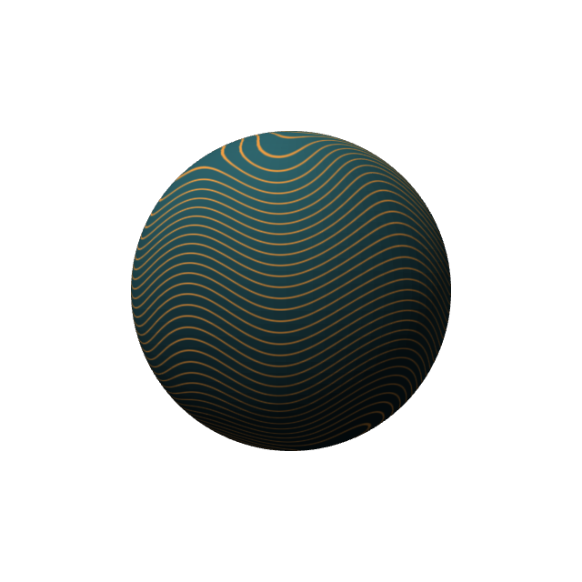
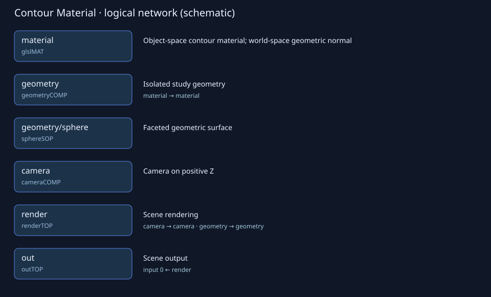

# Contour Material: deciding which space owns a pattern

Captured in TouchDesigner 2025.33230; see the stage receipts for settings.

A sphere carries thin warm contour bands over a blue-green surface. Rotating
the object moves its pattern, while a fixed world-space light continues to
illuminate the geometry from one direction. The study makes coordinate-space
choices visible rather than hiding them inside a finished material.

It follows the decomposition of vertex and fragment work in Maxime Heckel's
[The Study of Shaders](https://blog.maximeheckel.com/posts/the-study-of-shaders-with-react-three-fiber/)
and the explicit light/vector concerns of
[Refraction, dispersion, and other shader light effects](https://blog.maximeheckel.com/posts/refraction-dispersion-and-other-shader-light-effects/).
It does not reproduce that article's glass effect. The native MAT, scene and
contour composition are new toolkit work.

Build with `runpy.run_path('/path/to/build.py')['build']()` inside TouchDesigner.
The resulting component includes geometry/sphere, material, camera, render and
out. The material is deliberately self-lit in its fragment shader; no external
Light COMP is needed.

## Where should the pattern live?

The vertex stage passes object-space position and transformed world-space
position separately. It delegates native deformation and projection to
TouchDesigner's helpers. These are native host operations, not substitutes
copied from a Three.js uniform list.

{{code:vertex.vert:transforms}}

{{experiment:field}}

Object space is convenient for a pattern that belongs to an object. Moving the
camera changes its projection, but does not rewrite the field. World-space
position will serve a different purpose: determining the actual orientation
of the rendered surface. Combining these two roles into an ambiguously named
position vector would make later lighting errors difficult to explain.

## How do we draw contours over a surface?

{{code:pixel.frag:field}}

{{experiment:field}}

The field begins with object-space Y and adds a bounded fold in X and Z. Its
equal-valued surfaces intersect the sphere to create curved bands. As in the
image example, a periodic distance and derivative-width transition produce
the line mask. The surface geometry itself is unchanged.

This is a useful distinction when evaluating originality and cost: we changed
the representation attached to the surface, not the mesh topology. True raised
engraving would need displacement or a separately stated normal perturbation,
with corresponding geometry and shading validation.

## Which normal matches the light?

{{code:pixel.frag:normal}}

{{experiment:normal}}

The cross product of screen derivatives of world position yields a geometric
surface normal. Dividing by its length, with a small denominator floor, makes
the dot product with a normalized world-space light direction meaningful.
Front/back orientation is explicit.

This normal describes the rendered facets, not an interpolated smooth normal.
It was chosen to keep the experiment tied to the transformed surface and to
make the tradeoff visible. A smooth material should instead use appropriate
normal attributes and native normal deformation. A displaced surface would
also require updated normals; a visually plausible highlight is not proof that
the transformation is correct.

## What happens when we stretch the object?

{{code:pixel.frag:normal}}

{{experiment:stretch}}

Change only X scale from 1 to 1.4, leaving camera, time and rotation fixed.
Because the derivative normal is constructed from world-space positions after
transformation, it follows the stretched surface. Compare this with the
unscaled normal preset.

This experiment exposes a common adaptation risk: transforming a normal as an
ordinary position or direction under nonuniform scale is generally wrong.
If replacing this faceted method with attribute normals, use the correct
normal transform and repeat the test. Do not copy a historical shortcut solely
because it appeared in a visually successful browser demo.

## What does the final composition add?

{{code:pixel.frag:compose}}

{{experiment:final}}

A dark clay-like base and warm bands are multiplied by a simple diffuse term
with a small ambient floor. This is a stylized lighting model, not a calibrated
BRDF or a claim of physical clay properties. The debug stages separate
field, normals and line mask, making each contribution inspectable.

The Render TOP references only this study's geometry and camera. That scoped
selection matters when the component is loaded into a larger project: unrelated
objects should not silently enter the render.

## Evidence and limits

Native compile reports, captures, control checks and export/reopen results
belong in `validation.json` and their receipts. A successful material compile
must be followed by a scene render; a MAT preview alone is insufficient.
The intended faceting, artistic color and simple diffuse light are documented
choices. Multi-camera rendering, instancing, displacement and other builds
require additional native tests.
