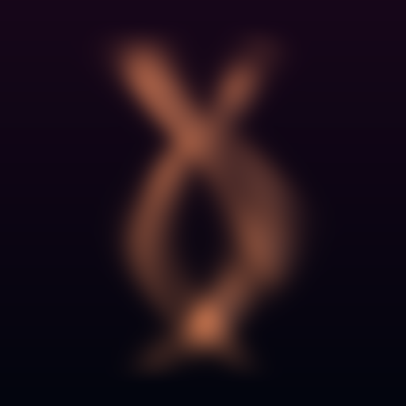
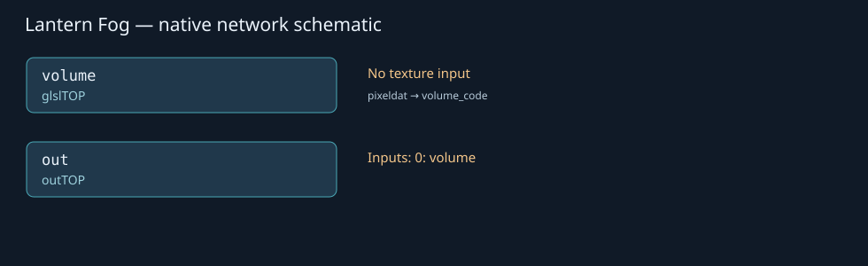

# Lantern Fog

Make two lit helical density ribbons suspended in a dark volume. Teach view transmission and light visibility as different quantities, and test step-size consistency with a homogeneous slab.

This is an original TouchDesigner study grounded in the cited archive. It separates the published technique, the new native implementation, and observations from actual tests. The source tutorial and excerpts are generated together so the explanation stays tied to the delivered shader.

## Open the study

Drag [the native component](native/study.tox) into TouchDesigner, or run `build.py` inside its Python Textport with `runpy`. Keep the returned component in a variable named `component` for the experiment commands below. Open its `out` viewer and use the Study parameter page. Presets fix unrelated controls; Pause and Time make comparisons reproducible. Any reset or warmup requirement is stated beside its experiment.

The recipe is [study.json](study.json), the source trail is [research.md](research.md), and native results are summarized in [review.md](review.md). The tested host is TouchDesigner 2025.33230 on macOS. Browser copies of these algorithms would require their own validation.

## Start with density, not a translucent surface

The scene contains two helical ribbons of density. Their centers wind through the XZ plane as Y changes, and exponential radial falloff gives each ribbon a soft cross-section. A vertical envelope limits their ends. A bounded sinusoidal modulation adds internal variation without requiring an external noise texture.

Density is nonnegative and exists only inside a cube with half-extent 1.5 scene units. A view ray traverses a total Z length of three units. The diagnostic shows a central slice rather than the integrated volume, so it answers where material exists before questions about lighting arise.

The Slab fixture replaces the ribbon function with a constant density of 0.4. That unglamorous option is central to the test: it removes spatial complexity and gives transmission a known answer. The image border extends slightly beyond the volume, so analytic slab comparisons use an interior region.

{{code:volume.frag:density}}

{{experiment:density}}

The diagram is a schematic of the recipe, not a captured network screenshot. Texture wires and parameter references are labeled separately.

## Transmission belongs to the view ray

For a segment of length ds, density rho and extinction sigma produce a segment transmission exp(-sigma*rho*ds). Density is dimensionless here and extinction is inverse scene distance, making the exponent dimensionless. The cumulative transmission T is the fraction surviving from the camera to the current sample.

The segment contributes T*(1-segmentT)*source to radiance, then updates T by multiplying it by segmentT. This order accounts for the current segment using the transmission that reached its front. A constant segment source makes this an exact exponential segment integral under the piecewise-constant approximation.

Including ds is essential. Simply adding a density contribution at every iteration would change brightness when sample count changed. This native implementation intentionally differs from historical snippets in the archive where the accumulation mixes those roles. The preserved source remains evidence of the published version; it is not silently rewritten to match this shader.

{{code:volume.frag:integrate}}

{{experiment:transmission}}

## Light takes a different journey

A sample can be visible to the camera yet poorly lit because material blocks its path toward the light. The second march estimates that separate path. It accumulates density times a 0.25-unit segment length along a fixed light direction and converts the resulting optical depth to transmission.

That visibility modifies the local source color. It does not replace cumulative view transmission. The two values answer different questions: whether light reaches a sample, and whether light from that sample reaches the camera.

The light march has twelve midpoint samples and a fixed three-unit reach. This is a deliberate bounded approximation. It can miss attenuation outside that reach or fine density detail between samples. The view-step convergence test therefore says nothing about convergence of the light march; keeping this limit visible prevents an attractive result from being mistaken for a fully converged scattering model.

{{code:volume.frag:light}}

{{experiment:light}}

## Use a slab to challenge the equation

With density 0.4, extinction 2 and path length 3, the exact transmission is exp(-2.4), approximately 0.090718. Dividing the path into 16, 64 or 128 equal segments should preserve that product apart from floating-point roundoff. The test checks all three choices on the native output.

The zero-extinction case should return transmission one. Increasing extinction should never increase transmission for the same density. These checks test the equation and parameter meaning independently from the visual ribbons.

For the spatially varying scene we also compare 32 and 64 view steps against a 128-step reference. Lower error at 64 supports convergence for this fixture. It is not a universal quality guarantee: a new high-frequency density function can require more samples, and an image error threshold should be chosen for its actual use.

{{code:volume.frag:integrate}}

{{experiment:slab}}

## Composite what survives

The remaining background is multiplied by final transmission and added to accumulated radiance. This prevents empty space from behaving like an opaque black surface. The displayed TOP is opaque because it includes the background; its alpha is not a reusable volume transmittance channel.

The amber illumination and violet-blue ambient term are chosen for legibility. They are not measured spectral scattering coefficients. The broad helical form gives a visibly different result from the opaque SDF study even though both shaders march rays.

The default 64-step view integration is an educational compromise. Native cook observations are recorded separately from image correctness and are not presented as GPU benchmarks. A production volume could add a tighter bounding volume, adaptive sampling, temporal reconstruction or a more complete lighting model, each with additional tests.

{{code:volume.frag:composite}}

{{experiment:final}}

## Evidence, tradeoffs and next experiments

The [review record](review.md) lists the actual checks and their limits. Captured presets establish those states; shader compilation establishes accepted code; mathematical fixtures test specific relationships. None alone establishes artistic acceptance or performance on another device. Native CPU cook observations are not labeled GPU execution time.

Change one mechanism at a time, preserve a fixed baseline, and explain why the new choice helps the intended image. The presets are teaching tools, not a restriction on new compositions. Shader approval and tutorial approval remain separate.

## Sources and credit

[Maxime Heckel’s article](https://blog.maximeheckel.com/posts/real-time-cloudscapes-with-volumetric-raymarching/) and its matching archived demo informed the mechanism and teaching structure. [Exact source records](sources.json) preserve the relevant lines, hashes and adaptation notes. Credit for underlying algorithms remains with the researchers named in those sources. New prose, diagrams and native code are authored for this toolkit. See [the package attribution](../../ATTRIBUTION.md) for original source terms.

Native host contracts: [GLSL TOP](https://docs.derivative.ca/Write_a_GLSL_TOP), [GLSL MAT](https://docs.derivative.ca/Write_a_GLSL_MAT), and [Feedback TOP](https://docs.derivative.ca/Feedback_TOP), as applicable to the recipe. The live host provides the parameter and compile evidence.
