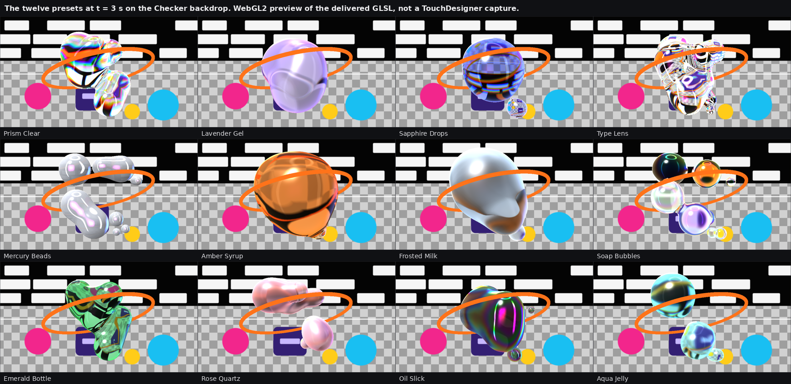
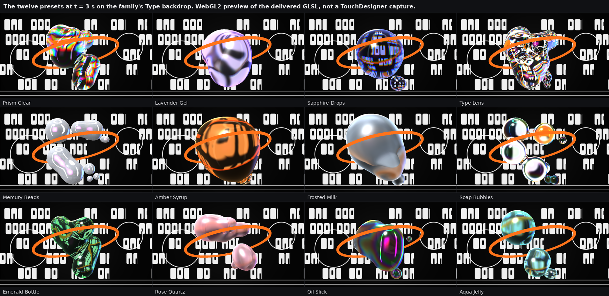
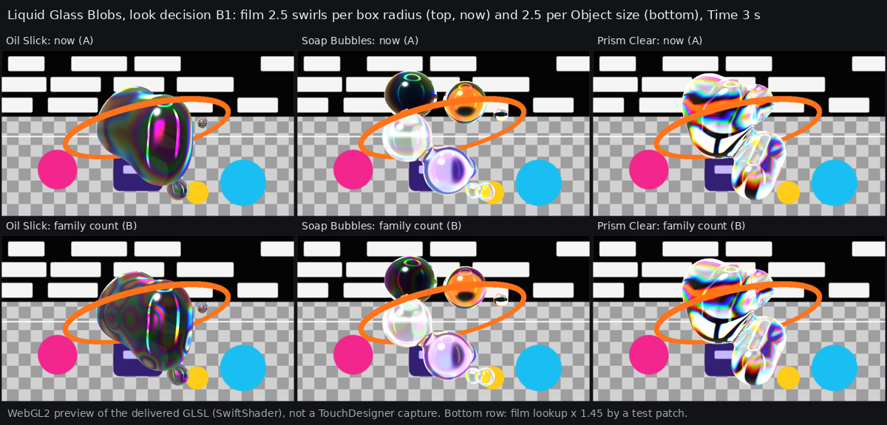

# Liquid Glass Blobs for TouchDesigner

Liquid-glass blobs that drift, merge, split and shed droplets, raymarched inside an ordinary box object. Because the box is normal geometry, the blobs work with perspective, orthographic and blended cameras, can be moved, scaled and instanced like any object, and sort correctly in depth against the rest of your scene. See [Limits](#limits) for what is not covered. Seen through them, the scene shrinks, flips and splits into rainbow fringes. Twelve presets get you started; every value stays editable, and an A/B morph blends looks and shapes.

This is one member of the liquid-glass family; the [core study](../liquid-glass/) is a glass material for meshes. Use this one when you want the glass itself to be liquid.

[Tutorial: how it works](article.md) · [Research](research.md) · [Decisions](decisions.json) · [Review](review.md) · [Validation status](validation.json)





*WebGL2 previews of the delivered GLSL, on this study's Checker backdrop and on the Type backdrop shared by the liquid-glass family. TouchDesigner has not rendered these blobs yet; see [Status](#status).*

*This study moved from `studies/liquid-glass-blobs/` to `examples/liquid-glass-blobs/` in commit 66b4eb8. Records written before the move (sources.json, decisions.json, review.md, co-design.json, brief.md and research.md) cite the old path.*

## What you get

| File | What it is |
| --- | --- |
| `blobs.vert`, `blobs.frag` | **The shader.** Vertex and pixel code for a GLSL MAT on a proxy box. |
| `build.py`, `builder.py` | Builds a ready `liquid_glass_blobs` component in your project from the Textport. |
| `presets.json`, `presets.py`, `preset_exec.py` | The twelve looks, the preset loader and the morph. |
| `blob_layout.tsv` | Example layout table (one row per blob: x, y, z, radius). |
| `backdrop.frag`, `env.frag` | Demo inputs: two backdrops (Checker, and the family's shared Type page) and a studio panorama. |
| `study.json` | The recipe the builder follows: every node, parameter and uniform binding. |
| `native.py` | In-TouchDesigner helpers: apply an experiment, inspect, capture, export. |
| `article.md` | The tutorial, with experiments you can load. |
| `checks/` | Compile check, WebGL2 preview, property tests and unit tests (run outside TouchDesigner). |

## Quick start

1. Download or clone this folder and note where it is.
2. In TouchDesigner, open the Textport (Dialogs > Textport and DATs) and run, with your own path:

   ```python
   import runpy
   component = runpy.run_path('/path/to/liquid-glass-blobs/build.py')['build']()
   ```

3. A `liquid_glass_blobs` component appears in `/project1`. Open its viewer: you should see clear glass blobs and an orange ring passing through them, over the demo backdrop. Pick a look from **Glass > Preset**.

If the build prints warnings, they come grouped by what they affect. *demo*: a demo node or a cosmetic setting failed; the blobs are fine. *setup*: a helper setting such as Draw Priority failed; the blobs should still work. *material*: a sampler setting failed, so frost, dispersion or reflection blur may look stepped. *inputs*: an input field could not be set to a plain path and uses an expression instead. *optional*: an Info DAT is missing. The warnings are stored in `component.fetch('build_warnings')`. The core nodes (`material`, `blobs_geo`, the presets) are built strictly: if one of them fails, the build stops and names the parameter.

## Use it on your own scene

The blobs live in `blobs_geo`, a Geometry COMP inside the component. You only need two settings:

1. **Render the blobs with your camera.** In your Render TOP's **Geometry** parameter, add the path to `liquid_glass_blobs/blobs_geo` next to your other objects. Move, rotate or scale `blobs_geo` to place the blobs; they fill its 2 x 2 x 2 box.
2. **Give them the scene behind.** Make a second Render TOP with the same camera and the objects *behind* the blobs, never `blobs_geo` itself. Drag it onto **Inputs > Refraction TOP**, replacing the demo's `scene`.

That is all: the blobs write their own depth, so your objects pass in front of them and behind them correctly in the first render. Keep both renders at the same resolution and camera. Never put the blobs in the Refraction TOP render: they would sample their own output. Turn **Dither** off on both Render TOPs (Render TOP, Advanced page): the glass is designed to be continuous, and dithering adds grain. The demo renders have it off; TouchDesigner's default for it is not stated in the documentation.

- **Scaled blobs.** If you scale `blobs_geo`, pulse **Inputs > Fit to Glass geometry**. It sets **Object size** to the box's radius in scene units over 1.45, the size every member of the liquid-glass family measures against (the core study's demo torus). The unscaled 2-unit box has radius 1, so it reads 1 / 1.45 = 0.69, the default; `blobs_geo` scaled 3 reads 2.07. Tint density, Backdrop distance and Frost are measured in scene units, and the film swirl in steps of the object's size, so without Fit a preset made for the 2-unit box turns dark and flat on a 200-unit one. The blob shape (radius, spread, merge, droplets and ripple) is in box units and follows the box by itself.

- **The background may be transparent.** The glass keeps the Refraction TOP's alpha. Where that render is empty (background alpha 0), clear glass lets through whatever you composite behind the final render later, for example with an Over TOP. Or include the background in the Refraction TOP, as the demo's `scene` does.
- **Leave out objects in front of the blobs.** The glass bends the Refraction TOP without knowing depth, so an object between the camera and the blobs would also appear inside the glass, as a ghost.
- **The demo inputs stay connected until you replace them.** Refraction TOP, Reflection TOP and Layout TOP start as plain paths to the demo nodes `scene`, `demo_env` and `layout_top`. Drag your own TOP onto the field, type a path, or select the text and delete it to empty the field. Right-click > *Reset to Default* brings the demo back. With Refraction TOP empty, the demo's `behind` Select TOP shows the transparent `blank` TOP instead of an empty path, so capture and export keep working (pending a native check). (If a build cannot resolve the plain path, the builder falls back to an expression and prints an *inputs* warning.)
- **Draw order.** `blobs_geo` has **Render > Draw Priority** -1, so the Render TOP draws it after the other objects listed beside it in its Geometry parameter (smaller values draw later). Blending needs that; see zero-wiring mode below.

**Reflections:** drag a TOP onto **Inputs > Reflection TOP**: a 360 panorama (HDRI, Movie File In) with **Reflection map** = *360 panorama TOP*, or any image with *Flat image TOP*. As with the Refraction TOP, never use a render that contains `blobs_geo`. Empty the field, or set **Reflection map** to *Built-in studio*, for the built-in studio.

**Zero-wiring mode:** empty the **Refraction TOP** field (select its text and delete it). The blobs then blend with whatever is behind them in the same render using alpha: clear parts are see-through, tint and reflections stay. You lose bending and dispersion, but you need only step 1. Blending only sees objects drawn *before* the blobs, because the blobs write depth: an object behind them that is drawn later is hidden instead. Draw Priority -1 on `blobs_geo` handles this for objects listed at the same level of the Render TOP's Geometry parameter (pending a native check). Order Independent Transparency is not supported.

**Several clusters:** copy `blobs_geo` (all copies can share the material), or instance it. Each instance gets its own layout. For different looks, copy the whole component. Copies and instances share one Object size, so keep them at one size (see *One Object size per component* under [Limits](#limits)).

### Drive the blobs with a CHOP or table

Set **Blobs > Blob layout** to *Layout TOP*. Blob *i* is then read from pixel *i* of the first row of **Layout TOP**: red, green, blue, alpha = x, y, z, radius, in box units (-1 to 1). To make that TOP:

- **From a CHOP:** one sample per blob, and the first four channels in this order: x, y, z, radius. CHOP to TOP maps channels to red, green, blue and alpha by their order in the CHOP; their names are ignored. Use CHOP to TOP with **Data Format** = RGBA, **Pixel Format** = 32-bit float (RGBA) and **Clamp CHOP Values** off (with it on, every negative coordinate would become 0).
- **From a table:** a Table DAT with columns x, y, z, r → DAT to CHOP (**Output** = Channel per Column, **First Row is** = Names) → CHOP to TOP as above. The demo builds exactly this: `layout_table` → `layout_chop` → `layout_top`.

**Blob count** still decides how many rows are used. Stretch and droplets stay procedural. A blob needs room for its radius, its stretch and the merge bulge: on each axis, |x| + radius × (1 + Stretch) + Merge / 4 + 0.01 must stay at or below 1 (the same for y and z). A centre closer to a wall is moved inward. A blob too big for the box even at its centre (radius × (1 + Stretch) + Merge / 4 + 0.01 above 1) is centred, and the box walls cut it flat: it shows a flat glass face there. To avoid that, scale `blobs_geo` up and lower Radius.

## Controls

**Glass page**

| Control | What it does |
| --- | --- |
| Preset | Loads one of the twelve looks (and its blob shape) into the sliders. *Custom* keeps your values. From a script, use `component.op('presets').module.apply(component, 'lavender_gel')` and set overrides after it. |
| Apply preset again | Reloads the chosen preset after you changed sliders. |
| Morph target, Morph | Blends every look and shape value toward a second preset (0 = sliders, 1 = preset B). Animate Morph for transitions. |
| Glass colour | The colour of the glass itself (white = clear). |
| Tint density | How strongly the colour builds up per scene unit of glass the light crosses, at Object size 1. 0 = no tint. |
| Edge tint | Extra tint toward the silhouette, for deep-coloured rims. |
| Translucency | 1 = see-through, 0 = solid, milky body in the glass colour. |
| Opacity | Fades the whole glass, reflections included. |
| Frost | Blurs the view through the glass. |

**Optics page**

| Control | What it does |
| --- | --- |
| Index of refraction | How much the glass bends light (1 = not at all, water 1.33, glass 1.5). |
| Backdrop distance | How far behind the blobs the scene is, in scene units at Object size 1. More distance, stronger flip and shrink. |
| Dispersion | Splits light into rainbow fringes. |
| Saturation | Colour intensity of what you see through the glass. |
| Samples | Colour quality vs speed (default 12; raise for crisper rainbows). |
| March steps | Shape quality vs speed (default 96; lower if slow, raise if silhouettes break up). |

**Blobs page**

| Control | What it does |
| --- | --- |
| Blob layout | *Procedural* (the sliders below) or *Layout TOP* (your own positions). |
| Layout TOP | The layout image (see above). Demo: `layout_top`. |
| Blob count | How many blobs (up to 12). A fraction grows the last blob in, so you can animate it. |
| Blob radius | Size of the main blob; the others are 55–100 % of it. Box units. |
| Spread | How far blobs wander from the centre. |
| Merge smoothness | 0 = blobs only touch with sharp creases; higher = they melt together through smooth necks. |
| Stretch | 0 = spheres, higher = capsules that tumble. |
| Droplets, Droplet size | Small drops that circle the body, touching and splitting off (up to 6, fractions allowed). |
| Speed | How fast everything drifts (0 = frozen layout). |
| Seed | A different, repeatable arrangement. Presets never change it. |
| Surface ripple, Ripple scale | Small travelling ripples on the surface. |

**Reflection page:** Reflection map, Reflection colour and amount, Mirror (reflect everywhere, not only at the edges), Reflection blur, Panorama rotation, Flat image warp, Fresnel falloff, Rim colour and glow, Energy conserving (off by default: the reflection adds on top of the view through the glass, as in Heckel's article; on: what the glass reflects no longer also passes through it, so Mirror 1 is a true mirror).

**Light page:** Light direction, Light colour, Specular, Shininess, Diffuse.

**Film page:** Iridescence (soap-film colours), Film thickness, Film variation.

**Inputs page:** Refraction TOP, Reflection TOP, Object size (the box's radius over 1.45; 1 = the core's demo torus, 0.69 = the demo box) and Fit to Glass geometry (see Use it on your own scene; it measures `blobs_geo`), Flip screen V (see troubleshooting), Colour parameters (*Auto* follows the project's working colour space; *As typed* passes colours unchanged; *sRGB* converts glass, light, rim and reflection colours from sRGB to linear).

**Study page:** Pause and Fixed time (for repeatable looks), Teaching stage (one ingredient at a time: proxy box, march steps, normal, depth, thickness, refraction, body, reflection, fresnel, film, screen UV, finite check), Demo ring spin, Demo backdrop (*Checker*, this study's own, or *Type*, the bold-type page every study in the family renders).

**Names in scripts.** Fit to Glass geometry is `Fitglass`, as in every family member. From Python, `component.op('study_tools').module.fit_glass(component)` does the same and returns what it measured; the helper has the same name in every member. `fit_object_size()` is its old name, kept for one round. Demo backdrop is `Demobackdrop` here, not `Backdrop` as in the other four, because `Backdrop` is Optics > Backdrop distance. The family's names are listed once in the core study ([names across the family](../liquid-glass/README.md#names-across-the-family)).

**How the blobs move.** Speed is not multiplied by the clock. Every frame, Python adds Speed × the frame's duration to a drift phase, in double precision, and the shader reads only that phase. Changing Speed, by hand or during an A/B morph, changes how fast the blobs move, never where they are, even after days of uptime. Each phase wraps where its own motion repeats (the shader rounds each layout wave speed to a multiple of 1/128 for this), so nothing jumps at a wrap. The blob layout repeats every 256π / Speed seconds (about 38 minutes at Speed 0.35), the ripple every 20π / (0.4 + Speed) seconds (84 s) and the film swirl every 256 / (0.015 + 0.045 × Speed) seconds (about 2.3 hours). These periods do not divide each other, so the image as a whole does not repeat exactly. Paused, the phase is Speed × Fixed time. Editing the `presets` DAT restarts the drift with one jump.

**Tutorial experiments.** `component.op('study_tools').module.apply(component, 'merge_soft')` first returns every look control to its default (preset values, Morph and target, Seed, Blob layout, Samples, March steps, Energy conserving, Light direction, Panorama rotation, Flat image warp and the Study page, Demo backdrop included, because the experiments' pictures use the Checker), then sets the experiment. Your scene setup stays: the input TOPs, Object size, Reflection map, Flip screen V and Colour parameters. So experiments can run in any order; `apply(component, 'final')` brings back the default look, paused, with Preset on Custom. Experiments change the component's shared material, so blobs in your own scene change too.

## The twelve presets

| Preset | Idea |
| --- | --- |
| Prism Clear (default) | Clear capsule blobs with dense rainbow dispersion and an oil-film sheen (reference 1). |
| Lavender Gel | Pale lavender gel with deep violet rims, see-through (reference 2). |
| Sapphire Drops | A blue-violet magnifying body that sheds droplets (reference 3). |
| Type Lens | Reflective clear glass that bends bold type with colour fringes (reference 4). |
| Mercury Beads | Nearly opaque liquid metal beads that merge and split. |
| Amber Syrup | Dense warm amber that merges slowly. |
| Frosted Milk | Icy, frosted, milky blobs. |
| Soap Bubbles | Thin, barely bending blobs under a swirling rainbow film. |
| Emerald Bottle | Green bottle glass in tall capsules, crisp and saturated at the edges. |
| Rose Quartz | Soft pink, half-frosted, milky beads that melt together. |
| Oil Slick | Dark glass in long rippling capsules under a swirling rainbow film. |
| Aqua Jelly | Wobbly cyan jelly with water-like refraction, shedding drops. |

The last four adapt the looks of the same names in the [core study](../liquid-glass/) (commit 6a58487) to blobs: they start from the core's colour, reflection and light values, retuned by eye in the preview, and each has its own blob shape. Presets set look and blob-shape values. They leave Seed, light direction, panorama rotation, reflection map, inputs, Samples and March steps alone.

## Using the shader files by hand

You can skip the builder:

1. A Geometry COMP containing a Box SOP of size 2 (corners at -1 and 1).
2. Two Text DATs with `blobs.vert` and `blobs.frag`; a GLSL MAT using them, GLSL Version 4.60; assign it to the Geometry COMP.
3. **Common page:** Cull Face = Front Faces (render the box's back faces), Depth Test and Write Depth Values on, Blending on with Source Color = One and Destination Color = One Minus Source Alpha (the output is premultiplied), Separate Alpha Function off, Post-Mult Color by Alpha off. On the Geometry COMP, set **Render > Draw Priority** below your other objects' (the builder uses -1). On the Render TOP's Advanced page, Dither off.
4. **Samplers page:** `sRefraction` (scene behind; Filter Mipmap Linear, Extend U and V Mirror), `sReflection` (panorama or image; Mipmap Linear, Extend U Repeat, Extend V Hold), `sLayout` (layout TOP, or any TOP if unused; Nearest, Hold).
5. **Vectors page:** sixteen vec4 uniforms:

| Uniform | x | y | z | w |
| --- | --- | --- | --- | --- |
| `uGlass` | glass R | glass G | glass B | tint density |
| `uBody` | translucency | frost | opacity | edge tint |
| `uOptics` | IOR | backdrop distance | dispersion | saturation |
| `uReflect` | reflection R | reflection G | reflection B | reflection amount |
| `uEnv` | map mode (0 panorama, 1 flat, 2 studio) | rotation (radians) | reflection blur | flat image warp |
| `uSurface` | mirror | fresnel falloff | diffuse | energy conserving (0 or 1) |
| `uRim` | rim R | rim G | rim B | rim glow |
| `uLight` | direction x | direction y | direction z | specular |
| `uLightColor` | light R | light G | light B | shininess |
| `uFilm` | iridescence | film thickness (nm) | film variation | film swirl frequency: 2.5 ÷ (1.45 × Object size); 0 gives one film thickness over all the blobs, which still drifts (Pause stops the drift) |
| `uBlobs` | count | radius | spread | merge smoothness |
| `uShape` | stretch | droplets | droplet size | seed |
| `uMotion` | 0 | ripple | ripple scale | 0 |
| `uPhase` | layout drift: Speed added up over time, wrapped at 256π | ripple drift: (0.4 + Speed) added up, wrapped at 20π | film drift: 0.15 × (0.1 + 0.3 × Speed) added up, wrapped at 256 | 0 |
| `uMarch` | march steps | layout (0 procedural, 1 layout TOP) | samples | flip V (0) |
| `uState` | teaching stage (0 = final) | refraction TOP connected (1/0) | reflection TOP connected (1/0) | colours are sRGB (1) or as typed (0) |

`uGlass.w` is Tint density ÷ Object size; `uOptics.y` is Backdrop distance × Object size; `uBody.y` is Frost × Object size; `uFilm.w` is 2.5 ÷ (1.45 × Object size), which the shader multiplies by the Geometry COMP's scale (`worldScale()`). At the default Object size (1 / 1.45) these give the demo's look. For a still look, put Speed × a fixed time into `uPhase` (for example 1.05, 2.25, 0.092 for Speed 0.35 at 3 s). Values for each preset are in `presets.json`.

## Troubleshooting

- **The blobs are invisible or cut off.** They only exist inside `blobs_geo`'s 2 x 2 x 2 box: check that the box is in your Render TOP's Geometry list and in view. Teaching stage *Proxy box* shows the box itself.
- **Objects that should be in front are hidden, or the other way round.** Depth is computed from the camera's own matrices, so perspective, orthographic and blended projections are covered. Fisheye and quad-reprojected cameras are not supported. Please note your build if a normal camera sorts wrongly.
- **The glass shows itself, or an object in front of the blobs appears inside them.** The Refraction TOP render includes `blobs_geo`, or objects in front of the blobs. Render only what is behind them.
- **The glass looks black.** The Refraction TOP shows black there. A transparent background is fine (clear glass then shows whatever is composited behind the final render); an opaque black background is not.
- **Refraction looks upside down.** The shader measures which way the screen runs, so a raster that runs the other way is handled. If the image inside the blobs is still upside down, your Refraction TOP itself arrives upside down: turn on **Inputs > Flip screen V**. Please note your build.
- **A preset looks dark or flat on scaled blobs.** Pulse **Inputs > Fit to Glass geometry**, or set **Object size** to the scale of `blobs_geo` ÷ 1.45.
- **Film bands too fine or too coarse on scaled blobs.** The film swirl counts in steps of Object size, so `blobs_geo` scaled by k but left at the default Object size shows k times as many bands (finer for k > 1). Fit fixes it. The ripples are part of the shape and keep their count.
- **Rainbow fringes look stepped.** Raise Samples (16–24), and check that `material`'s Samplers page uses Mipmap Linear.
- **Holes or sparkles at silhouettes.** Raise March steps.
- **Slow.** Every pixel of the box marches. Shrink or move `blobs_geo` so the box fits the blobs, lower March steps and Samples, set Reflection blur and Frost to 0, keep the Refraction TOP at the render's resolution.
- **Opacity below 1, or zero-wiring mode, hides objects behind the blobs.** Blending needs those objects drawn first. `blobs_geo` has **Render > Draw Priority** -1 (smaller values draw later), compared with the other top-level components listed in the Render TOP's Geometry parameter. If an object is nested elsewhere, give its top-level component a higher Draw Priority. Unverified natively.
- **Colours look different from the preview.** The preview treats colours as typed. In a project with a linear working colour space, **Inputs > Colour parameters** = *Auto* converts them from sRGB, as TouchDesigner does for its own colour parameters; choose *As typed* to turn that off. Wide-gamut spaces are not converted.
- **Errors after building.** Look at the `info_material` DAT inside the component for compile messages, and at `info_render`: a Render TOP compiles its own copy of the material. Your own Render TOP from step 1 compiles one too. `helpers.inspect(component)` collects both, script errors from the preset callback, and the errors of your own input TOPs. Under `render_diagnostics` it lists every Render or Render Pass TOP in the project that draws `blobs_geo`, with its errors and warnings: yours by path, the demo's by name. It reads your renders as they last cooked.

## Limits

- **Projections:** fisheye and quad-reprojected cameras are not supported, because the pixel shader writes depth itself (`TDWorldToProj` is vertex-only).
- **Several cameras:** the Refraction TOP is one image from one camera. With several cameras, stereo or a cube-map Render TOP, every camera after the first refracts the first camera's view. Use one Render TOP, one Refraction TOP and one copy of the component per camera.
- **Order Independent Transparency and Depth Peeling** are not supported: the material blends, and the depth it writes is not the proxy box's own.
- **Scene lights** are ignored: lighting comes from the Light page. (They could be applied per pixel at the blob surface, as the liquid-glass-lit study does; the family keeps that mode in its own member for now.) **Fog** from the Camera COMP is applied (`TDFog`) but untested natively.
- **Render Pick DAT/CHOP:** the vertex shader uses the picking form on Derivative's Write a GLSL MAT page (`#ifndef TD_PICKING_ACTIVE` ... `#else TDWritePickingValues(); #endif`), so a pick render only projects the box and writes TouchDesigner's default pick values. A pick can land on the empty part of the box, and its position and normal describe the box, not the blob surface (unverified natively).
- **Several colour buffers:** with a Render TOP that has more than one colour buffer, the blobs write their colour to the first and zeros to the others (compiled for 3 and 8 buffers; unverified natively).
- **One Object size per component.** Fit to Glass geometry measures `blobs_geo` when you press it, and its one Object size serves every box the component draws. The blob shape always follows its box; Backdrop distance, Frost, Tint density and the film bands follow Object size. Three setups break that. The numbers come from this study's own Fit code and preset maths ([review.md](review.md#family-critic-native-runs-and-one-object-size)):
  - *Copies of `blobs_geo` at another size.* Fit reads `blobs_geo` only. A copy at a fifth of its size bends and tints as if it were five times larger, with film bands five times larger. For different sizes, copy the whole component.
  - *A scale that changes or is animated.* The lengths and the film bands keep the world size Fit measured. Scaled up three times without a new Fit, the blobs bend and tint as if they were three times smaller and show three times as many film bands. Press Fit again after a scale change. For an animated scale, animate Object size by the same factor.
  - *Instances.* Fit and the shader see the Geometry COMP's scale, not each instance's. On an instance scaled 3 the blobs and the film bands grow with it, but they bend and tint as if they were three times smaller. For instances of different sizes, use one Geometry COMP and one copy of the component per size.

  A non-uniform scale counts as its average (the cube root of the volume change). A change that would let all three follow by themselves is proposed and waits for your decision ([decisions.json](decisions.json), *Family critic: one Object size per component*). None of this has run in TouchDesigner.
- **The motion wraps without a jump**, but only the blob layout loops exactly: every 256π / Speed seconds (about 38 minutes at Speed 0.35). The ripple and the film swirl repeat on their own periods (84 s and about 2.3 hours at that Speed), so the whole image does not repeat exactly.
- **Objects in front of the blobs** must stay out of the Refraction TOP render, or they appear inside the glass (screen-space refraction has no depth test).
- **Blobs too big for the box** are cut flat by its walls (see Drive the blobs).
- **A camera inside a blob** sees nothing of that blob, and glass nearer than the camera's near plane is clipped, as ordinary geometry is.
- **Finite check on macOS:** the finite-check stage tests float bits, because Metal's fast math may remove `isnan()` and `isinf()`. Whether it shows NaN natively on Apple Silicon is pending; see `validation.json` for a positive control.

## Look decisions waiting for you

The family close kept two rules here that differ from the family's, and you have not accepted them yet. The demo looks as before either way. Each question below has options and a recommended answer. Reply "defaults" to take every recommended option, or name a decision and an option, for example "LOOK-B1 B". Until you answer, the code stays as it is: the unit test class `LookDecisions` fails if it changes. [co-design.json](co-design.json) (`look_decisions_for_user`) has the full text; [checks/results/look-decisions.json](checks/results/look-decisions.json) has the measurements.

| Decision | Question | Options | Recommended |
| --- | --- | --- | --- |
| LOOK-B1 | Which film count should Blobs use? | **A** 2.5 swirls per box radius (in the code now). That is 1.724 per Object size, so the bands are 1.45 times as wide as the family rule's. **B** The family's 2.5 per Object size: 1.45 times as many bands; on Oil Slick the finer noise cells show as round spots. | **A** |
| LOOK-B2 | Should the ripple follow Object size, like the core's ripples, or the box, like the blob shape? | **A** The box (in the code now): Ripple and Ripple scale are in box units, like Radius and Merge. **B** Object size, as in the core. Both give the same image once Fit is pressed; they differ only when Object size does not match the box. | **A** |



## Status

Verified here (see [validation.json](validation.json)):

- GLSL 4.60 and Vulkan SPIR-V compile with glslang against stand-ins for TouchDesigner's built-ins, and a deliberately broken copy fails on the right line.
- The vertex shader also compiles as TouchDesigner's pick render sees it (`TD_PICKING_ACTIVE` defined), and a unit test checks that the pick render runs only the projection and `TDWritePickingValues()`. The pixel shader also compiles for Render TOPs with 3 and 8 colour buffers.
- A WebGL2 render of the same files passes 42 property tests, for example:
  - the field normal matches the exact sphere normal within 0.11°, and the exact ellipsoid normal under non-uniform scale within 0.22°;
  - the measured path matches the exact chord within 0.0008 scene units, and rim pixels never measure an unphysical path;
  - where the glass samples the Refraction TOP matches an exact two-surface lens trace within one pixel (worst 0.50), and stays right when the raster runs the other way; the measured screen orientation is right on every blob pixel of the twelve presets and of a blob cut by the box walls, also at an odd render size and with 4x multisampling;
  - the tint matches Beer-Lambert absorption over the measured path;
  - the written depth matches a rasterized sphere within 0.0006 scene units, for perspective, orthographic and blended projections;
  - IOR 1 makes the blobs invisible, also over a transparent Refraction TOP;
  - merge widths from 0 to 1 stay finite and never lose a pixel the plain union covers, and a blob too big for the box shows no holes;
  - one frame of an A/B morph after an hour changes the image no more than after 3 seconds;
  - Object size carries a preset to blobs three times bigger, and to blobs scaled 0.1 or 10 by their Geometry COMP, film bands included; left unfitted, a box scaled 10 shows about 7.6 times the film band detail (the swirl frequency is 10 times), and the same ripples; normals and refraction stay the same on blobs scaled to 0.001 or 20,000; the sRGB colour mode, Energy conserving and the 1024 output cap do what they say;
  - the twelve presets look different from each other on both demo backdrops.
- 81 unit tests of the presets, the drift clock, the experiments (run in every order), the builder's input fields, the diagnostics, the recipe, the shader source, the three setups one Object size does not follow, the native list and the Fit helper's name, `fit_glass()`, in every member pass, as does the plugin's static checker.

**Not yet run in TouchDesigner:** native compile, render, the builder, the preset callback, the CHOP to TOP layout chain, instancing, Draw Priority, fog, picking, several colour buffers, the Dither parameter, Fit to Glass geometry, the Auto colour mode, the `blank` fallback of the demo's `behind` Select TOP, the finite check on macOS, export to `.tox`, and performance. Run the Quick start on your machine and check `info_material` and `info_render`.

## Credits

The raymarching loop, sphere distance, smooth minimum, transforming the sampling point and the gradient normal follow Maxime Heckel, [Painting with Math: A Gentle Study of Raymarching](https://blog.maximeheckel.com/posts/painting-with-math-a-gentle-study-of-raymarching/), with the smooth-minimum and SDF-normal work of Inigo Quilez that it credits. The glass look follows [Refraction, dispersion, and other shader light effects](https://blog.maximeheckel.com/posts/refraction-dispersion-and-other-shader-light-effects/) through this repository's [liquid-glass study](../liquid-glass/) (commit a6f95c6). Beer's law follows Heckel's [Real-time cloudscapes with volumetric raymarching](https://blog.maximeheckel.com/posts/real-time-cloudscapes-with-volumetric-raymarching/). The TouchDesigner material, proxy-box route, depth write, two-surface lens path, colour-gap blur, silhouette smoothing, layout TOP, droplets, presets and builder are new for this study. The family sync (2026-11-02) brought in the core study's audit rounds 2 and 3 from commit 6a58487 (drift clock, input fields, experiment reset, shader hygiene, R2 frost disc after Martin Roberts, colour mode, energy toggle), the measured screen orientation and Type backdrop of the liquid-glass-prism study, the colour buffers and fit of the liquid-glass-flow study, and the dither, output cap and render diagnostics of the liquid-glass-lit study. The four presets Emerald Bottle, Rose Quartz, Oil Slick and Aqua Jelly adapt the core study's looks of the same names (commit 6a58487). The family close (2026-11-02) took the family's Object size rule from the liquid-glass-lit study's decisions.json (radius over 1.45) and the core study's `worldScale()` for the film lookup. See [sources.json](sources.json). This study is not authored or endorsed by Maxime Heckel; the repository's [NOTICE.md](../../NOTICE.md) covers licensing.
