# Liquid Glass Blobs: raymarched glass that merges, splits and sorts with your scene

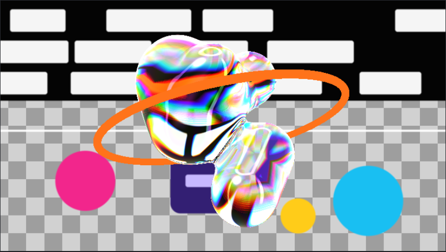

*The destination: clear glass blobs with rainbow fringes, and an ordinary orange ring passing in front of them and behind them. This image is a WebGL2 preview of the same shader files, not a TouchDesigner capture.*

This tutorial builds liquid-glass blobs for TouchDesigner. They drift, melt into each other, split apart and shed small droplets. Seen through them, the scene shrinks, flips and splits into rainbow fringes. They live inside an ordinary object, so they work with perspective and orthographic cameras and sort correctly against the rest of your scene. It is written for TouchDesigner users who have not written shaders before. Every code block below is copied automatically from the delivered files, so what you read is what runs.

Two articles by Maxime Heckel supply the core ideas. [Painting with Math: A Gentle Study of Raymarching](https://blog.maximeheckel.com/posts/painting-with-math-a-gentle-study-of-raymarching/) explains how to draw shapes from distance formulas and melt them together with a smooth minimum. [Refraction, dispersion, and other shader light effects](https://blog.maximeheckel.com/posts/refraction-dispersion-and-other-shader-light-effects/) explains glass, and this repository's liquid-glass study turned it into a TouchDesigner material. His raymarching examples are web scenes with one fixed camera. This study moves the idea into a TouchDesigner material, measures the real path through the glass, and adds depth, droplets, presets and a data input. Each change is pointed out where it happens.

## Open the study

Build the component from the Textport, keeping it in a variable named `component` so the experiment commands below work:

```python
import runpy
component = runpy.run_path('/path/to/liquid-glass-blobs/build.py')['build']()
```

Open the component's viewer. Each experiment below fixes time and every unrelated control, then changes one thing. The **Study > Teaching stage** menu shows one ingredient at a time; most experiments use it.

Experiments can run in any order. Before each one, `apply()` returns every look control to its default: the preset values, Morph and its target, Seed, Blob layout, Samples, March steps, Energy conserving, Light direction, Panorama rotation, Flat image warp and the Study page, Demo backdrop included (the pictures below use the Checker). It leaves your scene setup alone: the Refraction, Reflection and Layout TOPs, Object size, Reflection map, Flip screen V and Colour parameters. `apply(component, 'final')` brings the default look back, paused, with Preset on Custom.

The pictures under each experiment come from a WebGL2 preview that runs the same shader files in a browser. They show what the code does; they are not proof of how TouchDesigner renders it. When you run an experiment natively, compare against the stated prediction.

A shader is a small program the graphics card runs for you. A GLSL MAT holds two of them. The **vertex shader** runs once per corner of the mesh and decides where it lands on screen. The **pixel shader** runs once per pixel the object covers and decides its colour. Here the mesh is only a box, and almost everything happens in the pixel shader.

## A box that holds the blobs

How can a material draw a shape that is not in its mesh?

The blobs have no triangles. They are described by a formula, and the pixel shader works out where their surface is. But a pixel shader only runs on pixels some geometry covers. So we give it a stand-in: a 2 x 2 x 2 box (a Box SOP of size 2 inside `blobs_geo`). The box is the canvas. Each pixel it covers asks one question: "if I follow the camera's ray through this pixel, do I hit a blob inside the box?"

Because the box is ordinary geometry, TouchDesigner does the hard parts for us. It places the box with the Geometry COMP's transform, projects it with whatever camera the Render TOP uses, and handles instancing. The material renders the box's **back faces** (Cull Face = Front Faces), so each pixel gets exactly one fragment even when the camera is inside the box.

The vertex shader passes on what the pixel shader needs: the box corner in world space, and where the object's origin and its three axes end up in the world. Those four points pin down the whole object transform, including parents and instances, because they all go through `TDDeform`, TouchDesigner's own function for this.

From [blobs.vert](blobs.vert), lines 18–38:

```glsl
    vec4 world = TDDeform(vec4(TDPos(), 1.0));
    gl_Position = TDWorldToProj(world);
#ifndef TD_PICKING_ACTIVE
    vWorldPos = world.xyz;

    // Push the object's origin and axes through the same deform. This picks up
    // the Geometry COMP transform, its parents and any instance transform,
    // without the shader having to know which of them apply.
    vObjOrigin = TDDeform(vec4(0.0, 0.0, 0.0, 1.0)).xyz;
    vObjX = TDDeform(vec4(1.0, 0.0, 0.0, 1.0)).xyz - vObjOrigin;
    vObjY = TDDeform(vec4(0.0, 1.0, 0.0, 1.0)).xyz - vObjOrigin;
    vObjZ = TDDeform(vec4(0.0, 0.0, 1.0, 1.0)).xyz - vObjOrigin;

    vCamIndex = TDCameraIndex();
    vInstance = TDInstanceID();
#else
    // A Render Pick DAT or CHOP is rendering. TouchDesigner sets
    // TD_PICKING_ACTIVE and runs only this block (Write a GLSL MAT, Picking).
    // Its default pick values describe the proxy box, not the blob inside it.
    TDWritePickingValues();
#endif
```

The `#ifndef TD_PICKING_ACTIVE` lines are for the Render Pick DAT and CHOP. To find what lies at a pick position, they render the scene with `TD_PICKING_ACTIVE` defined. The `#` lines are read before compiling, so that render keeps only the first two lines (deform and project) and the `#else` block, the form Derivative's *Write a GLSL MAT* page shows. `TDWritePickingValues()` writes TouchDesigner's default pick values, and they describe the box, not the blob inside it. Ordinary renders skip the `#else` block.

In the pixel shader, `setup` builds the ray from TouchDesigner's built-in camera matrices, `uTDMats[]`. The box point this pixel shows, `vWorldPos`, lies on the pixel's camera ray. `camProjInverse` turns the pixel back into the point where that ray crosses the camera's near plane (depth 0). The ray starts there and runs through the box point. This works for any projection, perspective, orthographic or in between. Starting at the near plane also clips glass nearer than it, as TouchDesigner clips ordinary geometry. The ray is then moved into the box's own space ("object space"), where the blobs are defined. Heckel moves a shape by moving the sampling point the opposite way (article lines 453–555); here the whole ray is moved once with the inverse transform. `boxInterval()` finds where the ray enters and leaves the box, so the march only runs inside it.

From [blobs.frag](blobs.frag), lines 769–804:

```glsl
    mat4 cam = uTDMats[vCamIndex].cam;
    mat4 proj = uTDMats[vCamIndex].proj;
    mat4 camProj = uTDMats[vCamIndex].camProj;

    // This pixel's camera ray, from the camera's own matrices, so any
    // projection works (perspective, orthographic, blended or custom).
    // vWorldPos, the box point this pixel shows, lies on the ray. The ray
    // starts where it crosses the near plane, so nothing nearer than the near
    // plane is drawn, just as with ordinary geometry.
    vec4 clipBox = camProj * vec4(vWorldPos, 1.0);
    vec2 ndc = clipBox.xy / clipBox.w;
    // Screen derivatives come first, while all four pixels of each 2 x 2 block
    // still run the same code: inside a branch they are undefined. They decide
    // the screen orientation on a centre line (screenSign()).
    float invW = 1.0 / clipBox.w;
    vec2 ndcStep = vec2(dFdx(ndc.x), dFdy(ndc.y));
    vec2 depthStep = abs(vec2(dFdx(invW), dFdy(invW)) / invW);
    gScreenSign = screenSign(ndc, ndcStep, depthStep);
    TDCheckDiscard();

    vec3 rayStart = rayPoint(ndc, 0.0);
    // Depth 0 is the near plane (Write a GLSL MAT: "Vulkan style"). Should a
    // build ever reverse that, depth 0 lies beyond the box point: use depth 1.
    if ((cam * vec4(rayStart, 1.0)).z < (cam * vec4(vWorldPos, 1.0)).z) rayStart = rayPoint(ndc, 1.0);
    vec3 eye = safeDirection(vWorldPos - rayStart);  // view direction, world space

    // The box's own space ("object space"): the blobs live here.
    mat3 toWorld = mat3(vObjX, vObjY, vObjZ);
    mat3 toObject = inverse(toWorld);
    vec3 ro = toObject * (rayStart - vObjOrigin);
    vec3 rd = normalize(toObject * eye);
    vec2 span = boxInterval(ro, rd);
    span.x = max(span.x, 0.0);  // camera inside the box: start at the near plane

    buildLayout();
    int stage = int(uState.x + 0.5);
```

**Experiment `proxy`:** Which pixels does the material work on?

On the built component, run `component.op('study_tools').module.apply(component, 'proxy')`.

Prediction: The whole 2x2x2 proxy box is drawn: dark blue where rays miss every blob, light grey where they hit one. The back half of the ring disappears behind the box's back wall, because this stage writes the box's own depth where rays miss.

Parameters: Preset=prism_clear, Pause=True, Time=3.0, Stage=proxy. Time and unrelated controls are fixed by this preset.

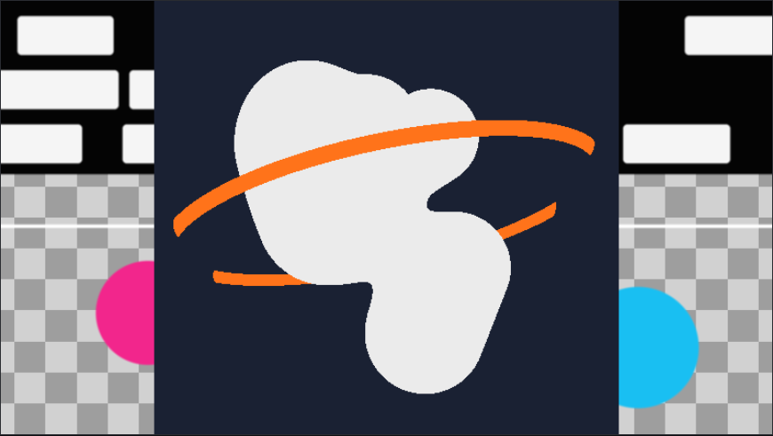

*Preview:* the box appears as a dark blue rectangle with the blobs in light grey. The back half of the ring vanishes inside the box. That happens only in this stage, which writes the box's own depth where rays miss. In the final image those pixels are thrown away (`discard`), so the box never hides anything.

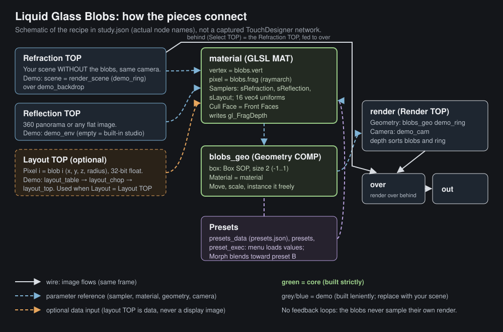

The diagram is a schematic of the recipe, not a captured network. Solid lines carry images; dashed lines are parameter references. Green nodes are the core you keep; the rest is a demo you replace with your own scene.

## March a ray to the surface

How does a ray find a surface that has no triangles?

Heckel's answer is the signed distance field (article lines 74–134). A function tells you, for any point, how far it is to the nearest surface: positive outside, negative inside. For a sphere that is simply `length(p) - radius`. Now walk along the ray. At each point, ask the function how far the nearest surface is, and step exactly that far: you cannot overshoot, because nothing is closer. Near a surface the steps get tiny. When the distance drops below a small epsilon, you have hit it. This is sphere tracing, or raymarching.

`marchSurface()` is that loop. It stops at the box's far side (`span.y`) or after **Optics > March steps** steps. Two additions make the hit precise. First, two Newton steps settle the point onto the surface: the field shrinks at a known rate along the ray, so dividing by that rate jumps almost exactly onto the zero. Second, the loop remembers how close a missing ray came, which the final image uses to smooth the silhouette.

From [blobs.frag](blobs.frag), lines 353–400:

```glsl
const float SURFACE_EPS = 0.0015;  // "close enough", in object units (the box is 2 wide)

// Where a ray enters and leaves the proxy box (slab method).
vec2 boxInterval(vec3 ro, vec3 rd)
{
    vec3 s = vec3(rd.x < 0.0 ? -1.0 : 1.0, rd.y < 0.0 ? -1.0 : 1.0, rd.z < 0.0 ? -1.0 : 1.0);
    vec3 inv = 1.0 / (s * max(abs(rd), vec3(1e-7)));
    vec3 t0 = (vec3(-BOX) - ro) * inv;
    vec3 t1 = (vec3(BOX) - ro) * inv;
    vec3 near = min(t0, t1);
    vec3 far = max(t0, t1);
    return vec2(max(max(near.x, near.y), near.z), min(min(far.x, far.y), far.z));
}

// Sphere tracing: step forward by the distance to the nearest surface until
// that distance is tiny (a hit) or the ray leaves the box (a miss). It also
// remembers how close a missing ray came, for the antialiased silhouette.
bool marchSurface(vec3 ro, vec3 rd, vec2 span, out float t, out int steps,
                  out float nearMiss, out float nearT)
{
    int budget = clamp(int(uMarch.x + 0.5), 8, 256);
    float scale = stepScale();
    t = span.x;
    steps = 0;
    nearMiss = 1e9;
    nearT = span.x;
    for (int i = 0; i < 256; i++) {
        if (i >= budget || t > span.y) break;
        float d = blobField(ro + rd * t);
        steps = i + 1;
        if (d < SURFACE_EPS) {
            // Already inside glass at the first step: the ray starts at the
            // near plane inside a blob (a box wall never starts inside, as the
            // field cuts the glass just inside the walls). Draw nothing.
            if (i == 0 && d < 0.0) return false;
            // Settle onto the surface: two Newton steps along the ray (the field
            // falls at rate dot(normal, rd) as the ray goes in).
            for (int j = 0; j < 2; j++) {
                vec3 p = ro + rd * t;
                t -= blobField(p) / min(dot(fieldNormal(p), rd), -0.05);
            }
            return true;
        }
        if (d < nearMiss) { nearMiss = d; nearT = t; }
        t += d * scale;
    }
    return false;
}
```

**Experiment `sphere`:** What does the smallest raymarched scene look like?

On the built component, run `component.op('study_tools').module.apply(component, 'sphere')`.

Prediction: One sphere of radius 0.6 with smoothly changing normal colours: x to red, y to green, z (toward the camera) to blue.

Parameters: Preset=prism_clear, Pause=True, Time=3.0, Count=1.0, Spread=0.0, Droplets=0.0, Stretch=0.0, Ripple=0.0, Radius=0.6, Stage=normal. Time and unrelated controls are fixed by this preset.

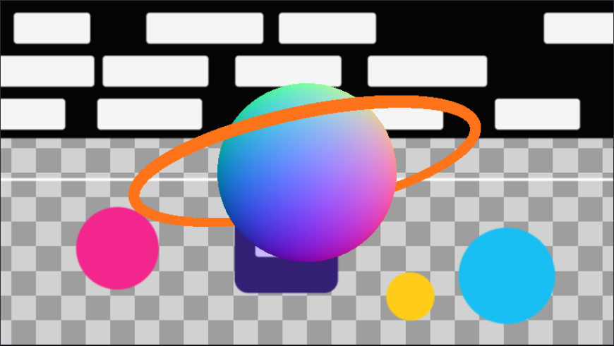

*Preview:* one smooth sphere. A test compares these normals with the exact sphere normal: the worst pixel is off by 0.11 degrees, also when the Geometry COMP is rotated, moved and scaled. Under non-uniform scale the sphere becomes an ellipsoid, and the normals match the exact ellipsoid normal within 0.22 degrees (`sdf_normal_matches_analytic` in [the preview tests](checks/preview_tests.cjs)).

**Experiment `steps`:** Where does marching cost the most?

On the built component, run `component.op('study_tools').module.apply(component, 'steps')`.

Prediction: Rays that hit head-on finish in a few steps (dark blue). Rays that skim past a silhouette take many steps (orange, yellow), and so do rays that pass through the gaps between blobs.

Parameters: Preset=prism_clear, Pause=True, Time=3.0, Stage=steps. Time and unrelated controls are fixed by this preset.

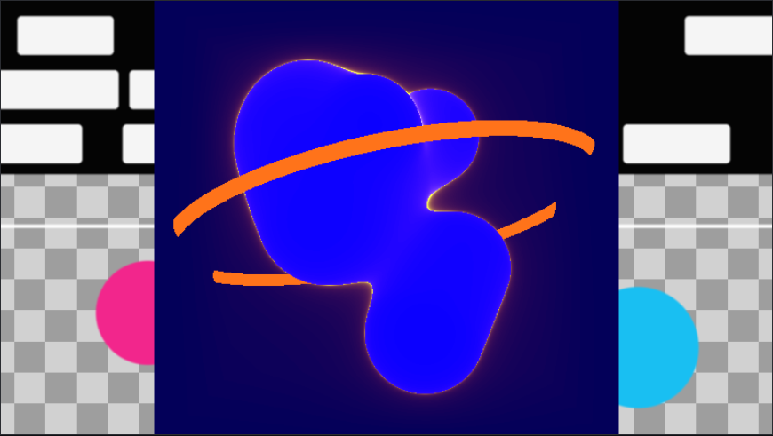

*Preview:* the blobs are dark blue (few steps). A thin orange halo marks rays that skim a silhouette, and the empty box between blobs is also more expensive than a direct hit. This is where the time goes: lower March steps if your frame rate drops, and watch the silhouettes.

## Melt blobs together

How do separate blobs merge like liquid instead of just overlapping?

Two shapes together are the closer of the two: `min(a, b)`. That gives sharp creases where they meet. Heckel's `smoothmin` (article lines 429–451) blends the two distances when they are within `k` of each other, so the surface bulges into a smooth neck. He notes it makes objects "act more like liquids". Two details matter here. The archived formula divides by `k`, so `k = 0` would produce NaN. `smoothMin()` handles a zero width first. Its slope also never exceeds 1, so the march stays safe.

Each blob is a capsule: a short segment thickened by a radius. With **Stretch** at 0 it is Heckel's sphere. Small travelling **ripples** can be added. They change the field faster than a true distance: their slope is at most 0.04 × Ripple × Ripple scale. `stepScale()` shortens the steps by a safe upper bound on that slope (1.75 times it), plus a 10 % margin.

Last, `blobField()` keeps only the glass inside the box: it takes the larger of the blob distance and the distance to the box walls (`sdBox()`), which is how two distance fields intersect. A blob too big for the box then ends in a flat glass face where a wall cuts it.

From [blobs.frag](blobs.frag), lines 272–337:

```glsl
// Distance from p to a capsule: a segment of half-length |halfAxis| around c,
// thickened by r. With halfAxis = 0 it is Heckel's sphere: length(p - c) - r.
float sdCapsule(vec3 p, vec3 c, vec3 halfAxis, float r)
{
    vec3 pa = p - (c - halfAxis);
    vec3 ba = 2.0 * halfAxis;
    float h = clamp(dot(pa, ba) / max(dot(ba, ba), 1e-8), 0.0, 1.0);
    return length(pa - ba * h) - r;
}

// Heckel's polynomial smooth minimum: shapes closer than k melt together.
// k = 0 is a plain union; it is handled first so nothing divides by zero.
float smoothMin(float a, float b, float k)
{
    if (k < 1e-4) return min(a, b);
    float h = clamp(0.5 + 0.5 * (b - a) / k, 0.0, 1.0);
    return mix(b, a, h) - k * h * (1.0 - h);
}

// Small travelling ripples on the surface (0 = smooth). t is the ripple
// phase; 1.7, 1.3 and 1.1 times 20 pi are whole turns, so it wraps at 20 pi.
// Ripple and Ripple scale are in box units, like Radius and Merge: the ripple
// moves the surface (the silhouette, the depth and the measured path), so it
// is part of the shape, and the shape follows the box. Object size does not
// change it (the film below, a colour pattern, does follow Object size).
float ripple(vec3 p)
{
    float a = 0.04 * uMotion.y;
    float s = uMotion.z;
    float t = uPhase.y;
    return a * sin(s * p.x + 1.7 * t) * sin(s * p.y - 1.3 * t) * sin(s * p.z + 1.1 * t);
}

// Distance to the proxy box's walls, pulled in by a hair: negative inside.
float sdBox(vec3 p)
{
    vec3 q = abs(p) - vec3(BOX - 0.001);
    return length(max(q, 0.0)) + min(max(q.x, max(q.y, q.z)), 0.0);
}

// The whole scene as one distance: negative inside the glass, positive outside.
float blobField(vec3 p)
{
    float d = 2.0 * BOX + 1.0;  // farther than anything in the box
    for (int i = 0; i < MAX_BLOBS; i++) {
        if (i >= gBlobCount) break;
        d = smoothMin(d, sdCapsule(p, gBlob[i].xyz, gAxis[i], gBlob[i].w), gBlend[i]);
    }
    for (int j = 0; j < MAX_DROPS; j++) {
        if (j >= gDropCount) break;
        d = smoothMin(d, length(p - gDrop[j].xyz) - gDrop[j].w, gDropBlend[j]);
    }
    if (uMotion.y > 0.0) d += ripple(p);
    // Keep only the glass inside the box: a blob too big for the box gets a
    // flat glass face where a wall cuts it, instead of a hole.
    return max(d, sdBox(p));
}

// Ripples make the field change faster than distance: their slope is at most
// 0.04 x Ripple x Ripple scale. Steps are divided by a safe bound on that
// (1 + 1.75 times it), then shortened by another 10 %. The smooth minimum and
// the box cut never need this (their slope is at most 1).
float stepScale()
{
    return 0.9 / (1.0 + 0.04 * uMotion.y * uMotion.z * 1.75);
}
```

Where do the blobs go? `buildLayout()` runs once per pixel, before marching. Each blob drifts on its own slow wave in x, y and z, with frequencies and phases from a seeded hash, so **Seed** gives a new but repeatable arrangement.

The waves move with a drift phase, `uPhase.x`, not with the clock itself. Python adds Speed × the frame's duration to it every frame, in double precision (`presets.py phase()`). Speed may change at any moment, during an A/B morph or while you drag the slider, and the blobs only change how fast they move. Multiplying Speed by the running time would make them jump by the change in Speed × every second since TouchDesigner started. The phase wraps after 256π, and `loopRate()` rounds every wave speed to a whole multiple of 1/128, so each wave has turned a whole number of times at the wrap and nothing jumps there. The shader never sees a large time value, so the motion stays smooth after weeks. Pause holds the phase at Speed × Fixed time. The ripple and the film drift the same way (`uPhase.y`, `uPhase.z`). A test plays one frame of a 100-frame morph after an hour: it changes the image no more than the same frame after 3 seconds (`morph_frame_is_smooth_after_an_hour`); with the old Speed × time it changed almost every pixel. Shifting a phase by its wrap period changes the image less than one frame of motion (`drift_wraps_without_a_jump`). **Count** may be fractional: the last blob grows in from nothing, so Count can be animated or morphed. Droplets circle the box's centre, mostly in the plane facing the default camera, on an orbit just outside where the main blob sits at Spread 0. There their gap breathes between touching (they merge in) and two radii (they split off); with more Spread the body wanders, so the gap varies more. Every centre is clamped so the blob, its stretch and its merge bulge stay inside the box. A blob too big to fit even at the centre is centred and cut flat by the walls.

From [blobs.frag](blobs.frag), lines 153–268:

```glsl
const float BOX = 1.0;        // the proxy box spans -1..1 in object space (Box SOP, size 2)
const int MAX_BLOBS = 12;
const int MAX_DROPS = 6;

vec4 gBlob[MAX_BLOBS];        // xyz centre, w radius (object units)
vec3 gAxis[MAX_BLOBS];        // half-length axis of each capsule (zero length = sphere)
float gBlend[MAX_BLOBS];      // merge width of each blob
vec4 gDrop[MAX_DROPS];        // droplets: xyz centre, w radius
float gDropBlend[MAX_DROPS];
int gBlobCount;
int gDropCount;

// Repeatable pseudo-random number in 0..1 from three integers.
float hash(int a, int b, int c)
{
    uint h = (uint(a) * 73856093u) ^ (uint(b) * 19349663u) ^ (uint(c) * 83492791u);
    h ^= h >> 16; h *= 0x7feb352du;
    h ^= h >> 15; h *= 0x846ca68bu;
    h ^= h >> 16;
    return float(h) * (1.0 / 4294967295.0);
}

vec3 hash3(int i, int salt, int seed)
{
    return vec3(hash(i, salt, seed), hash(i, salt + 1, seed), hash(i, salt + 2, seed));
}

// A unit vector from any vector; falls back to +Y if it is (nearly) zero.
vec3 safeDirection(vec3 v)
{
    float l = length(v);
    return l > 1e-4 ? v / l : vec3(0.0, 1.0, 0.0);
}

// A unit vector from a direction moved between the box's space and world
// space. Its length follows the object's scale (1 / scale for a normal), so a
// fixed threshold would fail on big objects: only an exact zero falls back.
vec3 movedDirection(vec3 v)
{
    float l2 = dot(v, v);
    return l2 > 0.0 ? v * inversesqrt(l2) : vec3(0.0, 1.0, 0.0);
}

// Clamp a centre so a shape reaching `extent` around it stays inside the box.
// A shape too big for the box is centred, and the box walls cut it flat
// (see blobField).
vec3 keepInside(vec3 c, float extent)
{
    float room = max(BOX - extent, 0.0);
    return clamp(c, vec3(-room), vec3(room));
}

// Drift speeds rounded to whole multiples of 1/128. Every wave below then
// repeats after 256 pi of drift phase, so uPhase.x can wrap there (in Python,
// in double precision) without a jump, and the shader never sees a large,
// imprecise time value.
float loopRate(float r) { return floor(r * 128.0 + 0.5) / 128.0; }
vec3 loopRate(vec3 r) { return floor(r * 128.0 + 0.5) / 128.0; }

// Work out every blob and droplet once per pixel, before marching.
// Each blob drifts on its own slow three-axis wave; a fractional count
// grows the last blob in from nothing, so Count can be animated or morphed.
// t is the drift phase: Speed added up over time by presets.py phase().
void buildLayout()
{
    float count = clamp(uBlobs.x, 0.0, float(MAX_BLOBS));
    float radius = uBlobs.y;
    float spread = uBlobs.z;
    float k = uBlobs.w;
    float stretch = uShape.x;
    int seed = int(uShape.w + 0.5) + 7919 * vInstance;  // each instance gets its own layout
    bool useTop = uMarch.y > 0.5;
    int topCount = useTop ? textureSize(sLayout, 0).x : 0;
    float t = uPhase.x;

    gBlobCount = int(ceil(count));
    for (int i = 0; i < MAX_BLOBS; i++) {
        if (i >= gBlobCount) break;
        float fade = clamp(count - float(i), 0.0, 1.0);
        vec3 freq = 0.35 + 0.65 * hash3(i, 1, seed);
        vec3 phase = 6.2831853 * hash3(i, 4, seed);
        vec3 c = spread * sin(loopRate(freq) * t + phase);
        float r = radius * (i == 0 ? 1.0 : 0.55 + 0.45 * hash(i, 7, seed));
        if (useTop && i < topCount) {
            vec4 row = texelFetch(sLayout, ivec2(i, 0), 0);
            c = row.xyz;
            r = max(row.w, 0.0);
        }
        r *= fade;
        vec3 axis = safeDirection(sin(loopRate(0.6 * freq.yzx) * t + phase.zxy)) * stretch * r;
        gBlob[i] = vec4(keepInside(c, r + length(axis) + 0.25 * k + 0.01), r);
        gAxis[i] = axis;
        gBlend[i] = k * fade;
    }

    // Droplets circle the box's centre, mostly in its XY plane (the plane
    // facing a camera on +Z), with a small wobble in depth. Their orbit sits
    // just outside where the main blob is at Spread 0: there each one's gap
    // breathes between touching (it merges in) and about two droplet radii
    // (it splits off). With more Spread the body wanders, so the gap varies more.
    float drops = clamp(uShape.y, 0.0, float(MAX_DROPS));
    gDropCount = int(ceil(drops));
    for (int j = 0; j < MAX_DROPS; j++) {
        if (j >= gDropCount) break;
        float fade = clamp(drops - float(j), 0.0, 1.0);
        vec3 freq = 0.45 + 0.75 * hash3(j, 10, seed);
        vec3 phase = 6.2831853 * hash3(j, 13, seed);
        float angle = phase.x + loopRate(0.6 * (freq.y - 0.8)) * t;
        vec3 dir = safeDirection(vec3(cos(angle), sin(angle), 0.35 * sin(loopRate(freq.z) * t + phase.z)));
        float r = uShape.z * radius * (0.6 + 0.4 * hash(j, 17, seed)) * fade;
        float gap = r * (2.2 * (0.5 + 0.5 * sin(loopRate(1.1 * freq.x) * t + phase.y)) - 0.2);
        float orbit = 0.7 * spread + radius + r + gap;
        gDrop[j] = vec4(keepInside(dir * orbit, r + 0.125 * k + 0.01), r);
        gDropBlend[j] = 0.5 * k * fade;
    }
}
```

**Experiment `merge_hard`:** What does a plain union (min) of blobs look like?

On the built component, run `component.op('study_tools').module.apply(component, 'merge_hard')`.

Prediction: Where blobs overlap, the normal colour jumps along a sharp crease: they intersect but do not melt together.

Parameters: Preset=prism_clear, Pause=True, Time=3.0, Merge=0.0, Stage=normal. Time and unrelated controls are fixed by this preset.

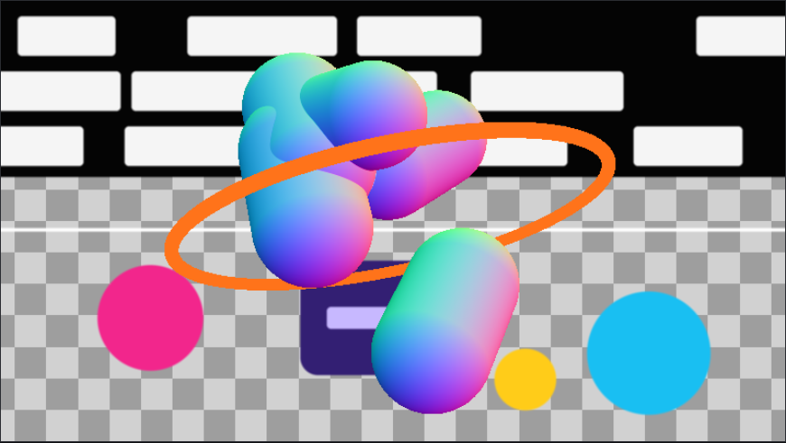

*Preview:* separate blobs with hard creases where they intersect; the normal colours jump.

**Experiment `merge_soft`:** What does the smooth minimum change?

On the built component, run `component.op('study_tools').module.apply(component, 'merge_soft')`.

Prediction: The creases become smooth necks and nearby blobs bridge across gaps; the colours flow without jumps.

Parameters: Preset=prism_clear, Pause=True, Time=3.0, Merge=0.6, Stage=normal. Time and unrelated controls are fixed by this preset.

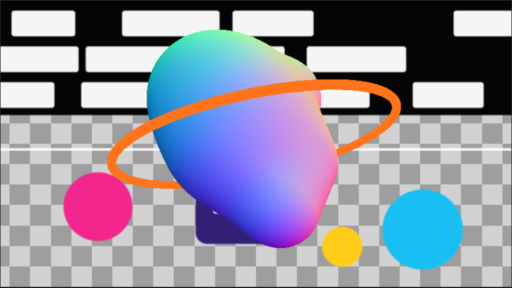

*Preview:* at Merge 0.6 the blobs fuse into one smooth body with flowing colours. A test runs merge widths from 0 to 1, an extreme layout and fully overlapping centres. No pixel turns NaN, and the smooth version covers every pixel the plain union covers: no holes (`smooth_min_stays_finite_without_holes`).

**Experiment `droplets`:** Can small drops split off and merge back?

On the built component, run `component.op('study_tools').module.apply(component, 'droplets')`.

Prediction: Small droplets circle beside the main body; at this time one touches it through a thin neck while another floats free.

Parameters: Preset=sapphire_drops, Pause=True, Time=5.0, Droplets=3.0. Time and unrelated controls are fixed by this preset.

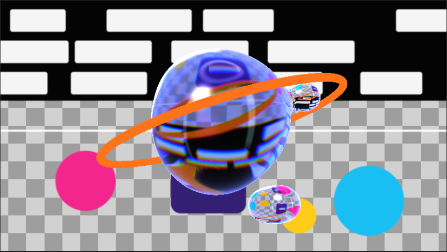

*Preview:* two droplets sit beside the main body at the lower right. One is joined to it by a neck, the other is free.

**Experiment `box_cut`:** What happens to a blob that is too big for the box?

On the built component, run `component.op('study_tools').module.apply(component, 'box_cut')`.

Prediction: One long capsule reaches past the box. Where the front wall cuts it, the glass has a flat face of one even normal colour (pointing at the camera), not a hole showing the backdrop.

Parameters: Preset=prism_clear, Pause=True, Time=3.0, Count=1.0, Spread=0.0, Droplets=0.0, Ripple=0.0, Radius=0.9, Stretch=0.8, Stage=normal. Time and unrelated controls are fixed by this preset.

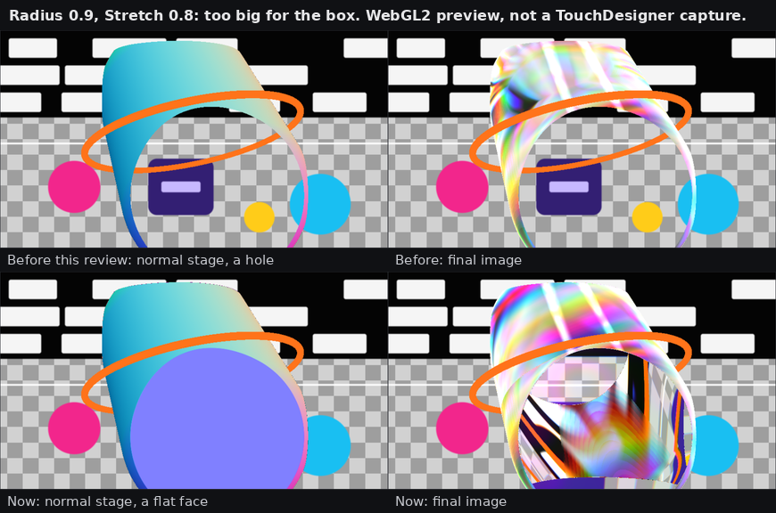

*Preview:* the top row is the shader before an independent review found this case. Where the front wall cut the capsule, the ray entered the box already inside glass, the march treated that as "the camera is inside a blob", and a hole showed the backdrop. With the box cut in `blobField()` (bottom row), the same blob has a flat front face of one even normal colour, and the final image shows glass there. A test renders single blobs crossing the walls, up to the slider maxima, and requires every row and column of covered pixels to be unbroken (`blobs_cut_by_the_box_have_no_holes`).

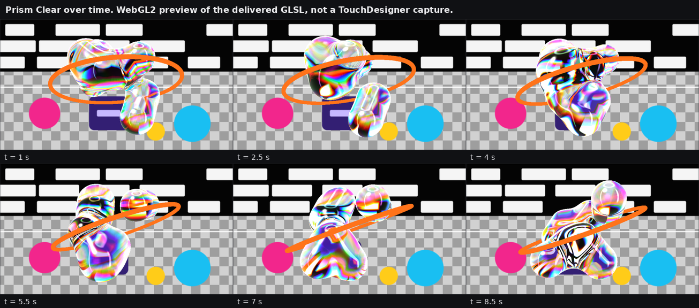

*Preview over time:* the same preset at six moments. Blobs part, join through necks and part again.

## Normals and depth

How does the glass know which way it faces, and how do other objects pass in front of it?

The field rises fastest straight out of the surface, so its gradient is the normal. Heckel samples the field a little to each side (article lines 325–338). `fieldNormal()` uses Inigo Quilez's four-sample tetrahedron, which he credits there. The normal is computed in object space and turned into world space with the inverse transpose of the object transform, which stays correct under non-uniform scale. That product is 1 / scale long, so `movedDirection()` normalises it with no fixed length threshold; a threshold would turn every normal of a 20,000-unit object into +Y (`normals_hold_at_any_object_scale`).

At the silhouette the estimated normal can tilt a hair away from the camera. `faceCamera()`, from the core study, lays such a normal back into the view plane. Flipping it instead would also reverse its sideways part: the light then bent straight back out of the glass, and rim pixels measured a path near 0 where a sphere's shortest path at IOR 1.55 is 0.92 scene units (`rim_chords_stay_physical`).

Depth is what makes the blobs a citizen of your scene. A rasterized object writes its depth automatically; a raymarched one must write its own, or everything sorts against the box. `gl_FragDepth` is set to the depth the hit point would have as ordinary geometry: project it with `uTDMats[].camProj` and divide z by w. TouchDesigner's documentation states that its projection maps depth to 0..1 ("Vulkan style"), which is exactly the range `gl_FragDepth` expects. The pixel shader cannot call `TDWorldToProj`, because that function is vertex-only, so fisheye and quad-reprojected cameras are not covered.

From [blobs.frag](blobs.frag), lines 341–349:

```glsl
// The field grows fastest straight out of the surface, so its gradient is
// the normal. Four samples on a tetrahedron estimate it (Inigo Quilez).
vec3 fieldNormal(vec3 p)
{
    const float h = 0.002;
    const vec2 k = vec2(1.0, -1.0);
    return safeDirection(k.xyy * blobField(p + k.xyy * h) + k.yyx * blobField(p + k.yyx * h)
                       + k.yxy * blobField(p + k.yxy * h) + k.xxx * blobField(p + k.xxx * h));
}
```

From [blobs.frag](blobs.frag), lines 808–848:

```glsl
    float t = 0.0;
    int steps = 0;          // stays 0 if the ray misses the box (no march runs)
    float nearMiss = 1e9;
    float nearT = 0.0;
    bool hit = span.x < span.y && marchSurface(ro, rd, span, t, steps, nearMiss, nearT);

    // Antialiased silhouette (final image only): a ray that misses by less than
    // half a pixel still covers part of the pixel. Shade it at its closest point
    // and fade it by that fraction. Teaching stages keep the hard edge.
    float coverage = 1.0;
    if (!hit && stage == 0 && span.x < span.y) {
        // One pixel's size in scene units at the closest point: it grows with
        // clip-space w (depth, for a perspective camera; 1 for orthographic).
        float w = (camProj * vec4(vObjOrigin + toWorld * (ro + rd * nearT), 1.0)).w;
        float pixel = 2.0 * uTDGeneral.viewport.w * max(w, 1e-4) / abs(proj[1][1]);
        float rayScale = length(toWorld * rd);  // scene units per object unit along this ray
        coverage = clamp(0.5 - nearMiss * rayScale / pixel, 0.0, 1.0);
        hit = coverage > 0.0;
        t = nearT;
    }
    if (!hit) {
        // Teaching stages 1, 2 and 12 also show the empty part of the box.
        if (stage == 1 || stage == 2 || stage == 12) {
            float cost = float(steps) / clamp(uMarch.x, 8.0, 256.0);
            vec3 c = stage == 2 ? vec3(cost, cost * cost, 0.35) : vec3(0.10, 0.13, 0.20);
            gl_FragDepth = gl_FragCoord.z;
            writeOutput(vec4(c, 1.0));
            return;
        }
        discard;
    }
    vec3 pObj = ro + rd * t;                         // the hit, in object space
    vec3 P = vObjOrigin + toWorld * pObj;            // the hit, in world space
    vec3 n = faceCamera(movedDirection(transpose(toObject) * fieldNormal(pObj)), eye);

    // Write the depth a rasterized surface at P would have, so other objects
    // sort correctly against the blobs. TouchDesigner's projection matrices
    // map depth to 0..1 (Vulkan style), the range gl_FragDepth expects.
    vec4 clip = camProj * vec4(P, 1.0);
    float depth = clamp(clip.z / clip.w, 0.0, 1.0);
    gl_FragDepth = depth;
```

**Experiment `depth`:** Do ordinary objects sort correctly against the blobs?

On the built component, run `component.op('study_tools').module.apply(component, 'depth')`.

Prediction: The orange ring passes in front of the blobs where it is nearer to the camera and is hidden where it goes behind them, including inside the box, because each blob pixel writes its own depth.

Parameters: Preset=prism_clear, Pause=True, Time=3.0, Stage=normal. Time and unrelated controls are fixed by this preset.

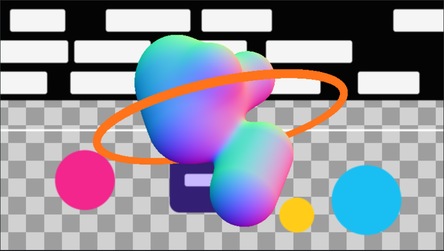

*Preview:* the orange ring crosses the blobs, in front where it is nearer the camera and hidden where it goes behind, inside the box too. Tests back this up. The written depth matches a rasterized sphere mesh of the same size within 0.0005 scene units, also for a rotated, moved, non-uniformly scaled ellipsoid. A raster sphere and a blob sphere that overlap hide each other exactly where their true surfaces cross: 0 wrong pixels out of 6,128 (`depth_matches_rasterized_sphere`). With an orthographic camera, and with projections blended between perspective and orthographic, the blobs cover the same pixels as a rasterized sphere and match its depth within 0.0006 scene units (`any_projection_matches_raster`). Glass nearer than the near plane is clipped, never written at depth 0 in front of everything (`near_plane_clips_the_blobs`).

## Go through the glass

Why do the blobs shrink and flip what is behind them?

Light bends when it enters glass and again when it leaves. The core study had only the front surface and a Thickness slider, because a mesh shader cannot see its own far side. A distance field can. Inside the glass the field is negative, and minus the field is the distance to the nearest wall. So `marchInside()` marches the bent ray until that distance reaches zero again: that is the exit. The path length is the real thickness at this pixel.

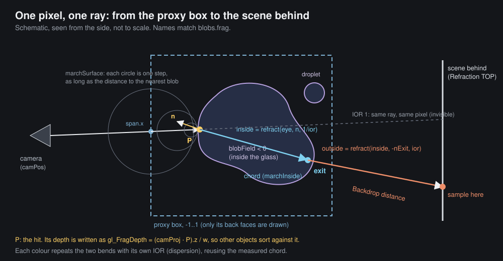

*Schematic, not to scale.* The colours and names match the code below.

From [blobs.frag](blobs.frag), lines 405–434:

```glsl
// Inside the glass the field is negative and -field is the distance to the
// nearest wall. March until it reaches zero again: that is where the ray
// leaves the glass. Returns the distance travelled inside (object units).
float marchInside(vec3 p, vec3 d, float limit)
{
    int budget = clamp(int(uMarch.x + 0.5), 8, 256);
    float scale = stepScale();
    float t = SURFACE_EPS;
    bool entered = false;     // deeper than SURFACE_EPS at least once
    float previous = -1e9;
    for (int i = 0; i < 256; i++) {
        if (i >= budget || t >= limit) break;
        float inside = -blobField(p + d * t);
        if (inside > SURFACE_EPS) {
            entered = true;
        } else if (entered) {
            // Back at a wall: settle onto it with two Newton steps, as on the way in.
            for (int j = 0; j < 2; j++) {
                vec3 q = p + d * t;
                t -= blobField(q) / max(dot(fieldNormal(q), d), 0.05);
            }
            return clamp(t, 0.0, limit);
        } else if (inside < previous) {
            return clamp(t, 0.0, limit);  // never got in: the ray only grazed the glass
        }
        previous = inside;
        t += max(abs(inside) * scale, SURFACE_EPS);
    }
    return clamp(t, 0.0, limit);
}
```

From [blobs.frag](blobs.frag), lines 852–860:

```glsl
    // Bend into the glass, march to the far wall, measure the real path.
    float ior = max(uOptics.x, 1.0);
    vec3 inside = refract(eye, n, 1.0 / ior);
    vec3 insideObj = movedDirection(toObject * inside);
    float s = marchInside(pObj, insideObj, max(boxInterval(pObj, insideObj).y, 0.0));
    vec3 qObj = pObj + insideObj * s;
    float chord = length(toWorld * (qObj - pObj));   // path inside the glass, scene units
    vec3 nExit = movedDirection(transpose(toObject) * fieldNormal(qObj));
    if (dot(nExit, inside) < 0.0) nExit = -nExit;    // point it out of the glass
```

`lensShift()` follows the light. It bends in at the front with GLSL's `refract()`, crosses the measured path, and bends out at the exit. If the exit angle is too steep to leave the glass (total internal reflection), it reflects instead. Then it travels **Backdrop distance** scene units to the scene behind. Projecting that point with the camera says where to read the Refraction TOP, relative to this pixel. `screenShift()` measures this with the camera's own matrix, so the effect does not change with distance, lens, aspect or projection.

Which way is "up" on the Refraction TOP? The shader measures it instead of assuming it. `screenSign()` projects the box point this pixel shows with the camera and compares the result with the pixel's raster position from `gl_FragCoord`, both in the same -1..1 range. On an ordinary raster they have the same sign; on a raster that runs the other way they have opposite signs. Every shift is turned the same way. On the centre line of an odd-sized render both are 0 and cannot be told apart, so there the sign of the screen derivatives decides (`dFdx` and `dFdy`, taken at the top of `main()` before any branch). The core and prism studies use the same comparison. A test reads the measured orientation on every blob pixel of the twelve presets, in a normal and a flipped raster, at 480 x 270 and 481 x 271, and finds no wrong pixel (`screen_orientation_has_no_wrong_pixels`). A build whose raster ran upside down would therefore still bend light the right way: a test flips the preview's raster and gets the mirror image of the normal render, lookup for lookup within 0.3 pixel (`bends_follow_screen_orientation`). **Flip screen V** stays for one case only, a Refraction TOP that arrives upside down; it flips the screen position and the measured vertical direction together (`flip_v_corrects_upside_down_inputs`).

A test checks this path directly. A UV ramp replaces the backdrop, so each pixel reads back where it sampled. An exact trace through a sphere (bend in, exact chord, bend out at the exact exit normal, travel, project) agrees within one pixel (worst 0.50 pixels) at IOR 1.33, 1.5 and 2.2, also with a scaled Geometry COMP (`lens_matches_exact_trace`). Dropping the second bend, or flipping the shift's sign, fails this test.

From [blobs.frag](blobs.frag), lines 438–451:

```glsl
// Follow one colour of light through the glass: it bends in at the front
// surface (normal n), crosses `chord` scene units, bends out at the back
// surface (normal nExit, pointing out), then travels `backdrop` units to the
// scene behind. Returns where that point lands on screen, relative to here.
vec2 lensShift(vec3 eye, vec3 n, vec3 P, float chord, vec3 nExit, float ior, float backdrop,
               mat4 camProj)
{
    vec3 inside = refract(eye, n, 1.0 / ior);
    if (dot(inside, inside) < 0.5) inside = eye;
    vec3 exitPoint = P + inside * chord;
    vec3 outside = refract(inside, -nExit, ior);
    if (dot(outside, outside) < 0.5) outside = reflect(inside, -nExit);  // total internal reflection
    return screenShift(exitPoint + outside * backdrop, P, camProj);
}
```

From [blobs.frag](blobs.frag), lines 80–149:

```glsl
// Where this pixel sits on the render, 0..1 across and up.
// uTDGeneral.viewport holds (x, y, 1/width, 1/height) in pixels.
vec2 screenUV()
{
    vec2 uv = (gl_FragCoord.xy - uTDGeneral.viewport.xy) * uTDGeneral.viewport.zw;
    if (uMarch.w > 0.5) uv.y = 1.0 - uv.y;  // escape hatch if a build flips V
    return uv;
}

// Fold coordinates that leave the image back inside it (mirror repeat),
// so strong refraction near the frame edge never smears a border pixel.
vec2 mirrorUV(vec2 uv)
{
    return 1.0 - abs(1.0 - mod(uv, 2.0));
}

// Which way screenUV() runs against the projection's x and y: +1 or -1
// each. TouchDesigner's usual orientation gives +1, +1; a build whose screen
// y (or x) runs the other way would bend light the wrong way without this.
// It is measured per pixel, without guessing: the box point this pixel shows,
// projected by the camera, lands at ndc; the raster says the pixel sits at
// `raster` (same -1..1 range, from gl_FragCoord). Same sign: the raster
// follows the projection; opposite: it is mirrored. On the centre line of a
// render with an odd width or height, both are 0 and cannot be told apart.
// There the sign of `ndcStep`, how ndc changes to the next pixel (screen
// derivatives, taken at the top of main()), decides instead. A derivative is
// only trusted where the box face is not nearly edge-on: `depthStep`, how
// much 1/w changes to the next pixel, stays under 10%. Otherwise, and for a
// value that is not a number, the result is +1. From the Liquid Glass Prism
// study. Flip V turns the measured y around too: it is there for a
// Refraction TOP that arrives upside down, and then every vertical shift
// must turn with the image.
vec2 screenSign(vec2 ndc, vec2 ndcStep, vec2 depthStep)
{
    vec2 raster = 2.0 * (gl_FragCoord.xy - uTDGeneral.viewport.xy) * uTDGeneral.viewport.zw - 1.0;
    vec2 runs = vec2(abs(ndc.x + raster.x) < abs(ndc.x - raster.x) ? -1.0 : 1.0,
                     abs(ndc.y + raster.y) < abs(ndc.y - raster.y) ? -1.0 : 1.0);
    // Neighbouring pixel centres are 2 x viewport.zw apart in raster units;
    // only a pixel exactly on a centre line comes within 0.5 x viewport.zw of 0.
    vec2 useStep = step(abs(raster), 0.5 * uTDGeneral.viewport.zw) * step(depthStep, vec2(0.1));
    runs = mix(runs, vec2(ndcStep.x < 0.0 ? -1.0 : 1.0, ndcStep.y < 0.0 ? -1.0 : 1.0), useStep);
    if (uMarch.w > 0.5) runs.y = -runs.y;
    return runs;
}

// Where a world point lands on screen, in the units of screenUV() (only
// differences are used, so the 0.5 offset is left out). The camera's own
// matrix does the work, so every projection works: perspective, orthographic
// or anything in between. gScreenSign turns projected directions into
// screen UV directions, so a shift points the way screenUV() counts even in
// a build whose raster or projection runs the other way.
vec2 toScreen(vec3 p, mat4 camProj)
{
    vec4 c = camProj * vec4(p, 1.0);
    return 0.5 * c.xy / max(c.w, 1e-4) * gScreenSign;
}

// How far apart two world points land on screen (in 0..1 units).
// Zero when both lie on one camera ray.
vec2 screenShift(vec3 target, vec3 origin, mat4 camProj)
{
    return toScreen(target, camProj) - toScreen(origin, camProj);
}

// How far one scene unit moves on screen at a point whose clip-space w is w
// (its depth along the view for a perspective camera, 1 for orthographic).
vec2 unitsToUV(mat4 proj, float w)
{
    return 0.5 * abs(vec2(proj[0][0], proj[1][1])) / max(w, 1e-4);
}
```

**Experiment `see_through`:** What do blobs show if they do not bend light?

On the built component, run `component.op('study_tools').module.apply(component, 'see_through')`.

Prediction: They disappear: every blob pixel shows the Refraction TOP at its own screen position, and the ring stays in front where it should.

Parameters: Preset=prism_clear, Pause=True, Time=3.0, Reflection=0.0, Rim=0.0, Specular=0.0, Diffuse=0.0, Iridescence=0.0, Ripple=0.0, Ior=1.0, Dispersion=0.0, Frost=0.0, Density=0.0, Saturation=1.0, Stage=final. Time and unrelated controls are fixed by this preset.

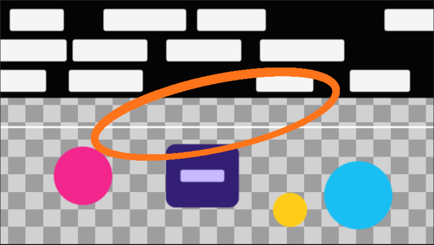

*Preview:* the blobs disappear completely. With an IOR of 1 every path stays on the pixel's own camera ray. The test compares this with the scene alone; the largest difference is 1/255 (`ior1_is_invisible`).

**Experiment `lens`:** What does a real path through the glass do to the view?

On the built component, run `component.op('study_tools').module.apply(component, 'lens')`.

Prediction: Each blob acts as a lens: the backdrop appears shrunk, flipped and shifted, most strongly near the rims.

Parameters: Preset=prism_clear, Pause=True, Time=3.0, Stage=refraction, Dispersion=0.0, Ior=1.5, Backdrop=2.32. Time and unrelated controls are fixed by this preset.


*Preview:* each blob is a small lens. The type band from the top of the backdrop appears upside down in the lower part of the blobs, and the checkerboard bends hardest near the rims.

**Experiment `backdrop_far`:** What does Backdrop distance change?

On the built component, run `component.op('study_tools').module.apply(component, 'backdrop_far')`.

Prediction: Doubling it roughly doubles how far the rays spread before they reach the scene, so the flipped image inside each blob shrinks further.

Parameters: Preset=prism_clear, Pause=True, Time=3.0, Stage=refraction, Dispersion=0.0, Ior=1.5, Backdrop=4.64. Time and unrelated controls are fixed by this preset.

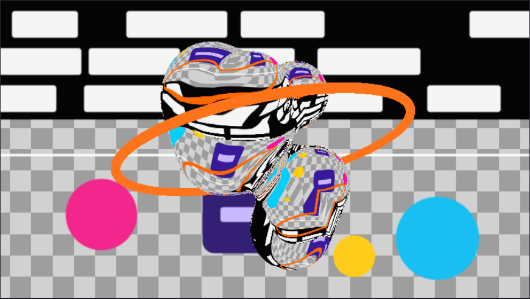

*Preview:* with the scene twice as far behind, the flipped image inside each blob shrinks further and more of the backdrop fits inside.

**Experiment `thickness`:** How much glass does each pixel's light cross?

On the built component, run `component.op('study_tools').module.apply(component, 'thickness')`.

Prediction: Bright in the middle of each blob and where blobs merge (long paths), dark at the rims (short paths).

Parameters: Preset=prism_clear, Pause=True, Time=3.0, Stage=thickness. Time and unrelated controls are fixed by this preset.

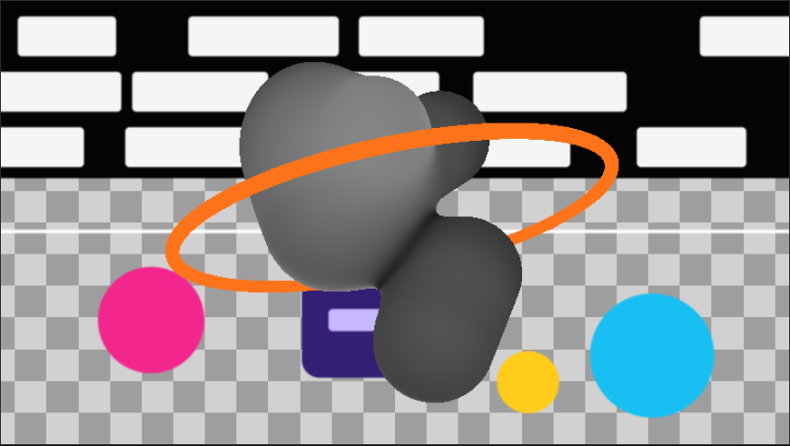

*Preview:* bright cores and dark rims, brighter where blobs merge. A test compares the measured path through a single blob with the exact chord of a ray through a sphere: within 0.0008 scene units at IOR 1 and 1.5, also when the object is scaled (`thickness_matches_exact_chord`).

## Split the colours, then frost them

Where do rainbow fringes come from, and how does the same loop frost the glass?

Glass bends violet light more than red. The loop in `transmitted()` repeats the lens path once per spectrum sample, each with a slightly different IOR, and weights each sample's red, green and blue. This is the core study's version of Heckel's dispersion (article lines 322–463). Spreading the same samples over a small disc blurs the view instead: frost.

Real lens paths spread the colours much further than the core's single bend. With 12 samples the first preview showed separate coloured copies, like contour lines. Random jitter would hide them with grain, which is dithering, and the brief rules that out. So each sample reads a blurred mipmap level sized from the gap to its neighbour on screen, and neighbouring colours blend.

How wide should that level be? A mipmap level blurs in every direction, not only along the rainbow. Against a 64-sample reference, a level as wide as the whole gap was twice as far off as no level at all (mean 16.6 against 8.3 out of 255 on the pixels the rainbow changes), because it also softened the edges across the fan. Of the widths tried (none, an eighth, a quarter, 0.35, a half and the whole gap), a quarter came out closest overall: mean 7.3, better than no level in all eight measured cases, and fewer badly wrong pixels than any wider level. So the level is a quarter of the gap; decisions.json has the full table. Fine steps can remain where the fan is widest; raise **Samples** to remove them (`dispersion_converges_with_samples`).

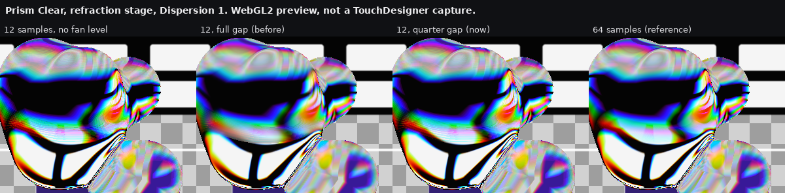

Frost spreads the same samples over a disc. `discPoint()` places them with Martin Roberts' R2 sequence, as the core study does: angle and radius come from two different irrational steps, so the points cover the disc evenly and average out near its centre. The golden-angle spiral used before put every point on one arm and moved the frosted view by 10 to 12 pixels; now it moves by under 4 at 12 samples and under 1 at 24 (`frost_does_not_shift_the_view`).

From [blobs.frag](blobs.frag), lines 455–524:

```glsl
// Weight of one spectrum sample in R, G and B: w = 0 is red, w = 1 is violet.
vec3 spectrum(float w)
{
    vec3 c = clamp(1.0 - abs(w - vec3(0.1, 0.45, 0.8)) * vec3(2.4, 2.8, 2.4), 0.0, 1.0);
    c.r += 0.6 * clamp(1.0 - abs(w - 1.0) * 5.0, 0.0, 1.0);  // violet also excites red
    return c * c * (3.0 - 2.0 * c) + 0.02;
}

// Point i of N on a unit disc, spread evenly for any N: angle and area come
// from two different irrational steps (Martin Roberts' "R2" sequence, built
// on the plastic number), so the points never line up on one spiral arm and
// their average stays near the centre (frost blurs without shifting).
vec2 discPoint(int i)
{
    vec2 f = fract(0.5 + float(i) * vec2(0.7548776662, 0.5698402910));
    float angle = 2.0 * LG_PI * f.x;
    return vec2(cos(angle), sin(angle)) * sqrt(f.y);
}

// Many slightly different paths through the glass, one per spectrum sample:
// violet bends more than red (dispersion). discPoint() spreads the same
// samples over a disc, which blurs the view (frost). Every sample reads a
// mipmap level as wide as the gap to its neighbours on the frost disc, or a
// quarter of the gap to its neighbours on the rainbow fan, so colours and
// blur blend continuously instead of showing separate copies. (A level as
// wide as the whole fan gap also blurs across the fan; against a 64-sample
// reference, a quarter of it measured closest: see decisions.json.)
// The result keeps the Refraction TOP's alpha:
// rgb stays premultiplied, and a says how much of the view through the
// glass that TOP actually covers. The Samples control stops at 32; the loop
// accepts 64, so a test can render a finer reference.
vec4 transmitted(vec3 eye, vec3 n, vec3 P, float chord, vec3 nExit, vec2 uv, vec2 toUV,
                 mat4 camProj)
{
    int count = clamp(int(uMarch.z + 0.5), 1, 64);
    float spread = uOptics.z * 0.3;
    float colourSplit = clamp(uOptics.z * 4.0, 0.0, 1.0);
    vec2 texSize = vec2(textureSize(sRefraction, 0));
    vec2 blurPixels = uBody.y * 0.25 * abs(toUV) * texSize;
    float frostGap = 2.0 * max(blurPixels.x, blurPixels.y) / sqrt(float(count));
    float red = max(uOptics.x - 0.5 * spread, 1.0);
    float violet = max(uOptics.x + 0.5 * spread, 1.0);
    vec2 fan = lensShift(eye, n, P, chord, nExit, violet, uOptics.y, camProj)
             - lensShift(eye, n, P, chord, nExit, red, uOptics.y, camProj);
    float fanGap = 0.25 * length(fan * texSize) / float(count);
    float lod = log2(max(max(frostGap, fanGap), 1.0));
    vec3 sum = vec3(0.0);
    vec3 weightSum = vec3(0.0);
    float alphaSum = 0.0;
    for (int i = 0; i < 64; i++) {
        if (i >= count) break;
        float w = (float(i) + 0.5) / float(count);
        // Never below 1: below it the bend flips and snaps to zero past the critical angle.
        float ior = max(uOptics.x + spread * (w - 0.5), 1.0);
        vec2 offset = lensShift(eye, n, P, chord, nExit, ior, uOptics.y, camProj);
        offset += discPoint(i) * uBody.y * 0.25 * toUV;
        vec3 weight = mix(vec3(1.0), spectrum(w), colourSplit);
        vec4 seen = textureLod(sRefraction, mirrorUV(uv + offset), lod);
        sum += seen.rgb * weight;
        weightSum += weight;
        alphaSum += seen.a;
    }
    return vec4(sum / weightSum, alphaSum / float(count));
}

vec3 saturateColour(vec3 c, float amount)
{
    float luma = dot(c, vec3(0.2125, 0.7154, 0.0721));
    return max(mix(vec3(luma), c, amount), 0.0);
}
```

**Experiment `dispersion`:** What happens if every colour bends by a different amount?

On the built component, run `component.op('study_tools').module.apply(component, 'dispersion')`.

Prediction: Bright edges seen through the blobs split into dense rainbow fringes, red and violet on opposite sides. Neighbouring colours blend; where the fan is widest, fine steps may remain (raise Samples to remove them).

Parameters: Preset=prism_clear, Pause=True, Time=3.0, Stage=refraction, Dispersion=1.0. Time and unrelated controls are fixed by this preset.

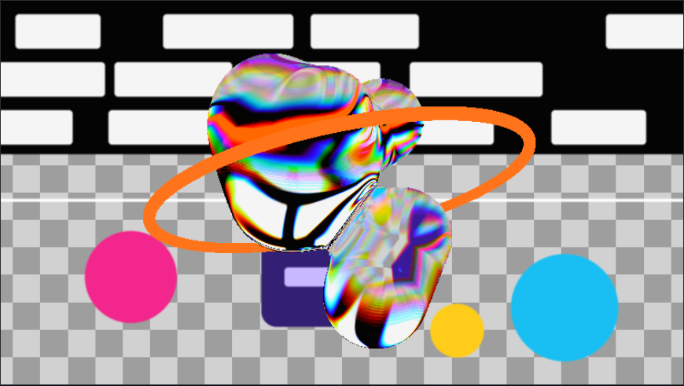

*Preview:* white type and the ring split into smooth rainbow bands, with no stepped copies.

**Experiment `frost`:** What does spreading the samples over a disc look like?

On the built component, run `component.op('study_tools').module.apply(component, 'frost')`.

Prediction: The view through the blobs blurs smoothly and stays centred, without grain or ghost copies.

Parameters: Preset=prism_clear, Pause=True, Time=3.0, Stage=refraction, Dispersion=0.0, Frost=0.87. Time and unrelated controls are fixed by this preset.

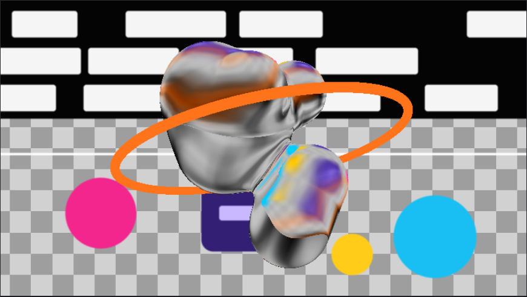

*Preview:* the view through the blobs blurs smoothly into soft greys and orange, with no grain.

## Colour, reflection and light

What makes the glass coloured, shiny and alive?

These are the core study's ingredients, now fed by real geometry. **Absorption** follows Beer's law, which Heckel explains for clouds (*Real-time cloudscapes*, lines 622–695): light through tinted glass loses the colours it absorbs, exponentially with the path. Here the path is the measured chord, so merged, thick regions tint more than thin rims. A test checks each channel against exp(−(1 − glass colour) × density × chord) at every pixel, with the chord read from the thickness stage (`beer_lambert_tint_follows_measured_chord`). **Edge tint** lengthens the path at grazing angles for deep-coloured rims. **Reflections** come from the Reflection TOP (a 360 panorama or a flat image) or a built-in studio, strongest at grazing angles (fresnel). **Highlights** use Heckel's squared Blinn-Phong term. The **thin film** adds soap-bubble colours.

From [blobs.frag](blobs.frag), lines 528–554:

```glsl
// Colour parameters reach the shader as typed. In a project with a linear
// working colour space, uState.w asks for the sRGB-to-linear conversion that
// TouchDesigner applies to its own colour parameters (Inputs > Colour parameters).
vec3 paramColour(vec3 c)
{
    if (uState.w < 0.5) return c;
    vec3 low = c / 12.92;
    vec3 high = pow((max(c, 0.0) + 0.055) / 1.055, vec3(2.4));
    return mix(low, high, step(vec3(0.04045), c));
}

// Light that crossed the glass loses the colours the glass absorbs
// (Beer-Lambert): a longer path through tinted glass gives a deeper tint.
// The colour is clamped to 0..1 here: a glass colour above 1 can brighten the
// body, but it never amplifies the light passing through.
vec3 absorption(float path)
{
    vec3 passes = clamp(paramColour(uGlass.rgb), 0.0, 1.0);
    return exp(-(1.0 - passes) * uGlass.a * path);
}

// The glass's own colour where it scatters light instead of passing it.
vec3 bodyColour(vec3 n, vec3 lightDir)
{
    float wrap = clamp((dot(n, lightDir) + 0.5) / 1.5, 0.0, 1.0);
    return paramColour(uGlass.rgb) * paramColour(uLightColor.rgb) * (0.25 + 0.75 * wrap);
}
```

From [blobs.frag](blobs.frag), lines 558–637:

```glsl
// Built-in studio: a dark room with soft white light strips. Used when the
// map mode is Studio, or when no reflection TOP is connected.
// (env.frag bakes the same studio into the demo panorama; keep them in sync.)
float band(float x, float centre, float halfWidth, float soft)
{
    return 1.0 - smoothstep(halfWidth - soft, halfWidth + soft, abs(x - centre));
}

float angleDelta(float a, float b)
{
    return mod(a - b + LG_PI, 2.0 * LG_PI) - LG_PI;
}

// Angle around the vertical axis. atan(0, 0) is undefined, so straight up and
// straight down get 0.
float azimuth(vec3 d)
{
    return dot(d.xz, d.xz) > 1e-12 ? atan(d.z, d.x) : 0.0;
}

// soft > 0 widens every light edge, which is how the studio blurs.
vec3 studio(vec3 d, float soft)
{
    float az = azimuth(d);
    float el = d.y;
    vec3 c = vec3(0.015) + vec3(0.05) * smoothstep(-0.1, 0.7, el);
    c += vec3(2.2) * band(angleDelta(az, 0.6), 0.0, 0.10, 0.03 + soft) * band(el, 0.15, 0.55, 0.15 + soft);
    c += vec3(1.6, 1.7, 1.9) * band(angleDelta(az, 2.6), 0.0, 0.06, 0.02 + soft) * band(el, 0.0, 0.65, 0.15 + soft);
    c += vec3(1.5, 1.25, 1.0) * band(angleDelta(az, -1.8), 0.0, 0.22, 0.06 + soft) * band(el, 0.3, 0.3, 0.1 + soft);
    c += vec3(1.8) * band(el, 0.93, 0.02, 0.015 + soft);
    c += vec3(0.06) * smoothstep(0.0, 0.7, -el);
    return c;
}

// Equirectangular lookup in this study's convention: u = 0 faces +X, then +Z;
// v = 0 is straight down. env.frag bakes the demo panorama the same way.
// Not yet compared with TouchDesigner's own environment lighting; Panorama
// rotation turns the map if your panorama is offset.
vec2 panoramaUV(vec3 d)
{
    float u = azimuth(d) / (2.0 * LG_PI);
    float v = 0.5 + asin(clamp(d.y, -1.0, 1.0)) / LG_PI;
    return vec2(fract(u), v);
}

// viewSign: which way camera-space x and y run in screen UV (see main()).
vec3 environmentSample(vec3 d, vec2 uv, mat3 view, vec2 viewSign, float blur)
{
    int mode = int(uEnv.x + 0.5);
    float c = cos(uEnv.y);
    float s = sin(uEnv.y);
    vec3 r = vec3(c * d.x + s * d.z, d.y, -s * d.x + c * d.z);  // rotate around +Y
    if (uState.z < 0.5 || mode == 2) return studio(r, 0.15 * blur);
    // Mipmap level about as wide as the gap between the 8 blur directions.
    // A flat image moves 2.5 x Flat image warp times further per direction than
    // a panorama, so its level widens by that factor.
    float spread = mode == 1 ? max(1.0, 2.5 * uEnv.w) : 1.0;
    float lod = log2(max(blur * 0.05 * spread * float(textureSize(sReflection, 0).x), 1.0));
    if (mode == 1) {
        vec3 rv = view * d;  // reflection direction as seen by the camera
        return textureLod(sReflection, mirrorUV(uv + rv.xy * viewSign * uEnv.w * 0.5), lod).rgb;
    }
    return textureLod(sReflection, panoramaUV(r), lod).rgb;
}

// Average a few nearby directions for blurry (rough) reflections.
vec3 environment(vec3 R, vec2 uv, mat3 view, vec2 viewSign)
{
    float blur = uEnv.z;
    if (blur <= 0.001) return environmentSample(R, uv, view, viewSign, 0.0);
    vec3 t = normalize(cross(abs(R.y) < 0.99 ? vec3(0.0, 1.0, 0.0) : vec3(1.0, 0.0, 0.0), R));
    vec3 b = cross(R, t);
    vec3 sum = vec3(0.0);
    for (int i = 0; i < 8; i++) {
        float a = float(i) * 2.39996;
        float r = sqrt((float(i) + 0.5) / 8.0) * blur * 0.4;
        sum += environmentSample(normalize(R + (t * cos(a) + b * sin(a)) * r), uv, view, viewSign, blur);
    }
    return sum / 8.0;
}
```

From [blobs.frag](blobs.frag), lines 641–652:

```glsl
// Heckel-style Blinn-Phong: squaring the half-vector term gives a tight,
// glassy highlight. The rim is a fresnel glow toward the silhouette.
vec3 highlights(vec3 n, vec3 eye, vec3 lightDir, float fresnel)
{
    vec3 h = lightDir - eye;
    float hh = dot(h, h);
    h = hh > 1e-12 ? h * inversesqrt(hh) : vec3(0.0);  // light straight behind: no highlight
    float nh = max(dot(n, h), 0.0);
    float spec = pow(nh * nh, uLightColor.w) * uLight.w;
    float diffuse = max(dot(n, lightDir), 0.0) * uSurface.z;
    return paramColour(uLightColor.rgb) * (spec + diffuse) + paramColour(uRim.rgb) * uRim.a * fresnel;
}
```

From [blobs.frag](blobs.frag), lines 656–709:

```glsl
// The noise lattice repeats every 256 units (cells -128..127, then again),
// so shifting the noise by 256 changes nothing: the film drift in uPhase.z
// can wrap around without a jump.
float latticeHash(ivec3 c)
{
    ivec3 q = ((c + 128) & 255) - 128;
    return hash(q.x, q.y, q.z);
}

// Smooth 3D value noise in 0..1, for the film's swirl.
float valueNoise(vec3 p)
{
    ivec3 i = ivec3(floor(p));
    vec3 f = fract(p);
    vec3 u = f * f * f * (f * (f * 6.0 - 15.0) + 10.0);
    float x00 = mix(latticeHash(i),                  latticeHash(i + ivec3(1, 0, 0)), u.x);
    float x10 = mix(latticeHash(i + ivec3(0, 1, 0)), latticeHash(i + ivec3(1, 1, 0)), u.x);
    float x01 = mix(latticeHash(i + ivec3(0, 0, 1)), latticeHash(i + ivec3(1, 0, 1)), u.x);
    float x11 = mix(latticeHash(i + ivec3(0, 1, 1)), latticeHash(i + ivec3(1, 1, 1)), u.x);
    return mix(mix(x00, x10, u.y), mix(x01, x11, u.y), u.z);
}

// Thin-film interference, as on a soap bubble or an oil slick. A film of a
// given thickness reflects some wavelengths strongly and cancels others.
vec3 thinFilm(float cosView, float thicknessNm)
{
    const float filmIor = 1.33;
    float sinT2 = (1.0 - cosView * cosView) / (filmIor * filmIor);
    float cosT = sqrt(max(1.0 - sinT2, 0.0));
    float path = 2.0 * filmIor * thicknessNm * cosT;          // optical path difference, nm
    vec3 wavelength = vec3(650.0, 532.0, 450.0);              // red, green, blue, nm
    return 0.5 - 0.5 * cos(2.0 * LG_PI * path / wavelength);  // half-wave shift at the top surface
}

// The Geometry COMP's scale (its parents' included) as one number: the cube
// root of how much its world transform changes a volume. 1 when unscaled.
// The same function as the family's (an instance's own scale is not in it).
float worldScale()
{
    return pow(abs(determinant(mat3(uTDMats[vCamIndex].world))), 1.0 / 3.0);
}

// Film thickness swirls over the blobs so the colours form bands; the swirl
// drifts upward by uPhase.z. pObj x worldScale() is the position in scene
// units and uFilm.w the swirls per scene unit, 2.5 / (1.45 x Object size).
// So a box fitted to its size shows 2.5 swirls per box unit at any scale,
// and a hand-set Object size scales the swirl like the lengths. uFilm.w = 0
// gives one film thickness over all the blobs, which still drifts with
// uPhase.z; Pause stops the drift.
float filmThickness(vec3 pObj)
{
    float swirl = valueNoise(pObj * uFilm.w * worldScale() + vec3(0.0, uPhase.z, 0.0)) * 2.0 - 1.0;
    return uFilm.y * (1.0 + uFilm.z * swirl);
}
```

`compose` puts it together. The Refraction TOP's alpha decides how the light from behind arrives. Where that TOP has content (`covered` = 1), the glass is opaque in alpha and shows the refracted scene. Where it is transparent, or not connected at all (`covered` = 0), there is nothing to bend: the glass blends with whatever is behind it in the same render, or with what you composite behind the final render later. Zero wiring is simply the case `covered` = 0 everywhere, without bending. Coverage from the silhouette smoothing fades the edge pixels. Last, `TDFog()` applies the Camera COMP's fog. It expects an unpremultiplied colour, so the shader asks it what fog it adds to black and keeps only the glass's own share (its alpha) of that.

Two switches come from the core study. **Energy conserving** (Reflection page, off by default) takes the reflected share out of the light that passes through, so Mirror 1 makes a true mirror (`energy_conserving_mirror_is_pure_reflection`); off, the glow adds on top, as in Heckel's article. **Colour parameters** (Inputs page) converts the glass, light, rim and reflection colours from sRGB to linear when your project works in linear colour; *Auto* follows the project's working colour space (`paramColour()`, `srgb_colour_mode_decodes_colours`).

**Object size** (Inputs page) tells the look how big the object is. It means the same in every member of the liquid-glass family: the object's radius in scene units over 1.45, the radius of the core study's demo torus. Tint density, Backdrop distance and the Frost disc are in scene units, so a preset made for blobs 2 units wide would turn black and stop flipping on blobs 200 units wide; Object size scales them. The box here has radius 1, so the unscaled demo reads 1 / 1.45 = 0.69, and the presets' values were converted once so they look as before on it. Pulse **Fit to Glass geometry** after you scale `blobs_geo`, and the presets keep their look (`object_size_carries_presets`, `fit_size_carries_presets_over_comp_scale`).

Not everything follows Object size. The film swirl is a colour pattern, so it does: `filmThickness()` multiplies the lookup by `worldScale()`, the Geometry COMP's scale, and Python divides the frequency by Object size. The ripple is different. It moves the surface itself, so it belongs to the shape, with Radius and Merge, and stays in box units. If you scale `blobs_geo` by 10 and forget Fit, the film swirl repeats ten times as often across the glass, so its bands get much finer, while the ripples keep their count. The preview test counts about 7.6 times the band detail (colour changes along pixel rows) and the same ripples (`comp_scale_at_default_object_size_gives_k_times_the_film_bands`).

From [blobs.frag](blobs.frag), lines 864–922:

```glsl
    vec2 uv = screenUV();
    vec2 toUV = unitsToUV(proj, clip.w);
    bool hasRefraction = uState.y > 0.5;
    mat3 view = mat3(cam);
    // Camera-space x and y to screen UV directions, for the flat-image reflection.
    vec2 viewSign = gScreenSign * vec2(proj[0][0] < 0.0 ? -1.0 : 1.0, proj[1][1] < 0.0 ? -1.0 : 1.0);
    vec3 lightDir = safeDirection(uLight.xyz);  // (0, 0, 0) means straight up
    float NdotV = clamp(dot(n, -eye), 0.0, 1.0);
    float fresnel = pow(1.0 - NdotV, uSurface.y);

    // The scene behind, bent through the glass. `covered` is the Refraction
    // TOP's alpha there: 0 where that TOP is transparent or not connected.
    vec3 through = vec3(0.0);
    float covered = 0.0;
    if (hasRefraction) {
        vec4 behind = transmitted(eye, n, P, chord, nExit, uv, toUV, camProj);
        through = saturateColour(behind.rgb, uOptics.w);
        covered = behind.a;
    }

    // Edge tint lengthens the light path at grazing angles (deep-coloured rims).
    float path = chord * (1.0 + uBody.w * (1.0 / max(NdotV, 0.15) - 1.0));
    vec3 tint = absorption(path);
    vec3 body = bodyColour(n, lightDir);
    float translucency = uBody.x;

    vec3 film = thinFilm(NdotV, filmThickness(pObj));
    vec3 filmTint = mix(vec3(1.0), 2.0 * film, uFilm.x);

    float r0 = (ior - 1.0) / (ior + 1.0);
    float reflectance = mix(mix(r0 * r0, 1.0, fresnel), 1.0, uSurface.x);
    vec3 env = environment(reflect(eye, n), uv, view, viewSign);
    vec3 reflection = env * paramColour(uReflect.rgb) * uReflect.a * reflectance * filmTint;
    vec3 glow = highlights(n, eye, lightDir, fresnel)
              + film * uFilm.x * 0.3 * (0.3 + 0.7 * fresnel);
    // Energy conserving (off by default, like Heckel's additive glow): light the
    // surface reflects no longer also passes through it, so Mirror 1 is a mirror.
    float keep = 1.0 - uSurface.w * clamp(reflectance, 0.0, 1.0);

    // Light crossing the glass comes from the Refraction TOP where it has
    // content. For the rest (covered < 1) there is nothing to bend: the glass
    // lets whatever is behind it in this render show through by blending.
    // Alpha drops by the share that passes; the tint can only darken it as a whole.
    float seeThrough = translucency * (1.0 - covered) * dot(tint, vec3(1.0 / 3.0));
    vec3 colour = (body * (1.0 - translucency) + through * tint * translucency
                   + paramColour(uGlass.rgb) * (translucency * (1.0 - covered) - seeThrough)) * keep
                + reflection + glow;
    float alpha = 1.0 - seeThrough * keep;

    // Premultiplied output: opacity fades the whole glass, reflections included;
    // coverage fades the antialiased edge.
    colour *= uBody.z * coverage;
    alpha *= uBody.z * coverage;

    // The Camera COMP's fog (TDFog changes nothing while fog is off). TDFog
    // takes an unpremultiplied colour; fogging black gives the fog colour it
    // adds, and the glass may only add its own share (alpha) of that.
    vec3 fogAdded = TDFog(vec4(0.0, 0.0, 0.0, 1.0), P, vCamIndex).rgb;
    colour = TDFog(vec4(colour, 1.0), P, vCamIndex).rgb - fogAdded * (1.0 - alpha);
```

**Experiment `tint`:** Where does the glass colour come from?

On the built component, run `component.op('study_tools').module.apply(component, 'tint')`.

Prediction: Lavender gets deeper where the path inside is long and toward the rims (edge tint); thin parts stay pale and see-through.

Parameters: Preset=lavender_gel, Pause=True, Time=3.0, Stage=body. Time and unrelated controls are fixed by this preset.

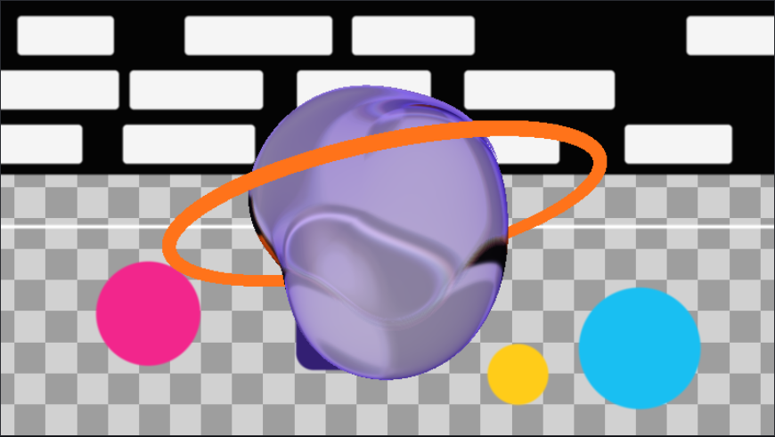

*Preview:* a pale lavender body with deeper violet toward the rims and in the thick middle; the checkerboard still shows through.

**Experiment `reflection`:** What do the blobs reflect, and where?

On the built component, run `component.op('study_tools').module.apply(component, 'reflection')`.

Prediction: Bright studio strips and coloured gels from the panorama, strongest near the silhouettes (fresnel) and everywhere a little (mirror).

Parameters: Preset=type_lens, Pause=True, Time=3.0, Stage=reflection. Time and unrelated controls are fixed by this preset.

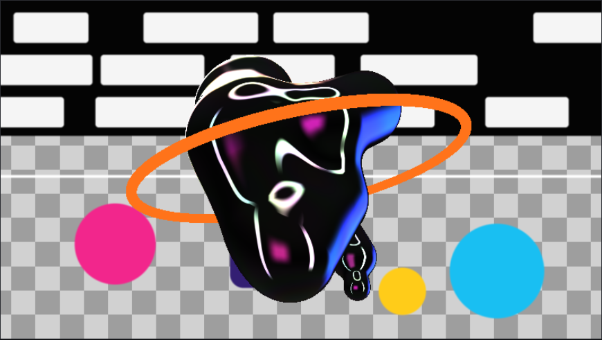

*Preview:* white studio strips and pink and blue gel lights curve over the blobs, brightest toward the silhouettes.

## Drive the blobs yourself

How do I place the blobs with my own data?

Set **Blobs > Blob layout** to *Layout TOP*. The shader then reads blob *i* from pixel *i* of the first row of the layout TOP: red, green, blue, alpha = x, y, z, radius, in box units (the box spans -1 to 1). A TOP was chosen over the GLSL MAT's CHOP array page because it uses the same sampler mechanism as the other inputs, and because the current GLSL MAT documentation does not name that page's per-row parameters. Any CHOP becomes such a TOP with a CHOP to TOP (Data Format RGBA, Pixel Format 32-bit float). The demo does exactly that from a table: `layout_table` → `layout_chop` (DAT to CHOP, a channel per column) → `layout_top`. Count still decides how many rows are used.

From [blobs.frag](blobs.frag), lines 26–54:

```glsl
uniform sampler2D sRefraction;
uniform sampler2D sReflection;
uniform sampler2D sLayout;

// Lengths are in scene units: the component multiplies Backdrop distance and
// Frost by Object size and divides Tint density and the film swirl frequency
// by it. Object size is the box's size in the world over the family's
// reference radius 1.45 (Fit to Glass geometry counts the Geometry COMP's
// scale), so the shader multiplies the film lookup by that scale
// (worldScale()). The blob shape (radius, spread, merge, droplets, ripple)
// stays in box units: it follows the box, as a mesh follows its SOP.
uniform vec4 uGlass;      // rgb glass colour, a tint density (per scene unit)
uniform vec4 uBody;       // translucency, frost (scene units), opacity, edge tint
uniform vec4 uOptics;     // ior, backdrop distance (scene units), dispersion, saturation
uniform vec4 uReflect;    // rgb reflection tint, a reflection amount
uniform vec4 uEnv;        // map mode (0 panorama, 1 screen, 2 studio), rotation (radians), blur, screen warp
uniform vec4 uSurface;    // mirror, fresnel power, diffuse, energy conserving (0 or 1)
uniform vec4 uRim;        // rgb rim colour, a rim amount
uniform vec4 uLight;      // xyz direction toward the light, w specular amount
uniform vec4 uLightColor; // rgb light colour, w shininess
uniform vec4 uFilm;       // iridescence, film thickness (nm), film variation, film swirl frequency (2.5 / (1.45 x object size); 0 = one thickness, no swirl)
uniform vec4 uBlobs;      // count (a fraction grows the last blob in), radius, spread, merge smoothness
uniform vec4 uShape;      // stretch, droplets (fraction allowed), droplet size, seed
uniform vec4 uMotion;     // unused, ripple, ripple scale, unused
uniform vec4 uPhase;      // drift, added up every frame in Python (presets.py phase()):
                          //   x layout (Speed), wraps at 256 pi; y ripple (0.4 + Speed), wraps at 20 pi;
                          //   z film (0.015 + 0.045 x Speed), wraps at 256; w unused
uniform vec4 uMarch;      // march steps, layout source (0 procedural, 1 layout TOP), samples, flip V
uniform vec4 uState;      // teaching stage, has refraction TOP, has reflection TOP, colours are sRGB (1) or as typed (0)
```

**Experiment `layout_top`:** Can I place the blobs myself?

On the built component, run `component.op('study_tools').module.apply(component, 'layout_top')`.

Prediction: Five blobs sit where the rows of blob_layout.tsv put them (one row per blob: x, y, z, radius), instead of drifting.

Parameters: Preset=prism_clear, Pause=True, Time=3.0, Layout=top, Count=5.0, Stretch=0.0, Merge=0.2. Time and unrelated controls are fixed by this preset.

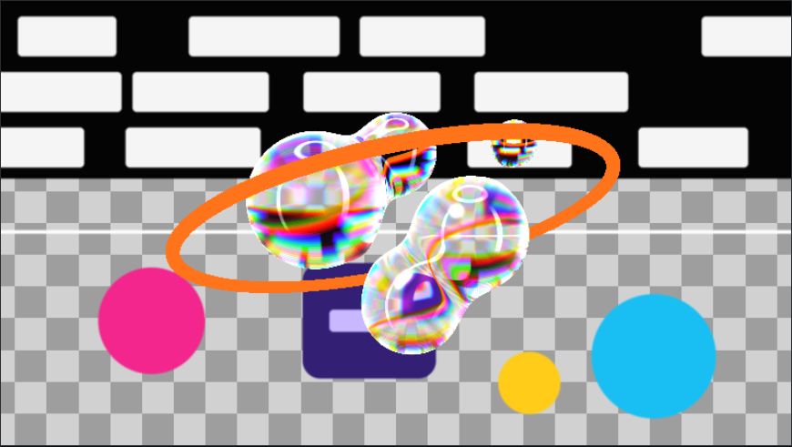

*Preview:* five blobs at the table's positions, including the small one at the upper right. A test places a single blob from the table and checks its normals against a sphere at the table's centre and radius: within 0.17 degrees (`layout_top_places_blobs`). In the preview the table is turned into a float texture directly; the native DAT to CHOP to TOP chain is pending a TouchDesigner run.

## Twelve looks and a morph

How do presets and morphing reach the shader?

Every control is a custom parameter on the component. Each uniform value is a Python expression such as `op('presets').module.u(parent().par.Ior)`. That function returns the parameter's value, blended toward preset B by **Morph**. Choosing a preset writes its values into the sliders, which stay editable. The presets also carry the blob shape (count, radius, spread, merge and so on), and because Count and Droplets may be fractional, a morph changes the shape continuously. The teaching stages are the last part of the shader.

From [blobs.frag](blobs.frag), lines 926–944:

```glsl
    if (stage > 0) {
        if (stage == 1) colour = vec3(0.92);
        else if (stage == 2) { float cost = float(steps) / clamp(uMarch.x, 8.0, 256.0); colour = vec3(cost, cost * cost, 1.0); }
        else if (stage == 3) colour = n * 0.5 + 0.5;
        else if (stage == 4) colour = vec3(depth);
        else if (stage == 5) colour = vec3(chord * 0.5);
        else if (stage == 6) colour = through;
        else if (stage == 7) colour = mix(body, through * tint, translucency);
        else if (stage == 8) colour = reflection;
        else if (stage == 9) colour = vec3(fresnel);
        else if (stage == 10) colour = film;
        else if (stage == 11) colour = vec3(uv, 0.0);
        else {
            bool finite = !(notFinite(depth) || notFinite(chord) || notFinite(n) || notFinite(colour));
            colour = finite ? vec3(0.1, 0.9, 0.3) : vec3(1.0, 0.0, 0.0);
        }
        alpha = 1.0;
    }
    writeOutput(vec4(colour, alpha));
```

**Experiment `morph`:** How do two presets blend?

On the built component, run `component.op('study_tools').module.apply(component, 'morph')`.

Prediction: Halfway between Prism Clear and Lavender Gel: a pale violet tint, less rainbow, and a blob layout halfway between the two.

Parameters: Preset=prism_clear, Pause=True, Time=3.0, Morphtarget=lavender_gel, Morph=0.5. Time and unrelated controls are fixed by this preset.

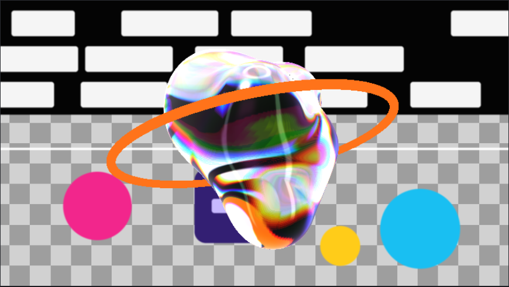

*Preview:* a pale violet glass with softer rainbow fringes and a blob layout between the two presets. Tests confirm that Morph 1 renders preset B exactly and Morph 0 changes nothing (`morph1_equals_target`, `morph0_is_neutral`).

**Experiment `final`:** What does the default look like?

On the built component, run `component.op('study_tools').module.apply(component, 'final')`.

Prediction: Clear capsule blobs with rainbow fringes, sharp highlights and studio reflections, merging and splitting over time.

Parameters: Preset=prism_clear, Pause=True, Time=3.0, Stage=final. Time and unrelated controls are fixed by this preset.

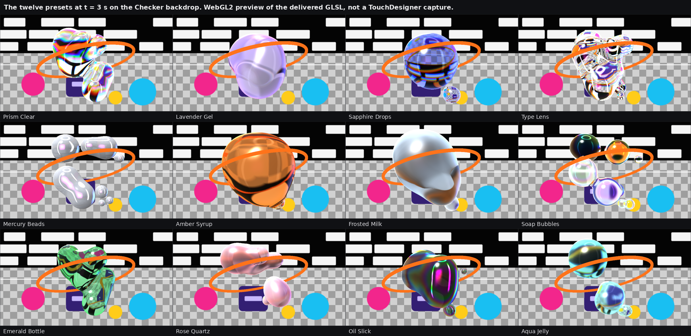

*Preview:* the twelve presets at the same moment. Prism Clear, Lavender Gel, Sapphire Drops and Type Lens follow the four reference images in look. Mercury Beads, Amber Syrup, Frosted Milk and Soap Bubbles are variations. Emerald Bottle, Rose Quartz, Oil Slick and Aqua Jelly adapt the core study's looks of the same names, each with its own blob shape. A test checks that no two presets look alike: at this moment every pair differs by a mean of at least 10/255 over the whole frame, on both backdrops (`presets_stay_distinct`).

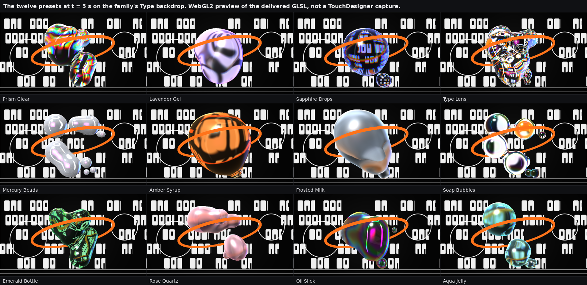

*Preview:* the same presets on **Study > Demo backdrop** = *Type*, bold white type on black. Every study in the liquid-glass family renders this backdrop, so their presets can be compared on one image.

Every output goes through `writeOutput()`. It caps colour at 1024, so a 16-bit float Render TOP never overflows, and it writes zeros into any extra colour buffers of the Render TOP, with one constant index per buffer (`colour_is_capped_for_half_float`).

## What this does not do yet

- **Native results are pending.** Everything above ran in a browser preview of the same GLSL. Compile, render, the builder, the presets callback, the layout chain, Draw Priority, fog, picking, export to `.tox` and performance have not been run in TouchDesigner yet.
- **Approximations.** All colours reuse the measured path of the middle colour. There is at most one bend out (no second internal bounce). The scene behind is treated as one flat layer at Backdrop distance.
- **Screen-space refraction.** The Refraction TOP is sampled without depth, so an object between the camera and the blobs appears inside the glass if it is in that render. Keep it out.
- **Camera limits.** Fisheye or quad-reprojected cameras are not supported, because the pixel shader projects depth itself. With several cameras, stereo or a cube map, every camera after the first refracts the first camera's image. A camera inside a blob sees nothing of that blob.
- **Blending and draw order.** In zero-wiring mode and at Opacity below 1, objects behind the blobs must be drawn first; `blobs_geo` has Draw Priority -1 for this. Order Independent Transparency and Depth Peeling are not supported.
- **Scene lights and picking.** Light comes from the Light page, not from Light COMPs. Render Pick sees the proxy box, not the blob surface.
- **Big blobs.** A blob too big for the box is cut flat by its walls.
- **One Object size per component.** Fit reads `blobs_geo` when you press it. Copies at another size, a scale that changes after Fit and an instance's own scale all keep that Object size. The blob shape follows its box, but Backdrop distance, Frost, Tint density and the film bands do not: scaled up three times without a new Fit, the blobs bend and tint as if they were three times smaller. The README's Limits list the workarounds; a change that would let all three follow is recorded in [decisions.json](decisions.json) and waits for the user's decision.
- **Running time.** The drift phases wrap every 256π (layout), 20π (ripple) and 256 (film) units, each where its own motion repeats, so nothing jumps. Only the blob layout loops exactly: every 256π / Speed seconds, about 38 minutes at the default Speed 0.35. The ripple repeats every 20π / (0.4 + Speed) seconds (84 s) and the film swirl every 256 / (0.015 + 0.045 × Speed) seconds (about 2.3 hours); these periods do not divide each other, so the whole image does not repeat exactly. The drift state lives in the `presets` module; editing that DAT restarts it with one jump.
- **Dithering.** The shader adds no noise anywhere. Turn **Dither** off on your own Render TOPs too (the demo renders have it off); TouchDesigner's default for it is not stated in the documentation.
- **Cost.** Every pixel of the box marches, and writing depth disables early depth rejection. Keep the box tight, and lower March steps and Samples if needed.
- **Edges.** The silhouette smoothing is analytic and sits up to half a pixel outward. Render TOP antialiasing does not smooth it.

## Credits

The raymarching loop, the sphere distance, the smooth minimum, moving shapes by moving the sampling point, and the gradient normal follow Maxime Heckel, [Painting with Math: A Gentle Study of Raymarching](https://blog.maximeheckel.com/posts/painting-with-math-a-gentle-study-of-raymarching/), with Inigo Quilez's smooth-minimum and SDF-normal work that he credits. The glass look follows [Refraction, dispersion, and other shader light effects](https://blog.maximeheckel.com/posts/refraction-dispersion-and-other-shader-light-effects/) through this repository's liquid-glass study (commit a6f95c6). Beer's law follows [Real-time cloudscapes with volumetric raymarching](https://blog.maximeheckel.com/posts/real-time-cloudscapes-with-volumetric-raymarching/). The TouchDesigner material, the proxy box route, the depth write, the two-surface lens path, the colour-gap blur, the silhouette smoothing, the layout TOP, droplets, presets and builder are new for this study. This study is not authored or endorsed by Maxime Heckel. See [sources.json](sources.json).
