# Liquid Glass Blobs: raymarched glass that merges, splits and sorts with your scene

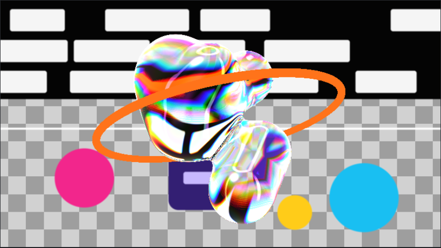

*The destination: clear glass blobs with rainbow fringes, and an ordinary orange ring passing in front of them and behind them. This image is a WebGL2 preview of the same shader files, not a TouchDesigner capture.*

This tutorial builds liquid-glass blobs for TouchDesigner. They drift, melt into each other, split apart and shed small droplets. Seen through them, the scene shrinks, flips and splits into rainbow fringes. They live inside an ordinary object, so they work with perspective and orthographic cameras and sort correctly against the rest of your scene. It is written for TouchDesigner users who have not written shaders before. Every code block below is copied automatically from the delivered files, so what you read is what runs.

Two articles by Maxime Heckel supply the core ideas. [Painting with Math: A Gentle Study of Raymarching](https://blog.maximeheckel.com/posts/painting-with-math-a-gentle-study-of-raymarching/) explains how to draw shapes from distance formulas and melt them together with a smooth minimum. [Refraction, dispersion, and other shader light effects](https://blog.maximeheckel.com/posts/refraction-dispersion-and-other-shader-light-effects/) explains glass, and this repository's liquid-glass study turned it into a TouchDesigner material. His raymarching examples are web scenes with one fixed camera. This study moves the idea into a TouchDesigner material, measures the real path through the glass, and adds depth, droplets, presets and a data input. Each change is pointed out where it happens.

## Open the study

Build the component from the Textport, keeping it in a variable named `component` so the experiment commands below work:

```python
import runpy
component = runpy.run_path('/path/to/liquid-glass-blobs/build.py')['build']()
```

Open the component's viewer. Each experiment below fixes time and every unrelated control, then changes one thing. The **Study > Teaching stage** menu shows one ingredient at a time; most experiments use it.

Experiments can run in any order. Before each one, `apply()` returns every look control to its default: the preset values, Morph and its target, Seed, Blob layout, Samples, March steps, Energy conserving, Light direction, Panorama rotation, Flat image warp and the Study page, Demo backdrop included (the pictures below use the Checker). It leaves your scene setup alone: the Refraction, Reflection and Layout TOPs, Object size, Reflection map, Flip screen V and Colour parameters. `apply(component, 'final')` brings the default look back, paused, with Preset on Custom.

The pictures under each experiment come from a WebGL2 preview that runs the same shader files in a browser. They show what the code does; they are not proof of how TouchDesigner renders it. When you run an experiment natively, compare against the stated prediction.

A shader is a small program the graphics card runs for you. A GLSL MAT holds two of them. The **vertex shader** runs once per corner of the mesh and decides where it lands on screen. The **pixel shader** runs once per pixel the object covers and decides its colour. Here the mesh is only a box, and almost everything happens in the pixel shader.

## A box that holds the blobs

How can a material draw a shape that is not in its mesh?

The blobs have no triangles. They are described by a formula, and the pixel shader works out where their surface is. But a pixel shader only runs on pixels some geometry covers. So we give it a stand-in: a 2 x 2 x 2 box (a Box SOP of size 2 inside `blobs_geo`). The box is the canvas. Each pixel it covers asks one question: "if I follow the camera's ray through this pixel, do I hit a blob inside the box?"

Because the box is ordinary geometry, TouchDesigner does the hard parts for us. It places the box with the Geometry COMP's transform, projects it with whatever camera the Render TOP uses, and handles instancing. The material renders the box's **back faces** (Cull Face = Front Faces), so each pixel gets exactly one fragment even when the camera is inside the box.

The vertex shader passes on what the pixel shader needs: the box corner in world space, and where the object's origin and its three axes end up in the world. Those four points pin down the whole object transform, including parents and instances, because they all go through `TDDeform`, TouchDesigner's own function for this.

{{code:blobs.vert:proxy}}

The `#ifndef TD_PICKING_ACTIVE` lines are for the Render Pick DAT and CHOP. To find what lies at a pick position, they render the scene with `TD_PICKING_ACTIVE` defined. The `#` lines are read before compiling, so that render keeps only the first two lines (deform and project) and the `#else` block, the form Derivative's *Write a GLSL MAT* page shows. `TDWritePickingValues()` writes TouchDesigner's default pick values, and they describe the box, not the blob inside it. Ordinary renders skip the `#else` block.

In the pixel shader, `setup` builds the ray from TouchDesigner's built-in camera matrices, `uTDMats[]`. The box point this pixel shows, `vWorldPos`, lies on the pixel's camera ray. `camProjInverse` turns the pixel back into the point where that ray crosses the camera's near plane (depth 0). The ray starts there and runs through the box point. This works for any projection, perspective, orthographic or in between. Starting at the near plane also clips glass nearer than it, as TouchDesigner clips ordinary geometry. The ray is then moved into the box's own space ("object space"), where the blobs are defined. Heckel moves a shape by moving the sampling point the opposite way (article lines 453–555); here the whole ray is moved once with the inverse transform. `boxInterval()` finds where the ray enters and leaves the box, so the march only runs inside it.

{{code:blobs.frag:setup}}

{{experiment:proxy}}

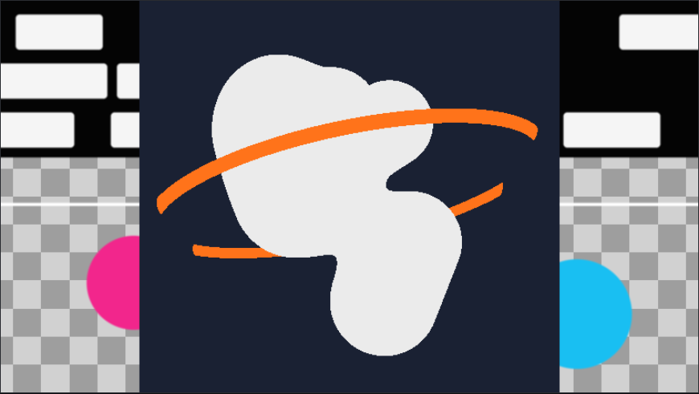

*Preview:* the box appears as a dark blue rectangle with the blobs in light grey. The back half of the ring vanishes inside the box. That happens only in this stage, which writes the box's own depth where rays miss. In the final image those pixels are thrown away (`discard`), so the box never hides anything.

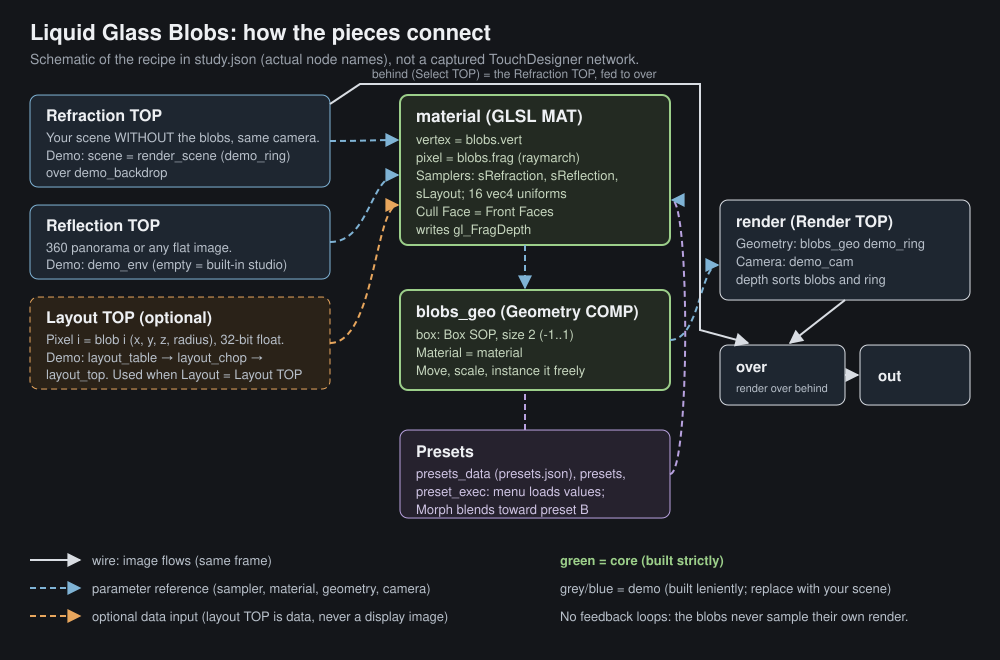

The diagram is a schematic of the recipe, not a captured network. Solid lines carry images; dashed lines are parameter references. Green nodes are the core you keep; the rest is a demo you replace with your own scene.

## March a ray to the surface

How does a ray find a surface that has no triangles?

Heckel's answer is the signed distance field (article lines 74–134). A function tells you, for any point, how far it is to the nearest surface: positive outside, negative inside. For a sphere that is simply `length(p) - radius`. Now walk along the ray. At each point, ask the function how far the nearest surface is, and step exactly that far: you cannot overshoot, because nothing is closer. Near a surface the steps get tiny. When the distance drops below a small epsilon, you have hit it. This is sphere tracing, or raymarching.

`marchSurface()` is that loop. It stops at the box's far side (`span.y`) or after **Optics > March steps** steps. Two additions make the hit precise. First, two Newton steps settle the point onto the surface: the field shrinks at a known rate along the ray, so dividing by that rate jumps almost exactly onto the zero. Second, the loop remembers how close a missing ray came, which the final image uses to smooth the silhouette.

{{code:blobs.frag:march}}

{{experiment:sphere}}

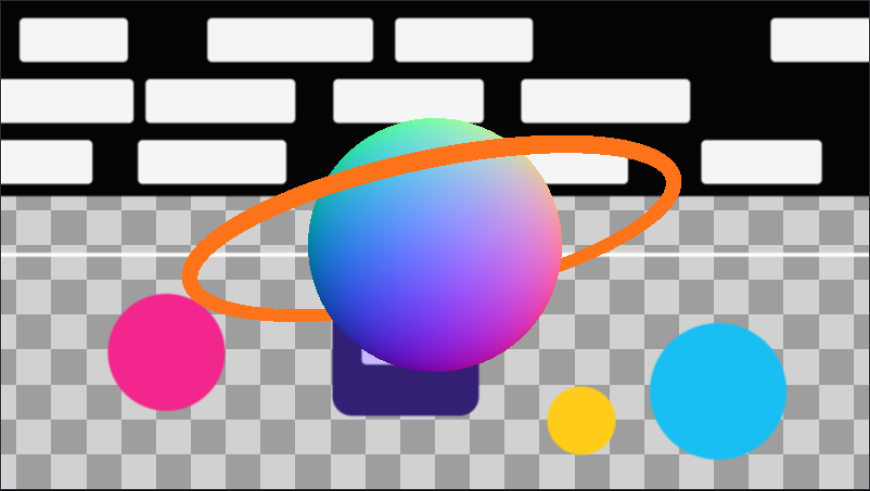

*Preview:* one smooth sphere. A test compares these normals with the exact sphere normal: the worst pixel is off by 0.11 degrees, also when the Geometry COMP is rotated, moved and scaled. Under non-uniform scale the sphere becomes an ellipsoid, and the normals match the exact ellipsoid normal within 0.22 degrees (`sdf_normal_matches_analytic` in [the preview tests](checks/preview_tests.cjs)).

{{experiment:steps}}

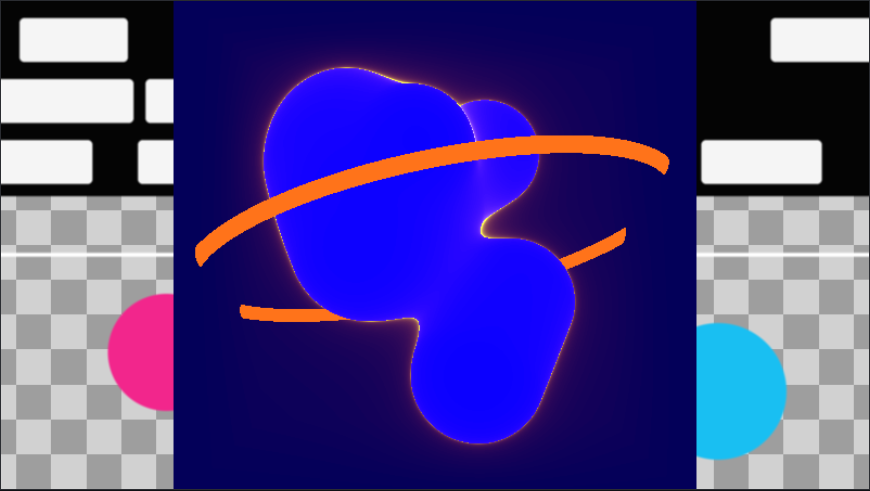

*Preview:* the blobs are dark blue (few steps). A thin orange halo marks rays that skim a silhouette, and the empty box between blobs is also more expensive than a direct hit. This is where the time goes: lower March steps if your frame rate drops, and watch the silhouettes.

## Melt blobs together

How do separate blobs merge like liquid instead of just overlapping?

Two shapes together are the closer of the two: `min(a, b)`. That gives sharp creases where they meet. Heckel's `smoothmin` (article lines 429–451) blends the two distances when they are within `k` of each other, so the surface bulges into a smooth neck. He notes it makes objects "act more like liquids". Two details matter here. The archived formula divides by `k`, so `k = 0` would produce NaN. `smoothMin()` handles a zero width first. Its slope also never exceeds 1, so the march stays safe.

Each blob is a capsule: a short segment thickened by a radius. With **Stretch** at 0 it is Heckel's sphere. Small travelling **ripples** can be added. They change the field faster than a true distance: their slope is at most 0.04 × Ripple × Ripple scale. `stepScale()` shortens the steps by a safe upper bound on that slope (1.75 times it), plus a 10 % margin.

Last, `blobField()` keeps only the glass inside the box: it takes the larger of the blob distance and the distance to the box walls (`sdBox()`), which is how two distance fields intersect. A blob too big for the box then ends in a flat glass face where a wall cuts it.

{{code:blobs.frag:field}}

Where do the blobs go? `buildLayout()` runs once per pixel, before marching. Each blob drifts on its own slow wave in x, y and z, with frequencies and phases from a seeded hash, so **Seed** gives a new but repeatable arrangement.

The waves move with a drift phase, `uPhase.x`, not with the clock itself. Python adds Speed × the frame's duration to it every frame, in double precision (`presets.py phase()`). Speed may change at any moment, during an A/B morph or while you drag the slider, and the blobs only change how fast they move. Multiplying Speed by the running time would make them jump by the change in Speed × every second since TouchDesigner started. The phase wraps after 256π, and `loopRate()` rounds every wave speed to a whole multiple of 1/128, so each wave has turned a whole number of times at the wrap and nothing jumps there. The shader never sees a large time value, so the motion stays smooth after weeks. Pause holds the phase at Speed × Fixed time. The ripple and the film drift the same way (`uPhase.y`, `uPhase.z`). A test plays one frame of a 100-frame morph after an hour: it changes the image no more than the same frame after 3 seconds (`morph_frame_is_smooth_after_an_hour`); with the old Speed × time it changed almost every pixel. Shifting a phase by its wrap period changes the image less than one frame of motion (`drift_wraps_without_a_jump`). **Count** may be fractional: the last blob grows in from nothing, so Count can be animated or morphed. Droplets circle the box's centre, mostly in the plane facing the default camera, on an orbit just outside where the main blob sits at Spread 0. There their gap breathes between touching (they merge in) and two radii (they split off); with more Spread the body wanders, so the gap varies more. Every centre is clamped so the blob, its stretch and its merge bulge stay inside the box. A blob too big to fit even at the centre is centred and cut flat by the walls.

{{code:blobs.frag:layout}}

{{experiment:merge_hard}}

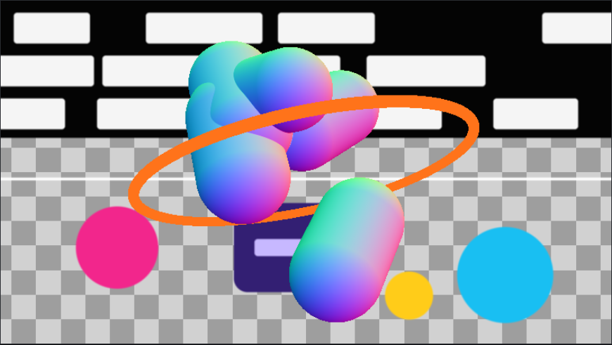

*Preview:* separate blobs with hard creases where they intersect; the normal colours jump.

{{experiment:merge_soft}}

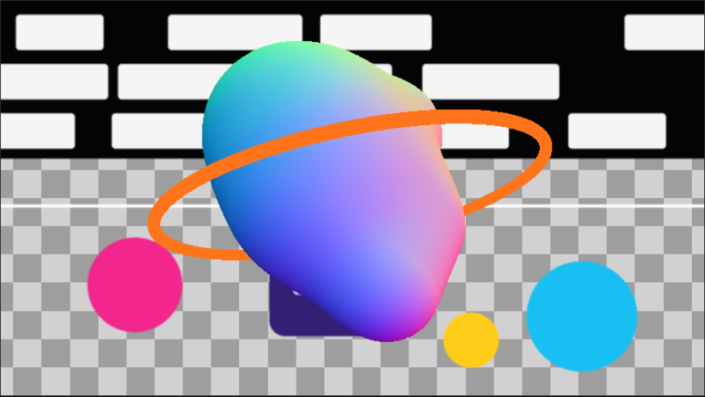

*Preview:* at Merge 0.6 the blobs fuse into one smooth body with flowing colours. A test runs merge widths from 0 to 1, an extreme layout and fully overlapping centres. No pixel turns NaN, and the smooth version covers every pixel the plain union covers: no holes (`smooth_min_stays_finite_without_holes`).

{{experiment:droplets}}

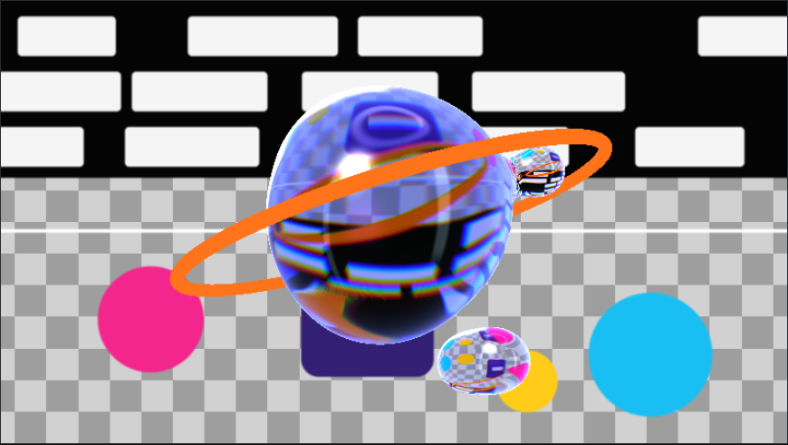

*Preview:* two droplets sit beside the main body at the lower right. One is joined to it by a neck, the other is free.

{{experiment:box_cut}}

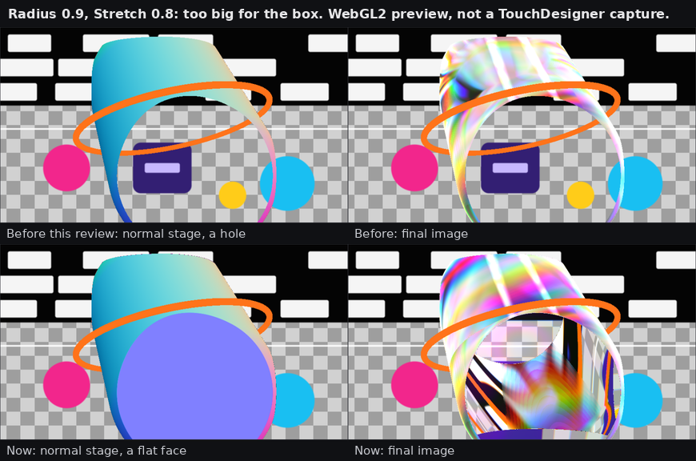

*Preview:* the top row is the shader before an independent review found this case. Where the front wall cut the capsule, the ray entered the box already inside glass, the march treated that as "the camera is inside a blob", and a hole showed the backdrop. With the box cut in `blobField()` (bottom row), the same blob has a flat front face of one even normal colour, and the final image shows glass there. A test renders single blobs crossing the walls, up to the slider maxima, and requires every row and column of covered pixels to be unbroken (`blobs_cut_by_the_box_have_no_holes`).

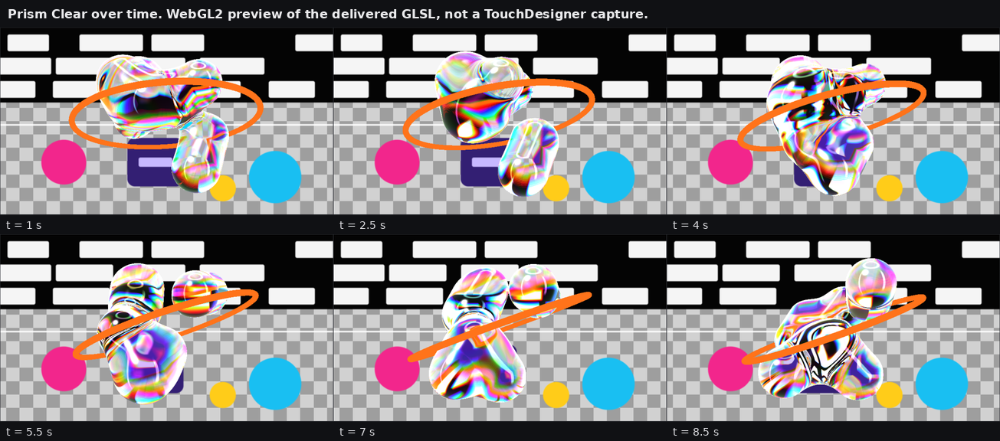

*Preview over time:* the same preset at six moments. Blobs part, join through necks and part again.

## Normals and depth

How does the glass know which way it faces, and how do other objects pass in front of it?

The field rises fastest straight out of the surface, so its gradient is the normal. Heckel samples the field a little to each side (article lines 325–338). `fieldNormal()` uses Inigo Quilez's four-sample tetrahedron, which he credits there. The normal is computed in object space and turned into world space with the inverse transpose of the object transform, which stays correct under non-uniform scale. That product is 1 / scale long, so `movedDirection()` normalises it with no fixed length threshold; a threshold would turn every normal of a 20,000-unit object into +Y (`normals_hold_at_any_object_scale`).

At the silhouette the estimated normal can tilt a hair away from the camera. `faceCamera()`, from the core study, lays such a normal back into the view plane. Flipping it instead would also reverse its sideways part: the light then bent straight back out of the glass, and rim pixels measured a path near 0 where a sphere's shortest path at IOR 1.55 is 0.92 scene units (`rim_chords_stay_physical`).

Depth is what makes the blobs a citizen of your scene. A rasterized object writes its depth automatically; a raymarched one must write its own, or everything sorts against the box. `gl_FragDepth` is set to the depth the hit point would have as ordinary geometry: project it with `uTDMats[].camProj` and divide z by w. TouchDesigner's documentation states that its projection maps depth to 0..1 ("Vulkan style"), which is exactly the range `gl_FragDepth` expects. The pixel shader cannot call `TDWorldToProj`, because that function is vertex-only, so fisheye and quad-reprojected cameras are not covered.

{{code:blobs.frag:normal}}

{{code:blobs.frag:hit}}

{{experiment:depth}}

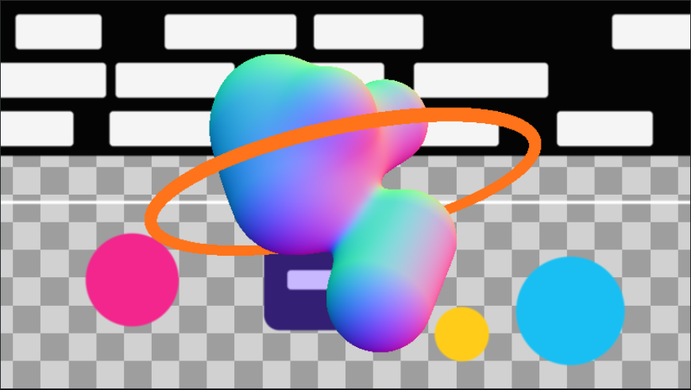

*Preview:* the orange ring crosses the blobs, in front where it is nearer the camera and hidden where it goes behind, inside the box too. Tests back this up. The written depth matches a rasterized sphere mesh of the same size within 0.0005 scene units, also for a rotated, moved, non-uniformly scaled ellipsoid. A raster sphere and a blob sphere that overlap hide each other exactly where their true surfaces cross: 0 wrong pixels out of 6,128 (`depth_matches_rasterized_sphere`). With an orthographic camera, and with projections blended between perspective and orthographic, the blobs cover the same pixels as a rasterized sphere and match its depth within 0.0006 scene units (`any_projection_matches_raster`). Glass nearer than the near plane is clipped, never written at depth 0 in front of everything (`near_plane_clips_the_blobs`).

## Go through the glass

Why do the blobs shrink and flip what is behind them?

Light bends when it enters glass and again when it leaves. The core study had only the front surface and a Thickness slider, because a mesh shader cannot see its own far side. A distance field can. Inside the glass the field is negative, and minus the field is the distance to the nearest wall. So `marchInside()` marches the bent ray until that distance reaches zero again: that is the exit. The path length is the real thickness at this pixel.

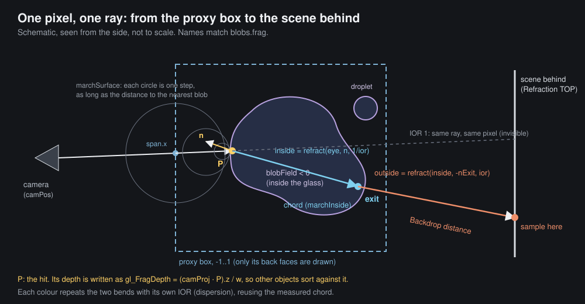

*Schematic, not to scale.* The colours and names match the code below.

{{code:blobs.frag:interior}}

{{code:blobs.frag:through}}

`lensShift()` follows the light. It bends in at the front with GLSL's `refract()`, crosses the measured path, and bends out at the exit. If the exit angle is too steep to leave the glass (total internal reflection), it reflects instead. Then it travels **Backdrop distance** scene units to the scene behind. Projecting that point with the camera says where to read the Refraction TOP, relative to this pixel. `screenShift()` measures this with the camera's own matrix, so the effect does not change with distance, lens, aspect or projection.

Which way is "up" on the Refraction TOP? The shader measures it instead of assuming it. `screenSign()` projects the box point this pixel shows with the camera and compares the result with the pixel's raster position from `gl_FragCoord`, both in the same -1..1 range. On an ordinary raster they have the same sign; on a raster that runs the other way they have opposite signs. Every shift is turned the same way. On the centre line of an odd-sized render both are 0 and cannot be told apart, so there the sign of the screen derivatives decides (`dFdx` and `dFdy`, taken at the top of `main()` before any branch). The core and prism studies use the same comparison. A test reads the measured orientation on every blob pixel of the twelve presets, in a normal and a flipped raster, at 480 x 270 and 481 x 271, and finds no wrong pixel (`screen_orientation_has_no_wrong_pixels`). A build whose raster ran upside down would therefore still bend light the right way: a test flips the preview's raster and gets the mirror image of the normal render, lookup for lookup within 0.3 pixel (`bends_follow_screen_orientation`). **Flip screen V** stays for one case only, a Refraction TOP that arrives upside down; it flips the screen position and the measured vertical direction together (`flip_v_corrects_upside_down_inputs`).

A test checks this path directly. A UV ramp replaces the backdrop, so each pixel reads back where it sampled. An exact trace through a sphere (bend in, exact chord, bend out at the exact exit normal, travel, project) agrees within one pixel (worst 0.50 pixels) at IOR 1.33, 1.5 and 2.2, also with a scaled Geometry COMP (`lens_matches_exact_trace`). Dropping the second bend, or flipping the shift's sign, fails this test.

{{code:blobs.frag:bend}}

{{code:blobs.frag:screen}}

{{experiment:see_through}}

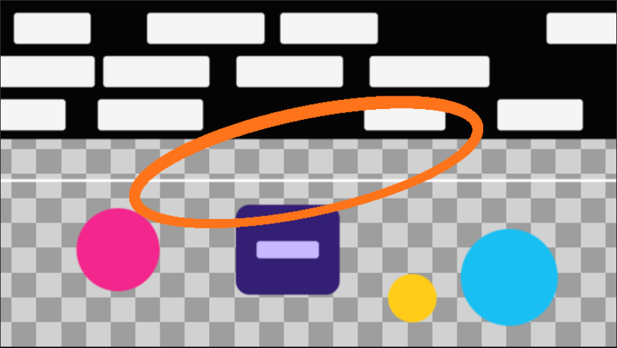

*Preview:* the blobs disappear completely. With an IOR of 1 every path stays on the pixel's own camera ray. The test compares this with the scene alone; the largest difference is 1/255 (`ior1_is_invisible`).

{{experiment:lens}}


*Preview:* each blob is a small lens. The type band from the top of the backdrop appears upside down in the lower part of the blobs, and the checkerboard bends hardest near the rims.

{{experiment:backdrop_far}}

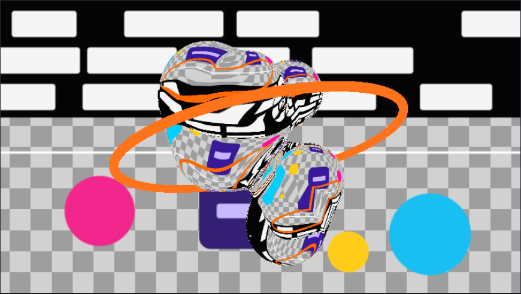

*Preview:* with the scene twice as far behind, the flipped image inside each blob shrinks further and more of the backdrop fits inside.

{{experiment:thickness}}

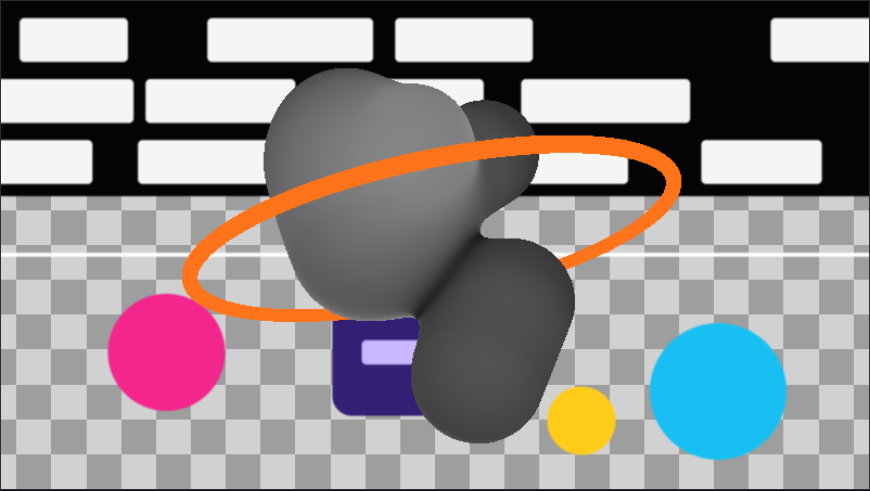

*Preview:* bright cores and dark rims, brighter where blobs merge. A test compares the measured path through a single blob with the exact chord of a ray through a sphere: within 0.0008 scene units at IOR 1 and 1.5, also when the object is scaled (`thickness_matches_exact_chord`).

## Split the colours, then frost them

Where do rainbow fringes come from, and how does the same loop frost the glass?

Glass bends violet light more than red. The loop in `transmitted()` repeats the lens path once per spectrum sample, each with a slightly different IOR, and weights each sample's red, green and blue. This is the core study's version of Heckel's dispersion (article lines 322–463). Spreading the same samples over a small disc blurs the view instead: frost.

Real lens paths spread the colours much further than the core's single bend. With 12 samples the first preview showed separate coloured copies, like contour lines. Random jitter would hide them with grain, which is dithering, and the brief rules that out. So each sample reads a blurred mipmap level sized from the gap to its neighbour on screen, and neighbouring colours blend.

How wide should that level be? A mipmap level blurs in every direction, not only along the rainbow. Against a 64-sample reference, a level as wide as the whole gap was twice as far off as no level at all (mean 16.6 against 8.3 out of 255 on the pixels the rainbow changes), because it also softened the edges across the fan. Of the widths tried (none, an eighth, a quarter, 0.35, a half and the whole gap), a quarter came out closest overall: mean 7.3, better than no level in all eight measured cases, and fewer badly wrong pixels than any wider level. So the level is a quarter of the gap; decisions.json has the full table. Fine steps can remain where the fan is widest; raise **Samples** to remove them (`dispersion_converges_with_samples`).

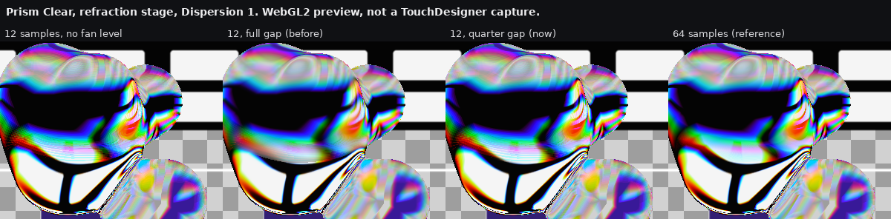

Frost spreads the same samples over a disc. `discPoint()` places them with Martin Roberts' R2 sequence, as the core study does: angle and radius come from two different irrational steps, so the points cover the disc evenly and average out near its centre. The golden-angle spiral used before put every point on one arm and moved the frosted view by 10 to 12 pixels; now it moves by under 4 at 12 samples and under 1 at 24 (`frost_does_not_shift_the_view`).

{{code:blobs.frag:dispersion}}

{{experiment:dispersion}}

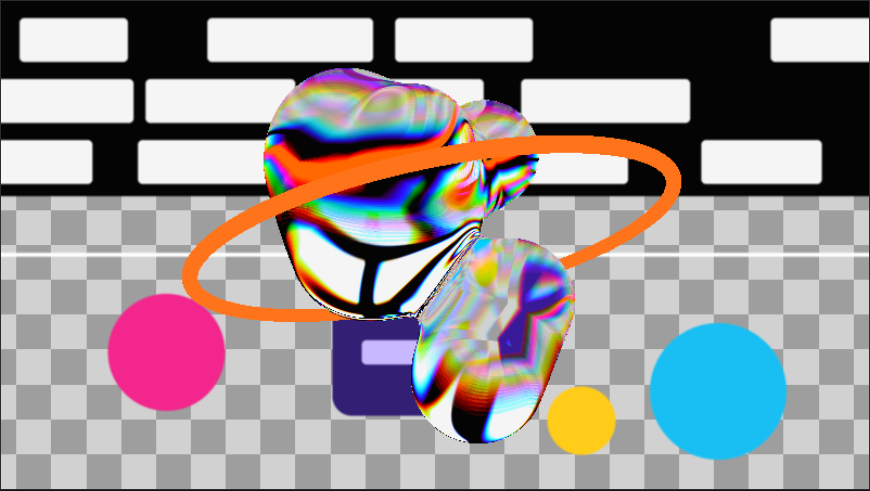

*Preview:* white type and the ring split into smooth rainbow bands, with no stepped copies.

{{experiment:frost}}

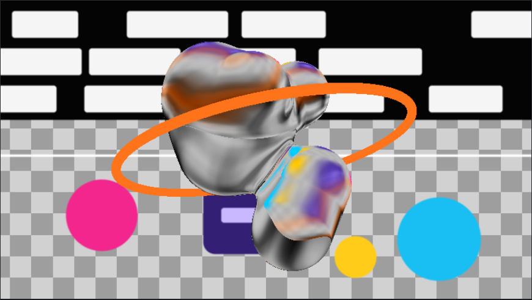

*Preview:* the view through the blobs blurs smoothly into soft greys and orange, with no grain.

## Colour, reflection and light

What makes the glass coloured, shiny and alive?

These are the core study's ingredients, now fed by real geometry. **Absorption** follows Beer's law, which Heckel explains for clouds (*Real-time cloudscapes*, lines 622–695): light through tinted glass loses the colours it absorbs, exponentially with the path. Here the path is the measured chord, so merged, thick regions tint more than thin rims. A test checks each channel against exp(−(1 − glass colour) × density × chord) at every pixel, with the chord read from the thickness stage (`beer_lambert_tint_follows_measured_chord`). **Edge tint** lengthens the path at grazing angles for deep-coloured rims. **Reflections** come from the Reflection TOP (a 360 panorama or a flat image) or a built-in studio, strongest at grazing angles (fresnel). **Highlights** use Heckel's squared Blinn-Phong term. The **thin film** adds soap-bubble colours.

{{code:blobs.frag:body}}

{{code:blobs.frag:reflection}}

{{code:blobs.frag:light}}

{{code:blobs.frag:film}}

`compose` puts it together. The Refraction TOP's alpha decides how the light from behind arrives. Where that TOP has content (`covered` = 1), the glass is opaque in alpha and shows the refracted scene. Where it is transparent, or not connected at all (`covered` = 0), there is nothing to bend: the glass blends with whatever is behind it in the same render, or with what you composite behind the final render later. Zero wiring is simply the case `covered` = 0 everywhere, without bending. Coverage from the silhouette smoothing fades the edge pixels. Last, `TDFog()` applies the Camera COMP's fog. It expects an unpremultiplied colour, so the shader asks it what fog it adds to black and keeps only the glass's own share (its alpha) of that.

Two switches come from the core study. **Energy conserving** (Reflection page, off by default) takes the reflected share out of the light that passes through, so Mirror 1 makes a true mirror (`energy_conserving_mirror_is_pure_reflection`); off, the glow adds on top, as in Heckel's article. **Colour parameters** (Inputs page) converts the glass, light, rim and reflection colours from sRGB to linear when your project works in linear colour; *Auto* follows the project's working colour space (`paramColour()`, `srgb_colour_mode_decodes_colours`).

**Object size** (Inputs page) tells the look how big the object is. It means the same in every member of the liquid-glass family: the object's radius in scene units over 1.45, the radius of the core study's demo torus. Tint density, Backdrop distance and the Frost disc are in scene units, so a preset made for blobs 2 units wide would turn black and stop flipping on blobs 200 units wide; Object size scales them. The box here has radius 1, so the unscaled demo reads 1 / 1.45 = 0.69, and the presets' values were converted once so they look as before on it. Pulse **Fit to Glass geometry** after you scale `blobs_geo`, and the presets keep their look (`object_size_carries_presets`, `fit_size_carries_presets_over_comp_scale`).

Not everything follows Object size. The film swirl is a colour pattern, so it does: `filmThickness()` multiplies the lookup by `worldScale()`, the Geometry COMP's scale, and Python divides the frequency by Object size. The ripple is different. It moves the surface itself, so it belongs to the shape, with Radius and Merge, and stays in box units. If you scale `blobs_geo` by 10 and forget Fit, the film swirl repeats ten times as often across the glass, so its bands get much finer, while the ripples keep their count. The preview test counts about 7.6 times the band detail (colour changes along pixel rows) and the same ripples (`comp_scale_at_default_object_size_gives_k_times_the_film_bands`).

{{code:blobs.frag:compose}}

{{experiment:tint}}

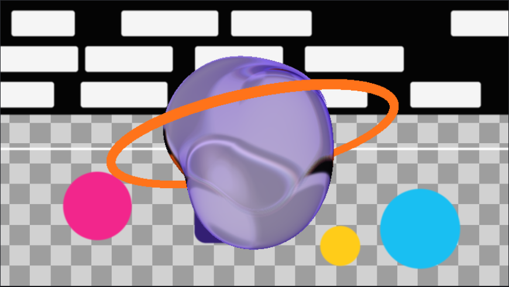

*Preview:* a pale lavender body with deeper violet toward the rims and in the thick middle; the checkerboard still shows through.

{{experiment:reflection}}

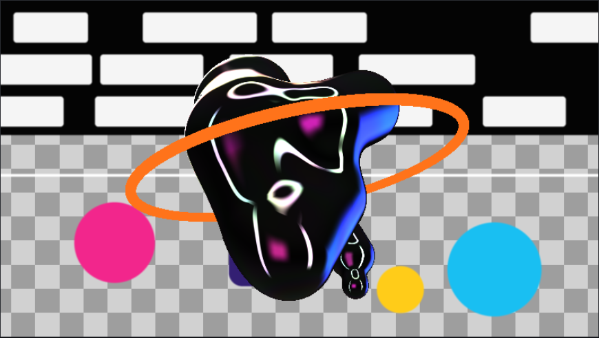

*Preview:* white studio strips and pink and blue gel lights curve over the blobs, brightest toward the silhouettes.

## Drive the blobs yourself

How do I place the blobs with my own data?

Set **Blobs > Blob layout** to *Layout TOP*. The shader then reads blob *i* from pixel *i* of the first row of the layout TOP: red, green, blue, alpha = x, y, z, radius, in box units (the box spans -1 to 1). A TOP was chosen over the GLSL MAT's CHOP array page because it uses the same sampler mechanism as the other inputs, and because the current GLSL MAT documentation does not name that page's per-row parameters. Any CHOP becomes such a TOP with a CHOP to TOP (Data Format RGBA, Pixel Format 32-bit float). The demo does exactly that from a table: `layout_table` → `layout_chop` (DAT to CHOP, a channel per column) → `layout_top`. Count still decides how many rows are used.

{{code:blobs.frag:uniforms}}

{{experiment:layout_top}}

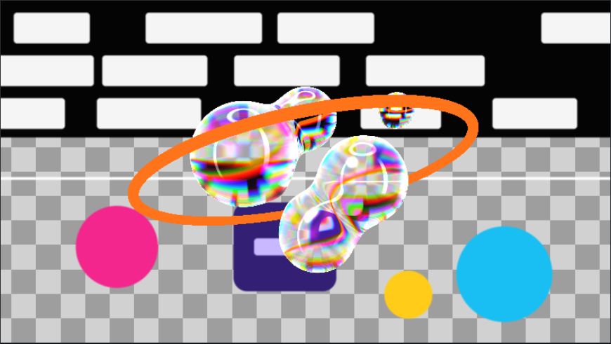

*Preview:* five blobs at the table's positions, including the small one at the upper right. A test places a single blob from the table and checks its normals against a sphere at the table's centre and radius: within 0.17 degrees (`layout_top_places_blobs`). In the preview the table is turned into a float texture directly; the native DAT to CHOP to TOP chain is pending a TouchDesigner run.

## Twelve looks and a morph

How do presets and morphing reach the shader?

Every control is a custom parameter on the component. Each uniform value is a Python expression such as `op('presets').module.u(parent().par.Ior)`. That function returns the parameter's value, blended toward preset B by **Morph**. Choosing a preset writes its values into the sliders, which stay editable. The presets also carry the blob shape (count, radius, spread, merge and so on), and because Count and Droplets may be fractional, a morph changes the shape continuously. The teaching stages are the last part of the shader.

{{code:blobs.frag:stages}}

{{experiment:morph}}

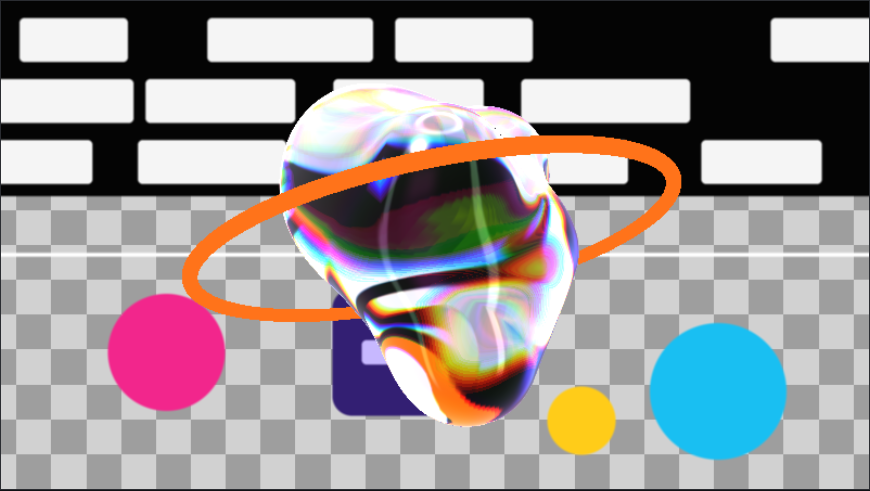

*Preview:* a pale violet glass with softer rainbow fringes and a blob layout between the two presets. Tests confirm that Morph 1 renders preset B exactly and Morph 0 changes nothing (`morph1_equals_target`, `morph0_is_neutral`).

{{experiment:final}}

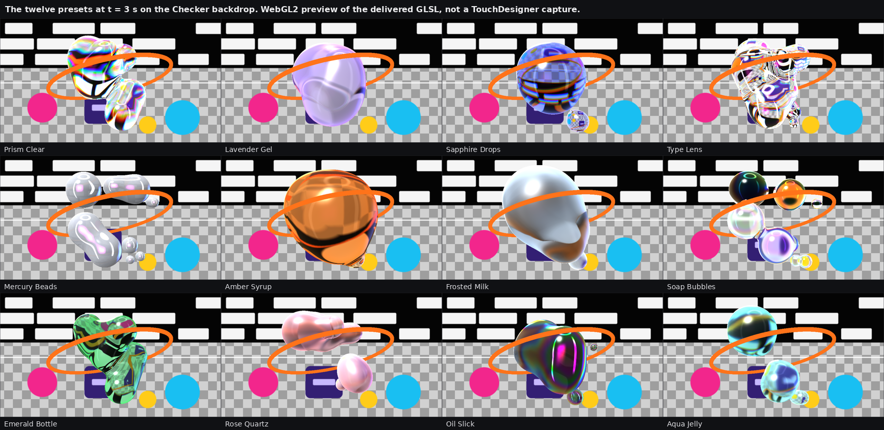

*Preview:* the twelve presets at the same moment. Prism Clear, Lavender Gel, Sapphire Drops and Type Lens follow the four reference images in look. Mercury Beads, Amber Syrup, Frosted Milk and Soap Bubbles are variations. Emerald Bottle, Rose Quartz, Oil Slick and Aqua Jelly adapt the core study's looks of the same names, each with its own blob shape. A test checks that no two presets look alike: at this moment every pair differs by a mean of at least 10/255 over the whole frame, on both backdrops (`presets_stay_distinct`).

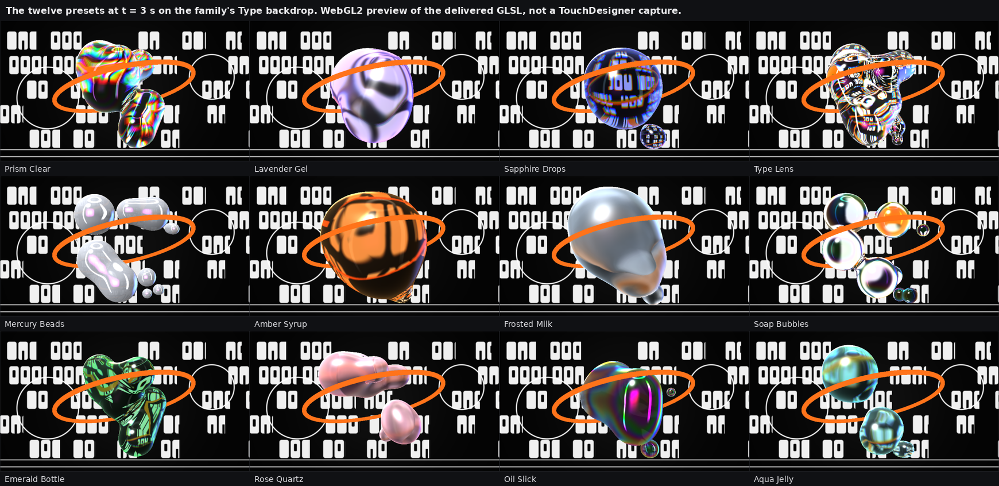

*Preview:* the same presets on **Study > Demo backdrop** = *Type*, bold white type on black. Every study in the liquid-glass family renders this backdrop, so their presets can be compared on one image.

Every output goes through `writeOutput()`. It caps colour at 1024, so a 16-bit float Render TOP never overflows, and it writes zeros into any extra colour buffers of the Render TOP, with one constant index per buffer (`colour_is_capped_for_half_float`).

## What this does not do yet

- **Native results are pending.** Everything above ran in a browser preview of the same GLSL. Compile, render, the builder, the presets callback, the layout chain, Draw Priority, fog, picking, export to `.tox` and performance have not been run in TouchDesigner yet.
- **Approximations.** All colours reuse the measured path of the middle colour. There is at most one bend out (no second internal bounce). The scene behind is treated as one flat layer at Backdrop distance.
- **Screen-space refraction.** The Refraction TOP is sampled without depth, so an object between the camera and the blobs appears inside the glass if it is in that render. Keep it out.
- **Camera limits.** Fisheye or quad-reprojected cameras are not supported, because the pixel shader projects depth itself. With several cameras, stereo or a cube map, every camera after the first refracts the first camera's image. A camera inside a blob sees nothing of that blob.
- **Blending and draw order.** In zero-wiring mode and at Opacity below 1, objects behind the blobs must be drawn first; `blobs_geo` has Draw Priority -1 for this. Order Independent Transparency and Depth Peeling are not supported.
- **Scene lights and picking.** Light comes from the Light page, not from Light COMPs. Render Pick sees the proxy box, not the blob surface.
- **Big blobs.** A blob too big for the box is cut flat by its walls.
- **One Object size per component.** Fit reads `blobs_geo` when you press it. Copies at another size, a scale that changes after Fit and an instance's own scale all keep that Object size. The blob shape follows its box, but Backdrop distance, Frost, Tint density and the film bands do not: scaled up three times without a new Fit, the blobs bend and tint as if they were three times smaller. The README's Limits list the workarounds; a change that would let all three follow is recorded in [decisions.json](decisions.json) and waits for the user's decision.
- **Running time.** The drift phases wrap every 256π (layout), 20π (ripple) and 256 (film) units, each where its own motion repeats, so nothing jumps. Only the blob layout loops exactly: every 256π / Speed seconds, about 38 minutes at the default Speed 0.35. The ripple repeats every 20π / (0.4 + Speed) seconds (84 s) and the film swirl every 256 / (0.015 + 0.045 × Speed) seconds (about 2.3 hours); these periods do not divide each other, so the whole image does not repeat exactly. The drift state lives in the `presets` module; editing that DAT restarts it with one jump.
- **Dithering.** The shader adds no noise anywhere. Turn **Dither** off on your own Render TOPs too (the demo renders have it off); TouchDesigner's default for it is not stated in the documentation.
- **Cost.** Every pixel of the box marches, and writing depth disables early depth rejection. Keep the box tight, and lower March steps and Samples if needed.
- **Edges.** The silhouette smoothing is analytic and sits up to half a pixel outward. Render TOP antialiasing does not smooth it.

## Credits

The raymarching loop, the sphere distance, the smooth minimum, moving shapes by moving the sampling point, and the gradient normal follow Maxime Heckel, [Painting with Math: A Gentle Study of Raymarching](https://blog.maximeheckel.com/posts/painting-with-math-a-gentle-study-of-raymarching/), with Inigo Quilez's smooth-minimum and SDF-normal work that he credits. The glass look follows [Refraction, dispersion, and other shader light effects](https://blog.maximeheckel.com/posts/refraction-dispersion-and-other-shader-light-effects/) through this repository's liquid-glass study (commit a6f95c6). Beer's law follows [Real-time cloudscapes with volumetric raymarching](https://blog.maximeheckel.com/posts/real-time-cloudscapes-with-volumetric-raymarching/). The TouchDesigner material, the proxy box route, the depth write, the two-surface lens path, the colour-gap blur, the silhouette smoothing, the layout TOP, droplets, presets and builder are new for this study. This study is not authored or endorsed by Maxime Heckel. See [sources.json](sources.json).
