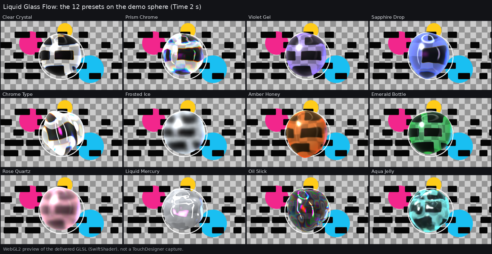
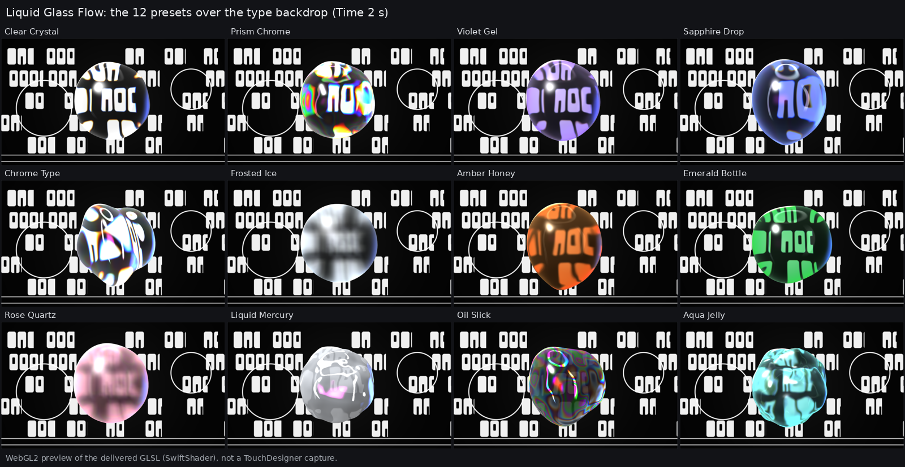
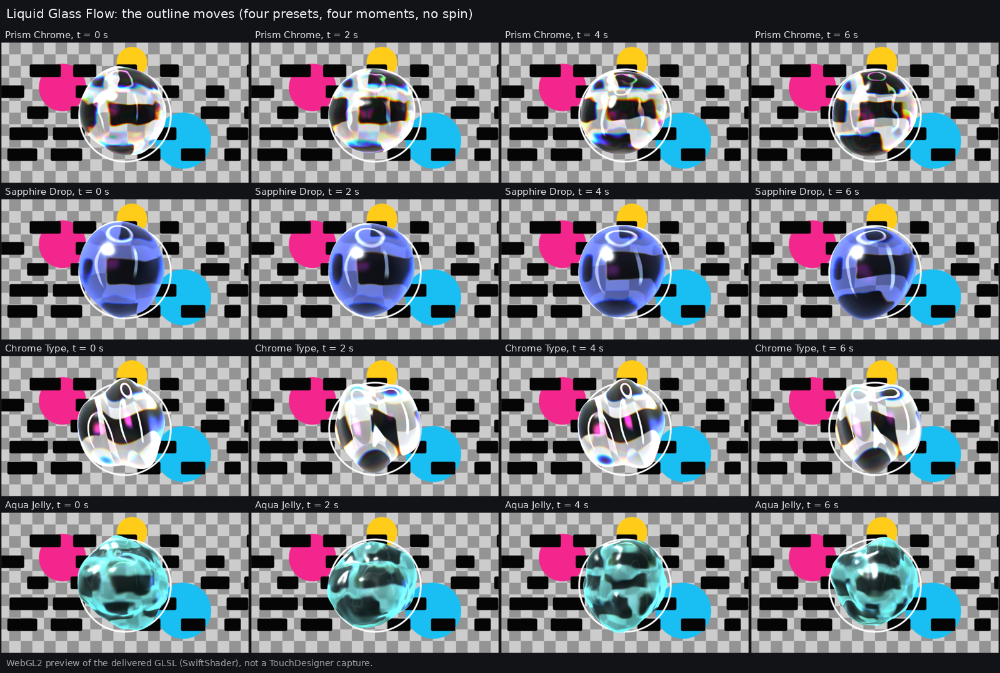
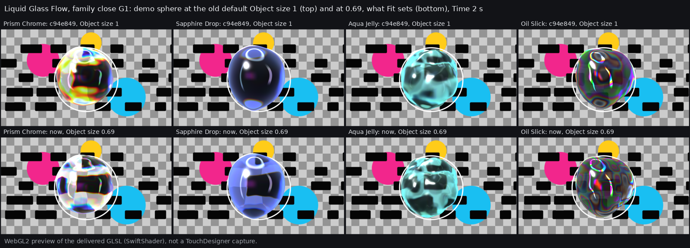

# Liquid Glass Flow for TouchDesigner

The Liquid Glass material, but the object's outline moves like liquid. Every point of the mesh rides an animated liquid field: slow swells, fine ripples, travelling waves and a gravity sag that gathers into drops. The surface normals are rebuilt for the moved shape, so refraction, rainbow fringes, reflections and highlights follow it. Put it on any mesh. All Liquid Glass controls and its twelve presets keep working, each preset now with its own motion.

[Tutorial: how it works](article.md) · [Research](research.md) · [Decisions](decisions.json) · [Review](review.md) · [Validation status](validation.json)







*WebGL previews of the delivered GLSL, over the two demo backdrops (**Study > Demo backdrop**: Checker and Type). TouchDesigner has not rendered this material yet; see [Status](#status).*

*This study moved from `studies/liquid-glass-flow/` to `examples/liquid-glass-flow/` in commit 66b4eb8. Records written before the move (sources.json, decisions.json, workflow.json, co-design.json, brief.md, research.md, the `derived_from` block in study.json, the presets.json note, checks/reference/ and checks/results/) cite the old path.*

## What you get

| File | What it is |
| --- | --- |
| `liquid_flow.vert` | **The new part.** Vertex shader: moves the surface and rebuilds its normals. |
| `liquid_flow.frag` | Pixel shader: the Liquid Glass look (the core study after the family close) plus one input and one teaching stage. |
| `build.py`, `builder.py` | Builds a ready `liquid_glass_flow` component in your project from the Textport. |
| `presets.json`, `presets.py`, `preset_exec.py` | The twelve looks with their motion, the preset loader, the morph and the clock that moves the liquid. |
| `backdrop.frag`, `env.frag` | Demo inputs: a high-contrast backdrop (checkerboard or bold type) and a studio panorama. |
| `study.json` | The recipe the builder follows: every node, parameter and uniform binding. |
| `native.py` | Helpers inside TouchDesigner: load an experiment, inspect, capture, export, fit the flow to an object. |
| `article.md` | The tutorial, with experiments you can load. |
| `checks/` | Compile check, WebGL preview, property tests against a float64 copy of the field, and unit tests (run outside TouchDesigner). `checks/core_reference/` holds the core study's current shaders, `checks/reference/` this study's shaders at commit 6a58487, so tests can compare. |

## Quick start

1. Download or clone this repository and note where this folder is.
2. In TouchDesigner, open the Textport (Dialogs > Textport and DATs) and run, with your own path:

   ```python
   import runpy
   component = runpy.run_path('/path/to/liquid-glass-flow/build.py')['build']()
   ```

3. A `liquid_glass_flow` component appears in `/project1`. Open its viewer: a glass blob swells over the demo backdrop. Pick a look from **Glass > Preset**, and a shape from **Study > Demo object**.

If the build prints warnings, they are grouped by what they affect, and stored in `component.fetch('build_warnings')`:

- **material**: a sampler filter or extend setting failed. The material works, but frost and reflection blur may look stepped, or blurred panorama reflections may show a seam. Set them by hand (see [Using the shader files by hand](#using-the-shader-files-by-hand), step 2).
- **inputs**: an Inputs field kept a Python expression instead of a path (see below).
- **dither**: a render's Dither switch could not be turned off. Turn it off by hand (Render TOP, Advanced page), so the image stays continuous.
- **optional**: the back-face pass could not be switched off with its toggle; it may cost render time while off.
- **demo** or **setup**: cosmetic, for example a renamed demo SOP parameter; the material itself is fine.

## Use it on your own objects

The material needs to see what is behind the glass. So you render your scene once without the glass and hand that image to the material. Then you draw the glass into that same render, so objects in front of the glass still cover it.

1. **Scene without glass.** Make a Render TOP (here `render_scene`) with your camera and every object except the glass. Drag it onto **Inputs > Refraction TOP** on the `liquid_glass_flow` component. Its background may be transparent: where it is, the glass lets whatever is behind it show through (see the notes).
2. **Reflections.** Drag a TOP onto **Inputs > Reflection TOP**: a 360 panorama (HDRI, Movie File In) with **Reflection map** = *360 panorama TOP*, or any image or render with *Flat image TOP*. For the built-in studio, set **Reflection map** to *Built-in studio*.
3. **Draw the glass into the scene.** Add a Render Pass TOP and wire `render_scene` into it. Set its **Camera** to your camera and its **Geometry** to the glass objects only. Turn off **Clear Depth Buffer** and **Clear to Camera Color**, so it keeps the scene's depth and colour. On its Advanced page, set **Override Material** to the component's material: drag the `material` node inside `liquid_glass_flow` onto the field, or type its absolute path (for example `/project1/liquid_glass_flow/material`). Keep its resolution, pixel format and anti-aliasing the same as `render_scene`. Its output is the finished image: the glass moves and bends the scene behind it, and anything in front of the glass still covers it. (Tested in the WebGL preview with an opaque ball in front of the moving glass: the ball stays exactly as in `render_scene`, while the Over TOP fallback (see the notes) paints the glass over it. Not yet checked in TouchDesigner.)
4. **Fit the flow and the glass to the object** (page **Flow fit**). Point **Inputs > Glass geometry** at your Geometry COMP and press **Fit to Glass geometry**. It reads the bounds of the SOP whose render flag is on and sets three values:
   - **Flow centre** and **Flow size** (the bounds' centre and half their largest side) in the SOP's own units, before the Geometry COMP's transform, because the motion happens there. The demo sphere has radius 1, so Flow size 1. Flow size sets the scale of the motion.
   - **Object size**: the object's size in the world, by the Liquid Glass family's rule (Liquid Glass and Liquid Glass Lit measure it the same way). That is half the largest side times the Geometry COMP's scale, divided by 1.45 (the radius of the Liquid Glass demo torus). The demo sphere fits to 0.69. Object size sets Thickness, Frost, Tint density and the ripple and film patterns.

   So a preset looks and moves the same on a 0.1-unit and a 10-unit object, whether you size it in its SOP or with the Geometry COMP's Scale, and on the same object it looks like Liquid Glass. You can also type the values. Presets and experiments never change them. One component fits one object: objects of very different sizes need their own `liquid_glass_flow` component.
5. **Choose the direction.** Keep **Displace along > Away from centre** for closed objects: it never tears the mesh, even at hard edges and UV seams, and its rebuilt normals are exact. Pick **Normal** for open sheets (grids, ribbons) and smooth meshes that wrap around the centre, such as a torus. It can tear meshes whose points have split normals, and its rebuilt normals are approximate: it treats the surface as flat around each point, so the error grows with Amplitude and curvature. In the preview tests the largest error is 4.5 degrees on the demo sphere and 10 degrees on the demo torus with a busy test field (Amplitude 0.15), and 9 degrees on the torus with Aqua Jelly; at Amplitude 0.5 it reaches 64 degrees on the torus. Refraction and highlights are off by that much at those points.
6. **Check the mesh density.** The motion only happens at the mesh's points. Keep about 8 points across the smallest bulge or ripple: for Ripple scale 4, about 32 points per flow size. A Sphere SOP's rows run from pole to pole, half way round, so a sphere of radius 1 (Flow size 1) needs about 100 rows and 200 columns for that. If the outline looks polygonal, raise the SOP's rows and columns or add a Subdivide SOP.
7. **Turn Dither off** on `render_scene` and the Render Pass TOP (Advanced page). The material never dithers, and the component's own renders have Dither off; this keeps the whole image free of dithering noise. (The documentation does not state the default; this is a precaution.)

Notes:

- Never put the glass itself in `render_scene`: the material would sample its own output.
- Override Material puts the glass on every object in that pass and leaves your Geometry COMPs untouched. One pass shows one look and one flow fit; for a second one, copy the component and add a second Render Pass TOP after the first.
- You can instead set each glass Geometry COMP's **Material** to the `material` node (drag it, or type the absolute path) and leave Override Material empty. With the back-face pass on, that creates a loop of parameter references (glass object, material, `render_back`, glass object), which TouchDesigner may report as a dependency loop; Override Material avoids it. Not yet checked natively.
- Not yet checked natively: that the material may sample `render_scene` while the Render Pass TOP draws on top of it. The Render Pass TOP documentation describes the TOP's image as a copy of its render buffer, so this should be safe. If TouchDesigner reports a problem, use the fallback: render the glass alone in its own Render TOP with a transparent background and lay it over `render_scene` with an Over TOP, as the demo inside the component does. That loses occlusion: objects in front of the glass are then painted over.
- **Transparent scene renders.** The material reads the Refraction TOP's alpha. Where the scene render is empty (alpha 0), the glass bends nothing there and blends with what is behind it instead, so a glass layer over a transparent background stays transparent, ready to lay over a plate later. This holds with the back-face pass on too. Limit: where the scene is only partly covered (alpha between 0 and 1, as on antialiased edges), that part of the scene is counted twice and looks slightly brighter and more opaque behind the glass.
- **Sizes and a scaled Geometry COMP.** Flow size is in the SOP's units, because the motion happens there; the Geometry COMP's scale then scales the moved object. Object size counts the COMP's scale, and the shader counts it in the ripple and film lookups, so after Fit a COMP-scaled object shows the preset's look (tested in the preview at COMP scale 0.1 and 10). If you type Object size by hand and then scale the COMP by k, the glass lengths stay as typed and the ripples and film bands become k times as many; press Fit again. A non-uniform scale counts as its average (the cube root of the volume change). For instances, see the next note.
- **One Object size per component.** Fit to Glass geometry measures when you press it, and its Flow size and Object size serve every object the component draws. Three setups break that. The numbers come from this study's own Fit code and uniforms ([review.md](review.md#family-critic-native-runs-and-one-object-size)):
  - *Objects of different sizes.* Fit reads only the first object in Glass geometry. An object a fifth of its size bends and tints as if it were five times larger, with Wobble ripples and film bands five times larger, and its motion is sized for the first object too. Give each size its own copy of the component and its own Render Pass TOP.
  - *A Geometry COMP Scale that changes or is animated.* The motion scales with the object, because it happens in the SOP's units. Thickness, Frost, Tint density and the Wobble ripples and film bands keep the world size Fit measured. Scaled up three times without a new Fit, the glass bends and tints as if it were three times smaller and shows three times as many Wobble ripples and film bands. Press Fit again after a scale change. For an animated scale, animate Object size by the same factor.
  - *Instances* (see **Instancing** below). The motion, the Wobble ripples and the film bands grow with each instance's own scale; Thickness, Frost and Tint density do not, so an instance scaled 3 bends and tints as if it were three times smaller. The Wobble ripples' tilt also ignores each instance's rotation, so on a turned instance they tilt the wrong way (gravity does undo it). For instances of different sizes, use one Geometry COMP and one copy of the component per size.

  A change that would let all three follow by themselves is proposed and waits for your decision ([decisions.json](decisions.json), *Family critic: one Object size per component*). It would also let Flow size and Object size become one value again. None of this has run in TouchDesigner.
- **Fog.** The glass takes the Camera COMP's fog (TDFog): it adds only its own share of the fog colour, because the scene behind it is fogged in its own render. Not yet checked natively.
- **Render Pick DAT/CHOP and extra colour buffers.** For picking, the vertex shader uses the form on Derivative's *Write a GLSL MAT* page (`#ifndef TD_PICKING_ACTIVE ... #else TDWritePickingValues(); #endif`): while picking, the point is still moved and placed, and only the `#else` block runs, which writes the moved positions and normals. In a render with several colour buffers, the glass writes zeros into buffers 1 and up, which leaves them as they were. Both are compile-checked only; native checks pending.

**The Inputs fields** start out pointing at the demo nodes. Drag a node onto a field or type its path to use your own; clear the field to leave it empty; right-click > Reset to Default brings the demo back. If the build printed an *inputs* warning, that field holds a Python expression instead of a path: switch it to constant mode first (click the field's mode indicator on its left), then edit it.

**Without a Refraction TOP** (field cleared), the glass can't bend anything. It then blends with whatever is behind it, using alpha: clear parts are see-through, tint and reflections stay. You lose refraction and dispersion. The glass must be drawn after the objects behind it: the Render Pass TOP above does that.

**Opacity below 1, or no Refraction TOP:** the glass writes depth, so the parts of one self-overlapping object can hide each other depending on triangle order. Set the render's **Transparency** to *Order Independent Transparency* in those cases. With a Refraction TOP and Opacity 1 this is not needed.

**Instancing.** Instances go through `TDDeform`, so instance positions, rotations and scales apply after the motion. All instances move the same way unless you raise **Instance variation**, which makes each instance read the field at a different place. Gravity points down in the world for every instance: the shader undoes the Geometry COMP's transform and each instance's own rotation and scale (`TDInstanceMat3()`). This is tested in the preview, not yet in TouchDesigner. Object size does not see an instance's own scale, and the Wobble ripples' tilt ignores its rotation (see *One Object size per component* above).

**Non-uniform scale.** The motion happens in the SOP's own space; the Geometry COMP's scale (even uneven) applies afterwards, and normals go through TouchDesigner's normal transform. A sphere stretched to an egg swells like an egg.

**Without normals.** A SOP with no normals still moves (always away from the centre), and the pixel stage should then build faceted normals from the screen (not yet checked natively). Give the SOP normals (for example its own Compute Normals option, or a Facet SOP) for smooth shading.

### Optional: back-face pass

Turn on **Inputs > Back-face pass** for thick shapes. Point **Camera** at your camera and **Glass geometry** at your glass object (for several, type their paths separated by spaces). The component then renders the inside of the glass once more (`render_back`), with the same shaders, so the inner surface moves identically. That gives measured thickness and visible inner surfaces.

- It costs one extra render, into a 32-bit float image: the distances it stores need that precision once the camera is tens of units away. It only renders while the toggle is on.
- With the default fields it renders the demo sphere and camera, so repoint both before you turn it on in your own scene.
- `render_back` takes the Refraction TOP's resolution (1280x720 without one). Keep your glass render at the same aspect ratio, or the thickness lookup drifts.

## Controls

### New in this study

**Flow page** (the motion; all of these are in the presets and morph)

| Control | What it does |
| --- | --- |
| Amplitude | How far the surface moves, as a fraction of Flow size. 0 = still glass, exactly like Liquid Glass with the same Object size. |
| Flow speed | How fast everything moves. Safe to animate: the liquid speeds up or slows down without jumping. 0 holds it still. |
| Swell, Swell scale | Big slow bulges, and how many fit across the object. |
| Ripples, Ripple scale | Fine fast ripples, and how many fit across the object. |
| Travelling waves, Wave length | A wave that sweeps across the object, and the distance between crests (in flow sizes). |
| Wave direction | Which way the waves travel (object space). Not in the presets. |
| Sag | Gravity pulls the lower half down into a teardrop. |
| Drip | Gathers the sag into one or two hanging drops. |

**Flow fit page** (your object; presets leave these alone)

| Control | What it does |
| --- | --- |
| Fit to Glass geometry | Sets Flow centre, Flow size and Object size from the object in Inputs > Glass geometry. Scripts call it `Fitglass`, as in every family member ([names across the family](../liquid-glass/README.md#names-across-the-family)). From Python, `component.op('study_tools').module.fit_glass(component)` does the same and returns what it measured; the helper has the same name in every member. `fit_flow()` is its old name, kept for one round. |
| Displace along | Away from centre (crack-free, exact normals, default) or Normal (open sheets, smooth meshes; approximate normals). |
| Flow centre | The object's centre in SOP units. Points move away from it in crack-free mode; sag hangs below it. |
| Flow size | About the object's radius (half its width) in SOP units (1 = the demo sphere). Sets the scale of every Flow control. Presets and experiments never change it. |
| Object size | The object's radius in the world (the Geometry COMP's scale counts) divided by 1.45, the radius of the Liquid Glass demo torus: the family's Object size, as in Liquid Glass and Liquid Glass Lit. The demo sphere fits to 0.69 (the default). Thickness and Frost are multiplied by it, Tint density and the ripple and film patterns divided by it, so presets carry over between small and large objects. Presets and experiments never change it. |
| Gravity direction | Which way is down, in world space. |
| Instance variation | 0 = all instances move alike; 1 = each moves differently. |
| Correct normals | Leave on. Turn off only to see what goes wrong without rebuilt normals. |

**Study page additions:** Teaching stage **Displacement** (orange where the surface moved out, blue where it moved in), **Demo object** (sphere, torus, box with hard edges, open grid) and **Demo detail** (rows of the demo shapes). The demo box is six separate grid faces merged together, so its edges repeat each point with different normals, like a default Box SOP but with points across each face. (A Box SOP with **Use Divisions** would not do: Derivative's page says such boxes do not render, because the divisions are open polygons.)

### Kept from Liquid Glass

These work as in the Liquid Glass study after the family close.

**Glass page**

| Control | What it does |
| --- | --- |
| Preset | Loads one of the twelve looks into all the sliders. *Custom* keeps your values. |
| Apply preset again | Reloads the chosen preset after you changed sliders. |
| Morph target, Morph | Blends every look and motion value toward a second preset (0 = sliders, 1 = preset B). Animate Morph for transitions: the motion changes speed smoothly. |
| Glass colour | The colour of the glass itself (white = clear). Values above 1 brighten the body; the tint itself never goes above 1, so the glass never amplifies what is behind it. |
| Tint density | How strongly the glass colour builds up with thickness. 0 = no tint. |
| Edge tint | Extra tint toward the silhouette, for deep-coloured rims. |
| Translucency | 1 = see-through, 0 = solid, milky body in the glass colour. |
| Opacity | Fades the whole object, reflections included. |
| Frost | Blurs the view through the glass, from clear to frosted. |

**Optics page**

| Control | What it does |
| --- | --- |
| Index of refraction | How much the glass bends light (1 = not at all, water 1.33, glass 1.5, diamond 2.4). |
| Thickness | Glass depth, in units of Object size (scene units while Object size is 1). More thickness, stronger bend and tint. |
| Dispersion | Splits light into rainbow fringes along edges. |
| Saturation | Colour intensity of what you see through the glass. |
| Samples | Quality vs speed for dispersion and frost (default 12; raise for heavy dispersion). |

**Reflection page**

| Control | What it does |
| --- | --- |
| Reflection map | 360 panorama TOP, flat image TOP (screen-mapped), or the built-in studio. |
| Reflection colour, Reflection amount | Tint and strength of reflections. |
| Mirror | 0 = glass-like (reflects mostly at the edges), 1 = reflects everywhere. |
| Energy conserving | Off (default, all presets): reflections add on top of the see-through view, as in Heckel's glow. On: what the surface reflects no longer also shows through, so Mirror 1 is a true mirror (liquid metal). |
| Reflection blur | Rough, blurry reflections. |
| Panorama rotation | Turns the panorama around the vertical axis. |
| Flat image warp | How far the flat image shifts with the surface. |
| Fresnel falloff | How tightly reflections and rim hug the silhouette (higher = thinner). |
| Rim colour, Rim glow | A glowing edge. |

**Light page:** Light direction (where the light comes from; 0, 0, 0 counts as straight up), Light colour, Specular (highlight strength), Shininess (higher = smaller, sharper highlight), Diffuse (soft lighting on the body).

**Liquid page:** Iridescence (oil-film rainbow sheen), Film thickness (shifts its colours), Film variation (how much the film swirls), Wobble (shading ripples; here they ride on top of the real motion), Wobble scale (ripples per Object size; they stick to the object, and the Geometry COMP's scale changes neither their count after Fit nor their strength), Wobble speed (changing or morphing it changes how fast the ripples and film drift, never where they are; 0 holds them still).

**Inputs page**

| Control | What it does |
| --- | --- |
| Refraction TOP, Reflection TOP | The scene behind the glass, and what it reflects. |
| Faces | Front only for closed objects, both sides for open surfaces like the demo grid. |
| Back-face pass, Camera | Optional measured thickness (see above). |
| Glass geometry | Your glass object: for the back-face pass and for Fit to Glass geometry. |
| Flip screen V | Escape hatch if the inputs arrive upside down (see troubleshooting). |
| Colour parameters | *Auto* follows the project's working colour space (see troubleshooting). |

**Study page:** Pause and Fixed time (for repeatable looks: with Pause on, flow time is Fixed time x Flow speed; unpausing continues the motion from that frame), Teaching stage (shows one ingredient at a time: normal, refraction, body, reflection, fresnel, thickness, film, screen UV, displacement), Demo spin, Demo backdrop (the demo scene behind the glass: *Checkerboard* or *Bold type on black*, the backdrop of the Liquid Glass Prism study, so contact sheets of the family compare), Demo render (turn it off once the material is on your own objects).

**From a script,** load a look with `component.op('presets').module.apply(component, 'violet_gel')` and set any overrides after it; the values are written at once. Setting the Preset menu from a script goes through its callback instead, which may apply the look at the end of the frame, over overrides set in the same script.

**Tutorial experiments:** `component.op('study_tools').module.apply(component, 'swell')` first returns these controls to their defaults, so experiments can run in any order: every preset value (look and motion), Morph and Morph target, Samples, Energy conserving, Panorama rotation, Flat image warp, Light direction, Back-face pass, Faces, Displace along, Correct normals, and Pause, Fixed time, Teaching stage, Demo spin, Demo object, Demo detail and Demo backdrop. Faces, Displace along and Correct normals are reset because the experiments vary them; set them again for your own object afterwards. It leaves your setup alone: Refraction TOP, Reflection TOP, Reflection map, Camera, Glass geometry, Flip screen V, Colour parameters, Demo render, and on the Flow fit page Flow centre, Flow size, Object size, Gravity direction, Wave direction and Instance variation (the component's viewer only shows experiments while Demo render is on). Experiments change the component's `material`, which your own glass objects share, so they change in your scene too; to keep a tuned look, run the tutorial on a second component. `apply(component, 'final')` brings back the default look, paused at 2 seconds with Preset on *Custom*: turn off **Study > Pause** to let it move again.

## The twelve presets

The look values are the Liquid Glass presets, unchanged. The motion is new.

| Preset | Look | Motion |
| --- | --- | --- |
| Clear Crystal | Colourless, crisp, gentle dispersion | A slow, gentle swell |
| Prism Chrome (default) | Strong rainbow dispersion, film sheen (reference 1) | A slow swell with fine ripples |
| Violet Gel | Lavender gel, deep violet rims (reference 2) | A heavy gel that sags a little |
| Sapphire Drop | Blue-violet magnifying drop (reference 3) | Sags into a hanging drop |
| Chrome Type | Reflective, sharp fringes over type (reference 4) | Travelling waves |
| Frosted Ice | Milky, blurred ice-blue | Almost still |
| Amber Honey | Dense warm amber | Slow and heavy: sinks and drips |
| Emerald Bottle | Green bottle glass | Low waves |
| Rose Quartz | Soft pink, half-frosted | A soft, slow swell |
| Liquid Mercury | Almost opaque liquid metal | Fast swell and ripples |
| Oil Slick | Dark glass, rainbow film | Waves and ripples |
| Aqua Jelly | Wobbly cyan jelly | Wobbly and quick |

Presets set look and motion values. They leave direction mode, Flow centre, Flow size, Object size, gravity, wave direction, light direction, panorama rotation, reflection map, inputs and samples alone.

## Using the shader files by hand

1. Two Text DATs with `liquid_flow.vert` and `liquid_flow.frag`; set a GLSL MAT's Vertex Shader and Pixel Shader to them; GLSL Version 4.60.
2. **Samplers page:** `sRefraction` (scene behind; Filter *Mipmap Linear*, Extend U and V *Mirror*), `sReflection` (panorama or image; Filter *Mipmap Linear*, Extend U *Repeat*, Extend V *Hold*), `sBackface` (Filter *Nearest*; when you don't use the back-face pass, point it at a small transparent Constant TOP and set `uInputs.z` to 0). Mipmap Linear gives smooth frost and reflection blur.
3. **Common page:** Blending on, Source Color = One, Destination Color = One Minus Source Alpha (the shader outputs premultiplied alpha), Separate Alpha Function off, Post-Mult Color by Alpha off. Cull Face = Back Faces for closed objects.
4. **Vectors page:** the fourteen Liquid Glass vec4 uniforms. Lengths are in scene units: with `size` = Object size (the object's world radius / 1.45), use Thickness x size, Frost x size, Tint density / size, Wobble scale / size and a film swirl frequency of 2.5 / size (size 1 gives the preset values as they are). The shader multiplies the ripple and film lookups by the Geometry COMP's scale itself.

| Uniform | x | y | z | w |
| --- | --- | --- | --- | --- |
| `uGlass` | glass R | glass G | glass B | tint density (per scene unit) |
| `uBody` | translucency | frost (scene units) | opacity | edge tint |
| `uOptics` | IOR | thickness (scene units) | dispersion | saturation |
| `uReflect` | reflection R | reflection G | reflection B | reflection amount |
| `uEnv` | map mode (0 panorama, 1 flat, 2 studio) | rotation (radians) | reflection blur | flat image warp |
| `uSurface` | mirror | fresnel falloff | diffuse | energy conserving (1/0) |
| `uRim` | rim R | rim G | rim B | rim glow |
| `uLight` | direction x | direction y | direction z | specular |
| `uLightColor` | light R | light G | light B | shininess |
| `uFilm` | iridescence | film thickness (nm) | film variation | film swirl frequency (2.5 / size; 0 = one film thickness over the whole object, no swirl; Wobble speed 0 stops the drift) |
| `uWobble` | wobble | scale (ripples per scene unit, laid out on the object) | speed | 0 |
| `uPhase` | drift at 0.6 x speed per second | drift at 0.4 x speed per second | drift at -0.3 x speed per second | drift at 0.15 x speed per second |
| `uState` | teaching stage (0 = final) | pass (0) | samples | flip V (0) |
| `uInputs` | refraction TOP connected (1/0) | reflection TOP connected (1/0) | use back-face TOP (1/0) | convert colours from sRGB (1/0) |

5. Six more vec4 uniforms for the motion:

| Uniform | x | y | z | w |
| --- | --- | --- | --- | --- |
| `uFlow` | amplitude (x flow size) | 0 (unused) | direction (0 normal, 1 from centre) | flow time (see below) |
| `uFlowShape` | swell | swell scale | ripples | ripple scale |
| `uFlowWave` | waves | wave length (flow sizes) | sag | drip |
| `uFlowAxis` | wave direction x | y | z | correct normals (1/0) |
| `uFlowSpace` | flow centre x | y | z | flow size (SOP units) |
| `uFlowGravity` | gravity x (world) | y | z | instance variation |

Values for each preset are in `presets.json`.

6. **Flow time and drift.** The shaders want time already multiplied by speed and wrapped to a small number. Flow time (`uFlow.w`) is Flow speed added up over time, wrapped to 0..25600: every drift in the flow noise has then moved a whole number of 256-cell repeats, so the wrap is invisible. Each `uPhase` value is its rate x Wobble speed added up, wrapped to 0..256 (the ripple and film noise repeats every 256 units). With speeds that never change while it runs, `(Flowspeed * absTime.seconds) % 25600` and `(0.6 * Wobblespeed * absTime.seconds) % 256` are enough. If a speed changes or is animated, add `speed * absTime.stepSeconds` to the previous value every frame instead; multiplying by `absTime.seconds` makes the pattern jump by the change in speed times every second since TouchDesigner started. `presets.py` (`flow_time()`, `phase()`) adds them up.
7. **Picking and colour buffers.** For a Render Pick DAT or CHOP, TouchDesigner defines `TD_PICKING_ACTIVE`, and of the vertex shader's `#ifndef TD_PICKING_ACTIVE ... #else ... #endif` branch only the `#else` block runs. Before the branch the point is moved and placed as in every render; the `#else` block writes TouchDesigner's pick values, then the moved positions and normals. If the render has more than one colour buffer, the pixel shader writes zeros into buffers 1 to 7. Both follow Derivative's *Write a GLSL MAT* page and compile here; neither has run in TouchDesigner yet.
8. **Back-face pass by hand (optional):** a second GLSL MAT with the same shaders and uniforms, but `uState.y` = 1, Blending off and Cull Face = Front Faces. A Render TOP with your camera and the glass objects, Override Material = that second MAT, Pixel Format 32-bit float RGBA, Background Color alpha 0 and Pre-Multiply RGB by Alpha off, at the aspect ratio of your glass render. Point the first material's `sBackface` at it and set `uInputs.z` to 1.
9. **Dither off:** in each Render TOP or Render Pass TOP that draws the glass, the back-face pass included, turn Dither off (Advanced page) to keep the image free of dithering noise.

## Troubleshooting

- **Cracks along edges.** Displace along is set to Normal on a mesh with split normals. Use Away from centre, or consolidate the points (Facet SOP) first.
- **The outline looks polygonal, or bulges look like facets.** Too few points for the field. Raise the mesh density, or lower Ripple scale and Swell scale.
- **The motion is tiny, or huge.** Flow size does not match the object. Press Fit to Glass geometry, or set Flow size to about the object's radius in SOP units.
- **The glass looks too thick or too thin, or its ripples too fine or too coarse.** Object size does not match the object, often after scaling its Geometry COMP. Press Fit to Glass geometry again.
- **The surface slides instead of bulging** (top of a torus tube, a flat sheet). Use Displace along > Normal, or move Flow centre.
- **Spikes or folds.** Amplitude is too large for the scale. Keep Amplitude times the largest scale below about 1. Where the surface does fold through itself, the rebuilt normal has no reliable direction, so those points keep their original normal.
- **A sheet through the flow centre does not bulge.** In Away from centre mode the points of a flat sheet through the centre only slide within the sheet (the point at the centre stays put). Use Normal, or move Flow centre off the sheet.
- **Highlights look slightly off in Normal mode.** Its normals are approximate on curved meshes (see step 5). Use Away from centre where its sideways sliding is acceptable, or lower Amplitude.
- **The glass looks black or shows itself.** The Refraction TOP is empty, or it includes the glass object. Render the scene without the glass.
- **Objects in front of the glass disappear behind it.** The glass is rendered on its own and laid over the scene. Draw it with the Render Pass TOP from [Use it on your own objects](#use-it-on-your-own-objects), step 3.
- **Refraction looks upside down.** The material measures which way the screen runs at every pixel, so a build whose screen runs the other way should still bend light correctly. If the Refraction TOP itself arrives upside down relative to the render, turn on **Inputs > Flip screen V**: it flips the screen position and every vertical offset together. It shouldn't be needed; if it is, please note your build.
- **A single pixel on a glass edge near the middle of the render looks too bright or too dark.** With antialiasing, a silhouette pixel that the glass only partly covers is shaded at its centre, outside its own triangle. Near the render's centre row or column its point can project to the other side, so it takes the wrong screen orientation and bends the wrong way. In the preview this changes at most 4 pixels in twelve frames, by up to 38/255, in TouchDesigner's usual orientation too. Whether you can see it in TouchDesigner is an open family question; if you do, please note your build and where the pixel is (validation.json, check `centre_line_residual`).
- **Frost or blurry reflections look stepped.** The build printed *material* warnings, or the sampler filter isn't Mipmap Linear (check `material`'s Samplers page). Raising Samples also helps frost.
- **Blurred panorama reflections show a seam.** `sReflection`'s Extend U isn't Repeat (check `material`'s Samplers page).
- **Rainbow fringes look banded.** Raise Samples (16–24). At the default 12 on the moving demo sphere, Dispersion 1 already matches a 64-sample render within 1/255 on average at the presets' own Thickness in the preview (within 2.5/255 at Thickness 2.5), but very thick glass on a large, sharp-edged scene can still show steps.
- **The glass turns a transparent scene background black or opaque.** Components built before the family sync ignored the Refraction TOP's alpha. Build a new component.
- **The liquid or the ripples jump while Morph or a speed changes, or two components move in step.** Components built before the family sync kept one clock per parameter name and read absTime in their expressions. Build a new component.
- **Slow.** Lower Samples, set Reflection blur and Wobble to 0, keep the Refraction TOP at the render's resolution, leave the back-face pass off, and lower the mesh density if it is far above what the motion needs. Once the material is on your own objects, turn off **Study > Demo render** and close the component's viewer: a visible viewer keeps the demo render cooking every frame.
- **Colours look different from the preview.** Check **Inputs > Colour parameters**. *Auto* keeps colours as typed in a pass-through project (the default) and converts them from sRGB to linear when the project uses a linear working colour space, as TouchDesigner does for its own colour parameters. The conversion covers the sRGB curve only, so in ACEScg, P3 or Rec.2020 projects colours look slightly more saturated. *As typed* and *sRGB* force either behaviour. Not yet checked natively.
- **Geometry without normals looks flat or wrong.** The shader should then build faceted normals itself (not yet checked natively). If it doesn't, add normals in the SOP chain, for example with a Facet SOP (Compute Normals).
- **Errors after building.** Look at the `info_material` DAT inside the component for compile messages, and at `info_render` and `info_render_back`: each render compiles its own copy of the material, so errors can show there instead. `component.op('study_tools').module.inspect(component)` also lists script errors (for example from the preset callback), the errors and warnings of the TOPs and COMPs your Inputs fields point at, and under `render_diagnostics` those of every Render and Render Pass TOP in the project that draws the material.
- **Fit to Glass geometry does nothing.** Set **Inputs > Glass geometry** first; the Textport shows what it measured.

## Look decisions waiting for you

The family close changed how the demo looks, and you have not accepted that change yet. The question below has options and a recommended answer. Reply "defaults" to take the recommended option, or name the decision and an option, for example "LOOK-F1 B". Until you answer, the code stays as it is: the unit test class `LookDecisions` fails if it changes. [co-design.json](co-design.json) (`look_decisions_for_user`) has the full text; [checks/results/look-decisions.json](checks/results/look-decisions.json) has the measurements.

| Decision | Question | Options | Recommended |
| --- | --- | --- | --- |
| LOOK-F1 | Which default Object size should the demo use? | **A** Keep 0.69, what Fit sets on the radius-1 demo sphere (in the code now). Against the old default 1, the glass is thinner relative to the sphere, so it bends and blurs less, and its ripples and film bands are 1.45 times finer. **B** Go back to 1: the old look, but pressing Fit on the demo then sets 0.69 and the look jumps. **C** Keep 0.69 and give Flow its own presets, with the lengths scaled by 1.45: the old lengths and ripples, finer film, and presets that no longer equal the core's. | **A** |



A bigger demo sphere is not a way back to the old look. A sphere of radius 1.45 at Object size 1 renders the same image as today (measured: at most 4/255 apart), because the glass lengths follow the object.

## Status

Verified here (see [validation.json](validation.json)): GLSL 4.60 and Vulkan SPIR-V compile with glslang against stand-ins for TouchDesigner's built-ins, also with picking active and with three and eight colour buffers, and two deliberately broken copies fail; a WebGL2 render of the same files passes forty-four property tests, among them "Amplitude 0 renders all twelve presets exactly like the current core Liquid Glass, also on a COMP-scaled torus and at an odd render size", "rebuilt normals are within 0.5 degrees of float64 finite-difference normals of the moved surface, also after 24 hours and a week of flow, and within 1 degree at the Amplitude maximum, where the surface is squeezed", "the motion matches a float64 copy of the field", "a morph frame an hour into a session changes the image no more than at 2 seconds", "invisible moving glass over a transparent scene leaves it transparent", "a preset looks and moves the same on a 0.1-unit and a 10-unit object, sized in its SOP or by its Geometry COMP (within 2/255 at every pixel for the COMP)", "the screen orientation is right at every glass pixel but a known few, on the centre lines too", "a build whose screen runs the other way renders the mirror image", "gravity stays world-down for rotated instances", "crack-free mode keeps coincident vertices together" and "an object in front of the moving glass stays in front with the Render Pass TOP route, and an Over TOP paints the glass over it"; ninety-one unit tests of the preset module and its clock, the preset callback, the tutorial experiments run in every order with your setup kept, Fit to Glass geometry (both sizes, the same Object size as Liquid Glass's own Fit, and the helper's name, `fit_glass()`, in every member), the recipe, the shader source (no dithering, extra colour buffers, what a pick render runs, hygiene rules), the native helpers, a builder dry run, the COMP-scale preview test's 2/255 bound and the records of the open centre-line question; the plugin's static checker and tutorial checker. Two reviews, a family sync and the family close are recorded in [review.md](review.md).

**Not yet run in TouchDesigner:** native compile, render, the builder (including the Inputs fields' links to the demo, the renders' Dither switch, the demo SOP parameters and the six-face demo box), the preset callback, the frame-by-frame clock in a running project, the Render Pass TOP workflow, Fit to Glass geometry (both sizes, a COMP-scaled object too), instancing (including `TDInstanceMat3()` for gravity), the back-face pass, Colour parameters *Auto*, picking with the documented branch, extra colour buffers, fog, the screen orientation on your build (an odd render size too), the antialiased centre-line residual (an open family question), export to `.tox`, and performance. Run the Quick start on your machine and check `info_material`.

## Credits

Vertex displacement by a noise of the position follows Maxime Heckel's Blob in [The Study of Shaders with React Three Fiber](https://blog.maximeheckel.com/posts/the-study-of-shaders-with-react-three-fiber/). Rebuilding normals from displaced neighbours follows his [Caustics in WebGL](https://blog.maximeheckel.com/posts/caustics-in-webgl/) and [Field Guide to TSL and WebGPU](https://blog.maximeheckel.com/posts/field-guide-to-tsl-and-webgpu/), which credit the method to Marco Fugaro. The glass look comes from the Liquid Glass study, after Heckel's [Refraction, dispersion, and other shader light effects](https://blog.maximeheckel.com/posts/refraction-dispersion-and-other-shader-light-effects/); through the core's family sync it carries ideas from the other family members (the Refraction TOP's alpha and fog from Liquid Glass Blobs, the measured screen orientation and the type backdrop from Liquid Glass Prism, Dither off, the output cap and render diagnostics from Liquid Glass Lit) and Martin Roberts' R2 sequence for the frost. The TouchDesigner material, crack-free mode, units, gravity, the folded noise drift, presets' motion and tests are new for this study. See [sources.json](sources.json). This study is not authored or endorsed by Maxime Heckel; the repository's [NOTICE.md](../../NOTICE.md) covers licensing.
