# Liquid Glass Flow: glass whose outline moves like liquid

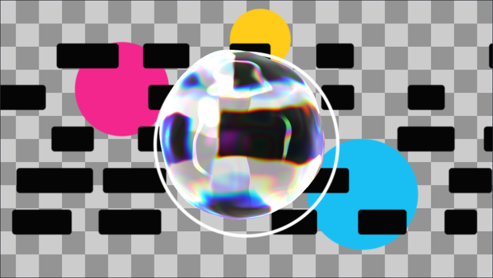

*The destination: the default look on the demo sphere. This image is a WebGL preview of the same GLSL files, not a TouchDesigner capture.*

The Liquid Glass material (the study in `examples/liquid-glass`, as it stands after its family sync) bends, splits and tints whatever is behind an object. Its Wobble control ripples the shading, but the outline of the object never moves: a sphere stays a perfect circle against the background. This study makes the outline itself flow. Every point of the mesh moves with an animated liquid field: slow swells, fine ripples, travelling waves and a gravity sag that gathers into drops. The material then rebuilds the surface direction (the normal) at every point, so refraction, reflections and highlights follow the new shape.

It works on any mesh you put it on, and it keeps the whole Liquid Glass look: all of its controls and its twelve presets. This tutorial is written for TouchDesigner users who have not written shaders before. Every code block below is copied automatically from the delivered files, so what you read is what runs.

The moving surface follows ideas from Maxime Heckel's articles: the Blob in [The Study of Shaders with React Three Fiber](https://blog.maximeheckel.com/posts/the-study-of-shaders-with-react-three-fiber/), and the way his [Caustics in WebGL](https://blog.maximeheckel.com/posts/caustics-in-webgl/) and [Field Guide to TSL and WebGPU](https://blog.maximeheckel.com/posts/field-guide-to-tsl-and-webgpu/) articles rebuild normals after moving vertices (a method he credits to Marco Fugaro). Those are web scenes. The TouchDesigner material, its crack-free mode, units, gravity and tests are new; each change is pointed out where it happens.

## Open the study

Build the component from the Textport, keeping it in a variable named `component` so the experiment commands below work:

```python
import runpy
component = runpy.run_path('/path/to/liquid-glass-flow/build.py')['build']()
```

Open the component's viewer. Each experiment below is a named preset that fixes time and every unrelated control, then changes one thing. Running an experiment first returns the look to its defaults: every preset value (look and motion), Morph, Samples, Energy conserving, the light direction, panorama rotation and flat image warp, the back-face pass, Faces, Displace along, Correct normals and the Study page. So you can run the experiments in any order. Your setup stays as it is: the Refraction and Reflection TOPs, Reflection map, the back-face camera and glass geometry, Flip screen V, Colour parameters, Demo render, and your object's flow fit (Flow centre, Flow size, Object size, gravity, wave direction, instance variation). `component.op('study_tools').module.apply(component, 'final')` brings back the default look, paused at 2 seconds with the Preset menu on *Custom*; turn off **Study > Pause** to let it move again. Experiments change the component's `material`, so glass in your own scene that uses it changes too: if you have tuned this component, build a second one for the tutorial. **Study > Teaching stage** shows one ingredient at a time, and **Study > Demo object** swaps the demo shape (sphere, torus, box, grid).

The pictures under each experiment come from a WebGL preview that runs the same shader files in a browser. They show what the code does; they are not proof of how TouchDesigner renders it. When you run an experiment natively, compare against the stated prediction.

A GLSL MAT holds two small programs that the graphics card runs for you. The **vertex shader** runs once per point (vertex) of the mesh and decides where it lands. The **pixel shader** runs once per pixel the object covers and decides its colour. Liquid Glass does almost everything in the pixel shader. This study adds its work to the vertex shader.

## Start from still glass

What does the flow material keep from Liquid Glass, and how can we be sure nothing else changed?

The pixel shader, `liquid_flow.frag`, is the current Liquid Glass pixel shader with two small additions: one more input and one more teaching stage. A test compares every added and removed line with that list, and another renders the moving glass through both pixel shaders and finds no difference in the final image (`pixel_stage_matches_core_while_moving`). When the core study changes, this file is rebuilt from it and both tests run again. It was last rebuilt on the core's family-close version (2 November 2026). Earlier rebuilds brought the scene's alpha, fog, the measured screen orientation, safer maths and the Object size scaling of the glass lengths; the family close added ripple and film patterns that count the Geometry COMP's scale and a tie-break for the screen's centre lines. The new work lives in the vertex shader, `liquid_flow.vert`. It starts by reading the point's rest position and normal from the mesh. `TDPos()` and `TDNormal()` are TouchDesigner's way to ask for them.

{{code:liquid_flow.vert:rest}}

The vertex shader ends by handing the moved point to TouchDesigner: `TDDeform()` applies the object's transform (and instancing, if any), `TDDeformNorm()` does the same for the normal, and `TDWorldToProj()` places the point on screen. Every render runs those lines. Then a branch writes what the pixel stage reads. The rest position goes there as `vObjPos`: the glass's own surface ripples and its oil film read it, so they stay glued to the material while the shape moves. A Render Pick DAT or CHOP renders with `TD_PICKING_ACTIVE` defined, and then only the `#else` block runs, as Derivative's *Write a GLSL MAT* page shows. It writes TouchDesigner's pick values, then replaces the positions and normals with those of the moved surface, so a pick lands on the liquid's real outline (compile-checked; not yet run in TouchDesigner).

{{code:liquid_flow.vert:transforms}}

When **Amplitude** is 0, the vertex shader skips every flow step and does exactly what the Liquid Glass vertex shader does. That gives a firm baseline.

{{experiment:core_match}}

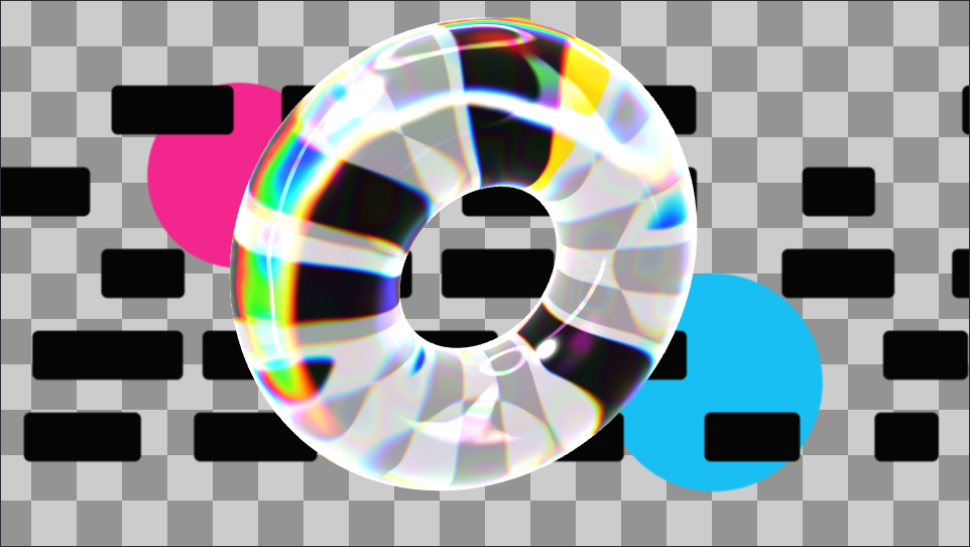

*Preview:* the familiar Liquid Glass torus. An automated test renders all twelve presets with Amplitude 0 next to the current Liquid Glass shaders (copied into `checks/core_reference/`) at the same settings, Object size included: every pixel matches exactly, maximum difference 0 (`amplitude0_matches_core`). It also does so on a torus scaled 3 by its Geometry COMP, where both Fits set Object size 3, and at the odd size 481 x 271 in a flipped raster, where the screen's centre row needs the core's tie-break. The flow demo camera sits a little closer (4 units instead of 5), so the torus looks larger here than in the Liquid Glass demo. The glass is also a little thinner here than in the Liquid Glass demo: Object size keeps its default, 0.69, what Fit sets on the demo sphere; Fit on this torus would set 1, the Liquid Glass default.

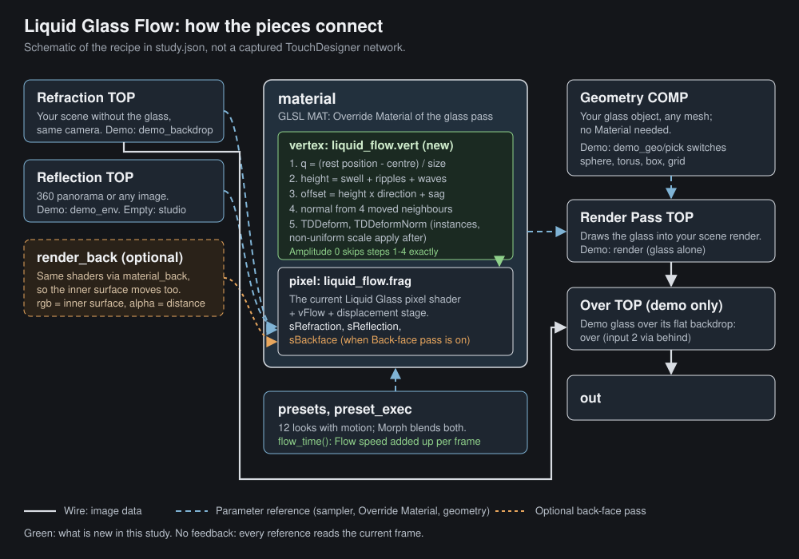

The diagram is a schematic of the recipe, not a captured network. Solid lines carry images, dashed lines are parameter references, the orange path is the optional back-face pass, and green marks what is new. In your own scene a Render Pass TOP draws the glass on top of the scene render and its output is the final image; the Over TOP belongs to the demo, whose backdrop is a flat picture.

## Paint a liquid field on the surface

How does one number per point become something that looks like liquid?

The smallest model is Heckel's Blob: take a smooth noise of the point's position, and push the point outward by that amount. Noise is "organic randomness": random, but changing smoothly from one place to the next. Feed it a time value and it drifts.

Here the field is a sum of three ingredients. **Swell** is two slow layers of noise: a few big bulges. **Ripples** is one finer, faster layer. **Waves** is a sine wave that travels along **Wave direction**, like a swell crossing a pool. Each has a strength, and a scale that sets how many bulges, ripples or wave crests fit across the object.

Positions are measured in **flow sizes**, from the **Flow centre** (both on the **Flow fit** page). A GLSL MAT cannot see how big its object is, so you tell it once: **Flow size** is about the object's radius, in its SOP's own units. The **Fit to Glass geometry** button measures it for you from the object's SOP. With it set, Amplitude 0.1 means "a tenth of the radius", and a preset moves the same on a sphere of radius 1 and on a model ten times bigger (a test moves a 10x sphere away from the origin and gets the same motion, scaled).

The glass's own lengths use a second size, **Object size**, which the same button sets: the object's radius in the world divided by 1.45, the radius of the Liquid Glass demo torus. This is the Liquid Glass family's rule for Object size (Liquid Glass and Liquid Glass Lit measure it the same way), so a preset looks the same here as in Liquid Glass on the same object. Object size scales Thickness, Frost, Tint density and the ripple and film patterns, so the whole preset carries over. One test renders four presets on spheres built with radius 0.1 and 10 (`object_size_carries_presets_over`). Another scales the demo sphere 0.1 and 10 times with its Geometry COMP (`fit_size_carries_presets_over_comp_scale`). Each moves the camera to match, and neither finds a pixel more than 8/255 from the unscaled image. The second is stricter: it fails if any pixel is more than 2/255 off, and it measures 1/255. Why two sizes? The motion happens in the SOP's space, before the Geometry COMP's transform, so it needs a size in SOP units. The glass is seen in the world, so its size counts the Geometry COMP's scale.

{{code:liquid_flow.vert:field}}

Each noise reads the position times its scale, shifted by a **drift** that grows with time, so the pattern slides through the object. `t` is the **flow time**: Flow speed added up frame by frame (the presets section explains why). `seed` moves an instance to another place in the field. `driftNoise()` is ordinary noise with one precision trick, shown with the cost of the noise further down.

To see the field, the vertex shader also passes how far each point moved outward (`vFlow`) to the pixel shader. The **Displacement** teaching stage turns it into colour, the same way Heckel's Blob colours its sphere by its displacement:

{{code:liquid_flow.frag:flowstage}}

{{experiment:swell}}

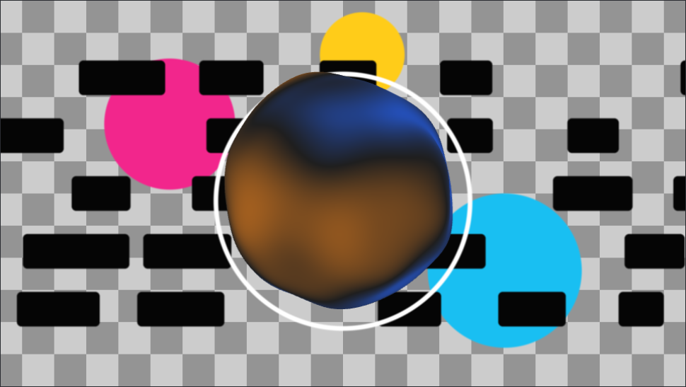

*Preview (Displacement stage):* a few large, soft-edged orange and blue regions; the outline already bulges where the colour is orange.

{{experiment:ripples}}

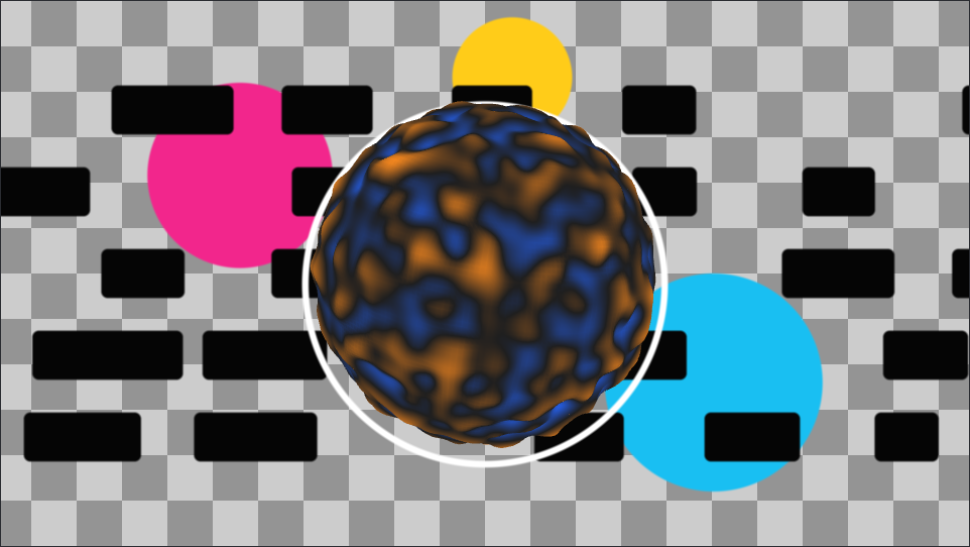

*Preview:* the same two colours in many small patches, and a finely bumpy outline.

{{experiment:waves}}

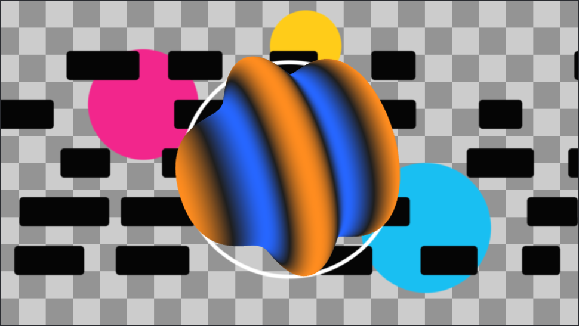

*Preview:* clean orange and blue bands across the sphere, and a wavy outline where the bands meet the edge.

## Push the points: which way?

Which way should a point move, and why do some meshes tear?

The Blob pushes each point along its normal. On a smooth sphere that is perfect. But many meshes store several copies of one point. A cube from TouchDesigner's Box SOP is made of six separate faces, so each corner exists four times, each copy with its own face's normal. Hard-edged models and some UV seams do the same. Push those copies along their own normals and they separate: the surface tears open along every edge.

The fix is a direction that depends only on *where* the point is, not on which face it belongs to. **Away from centre** uses the direction from the flow centre to the point. Copies of one point share a position, so they share a direction and a field value, and they move together. This is the default. The trade-off: where the surface does not face away from the centre, part of the motion slides sideways along the surface instead of pushing it out. On the top of a torus tube or on a flat sheet through the centre, the motion shows less. For smooth meshes and open sheets, choose **Displace along > Normal**. Geometry with no normals at all always uses the centre direction.

{{code:liquid_flow.vert:direction}}

Very close to the centre (within 0.05 flow sizes) the direction fades to zero. A point exactly at the centre has no "away", and without the fade it would jump out along its own normal while its neighbours stay in the sheet. A test checks that no point of the demo grid leaves its plane in crack-free mode (`centre_point_stays_on_sheet`).

The offset combines the field, the direction and the gravity sag (next section), all scaled by Amplitude. Note that the field reads the position only, never the UV coordinates: UV seams cannot split it either.

{{code:liquid_flow.vert:offset}}

The main function puts it together: convert to flow sizes, look up gravity, move the point, then rebuild its normal.

{{code:liquid_flow.vert:move}}

{{experiment:silhouette}}


*Preview:* the sphere's outline is no longer a circle. An automated test counts the pixels the glass covers: raising Amplitude from 0 to 0.06 changes 944 of them, and to 0.18 changes 2613 (`silhouette_coverage_changes`, at 480 x 270).

{{experiment:cracks}}

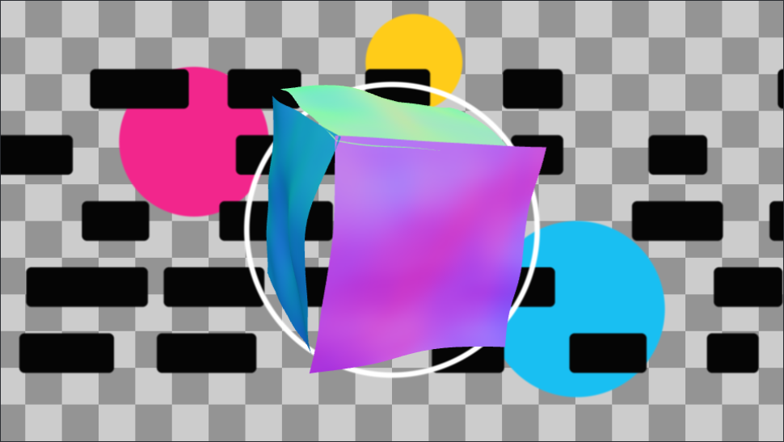

*Preview (Normal stage):* gaps open along the box's edges where the swell pushes outward, and the backdrop shows through.

{{experiment:crack_free}}

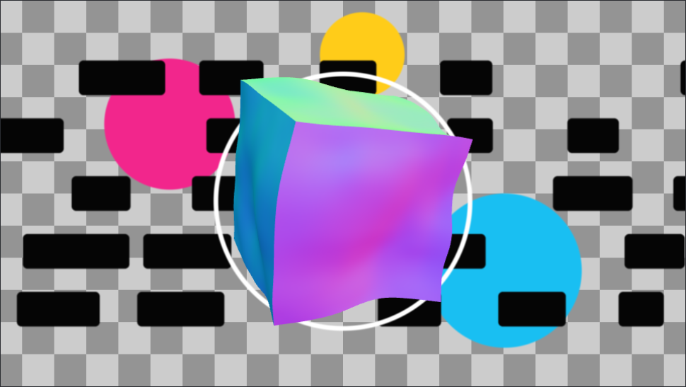

*Preview:* the same swell with closed edges. The faces keep distinct colours because each copy keeps its own face's normal. A test groups the box's vertices by position: in crack-free mode every copy of a position lands in exactly the same place (largest gap 0) and the render has no holes; along the normal the copies drift up to 0.24 units apart and 702 background pixels show through (`crack_free_keeps_coincident_vertices_together`).

{{experiment:open_sheet}}

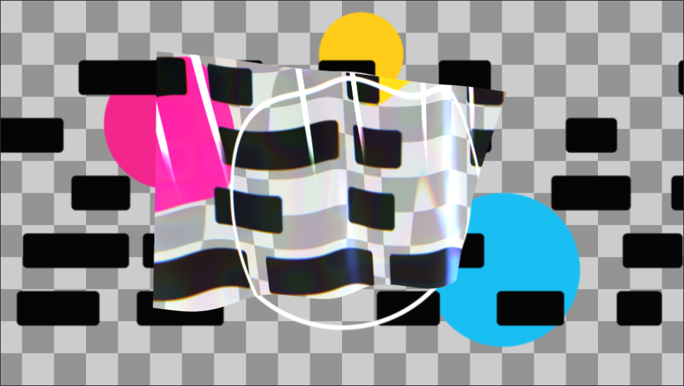

*Preview:* the grid ripples with travelling waves and bends the backdrop like a sheet of moving water.

## Let gravity pull

How do we make the liquid hang and drip?

**Sag** pulls the part of the object below the flow centre along **Gravity direction**, more the lower it is. The result is a teardrop. **Drip** varies that pull across the object with a slow noise, so the sinking gathers into one or two hanging drops instead of one even bulge. Gravity is given in world space, so it keeps pointing down while the object spins: the shader turns it into the object's own space with `worldInverse`, then undoes each instance's own rotation and scale with `TDInstanceMat3()`. A test spins, tilts and stretches the object, draws it as a rotated instance, and finds every sagging point moving straight down in the world (`gravity_stays_world_down`). Because the sag depends on position only, it never tears a mesh, whatever Displace along says.

{{code:liquid_flow.vert:sag}}

{{experiment:sag_drip}}

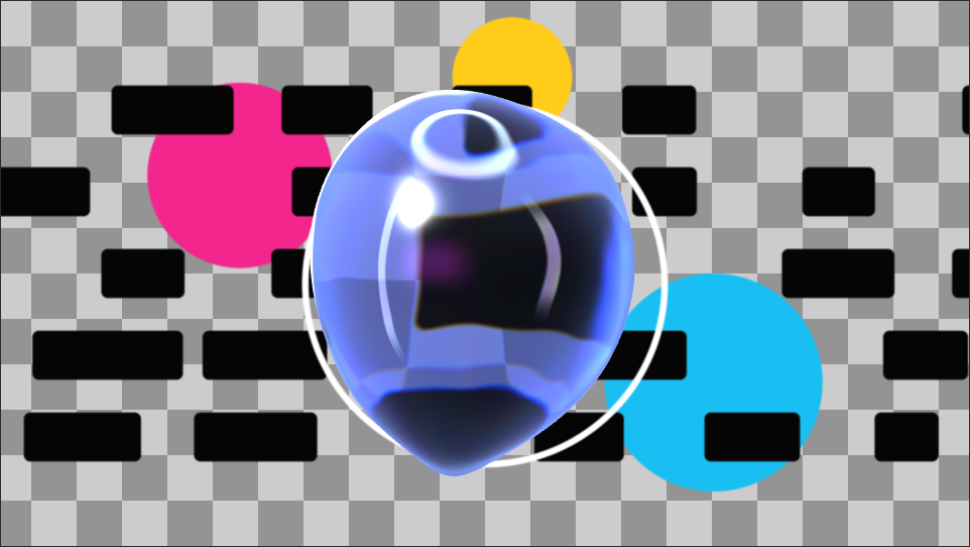

*Preview:* the lower half stretches into a rounded drop while the top stays round, like reference image 3's blue blob.

## Rebuild the normal

Why does a moved surface still shade like the old one, and how do we fix it for any field?

Every look in the glass depends on the normal: how far light bends, where the edges glow (fresnel), where highlights sit. The mesh's normals describe the *old* surface. Move the points without touching the normals and the outline is lumpy while the shading still believes it is a sphere.

The archived method is simple to picture. Take two tiny steps away from the point, along two directions that lie in its surface. Move both stepped copies with the same field. The two moved steps now lie in the *moved* surface, so their cross product points straight out of it: that is the new normal. Heckel's caustics and TSL articles step to one side only. Here each step goes both ways (central differences), which is more accurate for the same nudge size, and the steps are taken in flow sizes around the point, so where the object sits in the scene costs no precision. In crack-free mode the stepped copies also get their own direction, so the result is the normal of the moved surface, up to a tiny step error (measured below). In Normal mode they reuse the point's normal, which treats the surface as locally flat.

The best part: the method never looks inside the field. Add a new ingredient to `liquidHeight()` and its normals are right automatically.

One case needs care. The cross product's length is the area of the tiny moved patch. Squeezing the surface shrinks that area but keeps its direction, so a squeezed point still gets the right normal. Only where the surface folds through itself does the area drop to almost nothing, and then float rounding decides the direction. So the code keeps the original normal only below a thousandth of the patch's rest area, a threshold measured against the nudge itself.

{{code:liquid_flow.vert:normals}}

{{experiment:wrong_normals}}

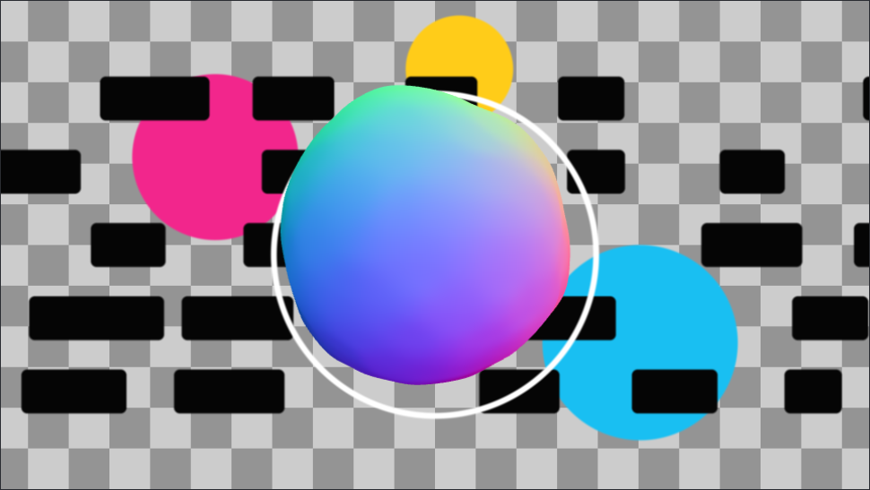

*Preview (Normal stage, which shows normal directions as colours):* a smooth sphere-like colour gradient inside a lumpy outline.

{{experiment:corrected_normals}}

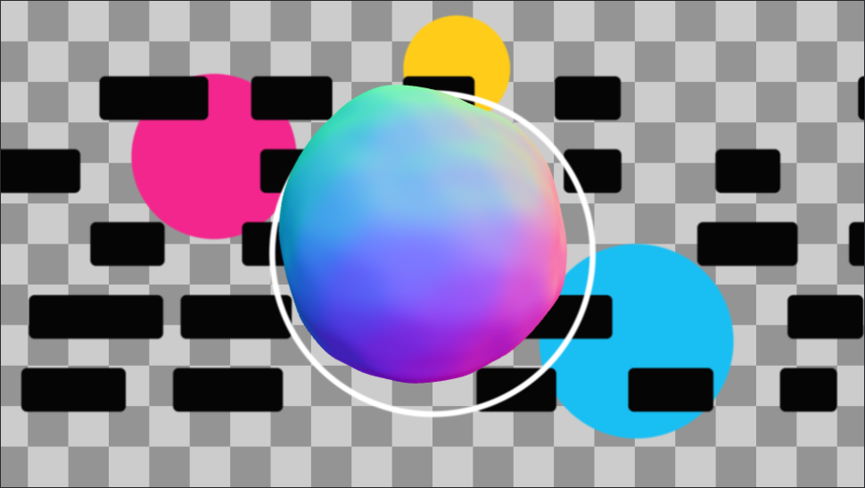

*Preview:* the colours now bend around each bulge and dent. A test confirms the outline is identical with the toggle on or off (0 pixels of coverage change); only the shading differs (`correct_normals_changes_shading_not_silhouette`).

How exact is it? A test compares the shader with `checks/flow_reference.cjs`, a copy of the field in 64-bit JavaScript numbers that builds the normal of the moved surface from steps of a millionth of a unit. On every vertex of a sphere, in crack-free mode, the two agree within 0.17 degrees in nine cases: a busy field (swell, ripples, waves, sag and drip together), the same rotated and stretched unevenly (scale 1.6, 0.7, 1.1), the finest scales the controls allow, waves in their own direction, a strong drip, an instance with variation, a 10x sphere away from the origin, and after 24 hours and a week of flow. The stated tolerance is 0.5 degrees (`normals_match_finite_differences`); positions agree within 0.0001 flow sizes (`motion_matches_float64_reference`). A tenth case pushes Amplitude to its maximum, 0.5, with Chrome Type's waves: 196 points are squeezed to under a quarter of their area (the smallest to 0.16), none folded. They keep their rebuilt normals, within 0.82 degrees (tolerance 1 degree; the step error grows where the surface is squeezed). An earlier version kept the original normal at those points and was up to 46 degrees off.

Normal mode pays for treating a curved surface as flat. With the busy field it is off by up to 4.5 degrees on the sphere and 10 degrees on the torus, whose tube curves more tightly; with Aqua Jelly's motion on the torus, up to 9 degrees. At Amplitude 0.5 the error reaches 64 degrees. Crack-free mode on the same torus stays within 0.02 degrees (`normal_mode_error_is_bounded`).

{{experiment:flow_refraction}}

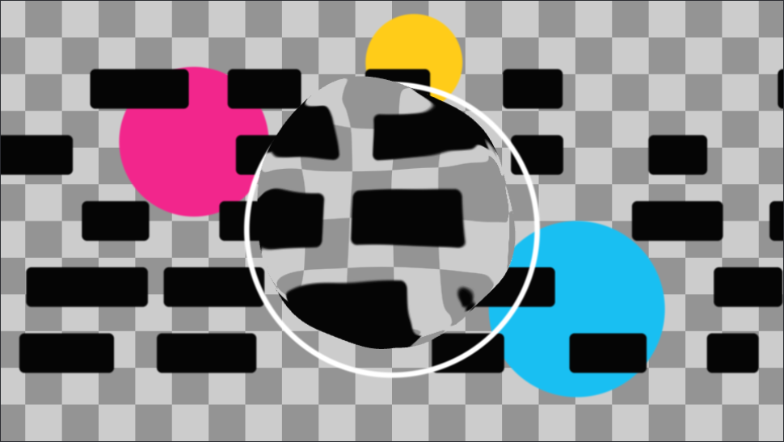

*Preview (Refraction stage):* the backdrop seen through the glass warps around each bulge. One more test: with IOR 1 and no tint or light, the moving glass is still perfectly invisible (maximum difference 0, `moving_glass_at_ior1_is_invisible`), so the moved surface does not disturb the pixel stage's maths.

## How many points does liquid need?

Why does the shape fall apart on a coarse mesh, and what does the motion cost?

The vertex shader only runs at the mesh's points. Between them, the graphics card draws flat triangles. If a ripple is smaller than the gap between points, the mesh cannot show it: the outline turns into straight segments and the bulges lose their shape. A rule of thumb: keep at least 8 points across the smallest feature. For Ripple scale 4 (four ripples per flow size), that means about 32 points per flow size. A Sphere SOP's rows run from pole to pole, half way round the sphere, so a sphere of radius 1 needs about 100 rows and 200 columns. Raise the SOP's rows and columns, or add a Subdivide SOP, until the outline stays smooth; watch the outline, where a coarse mesh shows first.

The cost is in the noise. Each noise lookup visits the 8 corners of a lattice cube and hashes each one three times. The field uses up to four lookups, and the normal needs the field at five places (the point plus four neighbours). That is about 20 noise lookups per vertex, on the vertex stage only: it scales with the number of points, not with screen size. Ingredients set to 0 are skipped.

{{code:liquid_flow.vert:noise}}

`driftNoise()` is about precision. A GPU float keeps about seven significant digits. After hours of motion a drift is in the thousands, and adding a nudge of a thousandth to it rounds the nudge away: the rebuilt normals fill with rounding noise that grows with uptime. In an earlier version of this shader, without it, the default look's normals were off by up to 0.6 degrees after one hour and 10 degrees after a day. So `driftNoise()` never adds the big number. The lattice repeats every 256 cells, so it first folds the drift into one repeat; then it moves the whole cells into the lattice index (integers are exact) and adds only the fraction to the position. The presets module also wraps flow time at 25600 seconds, where every drift has moved a whole number of repeats, so the wrap is invisible. After a day the normals are within 0.10 degrees of the 64-bit reference, after a week at double speed within 0.08.

{{experiment:coarse_mesh}}


*Preview (Normal stage, Demo detail 10):* the outline turns into visible straight segments. The colours stay smooth, because the graphics card blends the normals between points; the missing bulges show at the edge.

## Twelve looks that move

How do the presets and the morph reach the motion?

The shader sees six more sets of four numbers (uniforms) than Liquid Glass. Each comes from a parameter on the component through an expression on the GLSL MAT's Vectors page.

{{code:liquid_flow.vert:flow_uniforms}}

The time in `uFlow.w` is **flow time**, not seconds. The obvious binding is "seconds since TouchDesigner started, times Flow speed". It works while the speed stays put. But change the speed, by a slider or by an animated Morph between presets with different speeds, and the product jumps by "seconds since start x change of speed". In an earlier version that used it, a 2-second Morph from Prism Chrome to Amber Honey, an hour into a session, made the surface churn 438 times faster than normal, and backwards. So the component adds the speed up instead. `flow_time()` in `presets.py` adds Flow speed x frame time every frame, in Python's 64-bit numbers, and hands the shader the sum, wrapped at 25600 seconds. A speed change now changes only how fast the liquid moves. With **Pause** on, flow time is Fixed time x Flow speed, and it carries on from there when Pause is released. With Flow speed 0 it holds and never reads the clock, so a still look does not recook every frame. In Python, that is one line: `advance(comp, "flow", u(comp.par.Flowspeed), 25600)`.

`advance()` is the Liquid Glass study's integrator, shared here: each component keeps its own running values, so two flow components in one project move independently (the version before the family sync kept one value per parameter name, and a second component took the first one's time). The ripples and the oil film of the pixel stage use the same `advance()` for their four drift offsets (`uPhase`), wrapped at 256 where their noise repeats, and the demo spin uses it too. A test plays one frame of a Morph an hour into a session and finds it changes the image no more than at 2 seconds (`morph_frame_is_smooth_after_an_hour`); another renders the ripples and the film about a week in and finds them exactly as at 2 seconds (`ripples_and_film_exact_after_a_week`).

Every one of the twelve Liquid Glass presets keeps its look values unchanged (a test compares them with the Liquid Glass presets file). Each now also has a motion character: Sapphire Drop sags into a drop, Chrome Type carries travelling waves across reference 4's bold type, Amber Honey sinks slowly, Liquid Mercury swells fast. The motion values (Amplitude to Drip) are preset values like any other, so **Morph** blends motion too. Direction mode, centre, both sizes, gravity and wave direction are scene settings, not looks: presets leave them alone.

{{experiment:morph}}

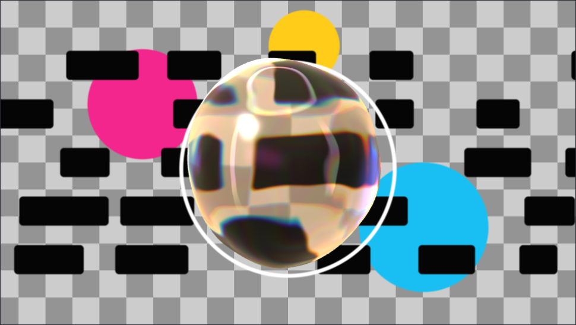

*Preview:* a faintly amber glass with a heavier, beginning sag. Automated tests confirm Morph 1 renders exactly the target preset, motion included, and Morph 0 changes nothing. Another plays that Morph over 2 seconds at 60 frames per second, starting 2 seconds, an hour and a day after start: the surface moves about as far per frame each time (`flow_time_follows_speed`).

{{experiment:final}}

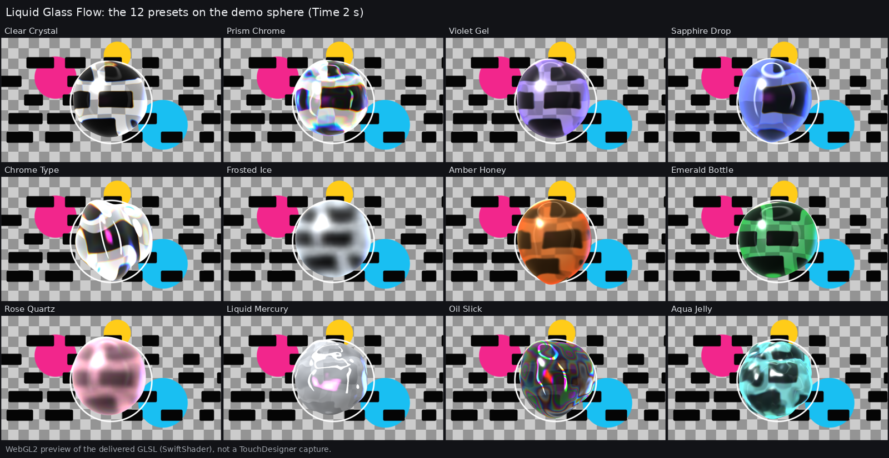

*Preview of all twelve presets on the demo sphere at Time 2 s.*

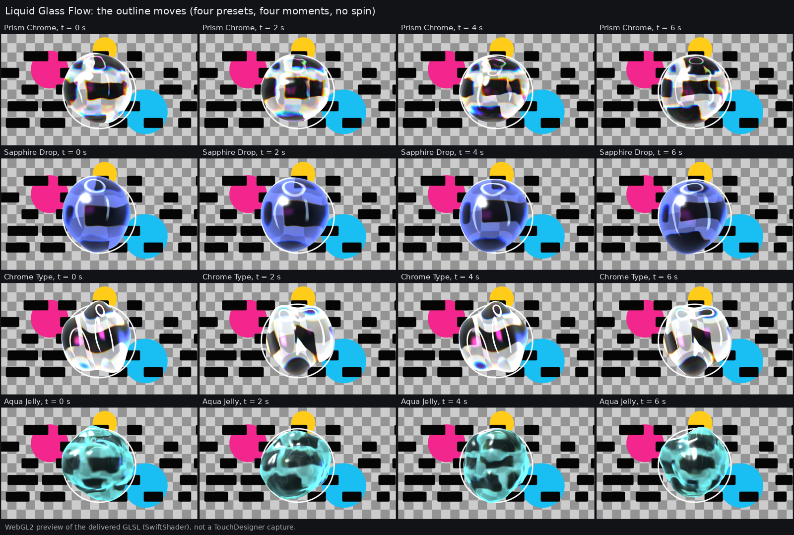

*Preview of four presets at 0, 2, 4 and 6 seconds with the spin stopped: only the liquid moves.*

## Use it on your own objects

The [README](README.md) has the full steps. In short: render your scene without the glass and use it as the Refraction TOP; its background may be transparent. Give the Reflection TOP a panorama or an image. Then add a Render Pass TOP after the scene render: it draws only the glass objects, with Override Material set to the component's `material`, on top of the scene's colour and depth, so objects in front of the glass still cover it. A preview test puts an opaque ball in front of the moving glass: drawn this way, the ball stays exactly as in the scene render; laid over the scene with an Over TOP, the glass covers it (`render_pass_keeps_foreground_in_front`; not yet checked in TouchDesigner). (The demo inside the component lays the glass over a flat backdrop with an Over TOP instead; that only works when nothing stands in front of the glass.) Point **Inputs > Glass geometry** at your object and press **Flow fit > Fit to Glass geometry**. It sets **Flow centre** and **Flow size** (about its radius) in the SOP's own units, and **Object size** (its radius in the world / 1.45). You can also type them. One component fits one object. Keep the default **Away from centre** for closed objects, or pick **Normal** for open sheets. Make sure the mesh has enough points. Turn Dither off on both renders, so nothing adds dithering noise to the continuous glass.

For instanced copies, **Instance variation** makes each instance read the field at a different place, so they do not ripple in step:

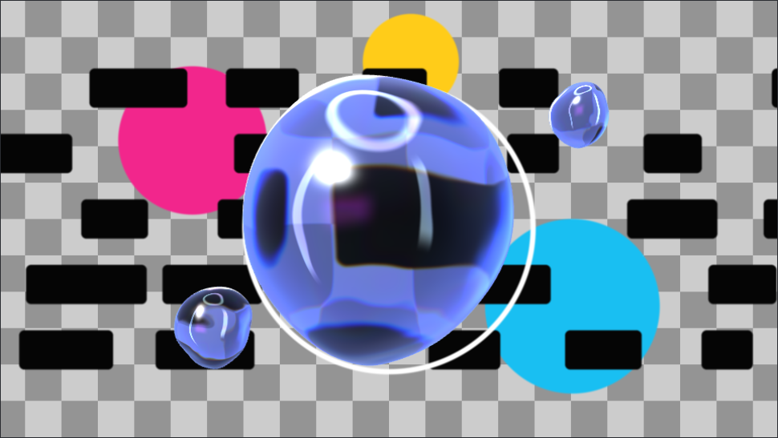

*Preview: one blob and two droplets, each drawn as its own instance with its own instance ID. In TouchDesigner, turn on instancing on the Geometry COMP instead.*

## Limits

- **Needs enough points.** The vertex shader cannot add points; coarse meshes facet (see above).
- **Away from centre slides on some shapes.** Where the surface does not face away from the flow centre, part of the motion is sideways; a flat sheet through the centre only slides. Normal mode avoids that but tears meshes with split normals.
- **Normal mode treats the surface as flat** when rebuilding normals: up to 4.5 degrees off on the sphere test, 9 to 10 degrees on the torus, 64 degrees at Amplitude 0.5.
- **Folds.** Very large Amplitude with fine scales can fold the surface through itself. Keep Amplitude times scale below about 1. At a fold the points keep their original normal.
- **One fit per component.** Flow centre, Flow size and Object size belong to the material, so objects of very different sizes need their own component. Fit reads only the first object in Glass geometry.
- **The shadow and other passes do not move.** Only renders that use this material see the motion; a depth or shadow pass with another material sees the rest shape.
- **The motion restarts when the presets module reloads** (a rebuild, or a project reopened): the liquid jumps once to "seconds since start x speed" and flows on from there.
- **Two sizes.** Flow size (SOP units) moves the liquid; Object size (world radius / 1.45, the family's rule) sizes the glass. Fit sets both from one object. A non-uniform Geometry COMP scale counts as its average. If the Geometry COMP's Scale changes after Fit, animated or not, press Fit again or change Object size by the same factor; otherwise the glass bends and tints as if it were smaller or larger than it is. An instance's own scale is not seen: the motion and the Wobble ripples grow with it, the glass lengths do not, and the Wobble ripples' tilt ignores its rotation. A change that would let all of these follow is recorded in [decisions.json](decisions.json) and waits for the user's decision.
- **Partly covered scenes.** Where the Refraction TOP's alpha is between 0 and 1 (antialiased edges), that part of the scene is counted twice behind the glass and looks slightly brighter.
- **Antialiased edges near the centre lines.** With antialiasing, a few silhouette pixels near the render's centre row or column still bend the wrong way: each is shaded at its centre, outside its own triangle, and its point projects to the other side of the centre line. In the preview they change at most 4 pixels in twelve frames, by up to 38/255. Whether that shows in TouchDesigner is an open family question, with a native check pending. A centroid-sampled position removed most of them in the usual raster in the Liquid Glass Lit study's preview, but no TouchDesigner build has run one.
- **Not yet run in TouchDesigner.** The shaders compile as GLSL 4.60 against stand-ins for TouchDesigner's built-ins, also with picking active and with three and eight colour buffers, and the preview passes its tests. Native compile, render, the builder, the frame-by-frame clock, the Render Pass TOP workflow, Fit to Glass geometry (both sizes, on a scaled Geometry COMP too), instancing, picking with the documented branch, extra colour buffers, fog, the screen orientation (an odd render size too), presets and export are still to be checked on a real host; see [validation.json](validation.json).

## Credits

Vertex displacement by a noise of the position and colouring by displacement: Maxime Heckel, [The Study of Shaders with React Three Fiber](https://blog.maximeheckel.com/posts/the-study-of-shaders-with-react-three-fiber/) (Blob). Rebuilding normals from displaced neighbours: Heckel, [Caustics in WebGL](https://blog.maximeheckel.com/posts/caustics-in-webgl/) and [Field Guide to TSL and WebGPU](https://blog.maximeheckel.com/posts/field-guide-to-tsl-and-webgpu/), who credit the method to Marco Fugaro's post *Calculating vertex normals after displacement in the vertex shader*. The glass look: Heckel, [Refraction, dispersion, and other shader light effects](https://blog.maximeheckel.com/posts/refraction-dispersion-and-other-shader-light-effects/), through the Liquid Glass study. The TouchDesigner implementation is newly written; [sources.json](sources.json) lists each idea's source lines and how it was adapted. TouchDesigner API details follow Derivative's documentation (Write a GLSL MAT, Render Pass TOP, Render TOP, Box SOP, Sphere SOP, Grid SOP, Transform SOP, Merge SOP, Switch SOP, SOP Class, AbsTime Class). The family sync brought the core study's later fixes and the family's shared items; [review.md](review.md#family-sync) lists them. This study is not authored or endorsed by Maxime Heckel.
