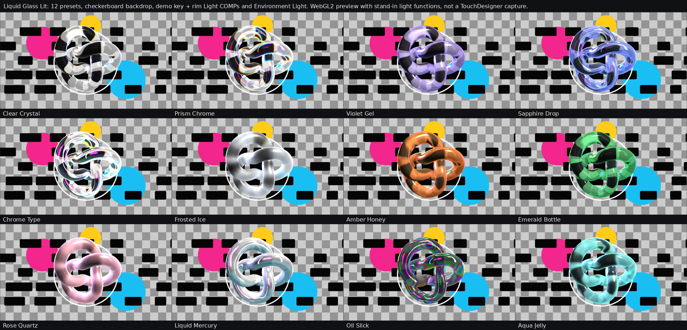
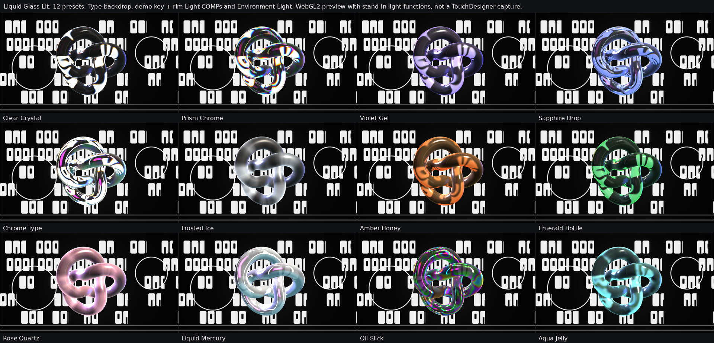

# Liquid Glass Lit for TouchDesigner

A liquid-glass material that takes its light from your scene. Highlights and body light come from the Light COMPs your render already uses. Reflections and ambient light come from its Environment Light COMP. You connect one input, the scene behind the glass, and nothing else. With no lights in the scene it falls back to a built-in key light and studio, so it always renders.

It is one member of the Liquid Glass family. The [core study](../liquid-glass/README.md) lights itself from typed-in values and a Reflection TOP; this one asks the scene instead. Twelve presets give you starting looks; every value stays editable. The glass part (refraction, frost, ripples, film, alpha, fog, picking) is kept in step with the core study; [review.md](review.md#family-sync) lists what the family sync brought over, and [Family close](review.md#family-close) what this study now shares with the core, checked by tests. Object size means the object's size in the world: the ripple and film patterns follow a Geometry COMP's scale too. Lit had this first ([review.md](review.md#verifier-fixes-after-the-sync), V1). It is the family's rule for Object size ([decisions.json](decisions.json), `family_rule`), and since the family close the core, Prism and Flow follow it as well (see [Object size across the family](#object-size-across-the-family)).

[Tutorial: how it works](article.md) · [Research](research.md) · [Decisions](decisions.json) · [Review](review.md) · [Validation status](validation.json)



*WebGL preview of the delivered GLSL, with stand-ins for TouchDesigner's light functions. TouchDesigner has not rendered this material yet; see [Status](#status).*

*This study moved from `studies/liquid-glass-lit/` to `examples/liquid-glass-lit/` in commit 66b4eb8. Records written before the move (sources.json, decisions.json, co-design.json, the `derived_from` block in study.json, checks/reference/ and checks/results/) cite the old path.*

## What you get

| File | What it is |
| --- | --- |
| `liquid_glass_lit.vert`, `liquid_glass_lit.frag` | **The shader.** Vertex and pixel code for a GLSL MAT. |
| `build.py`, `builder.py` | Builds a ready `liquid_glass_lit` component in your project from the Textport. |
| `presets.json`, `presets.py`, `preset_exec.py` | The twelve looks, the preset loader and the morph. |
| `backdrop.frag`, `envmap.frag`, `card.vert`, `card.frag` | Demo inputs: a high-contrast backdrop, the card that draws it behind the demo scene, and a panorama for the demo Environment Light. |
| `study.json` | The recipe the builder follows: every node, parameter and uniform binding. |
| `native.py` | In-TouchDesigner helpers: apply an experiment, inspect, capture, export. |
| `article.md` | The tutorial, with experiments you can load. |
| `checks/` | Compile check, preview renderer and tests (run outside TouchDesigner). `checks/reference/` keeps the commit-6a58487 shaders, so the tests can compare with them. |

## Quick start

1. Download or clone this folder and note where it is.
2. In TouchDesigner, open the Textport (Dialogs > Textport and DATs) and run, with your own path:

   ```python
   import runpy
   component = runpy.run_path('/path/to/liquid-glass-lit/build.py')['build']()
   ```

3. A `liquid_glass_lit` component appears in `/project1`. Open its viewer: a glass torus over the demo backdrop, lit by two demo Light COMPs and a demo Environment Light. Pick a look from **Glass > Preset**.
4. Try **Study > Demo Light COMPs** and **Demo Environment Light**. The highlights and reflections follow; nothing in the material changes.
5. Turn on **Study > Demo occluder**. A dark bar passes between the camera and the glass and stays in front of it.

If the build prints warnings, it groups them by what they affect: *material* (a sampler setting failed: frost may look stepped), *inputs* (the Refraction TOP field stayed an expression), *dither* (turn Dither off by hand on that render), *setup* or *demo* (cosmetic; the material itself is fine). The warnings are stored in `component.fetch('build_warnings')`.

## Use it in your own lit scene

The material needs to see what is behind the glass. Lights need no wiring: the render that draws the glass hands its lights to the material.

1. **Scene without the glass.** Make a Render TOP with your camera, your lights and every object except the glass. Keep its **Render Mode** at 2D. Drag it onto **Inputs > Refraction TOP** on the `liquid_glass_lit` component (or type its path). The field holds a plain path: clear it to disconnect, or right-click > **Reset to Default** to get the demo scene back.
2. **Apply the material.** On each glass Geometry COMP, set **Material** to `liquid_glass_lit/material`.
3. **Draw the glass into the scene.** Add a Render Pass TOP and wire the step-1 Render TOP into it. Set its **Camera** to the same camera and its **Geometry** to the glass objects only. In its **Lights**, list the Light COMPs and Environment Light COMPs that should light the glass, usually the same as step 1. Turn **Clear Depth Buffer** and **Clear to Camera Color** off. Its output is your final image. (Setting the pass's **Override Material** to the material instead of step 2 should work too; the core study does that. Neither form has been checked in TouchDesigner yet.)
4. **No dithering.** On both renders, turn **Dither** off (Advanced page). The glass never calls TDDither, so Dither does not touch it. Built-in materials in your scene render do dither while it is on, and that noise would be bent through the glass. The demo's two renders already have it off.
5. **Object size.** If your glass is much smaller or larger than the demo torus (1.45 units from its centre to its outer edge), press **Inputs > Fit to Glass geometry**. This study has no Glass geometry field: Fit finds every Geometry COMP that wears the material, measures it in the world (the Geometry COMP's scale counts) and sets **Object size**, so Thickness, Frost, Tint density and the ripple and film patterns keep their look. It works the same whether you sized the object in its SOP or with the Geometry COMP's Scale. You can also type Object size yourself: it is the object's size in the world, relative to the demo torus.

The Render Pass TOP keeps the scene's depth, so anything between the camera and the glass stays in front of it. The demo is built this way: `demo_scene` is the scene render and `render` is the Render Pass TOP. Turn on **Study > Demo occluder** to see it. This route is checked in the WebGL preview only; the TouchDesigner check is pending.

- Never put the glass in the Refraction TOP.
- Use one camera per glass render. The Refraction TOP is one picture from one camera. With several cameras, give each camera its own scene render, Render Pass TOP and copy of the component.
- Use Render Mode 2D. In Cube Map, Fish-Eye and Dual Paraboloid renders the glass still lands in the right place, but the bend is worked out for a flat picture, so the refraction reads the wrong part of the scene.
- Several glass objects can share one material; for different looks, copy the component. They also share one Object size: see *One Object size per component* below.

**Instancing.** Instanced glass works like any other geometry: positions and normals go through `TDDeform` and `TDDeformNorm`, so each instance is placed, turned and scaled, and the lights and reflections see it as it is. Two things do not follow an instance: Object size and the ripples' tilt (next paragraph). Not yet checked in TouchDesigner.

**One Object size per component.** Fit to Glass geometry measures when you press it, and its one Object size serves every object that wears the material. Three setups break that. The numbers come from this study's own Fit code and uniforms ([review.md](review.md#family-critic-native-runs-and-one-object-size)):

- *Objects of different sizes.* Fit takes the largest. An object a fifth of its size bends and tints as if it were five times larger, with ripples and film bands five times larger. Give each size its own copy of the component, and set each object's Material to its own copy.
- *A Geometry COMP Scale that changes or is animated.* Thickness, Frost, Tint density and the ripples and film bands keep the world size Fit measured. Scaled up three times without a new Fit, the glass bends and tints as if it were three times smaller and shows three times as many ripples and film bands. Press Fit again after a scale change. For an animated scale, animate Object size by the same factor.
- *Instances.* Fit and the shader see the Geometry COMP's scale, not each instance's. On an instance scaled 3 the ripples and film bands grow with it, but it bends and tints as if it were three times smaller. The ripples' tilt also ignores each instance's rotation, so on a turned instance they tilt the wrong way. For instances of different sizes, use one Geometry COMP and one copy of the component per size.

A change that would let all three follow by themselves is proposed and waits for your decision ([decisions.json](decisions.json), *Family critic: one Object size per component*). None of this has run in TouchDesigner.

**Over a flat image or video.** If nothing can pass in front of the glass, a simpler route works. Render only the glass in a second Render TOP with a transparent background (Background Color alpha 0) and the same camera and lights, and lay it over the image with an Over TOP (input 1 = glass, input 2 = image). Set the image as the Refraction TOP, at the glass render's resolution. Opaque objects in front of the glass are not supported this way: the glass is drawn over them.

**A scene render with a transparent background** works too. Where the Refraction TOP is transparent (alpha 0), there is nothing to bend, so the glass blends with whatever is behind it later, exactly as with no Refraction TOP. Where it is opaque, the glass shows the bent scene. Partly covered pixels (alpha between 0 and 1, as on antialiased edges) count the scene twice: they come out a little brighter and more opaque.

**Render Pick DAT and CHOP** can pick the glass. The vertex shader uses the picking form printed on Derivative's *Write a GLSL MAT* page: in a pick pass the point is still placed, and of the branch only the `#else` block runs. There `TDWritePickingValues()` writes TouchDesigner's default pick values; the outputs for the pixel shader are not written. **Fog** from the Camera COMP reaches the glass through `TDFog()`; the glass adds only its own share of the fog colour (checked in the preview with a stand-in; TouchDesigner's fog is a pending native check). Your scene render fogs its built-in materials by itself. A GLSL MAT fogs only if it calls `TDFog()`, and the demo's backdrop card does not, so the demo scene render stays unfogged: with fog on, only the glass fades in the demo.

**Objects in front of the glass** can show up bent inside the glass next to their edges, because the scene render contains them too. That is a limit of reading the scene from one picture.

What the material uses from your scene:

| In the Lights of the render that draws the glass | What the glass gets | If there is none |
| --- | --- | --- |
| Light COMPs (point, cone, distant) | Highlights, surface diffuse, body light; attenuation and shadows as set on each light | Built-in key light (**Built-in** page) |
| Environment Light COMP | Reflections from its map (rotation included), ambient on the body | Built-in studio |
| Ambient Light COMP | Ambient on the body | Nothing extra |

**Without a Refraction TOP**, the glass can't bend anything. It then blends with whatever is behind it in the same render, using alpha. Lights and reflections still work.

## Controls

**Glass page:** Preset, Apply preset again, Morph target and Morph (blend every look value toward a second preset), Glass colour, Tint density, Edge tint (deeper colour at the rims), Translucency (1 see-through, 0 solid body), Opacity (fades everything, reflections included), Frost (blur through the glass).

**Optics page:** Index of refraction (1 = no bend, water 1.33, glass 1.5), Thickness (in units of Object size: scene units while Object size is 1), Dispersion (rainbow split), Saturation, Samples (quality vs speed for dispersion and frost).

**Reflection page**

| Control | What it does |
| --- | --- |
| Reflection colour, Reflection amount | Tint and strength of reflections. |
| Mirror | 0 = glass-like (reflects mostly at the edges), 1 = mirror-like everywhere. |
| Energy conserving | Off (default): reflections are added on top of the view through the glass, as in Heckel's glow. On: light the surface reflects no longer also passes through, so Mirror 1 is a true mirror. |
| Reflection roughness | Blurs reflections, from sharp to soft glows. |
| Fresnel falloff | How tightly reflections and rim hug the silhouette. |
| Rim colour, Rim glow | A glowing edge, independent of the lights. |

**Lighting page**

| Control | What it does |
| --- | --- |
| Specular | Strength of the lights' highlights. |
| Highlight size | Roughness of the highlights: small = tight and bright, large = wide and soft. |
| Surface diffuse | Light scattered by the glass surface, for volume. |
| Ambient on the body | How much ambient light reaches a milky body (Translucency below 1). |
| Lights | *Auto* (scene Light COMPs, built-in key if none), *Scene only*, *Built-in only*. |
| Environment | *Auto* (scene Environment Light, built-in studio if none), *Scene only*, *Built-in only*. |
| Environment intensity | Scales reflections and ambient from Environment Light COMPs. |
| Environment blur range | Mipmap levels that Reflection roughness spans; about log2 of your map width (10 for 1024). |
| Shadow strength | How strongly shadows from shadow-casting Light COMPs darken the glass. |

**Built-in page:** Key light direction, intensity and colour, Studio rotation. Used only when the fallback is active.

**Liquid page:** Iridescence (oil-film sheen), Film thickness, Film variation, Wobble (liquid ripples, shading only), Wobble scale, Wobble speed. The ripples and the film drift at Wobble speed. The component adds up speed × frame time every frame, so a morph or a speed change only changes how fast they drift, even after days of uptime; Pause holds them at Fixed time.

**Inputs page:** Refraction TOP, Faces (front only for closed objects, both sides for open surfaces), Object size (the object's world radius over 1.45, Geometry COMP scale included; the demo torus fits to 1; scales Thickness, Frost, Tint density and the ripple and film patterns), Fit to Glass geometry (sets Object size from the objects that wear the material; scripts call it `Fitglass`, as in every family member: [names across the family](../liquid-glass/README.md#names-across-the-family)), Flip screen V (see troubleshooting), Colour parameters (*Auto* follows the project's working colour space; *As typed*; *sRGB* converts the glass, reflection, rim and built-in key colours to linear).

**Study page:** Pause and Fixed time, Teaching stage (final, normal, refraction, body, reflection, lights, environment, ambient, fresnel, film, light sources, screen UV), Demo spin, Demo Light COMPs (none, key, rim, both), Demo Environment Light, Demo environment rotation, Demo occluder (a bar in front of the glass), Demo Light COMP dimmer, Demo backdrop (*Checker*, or *Type*: bold white type on black, the backdrop the family's contact sheets share).

Running an experiment (`apply`, see the tutorial) first puts every look control back to its default: the preset values, Morph, Samples, Energy conserving, the Lighting and Built-in pages and the Study page. It keeps Preset, the setup controls (Refraction TOP, Faces, Object size, Flip screen V, Colour parameters) and anything you drive with an expression, export or bind. So experiments give the same result in any order.

## The twelve presets

| Preset | Idea |
| --- | --- |
| Clear Crystal | Colourless, crisp glass with gentle dispersion and sharp scene highlights. |
| Prism Chrome (default) | Clear glass with strong rainbow dispersion, oil-film sheen and bright rims (reference 1). |
| Violet Gel | Pale lavender gel with deep violet rims (reference 2). |
| Sapphire Drop | Blue-violet magnifying drop; a rim light paints its edge (reference 3). |
| Chrome Type | Near-colourless, highly reflective glass with colour fringes over type (reference 4). |
| Frosted Ice | Milky, blurred ice-blue glass with rough, soft reflections. |
| Amber Honey | Dense warm amber with slow liquid movement. |
| Emerald Bottle | Green bottle glass, saturated at the edges. |
| Rose Quartz | Soft pink, half-frosted and milky; the body takes the scene's light. |
| Liquid Mercury | Almost opaque liquid metal reflecting the environment. |
| Oil Slick | Dark glass under a swirling rainbow film. |
| Aqua Jelly | Wobbly cyan jelly with water-like refraction. |

Presets set the look only. Light sources, environment intensity, blur range, shadow strength, the built-in light and samples are scene settings, and presets leave them alone. So does Object size: a preset keeps its look on a small or a large object.



*The same twelve presets over the Type backdrop (Study > Demo backdrop), which the core and Prism studies also use. WebGL preview, not a TouchDesigner capture.*

## Using the shader files by hand

1. Two Text DATs with `liquid_glass_lit.vert` and `liquid_glass_lit.frag`; set the GLSL MAT's Vertex Shader and Pixel Shader to them; GLSL Version 4.60; **Lighting Space: World Space**.
2. **Samplers page:** `sRefraction` (scene behind), Filter *Mipmap Linear*, Extend U and V *Mirror*.
3. **Common page:** Blending on, Source Color = One, Destination Color = One Minus Source Alpha (premultiplied output), Separate Alpha Function off, Post-Mult Color by Alpha off. Cull Face = Back Faces for closed objects.
4. **Renders:** Dither off on every render that draws the glass.
5. **Vectors page:** fifteen vec4 uniforms:

| Uniform | x | y | z | w |
| --- | --- | --- | --- | --- |
| `uGlass` | glass R | glass G | glass B | tint density ÷ object size |
| `uBody` | translucency | frost × object size | opacity | edge tint |
| `uOptics` | IOR | thickness × object size | dispersion | saturation |
| `uReflect` | reflection R | reflection G | reflection B | reflection amount |
| `uSurface` | mirror | fresnel falloff | reflection roughness | highlight size |
| `uRim` | rim R | rim G | rim B | rim glow |
| `uShade` | specular | surface diffuse | ambient on the body | shadow strength |
| `uSources` | lights mode (0 auto, 1 scene, 2 built-in) | environment mode (same) | environment intensity | environment blur range |
| `uKey` | key direction x | y | z | key intensity |
| `uKeyColor` | key R | key G | key B | studio rotation (radians) |
| `uFilm` | iridescence | film thickness (nm) | film variation | 2.5 ÷ object size |
| `uWobble` | wobble | scale ÷ object size | speed | 0 (unused) |
| `uPhase` | drift 0.6 × speed × seconds, wrapped to 0..256 | 0.4 × the same | −0.3 × the same | 0.15 × the same |
| `uState` | teaching stage (0 = final) | samples | flip V (0) | refraction TOP connected (1/0) |
| `uOptions` | energy conserving (1/0) | colours are sRGB (1/0) | 0 | 0 |

By hand, `uPhase` can be `absTime.seconds` times speed times each factor, as long as speed never changes while it runs (otherwise the pattern jumps); the component integrates it in `presets.phase()` instead.

Object size is the object's size in the world. The shader multiplies the two pattern frequencies (`uWobble.y`, `uFilm.w`) by the Geometry COMP's own scale, the cube root of its world matrix's determinant, so a COMP scaled by k with Object size k shows the demo's ripples and film bands.

### Object size across the family

Object size follows the family's rule ([decisions.json](decisions.json), `family_rule`): the object's radius in the world over 1.45, the demo torus's, with the lengths and the ripple and film patterns all following it. Lit had it first. In the family close (2 November 2026) the core, Prism and Flow took it too. A script ran each member's own Fit code on one object, the core's demo torus in a Geometry COMP scaled by s, and read each member's pattern lookups and uniform expressions ([review.md](review.md#family-close)). A ratio of 1 means the member gives what the rule gives:

| Member | Fit's Object size at s = 3 | World thickness ÷ rule (s = 0.1 / 1 / 3 / 10) | Ripple and film period ÷ rule (same s) |
| --- | --- | --- | --- |
| Liquid Glass Lit (this study) | 3.0 | 1 / 1 / 1 / 1 | 1 / 1 / 1 / 1 |
| [Liquid Glass](../liquid-glass/README.md) (core) | 3.0 | 1 / 1 / 1 / 1 | 1 / 1 / 1 / 1 |
| [Liquid Glass Prism](../liquid-glass-prism/README.md) | 3.0 | 1 / 1 / 1 / 1 | 1 / 1 / 1 / 1 |
| [Liquid Glass Flow](../liquid-glass-flow/README.md) | 3.0 | 1 / 1 / 1 / 1 | 1 / 1 / 1 / 1 |

Before the family close (commit c94e849) the same script gave 3.0 for the core, but with ripple and film periods s times the rule's; 3.44 for Prism (its own demo torus, radius about 1.265); and 1.45 for Flow (SOP units). Now a typed Object size means the same object size in all four. Each member still tunes its own presets, so after copying values from one member to another, press Fit there. Flow also has **Flow size**, in its SOP's units, for its motion; its Fit sets both. Liquid Glass Blobs is not in the table. It raymarches its blobs inside a proxy box, so there is no mesh to put the torus on. Its own family close took the rule's Object size number: Fit gives the box's radius over 1.45 (2.069 for its demo box at s = 3), and Backdrop distance, Frost and Tint density follow it. It keeps two exceptions on purpose ([its decisions.json](../liquid-glass-blobs/decisions.json), *Family close G1*). Its film has 2.5 swirls per box radius, so one film cell is 1.45 times as long as the rule's. Its ripple is part of the blob shape and follows the box, not Object size. A unit test checks these numbers against Blobs' own code when that study sits next to this one. None of this has run in TouchDesigner.

## Troubleshooting

- **No highlights from my lights.** The Render Pass TOP (or Render TOP) drawing the glass must list them in its **Lights** parameter; the scene render's list doesn't count. Set **Teaching stage** to *Light sources*: red means scene lights are in use, blue means the built-in fallback is.
- **Dark patches on the glass when a light casts shadows.** The glass is probably in the light's Shadow Casters, so it shadows itself as if it were opaque. Remove it from Shadow Casters, or lower **Lighting > Shadow strength**. (Expected from how shadow maps work; not yet checked natively.)
- **The glass is drawn over things in front of it.** Draw the glass with a Render Pass TOP built on the scene render, not with an Over TOP (see above).
- **The glass lights up when I fade my lights to 0.** Derivative's docs say Light COMPs with Dimmer below 0.001 are ignored. If that removes them from the render, *Auto* switches to the built-in key light. For shows that black out, set **Lighting > Lights** to *Scene only*. (Not yet checked natively: experiment `blackout`.)
- **Reflections are black.** The Environment Light COMP has no map. Give it one, or set **Environment** to *Built-in only*.
- **Reflections turn the wrong way when I rotate the map.** Please note your build; the direction is a pending native check.
- **Compile error mentioning TDEnvLightingPBR or TDEnvLightTextureLod.** Look at the `info_material` and `info_render` DATs and note your build. The material uses the seven-argument `TDEnvLightingPBR()` from TouchDesigner's shader preamble; the documentation page lists a different form.
- **Rough reflections look stepped.** Raise **Environment blur range**, or check the Environment Light's map has mipmaps.
- **A thin vertical line in rough reflections.** The panorama's left and right edges meet in the +X direction. If TouchDesigner does not wrap its blurry mipmap levels sideways, a line can show there. Turn the Environment Light's map so the line faces away from the camera, or use a cube map. (Not yet checked natively: experiment `env_seam`.)
- **Extra colour buffers.** With **# of Color Buffers** above 1 (up to 8), the glass writes zero into the extra buffers, one constant index at a time. It does not output normals or velocity.
- **Ripples or film jump when I morph after hours of running.** The component adds up the drift every frame, so they should not. If you wired `uPhase` by hand with `absTime.seconds`, keep Wobble speed fixed, or use the component's `presets.phase()`.
- **Refraction looks upside down.** Turn on **Inputs > Flip screen V**.
- **One pixel on the screen's centre line bends the wrong way.** The material measures which way the screen runs at every pixel (`screenSign()`). On a centre line it falls back to a screen derivative, and on a nearly edge-on surface to the usual orientation. With antialiasing, a silhouette pixel that the glass only partly covers can still get the wrong sign: 17 pixels in 576 frames in a wide pose sweep of the preview, and at most 8 per twelve frames in its test. In the final image that changes at most 6 pixels in twelve frames, by up to 26/255, only in an emulated build whose raster runs the other way. Whether you can see it in TouchDesigner is an open family question; if you do, please note your build and where the pixel is (validation.json, check `centre_line_residual`).
- **Slow.** Lower Samples, set Reflection roughness and Wobble to 0, and use fewer lights. TouchDesigner compiles one shader version per light setup; the first frame after you add a light can stall.
- **Colours look different from the preview.** Check **Inputs > Colour parameters**: *Auto* converts typed colours to linear in a linear working colour space (transfer curve only, no gamut conversion); the previews show *As typed*. The preview's light functions are stand-ins too.
- **Errors after building.** Each light setup compiles its own copy of the material inside the render that draws it, so an error can show there and not in the material. Read `info_material`, `info_render` and `info_demo_scene`, and look for a blue and red checkerboard on the glass. `component.op('study_tools').module.inspect(component)` collects all of these: the errors and warnings of every render in the project that draws the material (`render_diagnostics`), Python errors in the preset callback (`script_errors`) and errors that stop `capture()` and `export()` (`blocking_errors`).

## Status

Verified here (see [validation.json](validation.json)): GLSL 4.60 and Vulkan SPIR-V compile with glslang against stand-ins for TouchDesigner's built-ins, for 0, 1 and 3 Light COMPs, 0 and 1 Environment Lights, and 1 or 3 colour buffers (or none defined), plus a Render Pick variant of the vertex shader and the demo shaders (58 compiles, and 4 negative tests that must fail). glslang's own preprocessor also lists what the vertex shader's `main()` runs in an ordinary render and in a pick render. A WebGL2 render of the same files passes 36 property tests, including "no lights equals the built-in fallback", "the built-in key light only adds energy where N·L > 0", "reflection roughness blurs rather than fades", "IOR 1 is invisible with the light terms off", "an object in front of the glass stays in front", "every stage stays finite", "a transparent scene stays transparent", "a morph frame is smooth after an hour", "bends follow the screen orientation", "the screen orientation is right at every pixel but a known few, on the centre lines too" and "a preset keeps its look on an object scaled by its Geometry COMP, with Fit's Object size" (within 2/255 at every pixel). For scene Light COMPs the N·L test only checks the preview's stand-in `TDLightingPBR`, not TouchDesigner's. 96 unit tests cover presets and the drift clock, the recipe, the lighting contract, shader numerics, the experiment reset in every order, the family's Object size rule (with each member's record) and control names, what this study shares with the core study (the vertex shader, the screen orientation, Fit and the pattern lookups), the builder and native helpers against a fake `td` module, the three setups one Object size does not follow and the native list (family critic), the Thickness and Object size labels and the core reference copies, which way the ripples change in the V1 record, the COMP-scale preview test's 2/255 bound, the records of the open centre-line question, and the test counts these docs state. The plugin's static checker and tutorial check pass.

**Not yet run in TouchDesigner:** native compile for each light setup, render, the builder, the preset callback, the Render Pass TOP route (and whether it warns about the scene render being read while it draws), shadows, scene-light levels and N·L, the environment rotation direction and mip blur, the panorama seam, cube-map Environment Lights, dimmed lights in Auto, picking, fog, the screen orientation (also on the centre lines of an odd-sized render), the antialiased centre-line residual (an open family question), extra colour buffers, the Dither switch, Fit to Glass geometry, instancing, the constant-mode Refraction TOP field, export to `.tox`, and performance. Run the Quick start on your machine and check `info_material` and `info_render`.

## Credits

Refraction through a render of the scene, multi-sample dispersion, saturation, the N·L diffuse term, the glass highlight and fresnel follow Maxime Heckel, [Refraction, dispersion, and other shader light effects](https://blog.maximeheckel.com/posts/refraction-dispersion-and-other-shader-light-effects/) (2023), which credits the Junni sample technique and Ravishankar Sundararaman's colour-channel work. Passing scene light data to a shader follows the pattern in his [Shaping light](https://blog.maximeheckel.com/posts/shaping-light-volumetric-lighting-with-post-processing-and-raymarching/) article. The refraction, body, liquid and film code derives from the core Liquid Glass study (commit a6f95c6). Drawing the glass into the scene render follows the same article's order: render the scene without the mesh, then draw the mesh in the normal, depth-tested render. The scene-light gathering, the fallback, environment reflections, roughness blur, body light, presets and builder are new for this study. The family sync brought over the core study's audit rounds 2 and 3 and the core's merges from the other members: the integrated drift clock, the R2 frost disc (Martin Roberts' quasirandom sequence), the Refraction TOP's alpha and fog (from Liquid Glass Blobs), measured screen orientation and the Type backdrop (from Liquid Glass Prism), Fit to Glass geometry (from Liquid Glass Flow). See [sources.json](sources.json). This study is not authored or endorsed by Maxime Heckel; the repository's [NOTICE.md](../../NOTICE.md) covers licensing.
