# Liquid Glass Lit: glass that takes its light from your scene

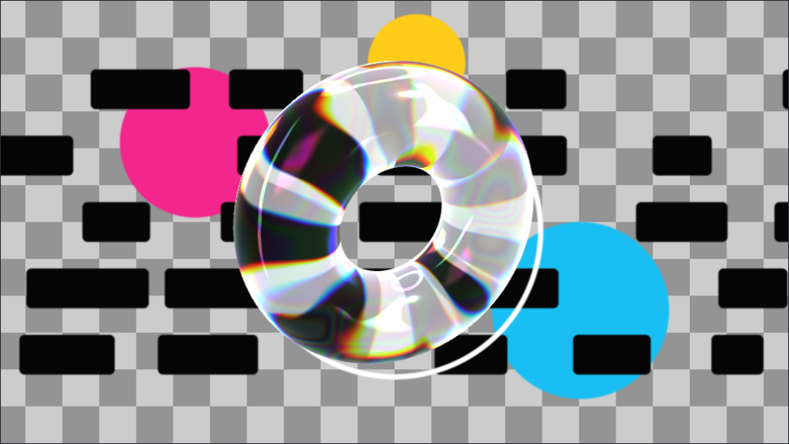

*The destination: the default look on the demo torus, lit by a warm key light, a blue-violet rim light and an Environment Light. This image is a WebGL preview of the same GLSL files, with stand-in light functions. It is not a TouchDesigner capture.*

The core Liquid Glass study lights itself. You type a light direction into the component, and you connect a Reflection TOP for reflections. This study removes both steps. The glass reads the Light COMPs and the Environment Light COMP that your render already uses. Drop it into a lit scene and the highlights land where your lights are, and the reflections show your environment map. With no lights at all, it falls back to a built-in key light and studio, so it never renders black.

This tutorial is for TouchDesigner users who have not written shaders before. Every code block is copied automatically from the delivered files, so what you read is what runs.

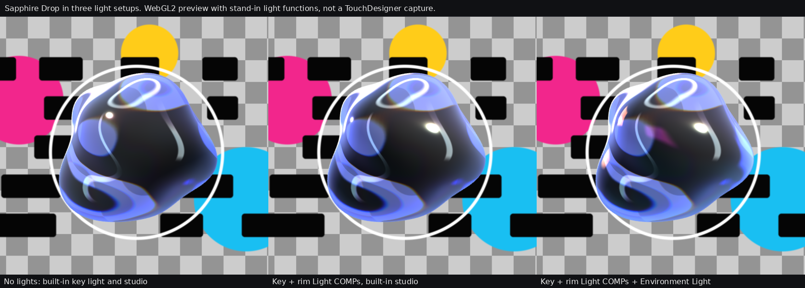

*Preview, left to right:* with no lights, the highlight comes from the built-in key light on the upper left and the reflections are the white studio. With the two demo Light COMPs, a bright highlight appears on the upper right and blue-violet glints on the left. With the Environment Light added, coloured panels from its map appear in the reflections. Nothing in the material changed between the three; only the scene did.

## Open the study

Build the component from the Textport, keeping it in a variable named `component` so the experiment commands below work:

```python
import runpy
component = runpy.run_path('/path/to/liquid-glass-lit/build.py')['build']()
```

Open the component's viewer. Each experiment below fixes time and every unrelated control, then changes one thing. Running one first puts every look control back to its default, so the experiments give the same result in any order. It keeps Preset, your setup (Refraction TOP, Faces, Object size, Flip screen V, Colour parameters) and anything you drive with an expression; `apply(component, 'final')` brings back the default look. **Study > Teaching stage** shows one ingredient at a time; most experiments use it. **Study > Demo Light COMPs** and **Demo Environment Light** switch the demo's lights, so you can watch the material react without touching the network.

The pictures come from a WebGL preview that runs the same shader files in a browser. TouchDesigner's own light functions are not available there, so the preview uses stand-ins written from Derivative's documented signatures. The pictures show what the code does with those stand-ins. They are not proof of how TouchDesigner renders it.

A shader is a small program the graphics card runs. A GLSL MAT holds two. The **vertex shader** runs once per corner of the mesh and decides where it lands on screen. The **pixel shader** runs once per covered pixel and decides its colour. All the lighting happens in the pixel shader.

## Start from the glass you already have

What does the material do before any light touches it?

It does what the core study does. The glass can't see the scene, so you hand it a picture of everything except the glass, from the same camera: the **Refraction TOP**. Each glass pixel looks up that picture at its own screen position, shifted by how much the surface bends light. That shift comes from `refract()`, the **index of refraction** (IOR) and **Thickness**. Dispersion repeats the lookup once per slice of the spectrum, each with a slightly different IOR, so edges split into rainbow fringes. **Frost** moves each lookup to a point of a small disc and reads a blurrier mipmap level, so the view blurs smoothly. The disc points come from the "R2" sequence, which spreads any number of points evenly and keeps their average near the centre, so frost blurs the view without shifting it. The core study's tutorial explains all of this step by step.

The function also returns the Refraction TOP's own alpha, `covered`: 1 where the scene render has something, 0 where its background is transparent. You will see below what the glass does with it.

The vertex shader places each point on screen (its `main()` comes back in "Use it in your own lit scene") and passes the surface position and normal in world space to the pixel shader. `passToPixelStage()` writes them. World space matters here: TouchDesigner's light functions work in world space, and the builder sets the GLSL MAT's **Lighting Space** to World Space to match.

{{code:liquid_glass_lit.vert:transforms}}

{{code:liquid_glass_lit.frag:transmission}}

{{experiment:see_through}}

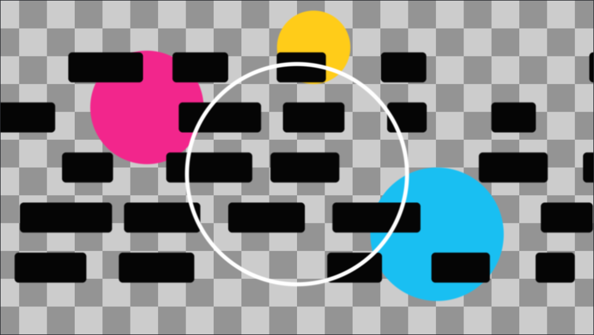

*Preview:* the torus disappears, with both demo lights and the Environment Light on. An automated test compares this render with the backdrop alone. The largest difference is 1/255, with and without scene lights (`ior1_invisible_with_light_terms_off` in [the preview tests](checks/preview_tests.cjs)). Light never leaks into the view through the glass; it is only added on top, as you will see.

{{experiment:dispersion}}

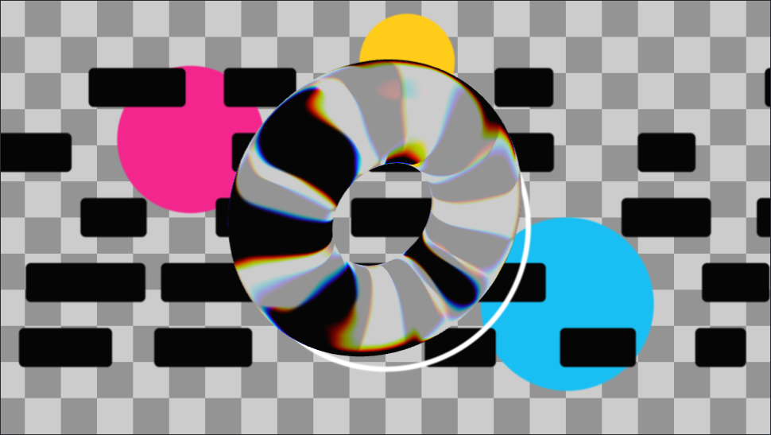

*Preview (Refraction only stage):* every black and white edge seen through the glass carries a red-to-violet fringe, widest near the silhouette.

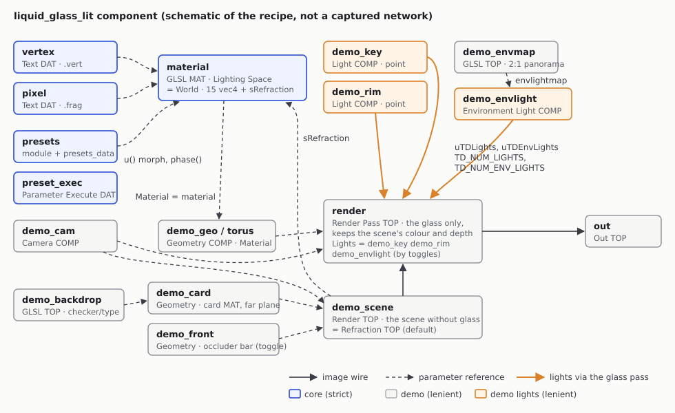

The diagram is a schematic of the recipe, not a captured network. Orange arrows are the new part: the render that draws the glass (here the Render Pass TOP `render`) hands its lights to every material it draws. No wire runs from a light to the material.

## Ask the Render TOP for its lights

How does a material know which lights the scene has?

It doesn't look for them. The **Lights** parameter of the Render TOP or Render Pass TOP that draws it lists the Light COMPs and Environment Light COMPs it renders with. TouchDesigner passes their data to the shader in built-in arrays (`uTDLights`, `uTDEnvLights`) and compiles one version of the shader for each light setup it meets. In each version, `TD_NUM_LIGHTS` and `TD_NUM_ENV_LIGHTS` are fixed numbers. With three Light COMPs, `TD_NUM_LIGHTS` is 3 and the loop below runs three times. With none, it is 0 and the loop never runs.

The web scenes in Heckel's article do this by hand: the JavaScript copies a light's position into a uniform every frame (see *Shaping light*, lines 116–177). TouchDesigner does it for you, which is why this material needs no wiring.

First the material decides which sources to use. **Lighting > Lights** and **Environment** each have three modes. *Auto* uses the scene's lights and falls back to the built-in ones only when the scene has none of that kind. *Scene only* never falls back. *Built-in only* ignores the scene.

{{code:liquid_glass_lit.frag:sources}}

Then it adds up what each light delivers. `TDLightingPBR()` is TouchDesigner's own light function. It knows each light's type (point, cone or distant), its colour and dimmer, its distance attenuation, and its shadow map if the light casts shadows. **Shadow strength** scales those shadows. The material asks it for two parts: **diffuse**, light the surface scatters, and **specular**, the light's own reflection, the highlight.

The `#if TD_NUM_LIGHTS > 0` line is a preprocessor guard. TouchDesigner removes the code between `#if` and `#endif` when the condition is false, before compiling. That keeps a shader with zero lights from mentioning a light that doesn't exist.

{{code:liquid_glass_lit.frag:gather}}

{{experiment:scene_lights}}

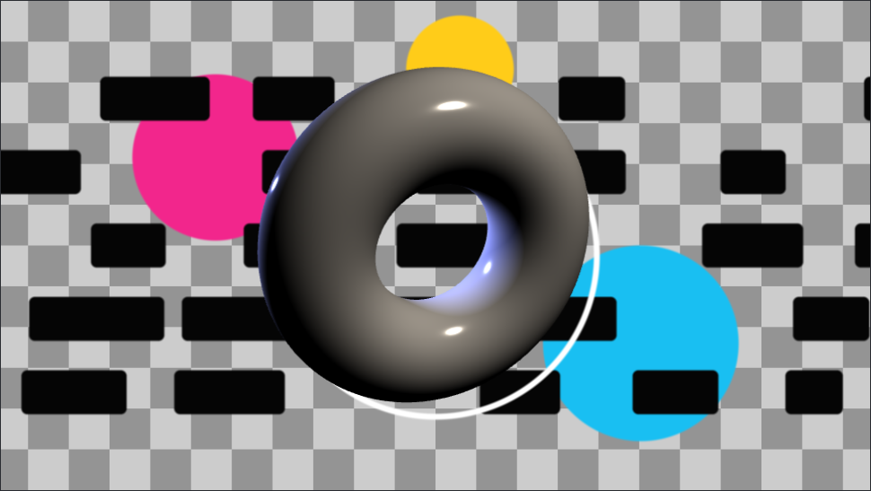

*Preview (Lights stage, which shows everything the lights add):* warm grey shading from the key light covers most of the front, with small hot highlights top and bottom. Blue-violet light from the rim light sits on the left edge and on the inner wall of the hole.

{{experiment:fallback}}

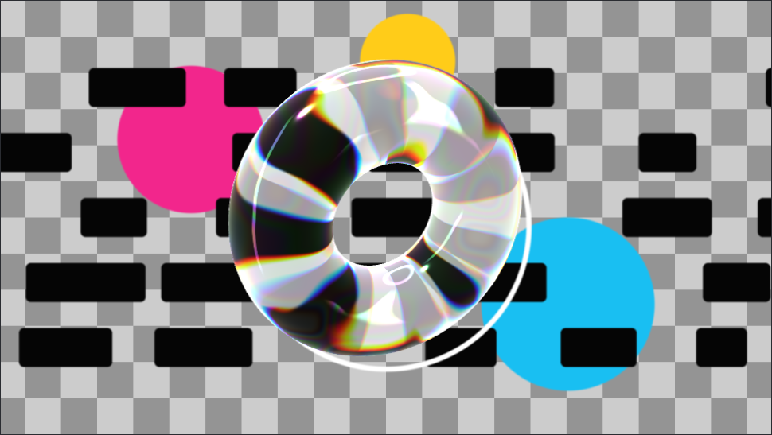

*Preview:* the glass still has highlights and reflections, now from the built-in key light and the white studio. An automated test renders three presets this way and compares them with *Built-in only* in a scene that has one or three lights and an Environment Light. The difference is 0 in every case (`no_lights_equals_builtin_fallback`). The **Light sources** stage confirms which sources are active: red for scene lights, green for a scene Environment Light, blue for a built-in fallback.

One case needs a native check. Derivative's Light COMP page says lights with a Dimmer below 0.001 are ignored in a Render TOP. If that also removes them from `TD_NUM_LIGHTS`, *Auto* treats a blacked-out scene as a scene with no lights and turns the built-in key light on. **Study > Demo Light COMP dimmer** lets you test it.

{{experiment:blackout}}

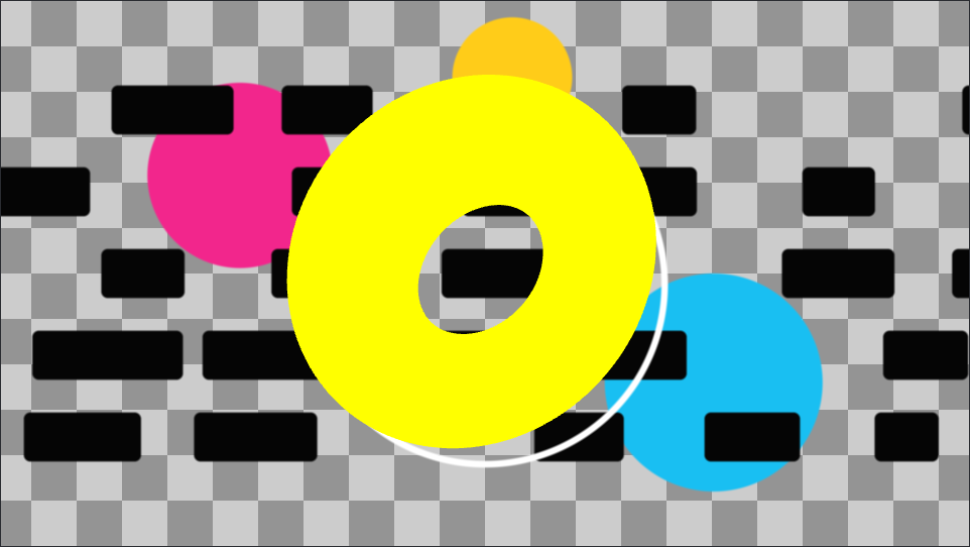

*Preview (Light sources stage):* the torus is yellow, so scene lights and the scene environment are in use. The preview keeps dimmed lights in the light count. That is the preview's assumption; only TouchDesigner can show what it does.

## Light only where the surface faces it

Why does a light behind the object only touch its edges?

A surface receives light in proportion to how directly it faces the light. The **dot product** N·L of the surface normal N and the direction to the light L measures that: 1 when the surface faces the light, 0 when it is edge-on, negative when it faces away. Clamped at 0, it is the diffuse term in Heckel's article and in most real-time light models.

Heckel's specular, `pow(NdotH * NdotH, shininess)`, has no N·L in it (`specular.ts`, lines 27–39). With his one fixed light that rarely shows. With a light behind the object, it would put a highlight on surfaces the light can't reach. Here no light adds anything where N·L is below 0. The built-in key light below multiplies each of its terms by N·L explicitly. For scene lights the material adds only what `TDLightingPBR()` returns, and TouchDesigner's PBR lighting is expected to include N·L; checking that in TouchDesigner is still to do.

The highlight's shape is **GGX**, the model most real-time PBR renderers use; TouchDesigner's own shader preamble contains a GGX function for its PBR lights. **Highlight size** is its roughness: small values give a tight, bright spot, large values a wide, soft sheen. It is the same idea as Heckel's shininess, turned around so that bigger means bigger.

{{code:liquid_glass_lit.frag:keylight}}

{{experiment:rim_only}}

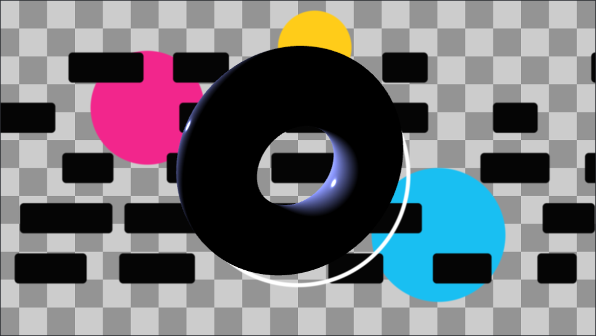

*Preview (Lights stage):* the front of the torus is black. Only a thin band on the left outer edge and the inner wall on the right side of the hole catch the rim light.

Two automated tests check the rule pixel by pixel. The first tests the material's own maths. With no Light COMPs, *Auto* uses the built-in key light. Raising **Key light intensity** from 0 to 1 changes none of the 19,963 pixels whose normal faces away from the key, darkens no pixel, and brightens 46,181 of the 46,356 pixels facing it (`builtin_key_adds_energy_only_where_NdotL_positive`). The second adds a distant Light COMP: none of the 15,365 away-facing pixels changes (`light_adds_energy_only_where_NdotL_positive`). There the N·L comes from the preview's stand-in for `TDLightingPBR()`, so that test only shows the material adds nothing of its own on the far side.

{{experiment:highlight_size}}

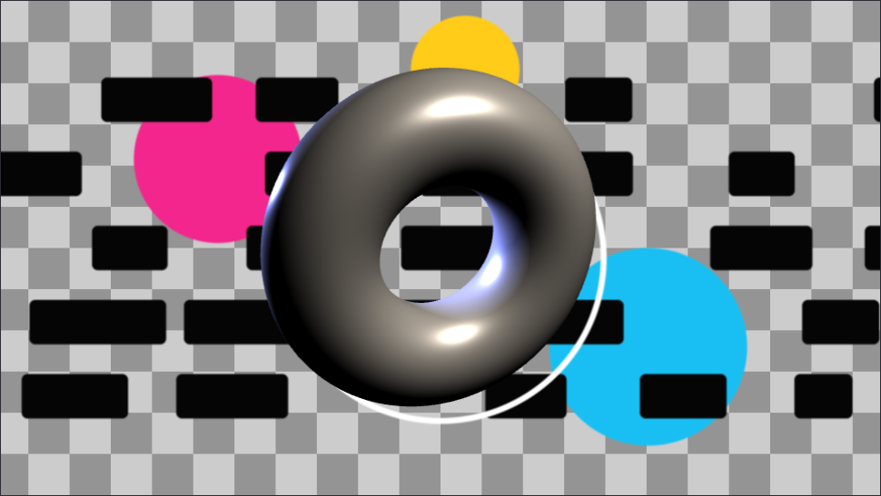

*Preview (Lights stage):* compared with `scene_lights`, the highlights spread into broad sheens while the diffuse shading stays the same.

## Reflect the Environment Light

Where do reflections come from, without a Reflection TOP?

An **Environment Light COMP** holds an environment map: a picture of everything around the scene, usually a 360 panorama. `reflect()` mirrors the viewing direction around the normal. The direction it returns says which part of the environment this pixel reflects.

Two details make this work with any Environment Light. First, the light's own **Environment Map Rotate** reaches the shader as a matrix, `uTDEnvLights[i].rotate`. Multiplying the direction by it turns the reflection when you turn the map. Second, a map can be a 2D panorama or a cube map. `TDEnvLightTextureLod()` has one version for each, and the version for the other kind returns black. The material calls both and adds them, so whichever kind the light uses comes through. `TDCubeMapToEquirectangular()` turns a direction into a panorama coordinate in TouchDesigner's own layout. The result is multiplied by the light's colour, `uTDEnvLights[i].color`.

{{code:liquid_glass_lit.frag:envlight}}

When the scene has no Environment Light, the built-in studio from the core study takes over: a dark room with soft white light strips. **Built-in > Studio rotation** turns it.

{{code:liquid_glass_lit.frag:studio}}

{{experiment:env_reflection}}

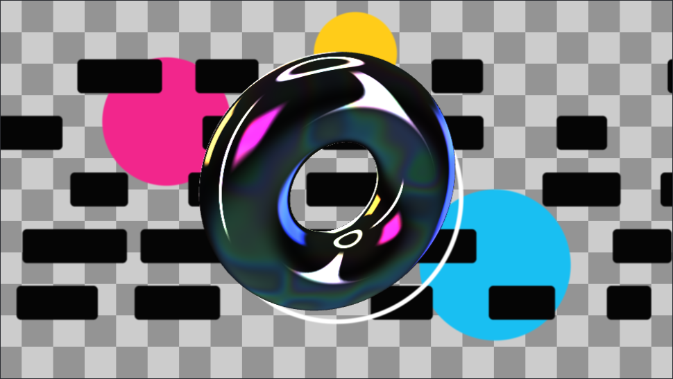

*Preview (Reflection only stage):* the blue-violet, magenta and warm panels of the demo map curve around the torus, brightest at its edges, where the fresnel term is strongest.

{{experiment:env_rotate}}

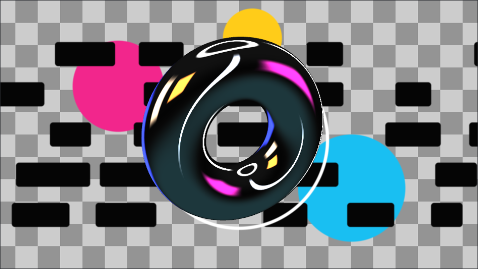

*Preview (Environment stage):* the panels have moved around the torus. An automated test confirms that a full 360-degree turn gives exactly the original image and 90 degrees changes it (`env_rotation_reaches_reflection`). Which way TouchDesigner turns the map for a positive angle is a native check: compare with a PBR MAT sphere lit by the same Environment Light.

## Rough reflections are blurrier mipmaps

How does a rough surface blur its reflection without grain?

A rough surface scatters each reflection over a cone of directions instead of one. Averaging many random directions would blur it, but with few samples it looks grainy, and this family of studies avoids grain. A **mipmap** is a chain of pre-shrunk copies of a texture, each half the size of the last, so each level is a blurrier version of the map. Reading a higher level costs one lookup and gives a smooth blur.

The material picks the level as roughness times **Lighting > Environment blur range**. This mapping is this study's own choice. About 10 suits a 1024-wide map: level 10 is the last one, a single pixel wide. A third-party TouchDesigner shader uses a similar rule, but it reads a prefiltered copy of the map that Derivative does not document. `TDEnvLightTextureLod()` reads the map itself, so how blurry its levels are in TouchDesigner is a native check. The material also averages eight nearby directions on a small disc, so the blur stays smooth where a map has coarse or missing mipmap levels.

{{code:liquid_glass_lit.frag:roughness}}

{{experiment:env_roughness}}

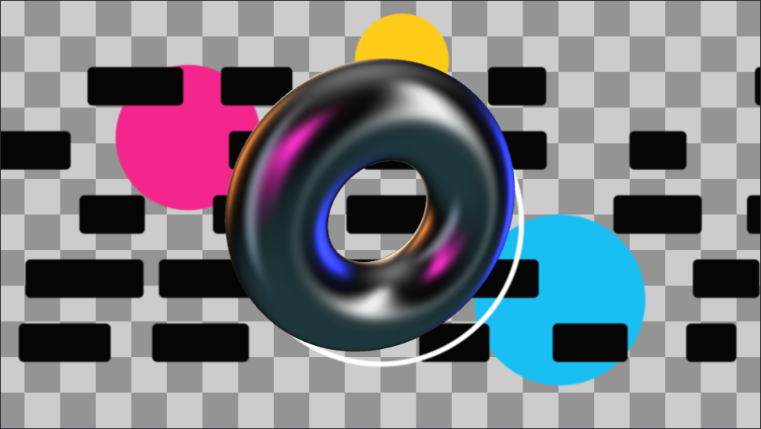

*Preview (Environment stage):* the same panels as soft glows, with no steps and no ghost copies. An automated test measures the colour gradient of the reflection on a sphere at six roughness values and divides it by the mean brightness, so a reflection that only got darker would not pass. It falls at every step, for the Environment Light (0.44 at roughness 0 down to 0.002 at 0.9) and for the built-in studio (0.53 down to 0.15), and the brightness never drops below 60% of the sharp reflection's (`env_roughness_blurs_monotonically`). The rough studio gets brighter, because its softened light strips spread wider. The preview's mipmaps are plain averages of 2×2 pixels; TouchDesigner's may differ.

A panorama has a seam where its left and right edges meet, in the +X direction. The preview wraps the panorama across it. Whether TouchDesigner does so for its blurry levels is another native check.

{{experiment:env_seam}}

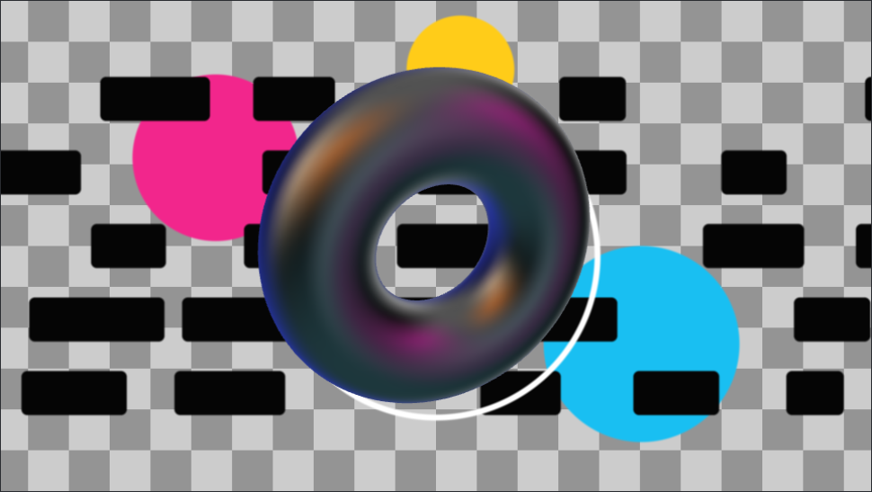

*Preview (Environment stage):* soft glows and no line, as expected from a preview that wraps the panorama. The TouchDesigner result is pending.

## Light the body, not only the surface

How does milky glass take the scene's light?

Clear glass shows mostly what is behind it. Milky glass, a gel or a jelly, also scatters light inside its body. **Translucency** mixes the two: at 1 you see the bent, tinted view through the glass, at 0 the glass's own body colour. The body is lit by two kinds of light. **Direct** light comes from the Light COMPs and only reaches the side facing them. **Ambient** light comes from all around and keeps the shadow side from going black.

Ambient light has three possible sources. Ambient Light COMPs arrive summed in `uTDGeneral.ambientColor`. Each Environment Light COMP gives a smooth average of its map through `TDEnvLightingPBR()`; the material uses only its diffuse part. Without an Environment Light, a soft average of the studio stands in. **Ambient on the body** scales it.

{{code:liquid_glass_lit.frag:ambient}}

The composition puts the pieces together. Light reaches the body and the surface, never the view through the glass: `through * tint` stays exactly what the Refraction TOP shows, tinted by the glass. Reflections, highlights, surface diffuse and the rim glow are added on top. **Opacity** scales everything, and the output is premultiplied alpha, as in the core study.

One formula covers every scene. Where the Refraction TOP covers the view (`covered` = 1), the glass shows the bent scene and is opaque. Where the scene render is transparent, or no Refraction TOP is connected (`covered` = 0), there is nothing to bend, so alpha drops by the share of light that passes and the real background behind the glass shows through by blending. **Energy conserving** (off by default) takes the reflected share out of the view through the glass, so Mirror 1 becomes a true mirror. Then `TDFog()` adds the Camera COMP's fog, only the glass's own share of it, since what shows through keeps whatever fog its own render gave it. Built-in MATs fog by themselves; a GLSL MAT fogs only if it calls `TDFog()`. The demo's backdrop card does not, so in the demo only the glass fades into fog. A very tight highlight can be thousands of times brighter than white, so the colour is capped at 1024 to stay finite in a 16-bit float render. The teaching stages get the same cap.

{{code:liquid_glass_lit.frag:compose}}

{{experiment:body_light}}

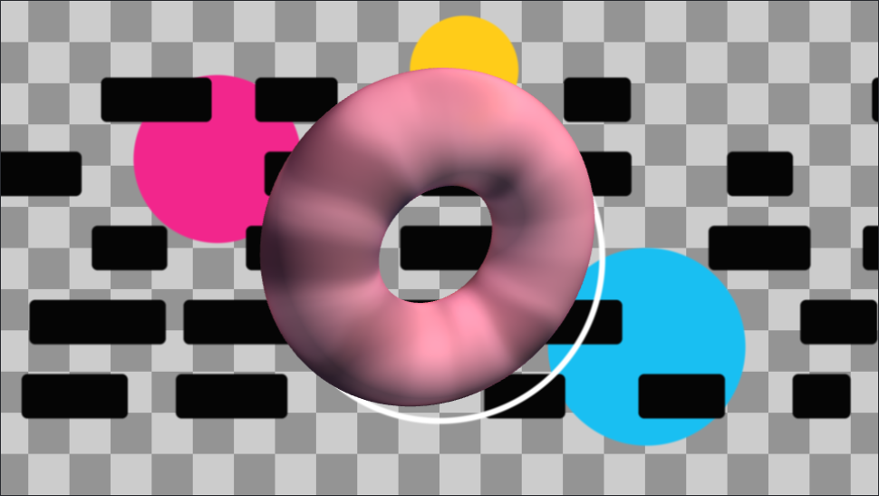

*Preview (Glass body stage):* the torus is bright pink on the right, where the key light reaches it, and keeps a dimmer pink on the left from the Environment Light's ambient. Faint dark bands are the backdrop's black bars, still visible through the 35% translucent body.

## Twelve looks and a morph

How do presets and morphing reach the shader?

The shader only sees fifteen sets of four numbers, its **uniforms**, plus the Refraction TOP. Each parameter on the component feeds one of those numbers through an expression on the GLSL MAT's Vectors page. Presets work exactly as in the core study: choosing one copies its values into the parameters, and **Morph** blends every look-related value toward the **Morph target**. Presets set the look only. The light sources, environment intensity, shadow strength and built-in light are scene settings, and presets leave them alone. A preset therefore keeps working in any lighting. **Object size** is a setup value too: it is the object's size in the world, with the Geometry COMP's scale counted. Lengths such as Thickness are multiplied by it and the ripple and film frequencies divided by it, so a preset looks the same on a small or a large object. The ripples and film are worked out on the object's own coordinates, so they stick to it. The shader multiplies those coordinates by the Geometry COMP's scale (the cube root of its world matrix's determinant), so they follow Object size whether you sized the object in its SOP or with the COMP's Scale (`fit_size_carries_presets_over_comp_scale`).

Morphing also changes **Wobble speed**, and that is where time comes in. If the shader computed the ripple drift as speed × the time since TouchDesigner started, a speed change after an hour would throw the pattern a long way in one frame. So the component adds up speed × frame time every frame, in Python's double precision, and hands the result to the shader in `uPhase`, wrapped at 256. The noise repeats every 256 units, so the wrap does not show. An automated test plays one frame of a morph after an hour: it changes the image no more than after two seconds (`morph_frame_is_smooth_after_an_hour`).

{{code:liquid_glass_lit.frag:uniforms}}

{{experiment:morph}}

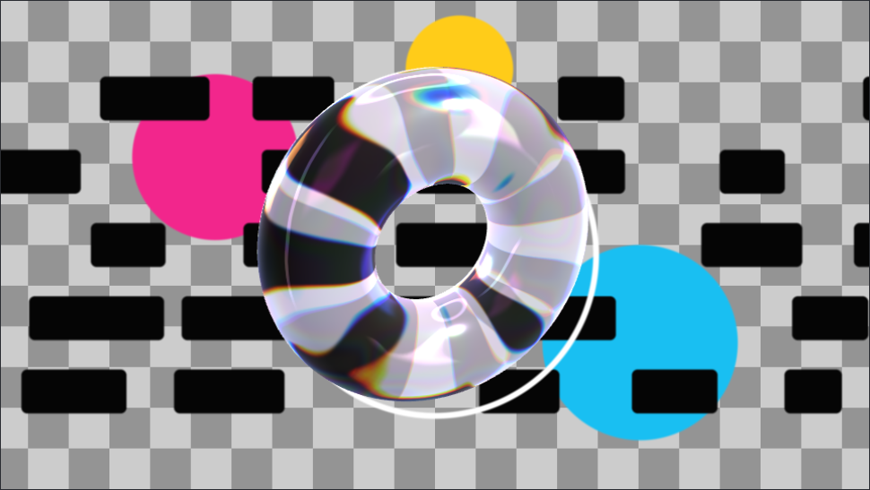

*Preview:* a faintly violet glass with softer fringes, under the same lights and reflections. Automated tests confirm that Morph 1 renders exactly the target preset and Morph 0 changes nothing.

{{experiment:final}}

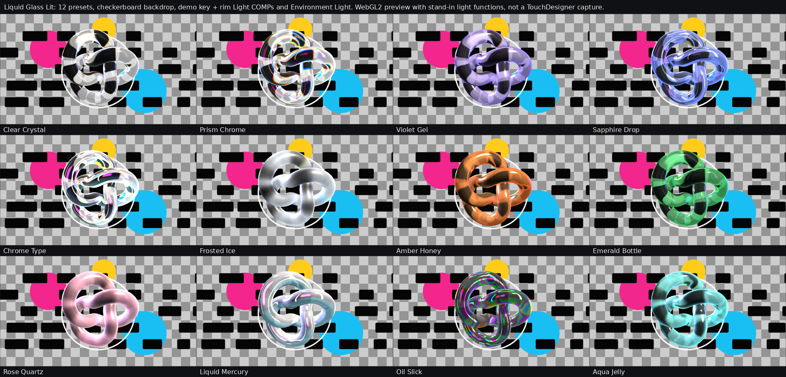

*Preview of all twelve presets on a knot (the knot exists only in the preview; the TouchDesigner demo uses a torus), lit by the demo key and rim lights and the Environment Light. [The same sheet over the Type backdrop](captures/presets-sheet-type.png) compares with the other family studies.*

## Use it in your own lit scene

How do you put the glass into a scene where things can pass in front of it?

Draw it into the scene render, the way Heckel's article does in WebGL: render the scene without the glass, then draw the glass into that render (refraction article, lines 140–154). In TouchDesigner that is a **Render Pass TOP**. It starts from another render's colour and depth, so anything already drawn in front of the glass hides it.

1. Render your scene without the glass in a Render TOP, Render Mode 2D, and set it as **Inputs > Refraction TOP**.
2. Set your glass Geometry COMP's **Material** to `liquid_glass_lit/material`.
3. Wire that Render TOP into a Render Pass TOP with the same camera, only the glass as Geometry, and the lights that should light the glass. Turn **Clear Depth Buffer** and **Clear to Camera Color** off, and **Dither** off on both renders: the glass never calls `TDDither()`, but dithered built-in materials would be bent through it.
4. If your glass is much smaller or larger than the demo torus, press **Inputs > Fit to Glass geometry**. It sets **Object size** from the objects that wear the material (this study has no Glass geometry field; it finds them for you), measured in the world, so a Geometry COMP's Scale counts.

That is all. No light direction to type, no Reflection TOP to connect. The demo uses the same network: `demo_scene` draws the backdrop on a card at the far plane and, if you ask for it, a dark bar in front of the torus; `render` is the Render Pass TOP.

The material finds its place in the Refraction TOP from the pixel's position on screen, and it turns scene units into a screen offset with the camera's own projection:

{{code:liquid_glass_lit.frag:screen}}

Both steps assume the render is one flat picture from one camera. So keep Render Mode at 2D: in Cube Map or Fish-Eye renders the glass still lands in the right place, but the bend reads the wrong part of the scene. With several cameras, give each one its own scene render and glass pass.

`screenSign()` checks which way the screen runs. It projects the pixel's own point with the camera's projection and compares where it lands with where the pixel actually is. If a build drew screen y upside down relative to the projection, every bend would go the wrong way; the sign turns it back. An automated test emulates such a build and gets the exact mirror image (`bends_follow_screen_orientation`). One row and one column are the exception. In a render with an odd width or height they sit exactly on the screen's centre lines, where both positions are 0 and there is nothing to compare. There the sign of a screen derivative decides: how the projected position changes to the next pixel. `main()` takes it at its very top, where every pixel still runs the same code. On a nearly edge-on surface the next pixel's position is a poor guess, so the tie gives +1 there. A second test counts the wrong signs at every glass pixel of the twelve presets on three objects, in both orientations and at an even and an odd size (`screen_orientation_has_no_wrong_pixels`). It also shows the remaining limit: with antialiasing, a pixel the glass only partly covers is shaded at its centre, outside its own triangle, and near a centre line a few of those still get the wrong sign. In this study's preview they change at most 6 pixels in twelve frames, by up to 26/255, and only where the raster runs the other way. Whether that shows in TouchDesigner is an open family question, with a native check pending. A centroid-sampled position removed most of them in the usual raster in a wider preview sweep, but no TouchDesigner build has run one, so the shader does not use it yet.

The vertex shader's `main()` is also ready for a **Render Pick DAT or CHOP**. It places the point first, which every render needs. Then it follows the form printed on Derivative's *Write a GLSL MAT* page: for a pick render TouchDesigner defines `TD_PICKING_ACTIVE`, so of the branch only the `#else` block runs, where `TDWritePickingValues()` writes the values the pick reads. An ordinary render runs the other block and calls `passToPixelStage()`. Its code is the core study's vertex shader (only the comments differ), and a unit test keeps it that way.

{{code:liquid_glass_lit.vert:picking}}

{{experiment:occluder}}

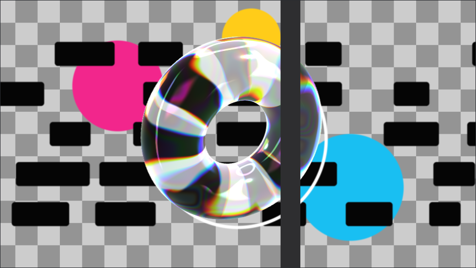

*Preview:* the bar stays in front of the torus. To its right, the glass shows a dark, bent copy of the bar: the Refraction TOP is the scene render, and the bar is in it. An automated test compares the bar with and without the glass: 0 of 20,444 bar pixels change (`occluder_stays_in_front`). The same test models the earlier recipe, a glass render laid over the scene with an Over TOP. There the glass covers 10,559 of the bar's pixels. An Over TOP is still fine over a flat image or video with nothing in front of the glass. The [README](README.md) has the details.

The scene behind the glass changes the look a lot. **Study > Demo backdrop** swaps the checkerboard for bold white type on black, the backdrop the core and Prism studies use too.

{{experiment:type_backdrop}}

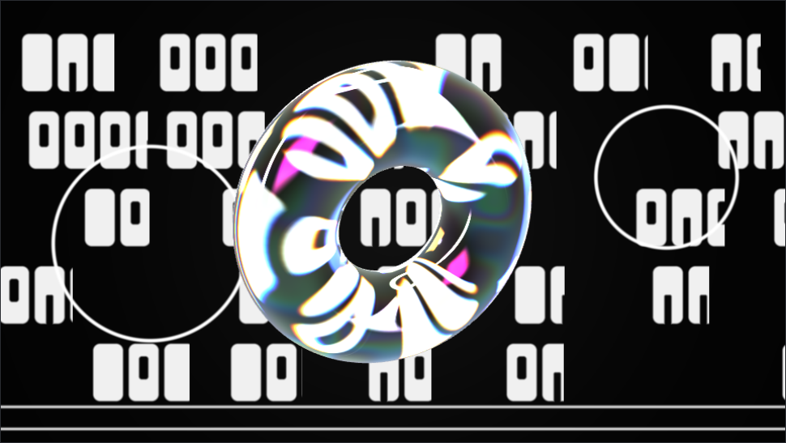

*Preview:* the white letters bend around the torus and break into thin colour fringes at their edges; the reflections are the same as over the checkerboard. An automated test confirms that *Checker* is still the earlier backdrop exactly and *Type* is mostly black with heavy white ink (`backdrop_menu_switches_the_demo_scene`).

## Limits

- **Not yet run in TouchDesigner.** The shaders compile as GLSL 4.60 against stand-ins for every light setup tested, and the preview passes its tests, but the stand-in light functions are not TouchDesigner's. Absolute brightness of scene lights can differ from the preview. See [validation.json](validation.json).
- **Signature risk.** The material calls the seven-argument `TDEnvLightingPBR()` that TouchDesigner's own shader preamble defines. Derivative's page lists a mixed form with extra arguments. If your build reports a compile error there, that line is the place to look.
- **Reflections need a map.** An Environment Light COMP without a map reflects black. Give it a map, or set **Environment** to *Built-in only*.
- **Glass casts opaque shadows.** A shadow map treats the glass as solid. Keep it out of a light's Shadow Casters if it darkens itself.
- **Light never passes through.** A light behind the glass does not shine through it toward the camera; only its edges catch it. The view through the glass comes only from the Refraction TOP.
- **Only what the camera sees can be refracted,** and the bend is a single-surface approximation, as in the core study.
- **Fog is an approximation.** `TDFog()` adds the glass's own share of the fog colour; the bent scene keeps any fog its own render gave it and gets the glass's fog on top. The demo scene render is unfogged: its backdrop card is a GLSL MAT that never calls `TDFog()`. TouchDesigner's fog is a pending native check. With several colour buffers, the extra ones get zero.
- **Partly covered scene pixels count twice.** Where the Refraction TOP's alpha is between 0 and 1 (antialiased edges of a transparent scene render), the glass draws the bent scene and blending adds the scene behind it again by the see-through share.
- **Objects in front can show up bent inside the glass,** next to their edges, because the Refraction TOP contains them.
- **One flat camera view.** Render Mode 2D and one camera per glass render.
- **One Object size per component.** Fit measures when you press it and takes the largest object that wears the material. A smaller object, a Geometry COMP whose Scale changes after Fit, and an instance with its own scale all keep that one Object size. At a fifth of the size the glass bends and tints as if it were five times larger; scaled up three times without a new Fit, as if it were three times smaller. Instanced glass is placed, turned and lit per instance through `TDDeform`, and its ripples and film bands grow with it, but their tilt ignores its rotation. The README lists the workarounds; a change that would let all three follow is recorded in [decisions.json](decisions.json) and waits for the user's decision.
- **The preview is not TouchDesigner.** Its light functions are stand-ins, its mipmaps are plain averages, it wraps the panorama sideways and it has no cube-map Environment Light.
- **Colour parameters convert the transfer curve only.** *Auto* follows the project's working colour space for the typed glass, reflection, rim and built-in key colours; wide-gamut primaries are not converted. The previews show *As typed*.

## Credits

Refraction through a render of the scene, multi-sample dispersion, saturation, the diffuse N·L term, the glass highlight and the fresnel glow come from Maxime Heckel, [Refraction, dispersion, and other shader light effects](https://blog.maximeheckel.com/posts/refraction-dispersion-and-other-shader-light-effects/). His article credits the sampling technique to the open-source Junni site by @ore_ukonpower, and the colour-channel split to research by Ravishankar Sundararaman. Copying scene light data into a shader each frame is shown in his [Shaping light](https://blog.maximeheckel.com/posts/shaping-light-volumetric-lighting-with-post-processing-and-raymarching/) article. The GGX highlight follows the widely used Cook-Torrance model (Walter et al. 2007; Karis 2013). The TouchDesigner implementation is newly written and builds on the core Liquid Glass study (commit a6f95c6, brought up to its audit rounds 2 and 3 and its family sync). The frost disc uses Martin Roberts' R2 quasirandom sequence. TouchDesigner API details follow Derivative's documentation (Write a GLSL MAT, GLSL Reference, Environment Light COMP, Render TOP). [sources.json](sources.json) lists each source's lines and how it was adapted.
