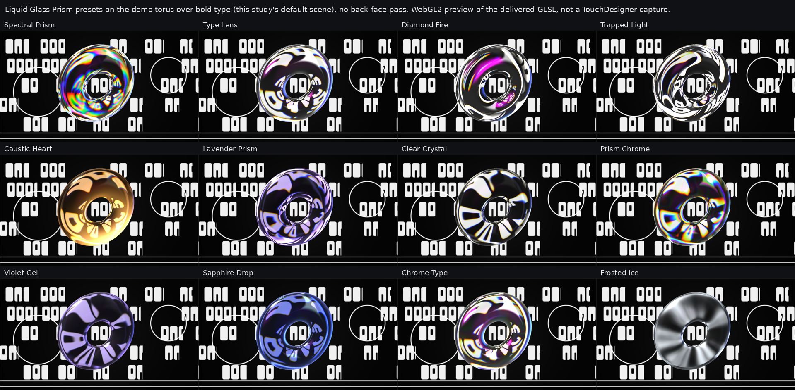
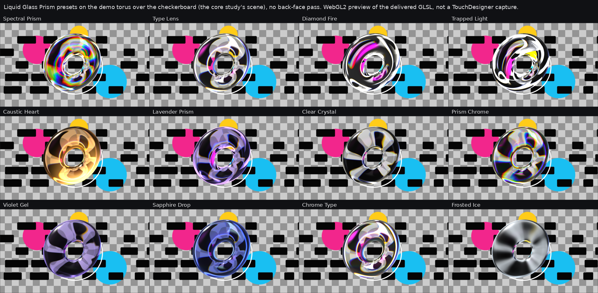
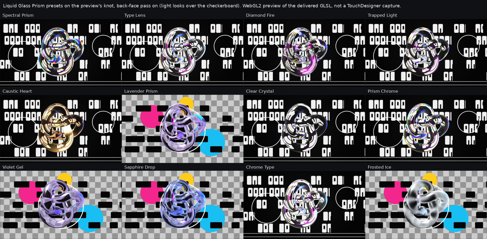
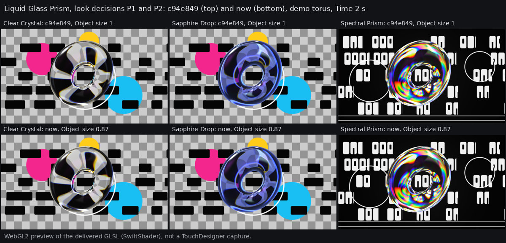

# Liquid Glass Prism for TouchDesigner

A glass material for any 3D object that bends light twice: where it enters and where it leaves. Each colour bends by its own amount at both surfaces, so edges seen through the glass break into a wide, correctly ordered rainbow. Where the far side is too steep, light is trapped and reflected back inside (total internal reflection), which gives the bright bands of cut glass. An optional glow imitates light the glass focuses. It is the physically richer member of the Liquid Glass family; the [core study](../liquid-glass/) bends light once and is cheaper.

[Tutorial: how it works](article.md) · [Research](research.md) · [Decisions](decisions.json) · [Review](review.md) · [Validation status](validation.json)



*WebGL preview of the delivered GLSL on the demo torus over this study's default scene (bold type on black), without the back-face pass. [The same presets over the core study's checkerboard](captures/presets-sheet.png) compare with the other family members. TouchDesigner has not rendered this material yet; see [Status](#status).*

*This study moved from `studies/liquid-glass-prism/` to `examples/liquid-glass-prism/` in commit 66b4eb8. Records written before the move (sources.json and decisions.json) cite the old path.*

## What you get

| File | What it is |
| --- | --- |
| `liquid_prism.vert`, `liquid_prism.frag` | **The shader.** Vertex and pixel code for a GLSL MAT. Both materials use the same two files. |
| `build.py`, `builder.py` | Builds a ready `liquid_glass_prism` component in your project from the Textport. |
| `presets.json`, `presets.py`, `preset_exec.py` | The twelve looks, the preset loader, the morph and the drift clock for ripples and film (the core study's module). |
| `backdrop.frag`, `env.frag` | Demo inputs: a backdrop (bold type on black, or the core study's checkerboard; the same file as the core's) and a studio panorama. |
| `native.py` | Helpers inside TouchDesigner: load an experiment, inspect, capture, export. |
| `study.json` | The recipe the builder follows: every node, parameter and uniform binding. |
| `article.md` | The tutorial, with experiments you can load. |
| `checks/` | Compile check, WebGL preview, property tests and unit tests (run outside TouchDesigner). `checks/reference/` keeps the shaders and presets as they were before the family sync (commit 6a58487), as test data. |

## Quick start

1. Download or clone this folder and note where it is.
2. In TouchDesigner (2025.x), open the Textport (Dialogs > Textport and DATs) and run, with your own path:

   ```python
   import runpy
   component = runpy.run_path('/path/to/liquid-glass-prism/build.py')['build']()
   ```

3. A `liquid_glass_prism` component appears in `/project1`. Open its viewer: a glass torus over bold white type. Pick a look from **Glass > Preset**. The Textport also prints the material's full path; `component.fetch('material_path')` returns it.
4. For the measured exit, turn on **Inputs > Back-face pass**. The demo already points it at the demo camera and torus.

If the build prints warnings, they come in groups that say what they affect: *demo* (cosmetic, the material is fine), *material* (a sampler setting failed: frost or blur may look stepped), *inputs* (an Inputs field stayed in expression mode), *optional* (the back-face pass may render while off), *dither* (turn a Render TOP's Dither off by hand) and *setup*. They are stored in `component.fetch('build_warnings')`.

## Use it on your own objects

The material needs to see what is behind the glass. So you render your scene once without the glass and hand that image to the material. Then you draw the glass into that same render, so objects in front of the glass still cover it.

1. **Scene without glass.** Make a Render TOP (here `render_scene`) with your camera and every object except the glass. Drag it onto **Inputs > Refraction TOP**. Its background may be transparent: where it is, the glass lets whatever is behind it show through (see the notes).
2. **Reflections.** Drag a TOP onto **Inputs > Reflection TOP**: a 360 panorama with **Reflection map** = *360 panorama TOP*, or any image with *Flat image TOP*. For the built-in studio, set **Reflection map** to *Built-in studio*. Trapped light heading back toward the camera also reads this.
3. **Draw the glass into the scene.** Add a Render Pass TOP and wire `render_scene` into it. Set its **Camera** to your camera and its **Geometry** to the glass objects only. Turn off **Clear Depth Buffer** and **Clear to Camera Color**, so it keeps the scene's depth and colour. On its Advanced page, set **Override Material** to the component's material: drag the `material` node inside `liquid_glass_prism` onto the field, or type the full path the build printed (for example `/project1/liquid_glass_prism/material`). Keep its resolution, pixel format and anti-aliasing the same as `render_scene`.
4. The Render Pass TOP's output is the finished image. The glass bends the scene behind it, and anything in front of the glass still covers it, because the scene's depth is kept. Nothing else has to be listed anywhere.
5. **Turn Dither off** on `render_scene` and the Render Pass TOP (Advanced page). The material never dithers, and the component's own renders have Dither off; this keeps the whole image free of dithering noise. (The documentation does not state the default; this is a precaution.)
6. **Object size.** Point **Inputs > Glass geometry** at your glass objects and press **Inputs > Fit to Glass geometry**. It measures them and sets **Object size**: their radius in the world over 1.45, the radius of the core study's demo torus. That is the rule for the whole Liquid Glass family ([Liquid Glass Lit's decisions.json](../liquid-glass-lit/decisions.json), `family_rule`), so a preset or a typed value means the same object size in every member. This study's demo torus is a little wider than the core's: half its largest side is 1.5, not 1.45. But its Geometry COMP flattens it to 0.6 in depth, and Fit counts a non-uniform scale as its average, the cube root of 0.6 (0.843). So Fit measures 1.5 x 0.843 = 1.265 and sets **0.872517**, the default. Thickness, Scene depth, Frost, Tint density and the ripple and film patterns then look the same on your object as on the torus, whether it is ten times smaller or larger, and whether you sized it in its SOP or with its Geometry COMP's Scale. Presets and experiments never change Object size. If you press nothing, it stays at the demo's 0.872517; at Object size 1 every length is in scene units.
7. **Scene depth.** Set **Optics > Scene depth**. It is a lens strength, in units of Object size: how far bent light travels behind the glass before it meets the scene. Start around 1 to 3. It is not the literal distance to your background; larger values bend and magnify more, and very large values squeeze much of the scene into a blurred average.

Never put the glass itself in `render_scene`: the material would sample its own output.

That is all the wiring it needs. Without the back-face pass, the shader guesses the far side of each pixel as a ball of diameter **Thickness**. It works on any object and never breaks; it is exact for balls, at every wavelength. For thin flat glass (windows, ribbons, open surfaces with **Faces** = both sides), set **Prism > Exit tilt** to -1 and **Thickness** to the sheet's thickness.

Notes:

- Override Material puts the glass on every object in that pass, nested ones included, and leaves your Geometry COMPs untouched. One pass shows one look; for a second look, copy the component and add a second Render Pass TOP after the first.
- You can instead set each glass Geometry COMP's **Material** to the `material` node and leave Override Material empty. With the back-face pass on, that creates a loop of parameter references (glass object, material, `render_back`, glass object), which TouchDesigner may report as a dependency loop; Override Material avoids it. Not yet checked natively.
- Not yet checked natively: that the material may sample `render_scene` while the Render Pass TOP draws on top of it. If TouchDesigner reports a problem, render the glass alone in its own Render TOP with a transparent background and lay it over `render_scene` with an Over TOP, as the demo inside the component does. That loses occlusion: objects in front of the glass are then painted over.
- Objects in front of the glass are also in the Refraction TOP, so they can appear bent inside the glass as well.
- **Transparent scene renders.** The material reads the Refraction TOP's alpha. Where the scene render is empty (alpha 0), the glass bends nothing there and blends with what is behind it instead, so a glass layer over a transparent background stays transparent, ready to lay over a plate later. Trapped light that heads into an empty part of the scene reads the reflection environment there, as it does with no Refraction TOP. Limit: where the scene is only partly covered (alpha between 0 and 1, as on antialiased edges), that part of the scene is counted twice and looks slightly brighter and more opaque behind the glass.
- **Object size and a scaled Geometry COMP.** Object size is the object's size in the world. Fit to Glass geometry multiplies the SOP's size by the Geometry COMP's scale (its parents' included), and the shader multiplies the ripple and film lookups by the same scale. So a preset looks the same on an object scaled by its COMP as on one built at that size in its SOP. A non-uniform scale counts as its average (the cube root of the volume change). For instances, see the next note.
- **One Object size per component.** Fit to Glass geometry measures when you press it, and its one Object size serves every object the component draws. Three setups break that. The numbers come from this study's own Fit code and uniforms ([review.md](review.md#family-critic-native-runs-and-one-object-size)):
  - *Objects of different sizes.* Fit takes the largest. An object a fifth of its size bends and tints as if it were five times larger, with ripples and film bands five times larger. Give each size its own copy of the component and its own Render Pass TOP.
  - *A Geometry COMP Scale that changes or is animated.* Thickness, Scene depth, Frost, Tint density and the ripples and film bands keep the world size Fit measured. Scaled up three times without a new Fit, the glass bends and tints as if it were three times smaller and shows three times as many ripples and film bands. Press Fit again after a scale change. For an animated scale, animate Object size by the same factor.
  - *Instances.* Positions and normals go through `TDDeform`, so each instance is placed, turned and scaled. Fit and the shader see the Geometry COMP's scale, not each instance's. On an instance scaled 3 the ripples and film bands grow with it, but it bends and tints as if it were three times smaller. The ripples' tilt also ignores each instance's rotation, so on a turned instance they tilt the wrong way. For instances of different sizes, use one Geometry COMP and one copy of the component per size.

  A change that would let all three follow by themselves is proposed and waits for your decision ([decisions.json](decisions.json), *Family critic: one Object size per component*). None of this has run in TouchDesigner.
- **Fog.** The glass takes the Camera COMP's fog (TDFog): it adds only its own share of the fog colour, because the scene behind it is fogged in its own render. Not yet checked natively.
- **Render Pick DAT/CHOP and extra colour buffers.** The vertex shader uses the picking form on Derivative's Write a GLSL MAT page: a pick render still places the point, then runs only `TDWritePickingValues()`, and writes none of the material's own outputs. In a render with several colour buffers, the glass writes zeros into buffers 1 and up, which leaves them as they were. Both are compile-checked only; native checks pending.

**The Inputs fields** start out pointing at the demo nodes. Drag a node onto a field or type its path to use your own; clear the field to leave it empty; right-click > Reset to Default brings the demo back. If the build printed an *inputs* warning, that field holds a Python expression instead of a path: switch it to constant mode first (click the field's mode indicator on its left), then edit it.

**Without a Refraction TOP** (field cleared), the glass can't bend anything. It then blends with whatever is behind it, using alpha: clear parts are see-through, tint, reflections, trapped light and the caustic glow stay. The glass must be drawn after the objects behind it: the Render Pass TOP above does that.

**Opacity below 1, or no Refraction TOP:** the glass writes depth, so the parts of one self-overlapping object (a knot, a tilted torus) can hide each other depending on triangle order. Set the render's **Transparency** to *Order Independent Transparency* in those cases (not tested). The shader lets TouchDesigner discard pixels for it only after its last screen derivative, so the blur levels stay defined.

### Optional: back-face pass (measured exit)

Turn on **Inputs > Back-face pass** and point **Camera** and **Glass geometry** at your camera and glass objects (with the default fields it renders the demo torus and camera). `render_back` renders every object that Glass geometry lists, with Dither off. For several objects, type their paths separated by spaces, or a pattern such as `glass*`; if your build's Glass geometry field takes only one object, type the paths into `render_back`'s Geometry parameter instead (not yet checked in TouchDesigner). The component then renders the far side of the glass once more (`render_back`) into one RGBA 32-bit float image: the far side's normal, and its distance from the camera stored as a negative number. The front pass uses them to find where each ray really leaves. Costs one extra render; it only cooks while the toggle is on. While it is on, **Exit tilt** only affects pixels where the pass has no data, mainly near silhouettes.

To check the wiring, run `component.op('study_tools').module.inspect(component)['backface']`. It lists missing references and a resolution mismatch, and warns when Camera or Glass geometry still point at the demo while the Refraction TOP is your own. `backface_report(component, sample=True)` (same module) also reads `render_back` back once and counts the texels that hold glass; use it to check, never every frame.

## Controls

The **Glass**, **Reflection**, **Light** and **Liquid** pages are the core study's, with the same names, ranges and meaning; core presets load unchanged. See the [core README](../liquid-glass/README.md) for those tables. In short: Glass colour, Tint density, Edge tint, Translucency, Opacity, Frost; Reflection map, colour, amount, Mirror, Energy conserving, blur, Fresnel falloff, Rim; Light direction (0, 0, 0 counts as straight up), colour, Specular, Shininess, Diffuse; Iridescence, Film thickness and variation, Wobble, scale and speed.

- **Energy conserving** (Reflection page, off by default and in every preset): what the surface reflects no longer also shows through, trapped light and the caustic glow included, so Mirror 1 is a true mirror.
- **Wobble speed** changes how fast the ripples and the film drift, never where they are, even while you morph or after days of running. 0 holds them still and stops the per-frame updates.
- **Wobble scale** counts ripples per Object size. The ripples stick to the object and count the Geometry COMP's scale, as Object size does, so at the fitted Object size they keep their size on a scaled object; scaling the COMP never changes their strength.

**Optics page**

| Control | What it does |
| --- | --- |
| Index of refraction | How much the glass bends light at each surface (1 = not at all, water 1.33, glass 1.5, diamond 2.4). Also sets the critical angle: higher IOR traps more light. |
| Thickness | Without the back-face pass, in units of Object size (scene units while Object size is 1): the diameter of the ball the shader assumes at Exit tilt 0, the thickness of the sheet at Exit tilt -1. Also the tint path. |
| Dispersion | Splits colours. At 1 the spectrum spans 0.3 IOR from red to violet, at both surfaces. |
| Saturation | Colour intensity of what you see through the glass. |
| Samples | Spectrum slices per pixel (default 16). At Dispersion 1, 16 slices differ from 64 by 0.6 to 2.2/255 on average in the preview. Raise for very strong dispersion, lower for speed. |
| Scene depth | Lens strength, in units of Object size: how far bent light travels behind the glass before it reads the scene. More depth, more bend and magnification. Not the literal distance to your background. |

**Prism page**

| Control | What it does |
| --- | --- |
| Exit tilt | Shape of the guessed far side, used without the back-face pass (and, with it, only where the pass has no data): -1 = a flat sheet parallel to the near side (windows, thin ribbons, open surfaces: shifts the view, no net bend), 0 = a ball (never traps light, at any wavelength), 1 = a steeper wall that traps light at the rims. Default 0.45, the Spectral Prism value; on the demo torus it traps more light than the measured exit does (0.3, used by the six core looks, is closer). |
| Inner reflection | Strength of trapped light (one bounce inside). 1 = physical share. |
| Caustic glow | A soft spot of light focused onto the far wall, opposite the light. 0 = off. |
| Caustic spread | Widens the glow without dimming it. 1 = ball-lens size. |

**Inputs page**

| Control | What it does |
| --- | --- |
| Refraction TOP, Reflection TOP | The scene behind the glass, and what it reflects. |
| Faces | Front only for closed objects, both sides for open surfaces like ribbons. |
| Back-face pass, Camera | Optional measured exit (see above). |
| Glass geometry | Your glass objects: for the back-face pass and for Fit to Glass geometry. |
| Object size | How big your glass object is in the world: its radius over 1.45, the core study's demo torus (the family rule; a Geometry COMP's scale counts). This study's flattened demo torus is 0.872517, the default. Thickness, Scene depth and Frost are multiplied by it, Tint density and the ripple and film patterns divided by it, so presets carry over between small and large objects. Presets and experiments never change it. |
| Fit to Glass geometry | Measures Glass geometry (half the largest side of its SOP's bounds, times the Geometry COMP's scale, over 1.45) and sets Object size; the demo torus measures 0.872517, the default, so pressing it on the demo changes nothing. Scripts call it `Fitglass`, as in every family member ([names across the family](../liquid-glass/README.md#names-across-the-family)). |
| Flip screen V | Escape hatch if the inputs arrive upside down (see troubleshooting). |
| Colour parameters | *Auto* follows the project's working colour space (see Colour). |

**Study page:** Pause and Fixed time (for repeatable looks; unpausing continues the motion from that frame), Teaching stage (shows one ingredient: the core's normal, refraction, body, reflection, fresnel, thickness, film and screen UV, plus Exit normal, Exit deviation, Trapped share, Inner bounce only, Caustic glow only), Demo spin, Demo backdrop (*Bold type on black*, this study's scene and the default, or *Checkerboard with discs*, the core study's scene, so the family's contact sheets compare), Demo render (turn it off once the material is on your own objects).

**From a script,** load a look with `component.op('presets').module.apply(component, 'lavender_prism')` and set any overrides after it; the values are written at once. Setting the Preset menu from a script goes through its callback instead, which may apply the look at the end of the frame, over overrides set in the same script.

**Tutorial experiments:** `component.op('study_tools').module.apply(component, 'critical_high')` first returns these controls to their defaults, so experiments can run in any order: every preset value, Morph and Morph target, Samples, Energy conserving, Panorama rotation, Flat image warp, Light direction, Back-face pass, and Pause, Fixed time, Teaching stage, Demo spin and Demo backdrop. It leaves your setup alone: Refraction TOP, Reflection TOP, Reflection map, Faces, Camera, Glass geometry, Object size, Flip screen V, Colour parameters and Demo render (the component's viewer only shows experiments while Demo render is on). Experiments change the component's `material`, which your own glass objects share; to keep a tuned look, run the tutorial on a second component. `apply(component, 'final')` brings back the default look, paused at 2 seconds with Preset on *Custom*: turn off **Study > Pause** to let it move again.

## The twelve presets

| Preset | Idea |
| --- | --- |
| Spectral Prism (default) | Clear glass, dense two-surface rainbow, bright trapped-light bands (reference 1). |
| Type Lens | Reflective clear lens that magnifies bold type with thin colour fringes (reference 4). |
| Diamond Fire | IOR 2.4: most light is trapped and returns as coloured fire. |
| Trapped Light | Steep inner walls: wide mirrored bands along the rims (its bands come from Exit tilt, so they narrow with the back-face pass on). |
| Caustic Heart | Warm amber glass with a glowing focused spot inside. |
| Lavender Prism | See-through lavender, deep violet rims, bright inner reflections (reference 2). |
| Clear Crystal, Prism Chrome, Violet Gel, Sapphire Drop, Chrome Type, Frosted Ice | The core study's looks with their exact core values. They look different here because the light crosses two surfaces. |

Presets set look values only. They leave light direction, panorama rotation, reflection map, inputs, samples, Object size and the back-face pass alone. **Morph target** and **Morph** blend every look value toward a second preset, for animated transitions.



*The same twelve presets over the core study's checkerboard (Study > Demo backdrop > Checkerboard), so they compare with the core and the other family members. WebGL preview.*



## Using the shader files by hand

1. Two Text DATs with `liquid_prism.vert` and `liquid_prism.frag`; set a GLSL MAT's Vertex Shader and Pixel Shader to them; GLSL Version 4.60.
2. **Samplers page:** `sRefraction` (scene behind; Filter *Mipmap Linear*, Extend U and V *Mirror*), `sReflection` (panorama or image; Filter *Mipmap Linear*, Extend U *Repeat*, Extend V *Hold*), `sBackface` (Filter *Nearest*, Extend *Hold*; it is read texel by texel; when you don't use the back-face pass, point it at a small transparent Constant TOP and set `uInputs.z` to 0).
3. **Common page:** Blending on, Source Color = One, Destination Color = One Minus Source Alpha (the shader outputs premultiplied alpha), Separate Alpha Function off, Post-Mult Color by Alpha off. Cull Face = Back Faces for closed objects.
4. **Vectors page:** sixteen vec4 uniforms: the core study's fourteen (see its README) plus `uPrism` and `uCaustic`. Lengths are in scene units: for an object of Object size `size` (its world radius over 1.45; the demo torus is 0.872517), use Thickness x size, Scene depth x size, Frost x size, Tint density / size, Wobble scale / size and a film swirl frequency of 2.5 / size (size 1 gives the preset values as they are). The shader multiplies the two pattern lookups by the Geometry COMP's scale itself.

| Uniform | x | y | z | w |
| --- | --- | --- | --- | --- |
| `uGlass` | glass R | glass G | glass B | tint density (per scene unit) |
| `uBody` | translucency | frost (scene units) | opacity | edge tint |
| `uOptics` | IOR | thickness (scene units) | dispersion | saturation |
| `uReflect` | reflection R | reflection G | reflection B | reflection amount |
| `uEnv` | map mode (0 panorama, 1 flat, 2 studio) | rotation (radians) | reflection blur | flat image warp |
| `uSurface` | mirror | fresnel falloff | diffuse | energy conserving (1/0) |
| `uRim` | rim R | rim G | rim B | rim glow |
| `uLight` | direction x | direction y | direction z | specular |
| `uLightColor` | light R | light G | light B | shininess |
| `uFilm` | iridescence | film thickness (nm) | film variation | film swirl frequency (2.5 / size; 0 = one film thickness over the whole object, no swirl; Wobble speed 0 stops the drift) |
| `uWobble` | wobble | scale (ripples per scene unit, laid out on the object) | speed | 0 |
| `uPhase` | drift at 0.6 x speed per second | drift at 0.4 x speed per second | drift at -0.3 x speed per second | drift at 0.15 x speed per second |
| `uState` | teaching stage (0 = final, up to 13) | pass (0 glass, 1 back-face pass) | samples | flip V (0) |
| `uInputs` | refraction TOP connected (1/0) | reflection TOP connected (1/0) | use back-face TOP (1/0) | convert colours from sRGB (1/0) |
| `uPrism` | scene depth (scene units) | exit tilt | inner reflection | 0 |
| `uCaustic` | caustic glow | caustic spread | 0 | 0 |

Wrap each `uPhase` value to 0..256: the noise repeats every 256 units, so the wrap is invisible, and small values keep the motion smooth after days of running. With a speed that never changes while it runs, `(0.6 * speed * absTime.seconds) % 256` is enough. If the speed changes or is animated, add `0.6 * speed * absTime.stepSeconds` to the previous value every frame instead; multiplying by `absTime.seconds` makes the pattern jump by the change in speed times every second since TouchDesigner started. `presets.py` `phase()` adds it up. Values for each preset are in `presets.json`.

5. **Back-face pass by hand:** a second GLSL MAT with the same two DATs and the same uniforms, `uState.y` = 1, Blending off, Cull Face = Front Faces. A Render TOP with Override Material = that MAT, Pixel Format = 32-bit float (RGBA), Anti-Alias 1x, Pre-Multiply RGB by Alpha off, Dither off, the same camera and resolution as your scene render. The pass stores minus the distance in alpha, so glass is alpha below 0 and any background (0 or above) reads as empty. Connect it to the glass material's `sBackface` and set `uInputs.z` = 1.
6. **Dither off:** in each Render TOP that draws the glass, the back-face pass included, turn Dither off (Advanced page).

## Not supported

- **Render modes other than 2D.** Fish-Eye, Cube Map and Dual Paraboloid renders warp the projection. The shader's screen offsets assume the camera's ordinary projection, so the bends and the back-face lookup would land in the wrong place.
- **Several cameras in one Render TOP** (stereo, VR, Multi-Camera Hint). The Refraction TOP and the back-face pass each hold one image from one camera.
- **Quad Reproject cameras** are untested: the shader's offsets skip that adjustment.

## Colour

Colours reach the shader as plain numbers on the Vectors page. **Inputs > Colour parameters** decides what the shader does with them. *Auto* (the default) follows the project's working colour space: in the default **Pass Through** space colours stay as typed (the presets were tuned there); in a linear space (sRGB Linear, ACEScg) the shader converts them from sRGB to linear, as TouchDesigner does for its own colour parameters. *As typed* and *sRGB* force either. Only the transfer curve is converted, not wide gamut. Under ACEScg TouchDesigner forces every TOP to 16-bit float, including `render_back`. That stores the far side's distance with about 11 significant bits (about 0.016 units at 16 to 32 units away), which can distort very thin glass far from the camera.

## Troubleshooting

- **The glass looks black or shows itself.** The Refraction TOP is empty, or it includes the glass object.
- **The glass covers an object that is in front of it.** Draw the glass with a Render Pass TOP on your scene render, with Clear Depth Buffer off (see "Use it on your own objects"). The Over TOP route paints the glass over everything.
- **Clear glass turns a transparent background black.** It should not any more: the material reads the Refraction TOP's alpha. Check that the scene render's background alpha is really 0.
- **The view through the glass looks wrong with the back-face pass on.** Check Camera and Glass geometry on the Inputs page, and that `render_back` has the same resolution as your scene render. `inspect(component)['backface']` reports both, and warns if they still point at the demo.
- **Refraction looks upside down.** Turn on **Inputs > Flip screen V**. It flips the screen position and every vertical bend together. It should not be needed: the shader measures which way the screen runs at each pixel. If you need it, please note your build.
- **A single pixel on a glass edge near the middle of the render looks too bright or too dark.** With antialiasing, a silhouette pixel that the glass only partly covers is shaded at its centre, outside its own triangle. Near the render's centre row or column its point can project to the other side, so it takes the wrong screen orientation and bends the wrong way. In the preview this changes at most 7 pixels in twelve frames, by up to 20/255, in TouchDesigner's usual orientation too. Whether you can see it in TouchDesigner is an open family question; if you do, please note your build and where the pixel is (validation.json, check `centre_line_residual`).
- **Grainy or blurry streaks at a large Scene depth.** The glass squeezes a large part of the scene into a few pixels; once a lookup sweeps more than 4 texels per pixel, the shader reads a blurred average. Lower Scene depth.
- **Rainbow fringes look banded.** Raise Samples (24-32). At the default 16 they are within about 2/255 of 64 slices on average in the preview, so this matters only for very strong dispersion.
- **Ripples or film jump during a morph, or after long uptime.** They should not: the drift is added up frame by frame in `presets.py`. If you wired `uPhase` by hand, see "Using the shader files by hand".
- **Banding or noise in the final image.** Turn Dither off on your Render TOPs (the material itself never dithers).
- **Presets look too strong or too weak on your object.** Set Object size (Inputs > Fit to Glass geometry).
- **Ripples or film bands changed size on an object scaled by its Geometry COMP.** Since the family close the ripple and film patterns count the COMP's scale, as Fit always did, so Object size means the same world size for them as for Thickness, Scene depth and Frost. An object scaled k times by its COMP but left at a hand-set Object size now shows k times as many ripples and film bands as before: finer if you scaled it up, coarser if you scaled it down. Press **Fit to Glass geometry**.
- **A component built before the family close looks different after a rebuild.** Object size now counts against the family's 1.45 radius, so Fit gives 0.872517 on the demo, and on any object 0.8725 times what it gave before. The six prism looks were mapped so they look the same on the demo. The six core looks keep the core's values, so they now look as they do in the core on an object of the same size; on the demo they bend and blur less than before (decisions.json, family close G1).
- **Colours look washed out or too dark in a linear project.** Check Inputs > Colour parameters (Auto converts in linear working spaces).
- **Trapped bands look dark.** They show the scene behind or the environment; if both are dark there, so are the bands. Raise Inner reflection, or give the Reflection TOP brighter content.
- **The caustic glow does not show.** It sits on the far wall facing away from the light. Move the light toward the camera side, or raise Caustic spread.
- **Slow.** Lower Samples, turn off the back-face pass, set Reflection blur and Wobble to 0. With the back-face pass and Dispersion above 0, each slice reads the pass again where it leaves.
- **Errors after building.** Look at the `info_material`, `info_material_back`, `info_render` and `info_render_back` DATs inside the component, or run `component.op('study_tools').module.inspect(component)`: it reports errors, script errors, the renders that draw the glass (`render_diagnostics`) and the back-face wiring.

## Look decisions waiting for you

The family close changed how the demo looks, and you have not accepted that change yet. Each question below has options and a recommended answer. Reply "defaults" to take every recommended option, or name a decision and an option, for example "LOOK-P1 B". Until you answer, the code stays as it is: the unit test class `LookDecisions` fails if it changes. [co-design.json](co-design.json) (`look_decisions_for_user`) has the full text; [checks/results/look-decisions.json](checks/results/look-decisions.json) has the measurements.

| Decision | Question | Options | Recommended |
| --- | --- | --- | --- |
| LOOK-P1 | How should the six core looks look on this demo? | **A** Keep the core's values (in the code now): a core look means the same glass on the same object in every member. On this demo their glass is 0.8725 times as long as before, so they bend, magnify and blur less. **B** Convert them for this demo as the prism looks were (lengths x 1.146): the old look on the demo, but these six looks no longer carry the core's numbers. | **A** |
| LOOK-P2 | Should the film bands keep the family's count on this demo? | **A** Keep the family's 2.5 swirls per Object size (in the code now): on this flattened demo the film and ripple bands are 3.4% wider than before. **B** A Prism-only count of 2.586 per Object size: the old bands on this demo, 3.4% off the other members on every other object. | **A** |



## Status

Verified here (see [validation.json](validation.json) and [review.md](review.md)): GLSL 4.60 and Vulkan SPIR-V compile with glslang against stand-ins for TouchDesigner's built-ins, including the picking variant of the vertex shader and a three-colour-buffer variant of the pixel shader; a deliberately broken copy fails on the right line. 54 property tests of the same files in a WebGL2 preview. Besides IOR 1 invisibility, zero net deviation through a slab, total internal reflection exactly past the critical angle and finite output, these check the rendered image itself: where light through a prism lands, the rainbow's colours and order, trapped light, the caustic glow, no false trapping on a ball, grain-free frost and large Scene depth (against a supersampled render), geometry without normals, screen orientation (also with a mirrored projection matrix and at an odd render size) and Flip V, objects in front of the glass with the Render Pass TOP route. The family sync and the verifier round after it added 19 of them: smooth drift during a morph after an hour, transparent scene renders, extra colour buffers, the output cap, fog, Object size, the demo backdrops and more ([review.md](review.md#family-sync)). The family close added one: presets carry over to an object scaled by its Geometry COMP ([review.md](review.md#family-close)). Also 84 unit tests (presets, drift clock, experiment order, core compatibility, recipe, back-face report, Fit to Glass geometry, the three setups one Object size does not follow, the native list, render diagnostics, the records of the open centre-line question) and the plugin's static and tutorial checkers. An independent review's 19 findings and what was done about each are in [review.md](review.md#independent-review); the mutation run there predates the sync.

**Not yet run in TouchDesigner:** native compile, render, the builder, the preset callback, the back-face pass, picking, extra colour buffers, fog, Fit to Glass geometry, instancing, the Render Pass TOP route, Order Independent Transparency, the antialiased centre-line residual (an open family question), export to `.tox`, and performance. Run the Quick start on your machine and check `info_material`.

## Credits

Built on the core [Liquid Glass](../liquid-glass/) study (commit a6f95c6, synced with its later state in November 2026). Screen-space refraction, multi-sample dispersion, saturation, the squared Blinn-Phong highlight, fresnel and back-side rendering follow Maxime Heckel, [Refraction, dispersion, and other shader light effects](https://blog.maximeheckel.com/posts/refraction-dispersion-and-other-shader-light-effects/) (2023), which credits the Junni sample technique and Ravishankar Sundararaman's colour-channel work and points to Jesper Vos's [Real-time Multiside Refraction in Three Steps](https://tympanus.net/codrops/2019/10/29/real-time-multiside-refraction-in-three-steps/) (Codrops, 2019). Two-surface image-space refraction goes back to Chris Wyman, *An Approximate Image-Space Approach for Interactive Refraction* (SIGGRAPH 2005). The caustic area ratio and the normal render pass follow Heckel's [Shining a light on Caustics](https://blog.maximeheckel.com/posts/caustics-in-webgl/). The TouchDesigner material, two-surface tracing, exit search, ball-plus-tilt fallback, bounce lookup, closed-form caustic glow and presets are new for this study. The frost disc uses Martin Roberts' R2 sequence, as in the core study. See [sources.json](sources.json). This study is not authored or endorsed by Maxime Heckel; the repository's [NOTICE.md](../../NOTICE.md) covers licensing.
