# Liquid Glass Prism: light that bends twice, splits and gets trapped

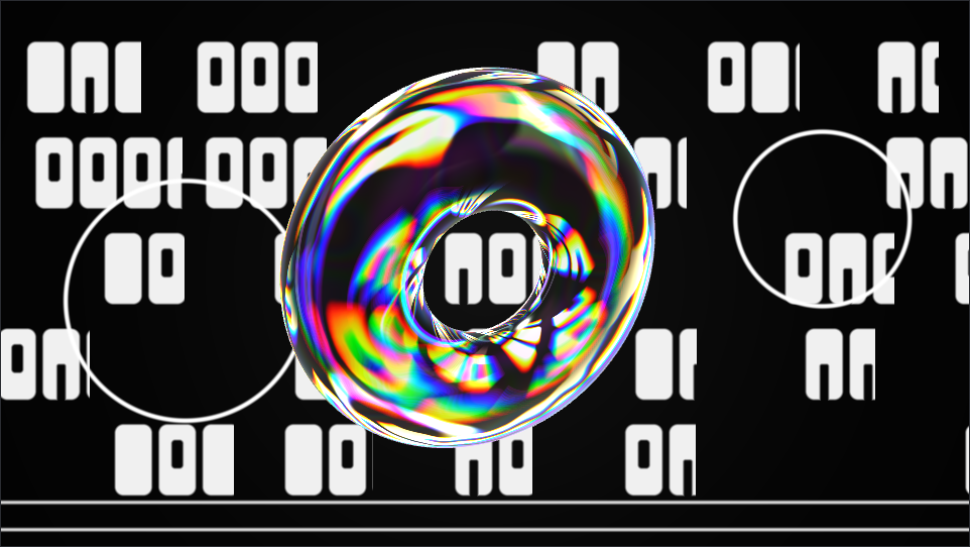

*The destination: the default look on the demo torus. This image is a WebGL preview of the same GLSL files, not a TouchDesigner capture.*

This tutorial builds a glass material for any 3D object in TouchDesigner that treats light more like real glass does. Light bends where it enters the object and again where it leaves. Each colour bends by its own amount at both surfaces, so edges seen through the glass break into a wide, correctly ordered rainbow. Where the far side is too steep, light cannot leave at all and is reflected back inside: total internal reflection, the bright bands you see in cut glass. An optional glow imitates light the glass focuses.

It is written for TouchDesigner users who have not written shaders before. It builds on the core [Liquid Glass](../liquid-glass/) study (commit a6f95c6, synced with its later state in November 2026), which bends light once. The colour, tint, reflection, highlight, liquid and film controls work exactly as there, and its tutorial explains them. This one covers what changes when light crosses two surfaces. Every code block below is copied automatically from the delivered files.

The grounding is Maxime Heckel's [Refraction, dispersion, and other shader light effects](https://blog.maximeheckel.com/posts/refraction-dispersion-and-other-shader-light-effects/), especially its backside rendering section, and his [caustics article](https://blog.maximeheckel.com/posts/caustics-in-webgl/). His backside section points to a Codrops article on multiside refraction, which builds on research by Chris Wyman (2005). Each adaptation is named where it happens.

## Open the study

Build the component from the Textport, keeping it in a variable named `component` so the experiment commands below work:

```python
import runpy
component = runpy.run_path('/path/to/liquid-glass-prism/build.py')['build']()
```

Open the component's viewer. Each experiment below fixes time and every unrelated control, then changes one thing. `component.op('study_tools').module.apply(component, id)` first returns every look control (presets, Morph, Samples, light direction, the back-face pass, the Study page, the demo backdrop) to its default, so the experiments can run in any order; your own inputs, Object size and the other setup controls stay as they are. The experiments change the component's shared material, so run them on a second component if your scene uses the first. The **Study > Teaching stage** menu shows one ingredient of the material at a time; most experiments use it.

The pictures come from a WebGL preview that runs the same shader files in a browser. They show what the code does. They are not proof of how TouchDesigner renders it. When you run an experiment natively, compare against the stated prediction.

A shader is a small program the graphics card runs for you. A GLSL MAT holds two. The **vertex shader** runs once per corner of the mesh and decides where it lands on screen. The **pixel shader** runs once per pixel the object covers and decides its colour. All the optics happen in the pixel shader.

## Make the object see-through

How can an object show what is behind it, when a shader only knows its own surface?

It can't see the scene, so we hand it a picture of the scene: a render of everything *except* the glass, from the same camera. This is the **Refraction TOP**. If each glass pixel copies the pixel at the same screen position from that picture, the object becomes invisible. Every effect after this changes *where* we look in that picture. Heckel does the same with a frame buffer rendered each frame in the web page.

The vertex shader passes on what the pixel shader needs: the surface position and normal in world space, the position in the object's own space (so ripples stick to the object), and which camera is rendering. A Render Pick DAT or CHOP draws the object once more to find what is under the mouse. For that pass TouchDesigner defines `TD_PICKING_ACTIVE`, and the shader uses the form from Derivative's Write a GLSL MAT page: every render places the point, and while picking only the `#else` block runs, which calls `TDWritePickingValues()` and writes none of the four outputs (unit test `test_g6_pick_render_runs_only_the_documented_picking_block`).

From [liquid_prism.vert](liquid_prism.vert), lines 16–33:

```glsl
    // Every render places the point, a pick render too.
    vec3 objPos = TDPos();
    vec4 world = TDDeform(objPos);
    gl_Position = TDWorldToProj(world);
#ifndef TD_PICKING_ACTIVE
    vObjPos = objPos;
    vWorldPos = world.xyz;
    // Decide before transforming: a missing normal stays exactly zero (the pixel
    // stage then builds faceted normals) instead of risking a NaN.
    vec3 objNormal = TDNormal();
    vWorldNormal = dot(objNormal, objNormal) > 1e-12 ? TDDeformNorm(objNormal) : vec3(0.0);
    vCamIndex = TDCameraIndex();
#else
    // A Render Pick DAT or CHOP is drawing: TouchDesigner sets
    // TD_PICKING_ACTIVE, so of the branch only this block runs. Its default
    // pick values are right, because the points move only through TDDeform.
    TDWritePickingValues();
#endif
```

In the pixel shader, `screenUV()` turns the pixel's position into 0..1 coordinates across the render. The core study stops there. This study follows light to points inside and behind the glass, so it also needs to know where a 3D point lands on screen. `projectOffset()` projects two points with the camera's own matrices and returns the difference. Working with differences has a useful property: two points on the same camera ray land on the same spot, so light that is not bent comes back to exactly its own pixel. It has two safeguards. A point near or behind the camera would land at a huge or mirrored offset, so it is first pulled back until it is at least half as far from the camera as the surface. And `screenSign()` makes the offset run the same way as the screen does, whatever the build's convention. It compares where the camera projects this pixel's own point with where the pixel actually sits on the render: the same way round, or mirrored. An earlier version took the sign of screen derivatives instead, which came out wrong on about one silhouette pixel per frame; the comparison needs none (test `screen_orientation_has_no_wrong_pixels`). One row and one column are the exception: in a render with an odd width or height they sit exactly on the centre line, where both positions are 0 and there is nothing to compare. There the sign of a screen derivative decides, unless the surface is nearly edge-on (then the next pixel's position is a poor guess, and the tie gives +1). Offsets in camera space need one more factor. The flat-image reflection moves by a direction as the camera sees it, not by a difference of projected points, so a projection matrix that is itself mirrored would turn it the wrong way. `cam.viewSign` adds the matrix's own sign for it (test `mirrored_projection_keeps_offsets_the_right_way`). `eyeDistance()` measures how far a point is from the camera, in a way that also works for orthographic cameras. `footprintLod()` comes back in "A rainbow through both surfaces".

From [liquid_prism.frag](liquid_prism.frag), lines 70–173:

```glsl
// The camera, gathered once per pixel.
struct PrismCamera {
    vec3 position;
    vec3 forward;    // viewing axis, world space
    mat4 viewProj;   // world space to clip space
    bool perspective;
    vec2 screenSign; // +1 or -1: does screen UV run the same way as projected x and y? (screenSign())
    vec2 viewSign;   // +1 or -1: does screen UV run the same way as the camera's own x and y?
                     // screenSign times the projection's own sign (a mirrored proj matrix)
};

// Where this pixel sits on the render, 0..1 across and up.
// uTDGeneral.viewport holds (x, y, 1/width, 1/height) in pixels.
vec2 screenUV()
{
    vec2 uv = (gl_FragCoord.xy - uTDGeneral.viewport.xy) * uTDGeneral.viewport.zw;
    if (uState.w > 0.5) uv.y = 1.0 - uv.y;  // Flip V: escape hatch if the Refraction TOP is upside down
    return uv;
}

// Which way screen x and y run against the camera's projected x and y: +1
// or -1 each. TouchDesigner's usual orientation gives +1, +1; a build whose
// screen y (or x) runs the other way would bend light the wrong way without
// this. It is measured per pixel, without guessing: the pixel's own point,
// projected by the camera, lands at ndc; the raster says the pixel sits at
// `raster` (same -1..1 range, from gl_FragCoord). Same sign: the raster
// follows the projection; opposite: it is mirrored. On the centre line of a
// render with an odd width or height, both are 0 and cannot be told apart.
// There the sign of `ndcStep`, how ndc changes to the next pixel (screen
// derivatives, taken at the top of main()), decides instead. A derivative
// is only trusted where the surface is not nearly edge-on: `depthStep`, how
// much 1/w changes to the next pixel, stays under 10%. On an edge-on sliver
// the next pixel's position is extrapolated far along the triangle and its
// sign can flip. Otherwise, and for a value that is not a number, the
// result is +1. Flip V flips the base UV and every vertical offset together.
vec2 screenSign(vec2 ndc, vec2 ndcStep, vec2 depthStep)
{
    vec2 raster = 2.0 * (gl_FragCoord.xy - uTDGeneral.viewport.xy) * uTDGeneral.viewport.zw - 1.0;
    vec2 runs = vec2(abs(ndc.x + raster.x) < abs(ndc.x - raster.x) ? -1.0 : 1.0,
                     abs(ndc.y + raster.y) < abs(ndc.y - raster.y) ? -1.0 : 1.0);
    // Neighbouring pixel centres are 2 x viewport.zw apart in raster units;
    // only a centre-line pixel is closer than half of that to 0.
    vec2 useStep = step(abs(raster), 0.5 * uTDGeneral.viewport.zw) * step(depthStep, vec2(0.1));
    runs = mix(runs, vec2(ndcStep.x < 0.0 ? -1.0 : 1.0, ndcStep.y < 0.0 ? -1.0 : 1.0), useStep);
    if (uState.w > 0.5) runs.y = -runs.y;
    return runs;
}

// Fold coordinates that leave the image back inside it (mirror repeat).
vec2 mirrorUV(vec2 uv)
{
    return 1.0 - abs(1.0 - mod(uv, 2.0));
}

// How far a point is from the camera: straight-line distance for a
// perspective camera, depth along the view axis for an orthographic one.
// The back-face pass stores the same measure, so the two can be subtracted.
float eyeDistance(vec3 p, PrismCamera cam)
{
    return cam.perspective ? length(p - cam.position) : dot(p - cam.position, cam.forward);
}

// How far point p lands from point `from` on screen, in 0..1 units.
// Working with offsets keeps "no bend" exact: two points on the same
// camera ray land on the same spot. screenSign turns projected directions
// into screen UV directions (see screenSign()), so a build whose screen y
// runs the other way still bends the right way.
// A point near or behind the camera would project to a huge or mirrored
// offset, so p is first pulled back along the line toward `from` until it
// is at least half as far from the camera as `from` (perspective only;
// an unchanged result whenever p is already that far).
vec2 projectOffset(vec3 p, vec3 from, PrismCamera cam)
{
    vec4 a = cam.viewProj * vec4(p, 1.0);
    vec4 b = cam.viewProj * vec4(from, 1.0);
    b.w = max(b.w, 1e-4);
    float nearest = 0.5 * b.w;
    if (a.w < nearest) a = mix(b, a, (b.w - nearest) / (b.w - a.w));
    return 0.5 * (a.xy / a.w - b.xy / b.w) * cam.screenSign;
}

// The mip level for one lookup: at least `base`, and wider once this
// pixel's lookup sweeps across more than 4 texels of the Refraction TOP
// (screen derivatives of the unfolded coordinate). Where the glass squeezes
// a large part of the scene into a few pixels, neighbouring pixels then
// read a smooth average instead of unrelated texels. The level stays 2 below
// the footprint (4 texels per pixel before it rises): the footprint is
// measured along its longer axis, and a full-width level blurred the
// ordinary squeeze at rims more than a supersampled render does
// (decisions.json). Call it only where every pixel runs the same code
// (derivatives need that).
float footprintLod(vec2 unfolded, float base, vec2 size)
{
    vec2 dx = dFdx(unfolded) * size;
    vec2 dy = dFdy(unfolded) * size;
    return max(base, 0.5 * log2(max(max(dot(dx, dx), dot(dy, dy)), 1.0)) - 2.0);
}

// How far one scene unit moves on screen at this pixel's depth (for blur sizes).
vec2 unitsToUV(mat4 proj, float depth)
{
    float perspective = abs(proj[2][3]) > 0.5 ? depth : 1.0;
    return 0.5 * abs(vec2(proj[0][0], proj[1][1])) / perspective;
}
```

**Experiment `see_through`:** What does the glass show when neither surface bends light?

On the built component, run `component.op('study_tools').module.apply(component, 'see_through')`.

Prediction: The torus disappears: entering and leaving at IOR 1 changes nothing, so every glass pixel shows the Refraction TOP at its own screen position.

Parameters: Preset=clear_crystal, Pause=True, Time=2.0, Stage=final, Ior=1.0, Dispersion=0.0, Frost=0.0, Density=0.0, Saturation=1.0, Reflection=0.0, Rim=0.0, Specular=0.0, Diffuse=0.0, Iridescence=0.0, Wobble=0.0, Caustic=0.0. Time and unrelated controls are fixed by this preset.

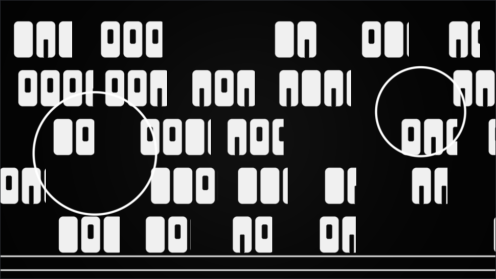

*Preview:* the torus disappears. Automated tests compare such renders with the backdrop alone: the largest difference is 1/255 on the torus and on a knot, with and without the back-face pass, and with an orthographic camera (`ior1_invisible_*` in [the preview tests](checks/preview_tests.cjs)). That matters more here than in the core study, because the light now takes a long detour through the object and must still come back to the same pixel.

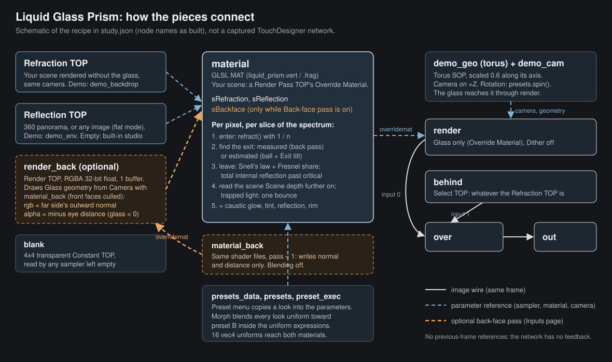

The diagram is a schematic of the recipe, not a captured network. Solid lines carry images, dashed lines are parameter references, and the orange path is the optional back-face pass.

## Bend twice: in and out

What does light do when it bends going into the glass and again coming out?

Light changes direction where it enters a denser material. The **index of refraction** (IOR) says how much: 1.0 is air, water is 1.33, glass about 1.5. Leaving the glass, light bends again, away from the surface normal this time. What you see through a piece of glass depends on both surfaces. A flat window has two parallel surfaces: the second bend exactly undoes the first, so the view through it is shifted but not turned. A lens or a prism has surfaces at different angles, so the bends add up.

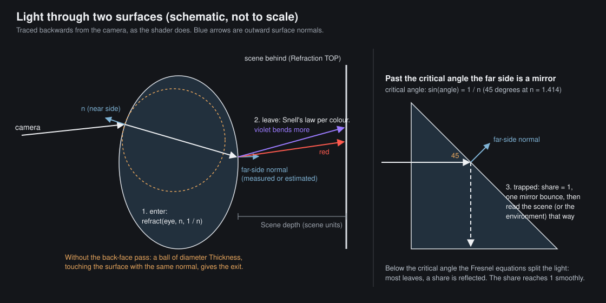

The shader follows a ray backwards from the camera, as the figure shows. `enterGlass()` is GLSL's `refract()` with the ratio 1 / IOR. `leaveGlass()` is Snell's law for the way out, written out by hand because it also has to report how much light the far surface reflects back inside. We return to that share in "Trapped light". For now, note the special case: past a certain angle nothing gets out.

From [liquid_prism.frag](liquid_prism.frag), lines 374–397:

```glsl
// Entering glass from air: GLSL's refract() with the ratio 1 / n. Light
// coming from air can always enter, so there is no special case here.
vec3 enterGlass(vec3 eye, vec3 n, float ior)
{
    return refract(eye, n, 1.0 / ior);
}

// Leaving glass into air through a surface whose normal points out of the
// glass. Returns the outgoing direction in xyz and, in w, the share of light
// the surface reflects back inside (Fresnel equations, unpolarised light).
// Past the critical angle sin(angle) > 1 / n nothing gets out: the share is
// 1, total internal reflection. The share climbs smoothly to 1 as the angle
// nears the critical angle, so the image never jumps.
vec4 leaveGlass(vec3 inside, vec3 outward, float ior)
{
    float cosI = clamp(dot(inside, outward), 0.0, 1.0);
    float sin2T = ior * ior * (1.0 - cosI * cosI);
    if (sin2T > 1.0) return vec4(inside, 1.0);       // trapped: total internal reflection
    float cosT = sqrt(1.0 - sin2T);
    vec3 leaving = ior * inside + (cosT - ior * cosI) * outward;  // Snell's law, vector form
    float rs = (ior * cosI - cosT) / max(ior * cosI + cosT, 1e-6);
    float rp = (cosI - ior * cosT) / max(cosI + ior * cosT, 1e-6);
    return vec4(normalize(leaving), 0.5 * (rs * rs + rp * rp));
}
```

After the second bend the ray travels **Scene depth** further, in units of Object size, and the shader reads the Refraction TOP where that point lands on screen. Treat Scene depth as a lens strength: roughly how far behind the glass the scene sits, but one number for the whole picture, not the literal distance to your background. The core study slides the view sideways by a thickness instead. Here the slide comes out of the geometry: where the ray leaves, in which direction, and how far it then travels.

The main function first gathers, once per pixel, the facts everything else uses: the camera, the eye direction, distances, the screen position, the normal and the fresnel term. It starts with screen derivatives (how a value changes from one pixel to the next) of the surface position and of its projected position. GLSL only defines them where neighbouring pixels run the same code, so they come before any branch; they give a faceted normal for geometry without normals, and the screen orientation on a centre line. `TDCheckDiscard()` lets TouchDesigner drop a pixel, for example for order-independent transparency. A dropped neighbour would leave later derivatives undefined, so each pass calls it only after its last one. Note the early `return`: the back-face pass uses the same file, and it stops here. That pass comes in "Measure the far side". The liquid ripples tilt the normal last, so it is turned toward the camera once more after them.

From [liquid_prism.frag](liquid_prism.frag), lines 829–875:

```glsl
    // Screen derivatives come first, while all four pixels of each 2x2 block
    // still run the same code: inside a branch that neighbouring pixels take
    // differently, or after TDCheckDiscard() has removed a neighbour, GLSL
    // leaves them undefined. They give the faceted normal when the geometry
    // has no normals, and the screen orientation on a centre line.
    PrismCamera cam;
    mat4 proj = uTDMats[vCamIndex].proj;
    cam.viewProj = proj * uTDMats[vCamIndex].cam;
    vec4 clip = cam.viewProj * vec4(vWorldPos, 1.0);
    vec2 ndc = clip.xy / clip.w;
    float invW = 1.0 / clip.w;
    vec2 ndcStep = vec2(dFdx(ndc.x), dFdy(ndc.y));
    vec2 depthStep = abs(vec2(dFdx(invW), dFdy(invW)) / invW);
    vec3 dPdx = dFdx(vWorldPos);
    vec3 dPdy = dFdy(vWorldPos);

    cam.screenSign = screenSign(ndc, ndcStep, depthStep);  // which way the screen runs
    cam.viewSign = cam.screenSign * vec2(proj[0][0] < 0.0 ? -1.0 : 1.0, proj[1][1] < 0.0 ? -1.0 : 1.0);
    cam.position = uTDMats[vCamIndex].camInverse[3].xyz;
    cam.forward = safeNormalize(-uTDMats[vCamIndex].camInverse[2].xyz, vec3(0.0, 0.0, -1.0));
    cam.perspective = abs(proj[2][3]) > 0.5;
    mat3 view = mat3(uTDMats[vCamIndex].cam);
    vec3 eye = cam.perspective ? safeNormalize(vWorldPos - cam.position, cam.forward) : cam.forward;
    float surfaceDistance = eyeDistance(vWorldPos, cam);
    float depth = max(-(uTDMats[vCamIndex].cam * vec4(vWorldPos, 1.0)).z, 1e-3);
    vec2 toUV = unitsToUV(proj, depth);
    vec2 uv = screenUV();

    // The back-face pass only records the far side: outward normal, and the
    // distance stored negative, so that any background (alpha >= 0) is empty.
    // Ripples tilt the normal, so it is turned away from the camera once more.
    // TDCheckDiscard() lets TouchDesigner drop this pixel (order-independent
    // transparency, dual-paraboloid renders); each pass calls it only after
    // its last screen derivative.
    if (uState.y > 0.5) {
        TDCheckDiscard();
        writeColour(vec4(faceAway(wobbleNormal(outwardBackNormal(eye, dPdx, dPdy)), eye), -surfaceDistance));
        return;
    }
    bool useBack = uInputs.z > 0.5;
    bool hasRefraction = uInputs.x > 0.5;

    // Ripples tilt the normal again, so it is turned toward the camera once more.
    vec3 n = faceCamera(wobbleNormal(facingNormal(eye, dPdx, dPdy)), eye);
    vec3 lightDir = safeNormalize(uLight.xyz, vec3(0.0, 1.0, 0.0));  // (0, 0, 0) means straight up
    float NdotV = clamp(dot(n, -eye), 0.0, 1.0);
    float fresnel = pow(1.0 - NdotV, uSurface.y);
```

The near side's normal comes from `facingNormal()`, kept from the core study. Near silhouettes a blended normal can tilt slightly away from the camera, and `refract()` would then bend even at IOR 1, so `faceCamera()` lays such normals back into the view plane. `safeNormalize()` turns a vector into a unit vector without dividing by zero, and `facetedNormal()` builds a normal from the screen derivatives when the mesh has none; its test for a degenerate triangle is relative, so it works the same on a tiny and a huge object.

From [liquid_prism.frag](liquid_prism.frag), lines 177–217:

```glsl
// A unit vector along v, or `fallback` when v is (nearly) zero: normalize()
// of a zero vector is undefined (NaN on many GPUs).
vec3 safeNormalize(vec3 v, vec3 fallback)
{
    float l2 = dot(v, v);
    return l2 > 1e-12 ? v * inversesqrt(l2) : fallback;
}

// A faceted normal from the screen derivatives of the position (dPdx and
// dPdy, taken at the top of main()), for geometry without normals. The test
// is relative, so the size of a pixel in scene units cancels out; a
// degenerate triangle gets `fallback`.
vec3 facetedNormal(vec3 dPdx, vec3 dPdy, vec3 fallback)
{
    vec3 n = cross(dPdx, dPdy);
    float l2 = dot(n, n);
    return l2 > 1e-12 * dot(dPdx, dPdx) * dot(dPdy, dPdy) ? n * inversesqrt(l2) : fallback;
}

// Near silhouettes a normal can tilt slightly away from the camera, and then
// refract() bends even at IOR 1. Lay any such normal back into the view plane.
vec3 faceCamera(vec3 n, vec3 eye)
{
    float away = dot(n, eye);
    return away > -0.01 ? normalize(n - eye * (away + 0.01)) : n;
}

// The near side: the interpolated normal, or a faceted one when the
// geometry carries no normals. Always turned to face the camera.
vec3 facingNormal(vec3 eye, vec3 dPdx, vec3 dPdy)
{
    vec3 n = vWorldNormal;
    if (dot(n, n) > 1e-8) {
        n = normalize(n);
        n = TDFrontFacing(vWorldPos, n) ? n : -n;
    } else {
        n = facetedNormal(dPdx, dPdy, -eye);
        n = dot(n, eye) > 0.0 ? -n : n;
    }
    return faceCamera(n, eye);
}
```

**Experiment `bend_twice`:** What does light do when it bends going in and again coming out?

On the built component, run `component.op('study_tools').module.apply(component, 'bend_twice')`.

Prediction: The type behind the tube appears flipped and pulled toward the tube's centre line, most strongly near the rims, where both surfaces tilt most.

Parameters: Preset=clear_crystal, Pause=True, Time=2.0, Stage=refraction, Ior=1.5, Dispersion=0.0, Scenedepth=1.0, Wobble=0.0. Time and unrelated controls are fixed by this preset.

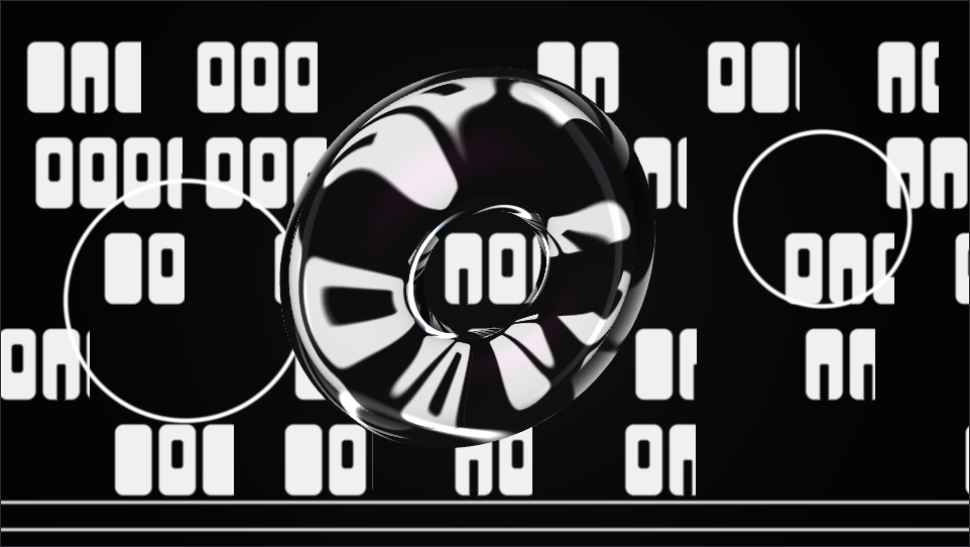

*Preview (Refraction stage):* the type behind the tube appears upside down and squeezed toward the tube's middle; near the rims it stretches into streaks.

**Experiment `scene_depth`:** How far behind the glass does the bent light meet the scene?

On the built component, run `component.op('study_tools').module.apply(component, 'scene_depth')`.

Prediction: With Scene depth 2.5 instead of 1 (in units of Object size), the same exit directions travel further before they read the Refraction TOP, so the flipped image is pushed further and looks more magnified.

Parameters: Preset=clear_crystal, Pause=True, Time=2.0, Stage=refraction, Ior=1.5, Dispersion=0.0, Scenedepth=2.5, Wobble=0.0. Time and unrelated controls are fixed by this preset.

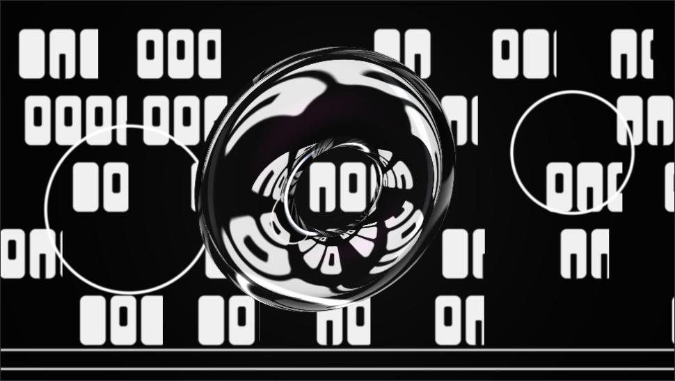

*Preview:* the flipped type is pushed further and looks more magnified; near the rims the letters smear into long arcs.

A test checks the window case directly. A flat slab, tilted 35 and 20 degrees, is rendered with the back-face pass and a stage that shows how far the light's direction turned. Across 49 points on its face the turn is 0 (out of 255, for red, middle and violet). The same slab without the back-face pass, where the shader can only guess the far side, does turn the light, so the test is able to fail (`slab_zero_net_deviation`).

## Guess the far side

Without seeing the back of the object, where does the shader think light leaves?

A material only knows the surface it is drawing. To bend light a second time it needs the far side's position and tilt. By default the study guesses, so it works on any object with nothing else connected.

The guess is a ball. Imagine a ball of diameter **Thickness** that touches this pixel's surface with the same normal. For a ray that enters a ball at refraction angle *a*, two short formulas give where it leaves: it travels Thickness × cos(*a*), and the ball's normal there is *n* + 2 cos(*a*) × *ray*. Both are always finite, and the normal is always unit length, so the guess can never produce a broken pixel. On a real ball of that size the guess is exact.

A ball has one more property: the angle at which light meets the far wall always equals the angle at which it entered. So light never gets trapped in a ball, at any wavelength. Real flattened or twisted shapes do trap light at their rims. **Exit tilt** bends the guess both ways. Toward 1 it blends the ball's far normal toward a steeper wall (the near normal mirrored through the view direction), so the rims can trap light too. Toward -1 it blends toward a far wall parallel to the near one: a flat sheet of thickness Thickness, like a window or a thin ribbon, which shifts the view but does not turn it. The path changes with it: in a ball a tilted ray travels less (Thickness × cos(*a*)), in a sheet more (Thickness / cos(*a*)). A ball bends light however small it is, so thin glass needs this setting. Exit tilt is a look control for the guess, not a measurement.

From [liquid_prism.frag](liquid_prism.frag), lines 401–437:

```glsl
// Where the bent ray reaches the far side of the glass, and that side's normal.
struct PrismExit {
    vec3 point;     // world space
    vec3 normal;    // points out of the glass
    float path;     // distance travelled inside the glass (scene units)
    float measured; // 1 = from the back-face pass, 0 = estimated
    vec3 ray;       // the traced (530 nm) ray inside the glass
};

// Without the back-face pass. Locally the glass is treated as a ball whose
// near side matches this pixel and whose diameter is Thickness. A ray that
// enters a ball at refraction angle a travels Thickness x cos(a) and leaves
// where the ball's normal is n + 2 cos(a) x ray. In a ball the exit angle
// always equals the entry angle, so a ball never traps light, at any
// wavelength (each slice gets its own exit normal; see sliceExitNormal()).
// Exit tilt bends the guess both ways: toward 1 it blends toward the near
// normal mirrored through the view direction, a steeper far wall as in
// flattened or twisted shapes, so rims can trap light; toward -1 it blends
// toward a far wall parallel to the near one, a flat sheet of thickness
// Thickness that shifts but does not turn the view (windows, ribbons, open
// surfaces). A sheet's path grows as the ray tilts (Thickness / cos(a));
// a ball's shrinks (Thickness x cos(a)).
PrismExit estimateExit(vec3 p, vec3 n, vec3 eye, vec3 ray)
{
    float cosA = max(-dot(ray, n), 0.0);
    float tilt = clamp(uPrism.y, -1.0, 1.0);
    PrismExit e;
    e.path = uOptics.y * mix(cosA, 1.0 / max(cosA, 0.2), max(-tilt, 0.0));
    e.point = p + ray * e.path;
    vec3 ball = n + 2.0 * cosA * ray;
    vec3 mirrored = n - 2.0 * dot(n, eye) * eye;
    vec3 blend = tilt >= 0.0 ? mix(ball, mirrored, tilt) : mix(ball, -n, -tilt);
    e.normal = dot(blend, blend) > 1e-6 ? normalize(blend) : ball;
    e.measured = 0.0;
    e.ray = ray;
    return e;
}
```

**Experiment `exit_ball`:** Without a back-face pass, where does the shader think the light leaves?

On the built component, run `component.op('study_tools').module.apply(component, 'exit_ball')`.

Prediction: Smooth colour gradients: the exit normal of a ball fitted to each pixel, tilted the opposite way from the near side's normal.

Parameters: Preset=clear_crystal, Pause=True, Time=2.0, Stage=exitnormal, Backface=False, Exittilt=0.0, Wobble=0.0. Time and unrelated controls are fixed by this preset.

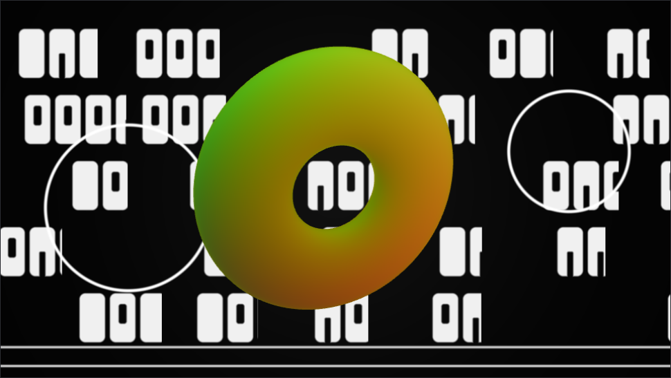

*Preview (Exit normal stage, normals shown as colours):* a smooth green-to-orange gradient across the torus, changing steadily from rim to rim, with no seams.

**Experiment `exit_flat`:** What if the guessed far side is parallel to the near side, as in a window or a thin ribbon?

On the built component, run `component.op('study_tools').module.apply(component, 'exit_flat')`.

Prediction: The type behind the torus is no longer flipped or magnified, only shifted: a flat sheet turns light back to its original direction. The shift grows toward the rims, where the ray crosses the sheet at a slant (path Thickness / cos). Compare with bend_twice, which uses Exit tilt 0.3, close to a ball.

Parameters: Preset=clear_crystal, Pause=True, Time=2.0, Stage=refraction, Backface=False, Exittilt=-1.0, Ior=1.5, Dispersion=0.0, Scenedepth=1.0, Wobble=0.0. Time and unrelated controls are fixed by this preset.

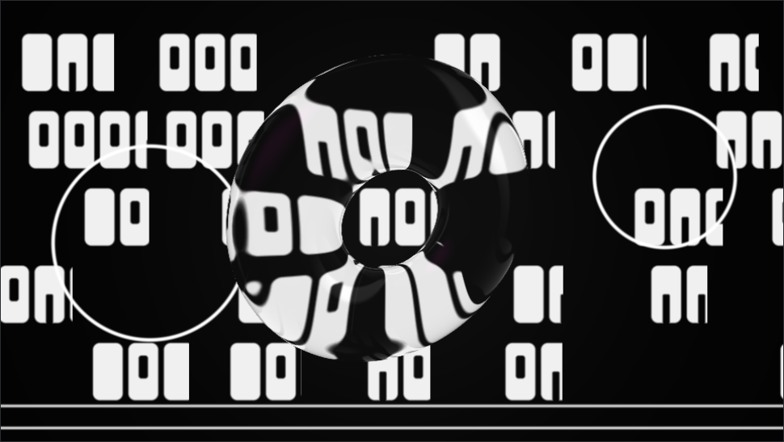

*Preview (Refraction stage, Exit tilt -1):* the letters behind the torus read upright and close to their place, shifted a little in the middle and more toward the rims, where light crosses the guessed sheet at a slant and travels further inside it. In `bend_twice` the same letters are flipped and squeezed.

Four tests check the guess. On a unit sphere with Thickness 2 and Exit tilt 0, the guessed exit normal matches the measured one from the next section within 1/255 at 81 points, from the middle out to 0.97 of the sphere's radius on screen (`fallback_ball_matches_measured_on_sphere`). On the tilted slab, Exit tilt -1 gives zero net deviation, like the measured exit (`slab_zero_net_deviation`), and with Thickness set to the slab's 0.4 it lands every lookup within 0.04 pixel of the measured image (`flat_guess_matches_measured_slab`). And across 5 shapes, 5 extreme settings and 8 stages, read back as 32-bit floats, no output value is NaN or infinite (`fallback_without_backpass_stays_finite`).

## Measure the far side

How can the shader see the back of the object, and what does it store?

Heckel renders the back side of his mesh first, then the front side over it. In his caustics article he swaps in a material that writes normals instead of colour, so another shader can read them. This study combines the two ideas. The optional **back-face pass** renders the glass once more into `render_back`, keeping only the far side (front faces culled), with `material_back`: the same shader files, with the pass switch set. For each pixel it stores two facts in one RGBA 32-bit float image: the far side's outward normal in red, green and blue, and its distance from the camera in alpha, stored as a negative number. Glass is alpha below 0, so any background, whatever a camera's background colour adds, reads as no glass.

Why one image and not several? TouchDesigner can write several colour buffers at once, but the shader then has to match the Render TOP's buffer count, and writing a buffer that is not there can crash the GPU. A normal and a distance fit in four channels, so one ordinary float image is the most portable choice. The comparison is in [decisions.json](decisions.json).

The far side's normal must point out of the glass, away from the camera. `faceAway()`, the mirror image of `faceCamera()`, lays a normal that tilts toward the camera back into the view plane; it runs again after the liquid ripples, as on the near side.

From [liquid_prism.frag](liquid_prism.frag), lines 221–236:

```glsl
// The mirror image of faceCamera(): a normal that must point away from the
// camera is laid back into the view plane if it tilts toward it.
vec3 faceAway(vec3 n, vec3 eye)
{
    return -faceCamera(-n, eye);
}

// The far side, drawn by the back-face pass: its normal points out of the
// glass, which for a back face means away from the camera.
vec3 outwardBackNormal(vec3 eye, vec3 dPdx, vec3 dPdy)
{
    vec3 n = vWorldNormal;
    n = dot(n, n) > 1e-8 ? normalize(n) : facetedNormal(dPdx, dPdy, eye);
    if (dot(n, eye) < 0.0) n = -n;
    return faceAway(n, eye);
}
```

The front pass then has to find where the bent ray meets that far side. The view ray's thickness is only right at IOR 1, because the bent ray reaches the far side somewhere else on screen. Near the silhouette it also shrinks to nothing. So `measureExit()` starts from the longer of that thickness and the ball guess's path, then corrects the guess up to four times: see where the guess lands on screen, read the far side's distance there, and move the guess onto it. It stops early once a step is tiny. `backSample()` reads the four nearest texels itself and skips empty ones, so the silhouette never mixes in garbage. If the pass has nothing at this pixel, the pixel falls back to the ball.

From [liquid_prism.frag](liquid_prism.frag), lines 441–505:

```glsl
// Read the back-face pass with bilinear weights, skipping empty texels, so
// silhouettes never mix in garbage. The pass stores minus the eye distance
// in alpha: glass is alpha < 0, and any background (0, or whatever
// non-negative alpha a camera's background colour adds) reads as empty.
// Returns the outward normal in xyz and the eye distance in w; `coverage`
// is how much real data was found (0..1).
vec4 backSample(vec2 uv, out float coverage)
{
    ivec2 size = textureSize(sBackface, 0);
    vec2 texel = uv * vec2(size) - 0.5;
    ivec2 base = ivec2(floor(texel));
    vec2 f = texel - vec2(base);
    vec4 sum = vec4(0.0);
    float weightSum = 0.0;
    for (int i = 0; i < 4; i++) {
        ivec2 corner = ivec2(i - 2 * (i / 2), i / 2);
        vec4 b = texelFetch(sBackface, clamp(base + corner, ivec2(0), size - 1), 0);
        vec2 g = mix(1.0 - f, f, vec2(corner));
        if (b.a < 0.0) {
            sum += vec4(b.xyz, -b.a) * (g.x * g.y);
            weightSum += g.x * g.y;
        }
    }
    coverage = weightSum;
    if (weightSum < 1e-4) return vec4(0.0);
    sum /= weightSum;
    float len = length(sum.xyz);
    return vec4(len > 1e-4 ? sum.xyz / len : vec3(0.0, 0.0, -1.0), sum.w);
}

// With the back-face pass. First guess: the longer of the glass's
// thickness along the view ray (which shrinks to 0 at the silhouette) and
// the ball guess's path. Then up to four times: see where the guess lands
// on screen, read the far side's distance there, and move the guess onto
// it. It stops early once a step is tiny.
PrismExit measureExit(vec3 p, vec3 ray, vec2 uv, PrismCamera cam, float frontDistance, PrismExit fallback)
{
    float coverage;
    vec4 back = backSample(uv, coverage);
    if (coverage < 0.5 || back.w <= frontDistance) return fallback;
    float viewThickness = back.w - frontDistance;
    float limit = 4.0 * viewThickness + uOptics.y;
    float t = min(max(viewThickness, fallback.path), limit);
    for (int i = 0; i < 4; i++) {
        vec3 q = p + ray * t;
        float c;
        vec4 s = backSample(uv + projectOffset(q, p, cam), c);
        if (c < 0.5) break;
        vec3 along = cam.perspective ? safeNormalize(q - cam.position, cam.forward) : cam.forward;
        float rate = max(dot(ray, along), 0.2);  // how fast the eye distance grows along the ray
        float next = clamp(t + (s.w - eyeDistance(q, cam)) / rate, 0.0, limit);
        float moved = abs(next - t);
        t = next;
        if (moved < 1e-4 * (1.0 + t)) break;
    }
    float c;
    vec4 s = backSample(uv + projectOffset(p + ray * t, p, cam), c);
    PrismExit e;
    e.path = t;
    e.point = p + ray * t;
    e.normal = c >= 0.5 ? s.xyz : back.xyz;
    e.measured = 1.0;
    e.ray = ray;
    return e;
}
```

**Experiment `backface`:** What does the back-face pass measure?

On the built component, run `component.op('study_tools').module.apply(component, 'backface')`.

Prediction: The exit normals now come from the real far side: flatter, more uniform colours on the flattened torus than the ball estimate, with sharp changes only where the ray reaches a different part of the tube.

Parameters: Preset=clear_crystal, Pause=True, Time=2.0, Stage=exitnormal, Backface=True, Wobble=0.0. Time and unrelated controls are fixed by this preset.

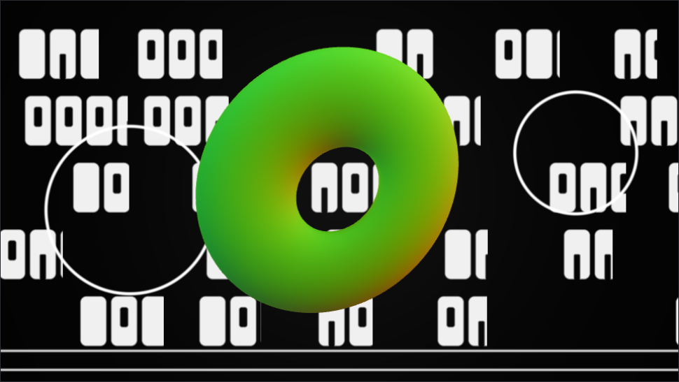

*Preview (Exit normal stage):* a flatter, mostly olive-green field. The far side of the flattened torus mostly faces straight away from the camera, tilted by the demo's 20-degree tilt; the colour changes only toward the rims. Compare it with the ball guess above.

**Experiment `backface_path`:** How far does light travel inside the glass?

On the built component, run `component.op('study_tools').module.apply(component, 'backface_path')`.

Prediction: A low grey, brightest across the middle of each tube section and darker toward its edges: the flattened tube is roughly 0.6 scene units deep, shown as path / (2 x Thickness x Object size), about 0.34 of full brightness at the demo's Object size, 0.872517.

Parameters: Preset=clear_crystal, Pause=True, Time=2.0, Stage=thickness, Backface=True, Thickness=1.0, Wobble=0.0. Time and unrelated controls are fixed by this preset.

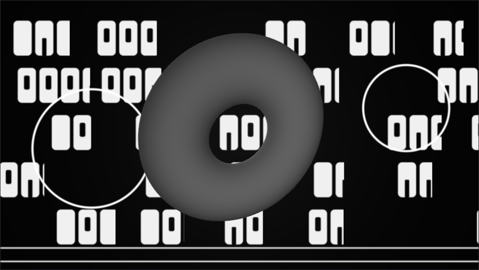

*Preview (Thickness stage):* along the centre row one tube section reads 73, 96 and 65 out of 255, about 0.5, 0.66 and 0.45 scene units of glass (the stage shows path / (2 x Thickness x Object size)), brightest mid-tube. On a unit sphere a test compares the measured path with the exact chord of the refracted ray at four points, at IOR 1 and 1.5: all within 3/255 (`backpass_path_matches_sphere_chord`).

Turn it on with **Inputs > Back-face pass**, then point **Camera** and **Glass geometry** at your camera and glass objects. It costs one extra render and only cooks while the toggle is on. With it on, Exit tilt only affects pixels where the pass has no data, mainly near silhouettes.

## Trapped light

When does light fail to leave the glass?

Leaving glass, light bends away from the normal. The steeper it meets the surface, the more it bends, until at the **critical angle** it would skim along the surface. Past that angle no light gets out: the surface becomes a perfect mirror from inside. This is **total internal reflection**. The critical angle depends only on the IOR: sin(angle) = 1 / IOR, so 42 degrees for glass of 1.5 and 24 degrees for diamond.

Below the critical angle the surface still reflects a share of the light back inside. The **Fresnel equations** give that share; it is a few per cent for light meeting the surface head-on and climbs steeply, but smoothly, to 100% at the critical angle. `leaveGlass()` computes it exactly, and the shader splits each slice of light between the way out and the way back by that share. Because the share reaches 100% smoothly, the trapped bands appear without a hard edge.

The **Trapped share** stage shows it for red, middle and violet:

From [liquid_prism.frag](liquid_prism.frag), lines 749–777:

```glsl
// One wavelength through both surfaces, exactly as in throughGlass():
// the outgoing direction in xyz and the trapped share in w.
vec4 traceSlice(float w, vec3 eye, vec3 n, vec2 uv, PrismExit exit, PrismCamera cam)
{
    vec3 inside = enterGlass(eye, n, sliceIor(w));
    return leaveGlass(inside, sliceExitNormal(inside, n, eye, uv, exit, cam), sliceIor(w));
}

// Exit directions for red (680 nm), the middle (530 nm, the Ior value) and
// violet (400 nm), as angles away from the view direction (1 = 90 degrees).
// A trapped slice shows 1.
vec3 deviation(vec3 eye, vec3 n, vec2 uv, PrismExit exit, PrismCamera cam)
{
    vec4 r = traceSlice(0.0, eye, n, uv, exit, cam);
    vec4 g = traceSlice(MIDDLE_W, eye, n, uv, exit, cam);
    vec4 v = traceSlice(1.0, eye, n, uv, exit, cam);
    vec3 d = vec3(atan(length(cross(r.xyz, eye)), dot(r.xyz, eye)),
                  atan(length(cross(g.xyz, eye)), dot(g.xyz, eye)),
                  atan(length(cross(v.xyz, eye)), dot(v.xyz, eye))) / (0.5 * LG_PI);
    return mix(d, vec3(1.0), step(vec3(1.0), vec3(r.w, g.w, v.w)));
}

// Share of light reflected back inside at the exit, for red, middle, violet.
vec3 trapped(vec3 eye, vec3 n, vec2 uv, PrismExit exit, PrismCamera cam)
{
    return vec3(traceSlice(0.0, eye, n, uv, exit, cam).w,
                traceSlice(MIDDLE_W, eye, n, uv, exit, cam).w,
                traceSlice(1.0, eye, n, uv, exit, cam).w);
}
```

**Experiment `critical_low`:** At a low index of refraction, how much light is trapped at the far side?

On the built component, run `component.op('study_tools').module.apply(component, 'critical_low')`.

Prediction: Mostly dark: below the critical angle only a few per cent is reflected back inside. Only grazing rims brighten.

Parameters: Preset=clear_crystal, Pause=True, Time=2.0, Stage=tir, Backface=True, Ior=1.3, Dispersion=0.0, Wobble=0.0. Time and unrelated controls are fixed by this preset.

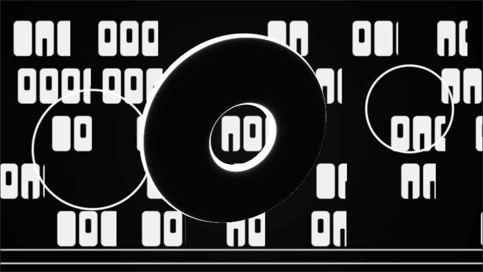

*Preview (Trapped share stage, back-face pass):* nearly black, with thin white lines only along the outer rim and around the hole.

**Experiment `critical_high`:** What changes when the index of refraction rises past the critical value?

On the built component, run `component.op('study_tools').module.apply(component, 'critical_high')`.

Prediction: The critical angle shrinks from 50 to 32 degrees, so wide white regions appear where the inside angle now exceeds it: total internal reflection.

Parameters: Preset=clear_crystal, Pause=True, Time=2.0, Stage=tir, Backface=True, Ior=1.9, Dispersion=0.0, Wobble=0.0. Time and unrelated controls are fixed by this preset.

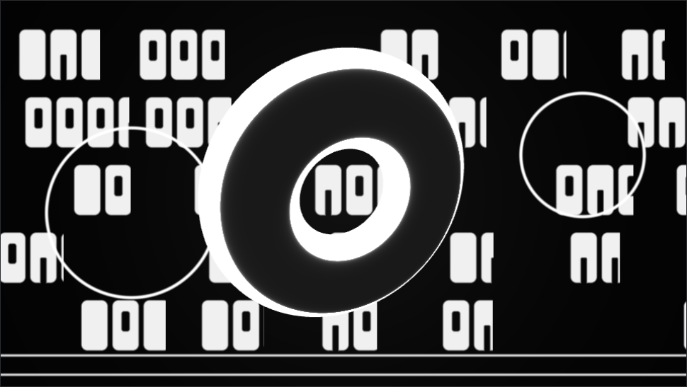

*Preview:* the white bands along both rims widen; the middle of the tube stays dark.

A test makes this exact. Behind a 45-degree prism face, light meets the far side at 45 degrees, so it is trapped from IOR 1.4142 up. At the pixel tested, the share matches the Fresnel equations within 3/255 at IOR 1.30, 1.36, 1.40 and 1.41, and is 255 (total) at 1.42, 1.43, 1.50 and 1.60, rising steadily in between (`tir_beyond_critical_angle_only`). One detail from building that test: just below the critical angle the share changes so fast that the 0.03-degree tilt of the ray through a pixel centre moved it by 7/255. The test now follows the exact ray.

**Experiment `exit_tilt`:** Can light get trapped inside a ball, and what does Exit tilt change?

On the built component, run `component.op('study_tools').module.apply(component, 'exit_tilt')`.

Prediction: A wide white band of totally reflected light along the outer rim and around the hole. Set Exit tilt back to 0 (a ball) and the band disappears, because in a ball the exit angle always equals the entry angle.

Parameters: Preset=clear_crystal, Pause=True, Time=2.0, Stage=tir, Backface=False, Exittilt=1.0, Ior=1.5, Dispersion=0.0, Wobble=0.0. Time and unrelated controls are fixed by this preset.

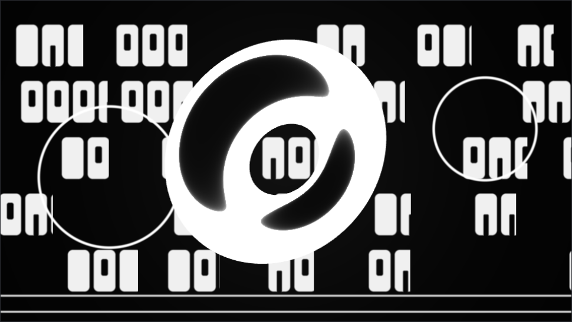

*Preview (no back-face pass, Exit tilt 1):* a wide white band covers the outer rim and circles the hole. At Exit tilt 0 the same view has no white at all: a ball never traps light.

## One bounce inside

Where does trapped light go, and what do we see there?

Trapped light keeps travelling inside the glass, bouncing until it finds a way out. Following every bounce would cost an unknown number of steps per pixel. `bounceLight()` follows one mirror bounce off the far wall, then looks up what lies in that direction without a second exit. If the bounced ray heads away from the camera or sideways, it meets the scene behind: the shader reads the Refraction TOP there and you see a mirrored fragment of the scene. If it heads back toward the camera, it meets whatever is in front of the object, so the shader reads the reflection environment. A smooth blend joins the two.

The first version only looked up the environment. In the preview the trapped bands then read dark, because the studio environment is mostly dark, while reference 1 shows bright bands. After one bounce most rays head sideways, so they should see the scene. **Inner reflection** scales the result, and the bounced light is tinted over twice the path.

From [liquid_prism.frag](liquid_prism.frag), lines 668–687:

```glsl
// Light the far wall reflects back inside (all of it past the critical
// angle). It is followed for one mirror bounce, then looked up without a
// second exit: an approximated internal bounce. Heading away from the
// camera or sideways, it meets the scene behind (a mirrored copy of the
// Refraction TOP, read at `unfolded`, the bounced ray's point Scene depth
// further on); heading back toward the camera, it meets the environment.
// The two blend smoothly in between. Where the Refraction TOP is
// transparent, the environment stands in for the part it does not cover
// (premultiplied: scene + environment x (1 - alpha)), as it does with no
// Refraction TOP at all.
vec3 bounceLight(vec3 bounced, vec3 eye, vec2 uv, vec2 unfolded, PrismCamera cam, mat3 view, float lod)
{
    vec3 seen = environmentSample(bounced, uv, view, cam.viewSign, uEnv.z);
    float towardScene = uInputs.x * smoothstep(-0.6, 0.2, dot(bounced, eye));
    if (towardScene > 0.0) {
        vec4 scene = textureLod(sRefraction, mirrorUV(unfolded), lod);
        seen = mix(seen, scene.rgb + seen * (1.0 - scene.a), towardScene);
    }
    return seen;
}
```

**Experiment `bounce`:** Where does trapped light go?

On the built component, run `component.op('study_tools').module.apply(component, 'bounce')`.

Prediction: Bright, mirrored fragments of the type and studio strips inside the trapped bands; dark where nothing is trapped.

Parameters: Preset=trapped_light, Pause=True, Time=2.0, Stage=bounce. Time and unrelated controls are fixed by this preset.

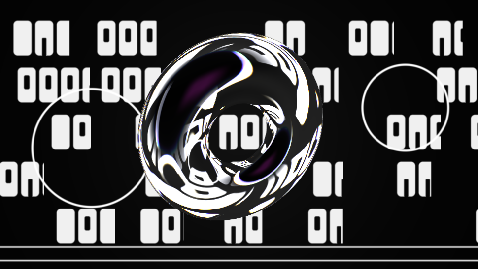

*Preview (Inner bounce stage, Trapped Light preset):* bright, mirrored pieces of the white type and thin studio strips fill the rim bands; the middle of the tube, where little is trapped, stays dark.

## A rainbow through both surfaces

Why does each colour leave at a different angle, and in which order?

In glass the IOR depends on the colour of light: violet bends more than red. This is **dispersion**. A prism splits white light because both of its surfaces bend each colour by a different amount, and the second surface adds to the first.

The shader samples the spectrum in slices, from red (680 nm) to violet (400 nm). `sliceIor()` gives each slice its IOR with **Cauchy's law**, IOR = A + B / wavelength². That spreads the violet end more than the red end, as in real glass. The 530 nm wavelength keeps the Ior control's value; the diagnostic stages show it as their middle channel. Dispersion keeps the core's scale: at 1 the slices span 0.3 IOR. `spectrum()` turns each slice into red, green and blue weights, as in the core study.

From [liquid_prism.frag](liquid_prism.frag), lines 330–370:

```glsl
// Index of refraction for one slice of the spectrum, from w = 0 (red,
// 680 nm) to w = 1 (violet, 400 nm). Cauchy's law, n = A + B / wavelength^2,
// spaces the slices like real glass: violet bends most, and the blue-violet
// end spreads more than the red end. The 530 nm wavelength (w = MIDDLE_W)
// keeps the Ior value; Dispersion 1 spreads red to violet over 0.3.
const float MIDDLE_W = 150.0 / 280.0;  // 530 nm on the 680..400 nm scale

float sliceIor(float w)
{
    float nm = mix(680.0, 400.0, w);
    const float red = 1.0 / (680.0 * 680.0);
    const float mid = 1.0 / (530.0 * 530.0);
    const float violet = 1.0 / (400.0 * 400.0);
    float curve = (1.0 / (nm * nm) - mid) / (violet - red);  // -0.34 (red) .. 0.66 (violet)
    return max(uOptics.x + 0.3 * uOptics.z * curve, 1.0);
}

// Weight of one slice in R, G and B: w = 0 is red, w = 1 is violet.
vec3 spectrum(float w)
{
    vec3 c = clamp(1.0 - abs(w - vec3(0.1, 0.45, 0.8)) * vec3(2.4, 2.8, 2.4), 0.0, 1.0);
    c.r += 0.6 * clamp(1.0 - abs(w - 1.0) * 5.0, 0.0, 1.0);  // violet also excites red
    return c * c * (3.0 - 2.0 * c) + 0.02;
}

vec3 saturateColour(vec3 c, float amount)
{
    float luma = dot(c, vec3(0.2125, 0.7154, 0.0721));
    return max(mix(vec3(luma), c, amount), 0.0);
}

// Point i of N on a unit disc, spread evenly for any N: angle and area come
// from two different irrational steps (the "R2" sequence, built on the plastic
// number), so the points never line up on one spiral arm and their average
// stays near the centre. Frost spreads the slices over this disc.
vec2 discPoint(int i)
{
    vec2 f = fract(0.5 + float(i) * vec2(0.7548776662, 0.5698402910));
    float angle = 2.0 * LG_PI * f.x;
    return vec2(cos(angle), sin(angle)) * sqrt(f.y);
}
```

Heckel splits light into R, G and B, then six bands, each with its own IOR, and reads the picture several times per band. Here each slice reads the picture once, and each slice now crosses both surfaces with its own IOR. The exit point is traced once, with the 530 nm IOR, and shared. The far side's tilt is not shared: a violet slice enters more steeply bent, so it reaches the far side at a different point, where the wall faces another way. With one shared normal, violet would meet the wall more steeply than its own path does and be trapped even in a ball, where nothing can be trapped. `sliceExitNormal()` gives each slice its own: the ball formula for its own ray, or, with the back-face pass, a second reading of the far side where that slice arrives.

From [liquid_prism.frag](liquid_prism.frag), lines 509–526:

```glsl
// Each slice of the spectrum enters at its own angle, so it reaches the far
// side at its own point, where the far side may face another way. Sharing
// the traced ray's exit normal would let a violet slice meet the far side
// more steeply than its own path does, and be trapped where no light is
// (a ball, for example). Ball guess: the closed form for this slice's ray.
// Back-face pass: read the far side again where this slice's ray reaches
// it, with the path scaled as in a ball (exact for a ball; a flat far side
// has one normal everywhere, so there the scale does not matter). Without
// dispersion every slice is the traced ray.
vec3 sliceExitNormal(vec3 inside, vec3 n, vec3 eye, vec2 uv, PrismExit exit, PrismCamera cam)
{
    if (uOptics.z <= 0.0) return exit.normal;
    if (exit.measured < 0.5) return estimateExit(vWorldPos, n, eye, inside).normal;
    float scale = clamp(max(-dot(inside, n), 0.0) / max(-dot(exit.ray, n), 1e-3), 0.5, 2.0);
    float c;
    vec4 s = backSample(uv + projectOffset(vWorldPos + inside * exit.path * scale, vWorldPos, cam), c);
    return c >= 0.5 ? s.xyz : exit.normal;
}
```

**Frost** reuses the same loop, as in the core study: it spreads the lookups over a small disc and reads a pre-blurred mipmap level, so the blur stays continuous without random jitter. The disc points come from the "R2" sequence (`discPoint()`), whose angle and area use two different steps, so the points never line up on one spiral arm and their average stays near the centre: frost blurs the view without moving it (test `frost_does_not_shift_the_image`). Each lookup also reads a mipmap level that rises once it sweeps across more than 4 texels of the picture from one pixel to the next (`footprintLod()`). Where the glass squeezes a large part of the scene into a few pixels, for example at a large Scene depth, neighbouring pixels then read a smooth average instead of unrelated texels, which would look like grain. Why 4 texels and not 1: compared with a supersampled render, a level as wide as the whole footprint blurred the ordinary squeeze at the rims more than the true image is blurred (test `large_scene_depth_stays_smooth`; numbers in [decisions.json](decisions.json)). The same loop also averages the Refraction TOP's alpha at the lookups, `covered`, which the next sections use.

From [liquid_prism.frag](liquid_prism.frag), lines 691–745:

```glsl
// Every slice of the spectrum, through both surfaces. Each slice enters
// with its own IOR, crosses to the exit, and either leaves (then travels
// Scene depth further and reads the Refraction TOP there) or is reflected
// back inside, in proportion to the Fresnel share. `covered` is the
// Refraction TOP's own alpha at the lookups (0 where that TOP is
// transparent). Frost spreads the lookups over a small disc (discPoint()),
// read from a mipmap level as wide as the gap between them, so the blur
// stays continuous and does not shift the image. Each lookup also reads a
// level wide enough for its own footprint (footprintLod), so a strongly
// shrunk view turns smooth instead of grainy. The bounce lookup is worked
// out for every slice, not only trapped ones, because its footprint needs
// screen derivatives, which every pixel must compute together.
void throughGlass(vec3 eye, vec3 n, vec2 uv, PrismExit exit, PrismCamera cam, mat3 view,
                  vec2 toUV, vec3 lightDir, out vec3 behind, out vec3 bounce, out vec3 glow,
                  out float covered)
{
    int count = clamp(int(uState.z + 0.5), 1, 32);
    float colourSplit = clamp(uOptics.z * 4.0, 0.0, 1.0);
    vec2 size = vec2(textureSize(sRefraction, 0));
    vec2 blurPixels = uBody.y * 0.25 * abs(toUV) * size;
    float lod = log2(max(2.0 * max(blurPixels.x, blurPixels.y) / sqrt(float(count)), 1.0));
    mat3 toWorld = transpose(view);  // camera right and up, in world space
    vec3 sumBehind = vec3(0.0);
    vec3 sumBounce = vec3(0.0);
    vec3 sumGlow = vec3(0.0);
    vec3 weightSum = vec3(0.0);
    float alphaSum = 0.0;
    for (int i = 0; i < 32; i++) {
        if (i >= count) break;
        float w = (float(i) + 0.5) / float(count);
        float ior = sliceIor(w);
        vec3 inside = enterGlass(eye, n, ior);
        vec3 farNormal = sliceExitNormal(inside, n, eye, uv, exit, cam);
        vec4 leave = leaveGlass(inside, farNormal, ior);
        vec2 disc = discPoint(i) * uBody.y * 0.25;
        vec3 hit = exit.point + leave.xyz * uPrism.x + toWorld[0] * disc.x + toWorld[1] * disc.y;
        vec2 unfolded = uv + projectOffset(hit, vWorldPos, cam);
        vec3 weight = mix(vec3(1.0), spectrum(w), colourSplit);
        vec4 seen = textureLod(sRefraction, mirrorUV(unfolded), footprintLod(unfolded, lod, size));
        sumBehind += (1.0 - leave.w) * weight * seen.rgb;
        alphaSum += seen.a;
        if (uPrism.z > 0.0) {
            vec3 bounced = inside - 2.0 * max(dot(inside, farNormal), 0.0) * farNormal;
            vec2 bounceAt = uv + projectOffset(exit.point + bounced * uPrism.x, vWorldPos, cam);
            float bounceLod = footprintLod(bounceAt, lod, size);
            if (leave.w > 0.001) sumBounce += leave.w * weight * bounceLight(bounced, eye, uv, bounceAt, cam, view, bounceLod);
        }
        sumGlow += causticGlow(exit.normal, lightDir, ior) * weight;
        weightSum += weight;
    }
    behind = sumBehind / weightSum;
    bounce = uPrism.z * sumBounce / weightSum;
    glow = sumGlow / weightSum;
    covered = alphaSum / float(count);
}
```

**Experiment `dispersion`:** What happens when every colour bends by a different amount at both surfaces?

On the built component, run `component.op('study_tools').module.apply(component, 'dispersion')`.

Prediction: Every edge of the type seen through the glass splits into a full rainbow, red on one side and violet on the other, wider where the glass bends most.

Parameters: Preset=spectral_prism, Pause=True, Time=2.0, Stage=refraction. Time and unrelated controls are fixed by this preset.

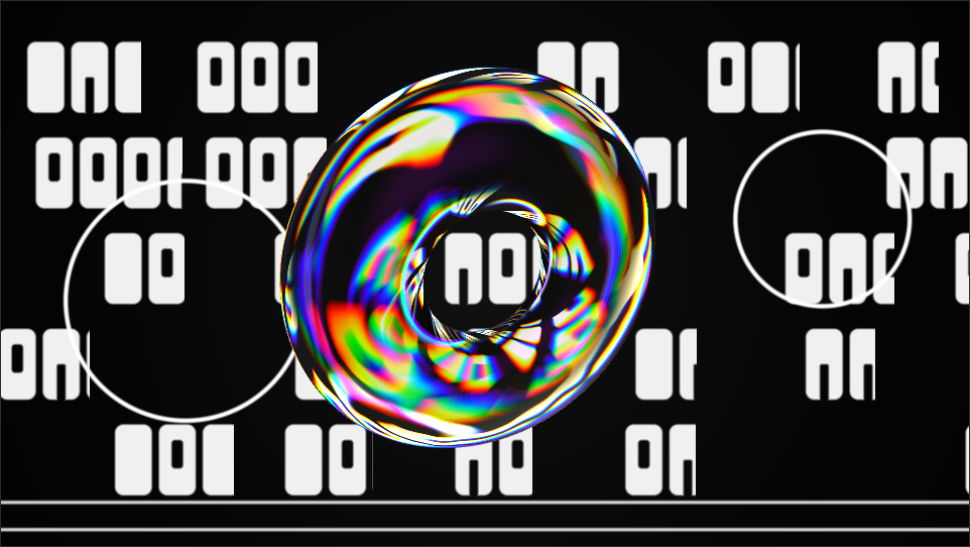

*Preview (Refraction stage, Spectral Prism):* every edge of the type seen through the glass carries a full red-to-violet fringe, widest where the glass bends most.

**Experiment `deviation`:** Which colour leaves the glass at the largest angle?

On the built component, run `component.op('study_tools').module.apply(component, 'deviation')`.

Prediction: Blue-tinted everywhere: the violet slice (blue channel) deviates more than the middle (green) and red (red channel). White marks slices that are trapped.

Parameters: Preset=spectral_prism, Pause=True, Time=2.0, Stage=deviation, Backface=True. Time and unrelated controls are fixed by this preset.

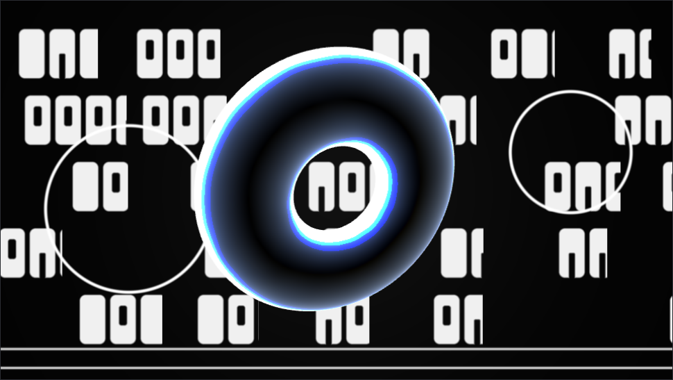

*Preview (Exit deviation stage, back-face pass):* dark blue across the tube, because the violet slice (blue channel) turns furthest; white rings along the rims, where slices are trapped. A test measures it through the 45-degree prism at IOR 1.3 and Dispersion 0.3: red turns 18.7 degrees, the middle (530 nm) 21.9 and violet 28.9, matching Snell's law with the Cauchy curve within 2/255 of 90 degrees (`dispersion_violet_deviates_more`).

That stage is a diagnostic. Two more tests check the picture itself, over a test backdrop that stores its own screen position, so a colour read back says where a lookup landed. Through the same prism, every lookup lands within 0.25 pixel of an independent trace (Snell's law in, the far face, Snell's law out, Scene depth further, the camera's projection), for a sideways and an up-and-down bend (`refraction_lookup_follows_snell`). With Dispersion 0.3, each colour channel equals the traced 16-slice spectrum within 0.0001, with violet on the side Snell's law predicts (`rainbow_in_the_image_follows_snell`). On a unit sphere at Dispersion 1, no wavelength is trapped anywhere out to 0.97 of its radius, with the ball guess or the back-face pass (`ball_never_traps_any_wavelength`).

## Focused light

Where does the glass gather light into a bright spot?

A glass ball in sunlight throws a bright spot: rays that entered across the whole ball meet in a small area. Heckel's caustics article measures this as a ratio of areas: the area a bundle of light covers before refraction, divided by the area after. A smaller area afterwards means brighter light. He computes the areas with screen derivatives on a separate plane.

In a material, screen derivatives are only constant over blocks of 2 × 2 pixels and change per triangle, which would show as blocks or facets. For a ball the ratio has a closed form instead. Parallel light focuses at *f* = *n R* / (2 (*n* − 1)) from the centre. On the far wall the bundle has then shrunk to an angle of |2 − *n*| / *n* around the point that faces away from the light. `causticGlow()` draws a soft spot of that size, as bright as the area shrank, with a floor so the spot never becomes a pin-point. Violet focuses sooner than red, so the spot has coloured edges. **Caustic spread** widens the spot without dimming it.

From [liquid_prism.frag](liquid_prism.frag), lines 543–560:

```glsl
// Light focused by the glass. Heckel's caustics compare the area a bundle
// of light rays covers before and after refraction: a smaller area means
// brighter light. For a ball lens that ratio has a closed form. Parallel
// light focuses f = n R / (2 (n - 1)) from the centre, so on the far wall
// the bundle shrinks to an angle of |2 - n| / n around the point facing
// away from the light. The glow is a soft spot of that size, as bright as
// the area shrank (1 at IOR 1.5, brighter toward IOR 2). Violet focuses
// sooner than red, so the spot has coloured edges. The spot never shrinks
// below 0.1 radians: real objects are not perfect balls, and a pin-point
// spot would vanish between their normals. Caustic spread widens the spot
// without dimming it (an artistic control; 1 is the ball-lens size).
vec3 causticGlow(vec3 exitNormal, vec3 lightDir, float ior)
{
    float radius = max(abs(2.0 - ior) / ior, 0.1);
    float concentration = min((1.0 / 9.0) / (radius * radius), 4.0);
    float angle = acos(clamp(dot(exitNormal, -lightDir), -1.0, 1.0)) / (radius * uCaustic.y);
    return paramColour(uLightColor.rgb) * uCaustic.x * concentration * exp(-angle * angle);
}
```

**Experiment `caustic`:** Where does focused light collect inside the glass?

On the built component, run `component.op('study_tools').module.apply(component, 'caustic')`.

Prediction: A soft warm glow on the part of the far wall that faces away from the light (lower right for the default light direction), with slightly coloured edges.

Parameters: Preset=caustic_heart, Pause=True, Time=2.0, Stage=caustic. Time and unrelated controls are fixed by this preset.

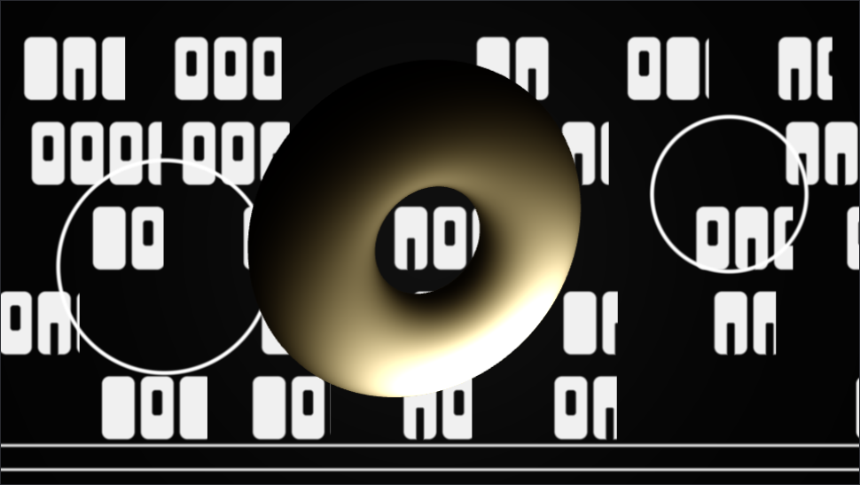

*Preview (Caustic glow stage, Caustic Heart):* a warm glow grows from the lower-right part of the torus and fades toward the upper left; the rest is black. With the default light up and to the front-left, the far wall facing away from it is at the lower right. Move the light and the glow moves. A light behind the object would focus onto the near wall, which this model does not draw.

## Put it together: twelve looks and a morph

How do the pieces combine, and how do presets reach the shader?

The composition traces one exit, runs the spectral loop, and adds the bounced and focused light inside the glass. From there it is the core study's recipe: tint by Beer-Lambert absorption over the measured or guessed path, mix with the glass body by **Translucency**, add reflections and highlights, and scale everything by **Opacity**. Output is premultiplied alpha, which TouchDesigner's blending and Over TOP expect.

One formula covers every scene. `covered` says how much of the view through the glass the Refraction TOP actually holds: 1 over an opaque scene render, 0 where its background is transparent or nothing is connected. Where it is 1, the bent scene passes through and alpha is 1. Where it is 0, there is nothing to bend, so the glass lets the real background behind it in the render show through by blending, and alpha drops by the share that passes. Bounce and glow do not need the Refraction TOP, so they stay. **Energy conserving** (`keep`) removes the reflected share from what passes through, so Mirror 1 becomes a true mirror. Last, the Camera COMP's fog: TDFog changes nothing while fog is off, and with fog on the glass adds only its own alpha's share of the fog colour. The colour is capped at 1024 before it is written, so a very bright highlight never becomes infinity in a 16-bit float render. `TDCheckDiscard()` sits right after the spectral loop: the loop's blur levels are the glass pass's last screen derivatives.

From [liquid_prism.frag](liquid_prism.frag), lines 879–941:

```glsl
    // The exit is traced once, with the Ior value (530 nm); each slice then
    // gets its own exit normal in throughGlass().
    vec3 centreRay = enterGlass(eye, n, max(uOptics.x, 1.0));
    PrismExit exit = estimateExit(vWorldPos, n, eye, centreRay);
    if (useBack) exit = measureExit(vWorldPos, centreRay, uv, cam, surfaceDistance, exit);

    // `covered` is the Refraction TOP's alpha where the slices land: 0 where
    // that TOP is transparent or not connected.
    vec3 behind, bounce, glow;
    float covered;
    throughGlass(eye, n, uv, exit, cam, view, toUV, lightDir, behind, bounce, glow, covered);
    TDCheckDiscard();  // after footprintLod()'s derivatives in throughGlass(), the last ones
    if (!hasRefraction) {
        behind = vec3(0.0);
        covered = 0.0;
    }
    // Bounced light crosses the glass again, so it is tinted twice as deep.
    vec3 inner = bounce * absorption(exit.path) + glow;
    vec3 through = saturateColour(behind + inner, uOptics.w);

    // Edge tint lengthens the light path at grazing angles (deep-coloured rims).
    float path = exit.path * (1.0 + uBody.w * (1.0 / max(NdotV, 0.15) - 1.0));
    vec3 tint = absorption(path);
    vec3 body = bodyColour(n, lightDir);
    float translucency = uBody.x;

    vec3 film = thinFilm(NdotV, filmThickness());
    vec3 filmTint = mix(vec3(1.0), 2.0 * film, uFilm.x);

    float r0 = (uOptics.x - 1.0) / (uOptics.x + 1.0);
    float reflectance = mix(mix(r0 * r0, 1.0, fresnel), 1.0, uSurface.x);
    vec3 env = environment(reflect(eye, n), uv, view, cam.viewSign);
    vec3 reflection = env * paramColour(uReflect.rgb) * uReflect.a * reflectance * filmTint;
    vec3 shine = highlights(n, eye, lightDir, fresnel)
               + film * uFilm.x * 0.3 * (0.3 + 0.7 * fresnel);
    // Energy conserving (off by default, like Heckel's additive glow): light the
    // surface reflects no longer also passes through it, so Mirror 1 is a mirror.
    float keep = 1.0 - uSurface.w * clamp(reflectance, 0.0, 1.0);

    // Where the Refraction TOP covers the view (covered = 1), the bent scene
    // passes through the glass. Where it is transparent or missing (covered
    // < 1) there is nothing to bend: the glass lets the real background behind
    // it in the render show through by blending, so alpha drops by the share
    // that passes. One grey share (the tint's average), since alpha has one
    // channel; the glass colour fills in the rest of the tint. Bounce and glow
    // do not need the Refraction TOP, so they stay.
    float seeThrough = translucency * (1.0 - covered) * dot(tint, vec3(1.0 / 3.0));
    vec3 colour = (mix(body, through * tint, translucency)
                   + paramColour(uGlass.rgb) * (translucency * (1.0 - covered) - seeThrough)) * keep
                + reflection + shine;
    float alpha = 1.0 - seeThrough * keep;

    // Premultiplied output: opacity fades the whole glass, reflections included.
    colour *= uBody.z;
    alpha *= uBody.z;
    // The Camera COMP's fog (TDFog changes nothing while fog is off). TDFog
    // takes an unpremultiplied colour: fogging black gives the fog colour it
    // adds, and the glass adds only its own share (alpha) of that; what
    // shows through by blending is fogged in its own render. The bent scene
    // inside `colour` was fogged in its render too and gets the glass's fog
    // on top: an approximation.
    vec3 fogAdded = TDFog(vec4(0.0, 0.0, 0.0, 1.0), vWorldPos, vCamIndex).rgb;
    colour = TDFog(vec4(colour, 1.0), vWorldPos, vCamIndex).rgb - fogAdded * (1.0 - alpha);
```

The shader itself never sees presets: only sixteen sets of four numbers (**uniforms**). Each component parameter feeds one of them through an expression on the GLSL MAT's Vectors page. The lengths (Thickness, Scene depth, Frost, Tint density, the ripple and film patterns) are converted with **Object size** on the way, so a preset looks the same on a small and a large object. Object size means the same in every Liquid Glass study: the object's radius in the world over 1.45, the radius of the core study's demo torus. This study's demo torus is a little wider than the core's (half its largest side is 1.5), but its Geometry COMP flattens it to 0.6 in depth. Fit counts a non-uniform scale as its average, the cube root of 0.6 (0.843), so it measures 1.5 x 0.843 = 1.265 and sets 0.872517, the default. A Geometry COMP's scale counts too. Fit to Glass geometry includes it in the size it measures, and `worldScale()` multiplies the ripple and film lookups by it, so an object scaled by its COMP shows the same pattern at its fitted size as one built at that size (preview test `fit_size_carries_presets_over_comp_scale`). `uPhase` is the ripples' and film's drift, added up frame by frame in Python, so changing Wobble speed or morphing never makes the pattern jump, even after days of running.

From [liquid_prism.frag](liquid_prism.frag), lines 27–51:

```glsl
uniform sampler2D sRefraction;
uniform sampler2D sReflection;
uniform sampler2D sBackface;

// Lengths are in scene units: the component multiplies Thickness, Frost and
// Scene depth by Object size and divides Tint density and the pattern
// frequencies by it. Object size is the object's size in the world (Fit to
// Glass geometry counts the Geometry COMP's scale), so the shader multiplies
// the pattern frequencies by that scale (worldScale()).
uniform vec4 uGlass;     // rgb glass colour, a tint density (per scene unit)
uniform vec4 uBody;       // translucency, frost (scene units), opacity, edge tint
uniform vec4 uOptics;     // ior, thickness (scene units), dispersion, saturation
uniform vec4 uReflect;    // rgb reflection tint, a reflection amount
uniform vec4 uEnv;        // map mode (0 panorama, 1 screen, 2 studio), rotation (radians), blur, screen warp
uniform vec4 uSurface;    // mirror, fresnel power, diffuse, energy conserving (0 or 1)
uniform vec4 uRim;        // rgb rim colour, a rim amount
uniform vec4 uLight;      // xyz direction toward the light, w specular amount
uniform vec4 uLightColor; // rgb light colour, w shininess
uniform vec4 uFilm;       // iridescence, film thickness (nm), film variation, film swirl frequency (2.5 / object size; 0 = one thickness, no swirl)
uniform vec4 uWobble;     // amount, scale (ripples per scene unit, laid out on the object), speed, unused
uniform vec4 uPhase;      // noise drift: 0.6, 0.4, -0.3, 0.15 x speed, added up every frame, wrapped to 0..256
uniform vec4 uState;      // debug stage, pass (0 front, 1 back), samples, flip V
uniform vec4 uInputs;     // has refraction TOP, has reflection TOP, use back-face TOP, colours are sRGB (1) or as typed (0)
uniform vec4 uPrism;      // scene depth (scene units), exit tilt, inner reflection, unused
uniform vec4 uCaustic;    // caustic glow, caustic spread, unused, unused
```

Choosing a **Preset** runs a small script ([preset_exec.py](preset_exec.py)) that copies the look's values from [presets.json](presets.json) into the parameters, so you can keep adjusting. **Morph** blends every look value toward the **Morph target** preset inside the uniform expressions ([presets.py](presets.py), the core study's module). Six presets are new prism looks. They were tuned on this demo when Object size 1 still meant the demo itself; since the family rule their lengths are 1.146 times larger, so that at the demo's 0.872517 they look as they did. Six are core looks with their exact core values, so they mean the same object size here as in the core; they look different here because the optics are different.

**Experiment `morph`:** How do presets and morphing reach the shader?

On the built component, run `component.op('study_tools').module.apply(component, 'morph')`.

Prediction: A look halfway between Spectral Prism and Type Lens: thinner fringes, stronger reflections.

Parameters: Preset=spectral_prism, Pause=True, Time=2.0, Morphtarget=type_lens, Morph=0.5. Time and unrelated controls are fixed by this preset.

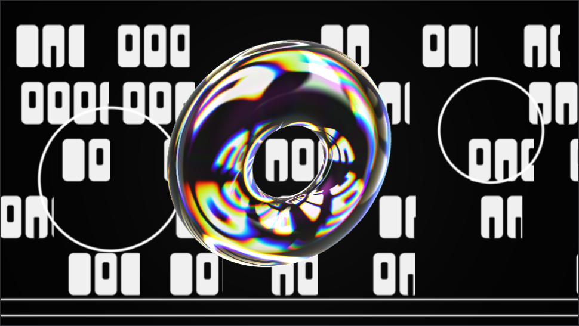

*Preview:* thinner fringes than Spectral Prism and stronger reflections. Tests confirm Morph 1 renders exactly the target preset and Morph 0 changes nothing.

**Experiment `final`:** What does the default look add up to?

On the built component, run `component.op('study_tools').module.apply(component, 'final')`.

Prediction: Clear glass with a dense rainbow along every edge seen through it, bright trapped-light bands near the rims, a white rim and sharp highlights.

Parameters: Preset=spectral_prism, Pause=True, Time=2.0, Stage=final. Time and unrelated controls are fixed by this preset.

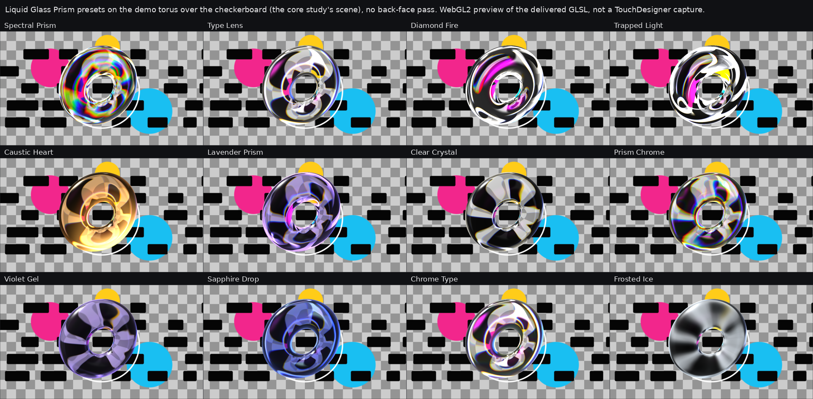

*Preview of all twelve presets on the demo torus without the back-face pass, over the core study's checkerboard (Study > Demo backdrop > Checkerboard), so they compare with the rest of the family. [The same presets over bold type](captures/presets-sheet-type.png), this study's default scene, and [on a knot with the back-face pass](captures/presets-sheet-backpass.png).*

## Use it in your own scene

The [README](README.md) has the steps. In short: render your scene without the glass and use it as the Refraction TOP. Add a Render Pass TOP on that render with your camera and the glass objects, Clear Depth Buffer and Clear to Camera Color off, and the component's `material` as its Override Material (the build prints its full path). The pass keeps the scene's depth, so objects in front of the glass stay in front, with nothing extra to list. Turn Dither off on both renders. Press **Fit to Glass geometry** so presets match your object's size, and set **Scene depth**, the lens strength, to roughly how far your scene sits behind the glass. For exact exits, turn on the back-face pass and point it at your camera and glass objects.

## Limits

- **Only what the camera sees can appear through the glass.** Light that leaves toward something off screen or hidden reads a folded copy of the picture instead.
- **The far side is the nearest back face.** With the back-face pass, a ray that passes through two separate glass parts sees only the first far wall. Without it, the far side is a ball-shaped guess, exact only for balls.
- **One bounce.** Trapped light is followed for one mirror reflection, then looked up without a second exit. Further bounces are ignored.
- **One exit point for all colours.** Slices share the exit point and path traced at 530 nm; each gets its own far-side normal, so only the small spatial spread inside the glass is missed. With the back-face pass, within about 2 pixels of a silhouette the exit search can still miss and report total reflection where the exact share is up to 0.94.
- **The caustic glow is a closed-form ball-lens estimate**, not a light simulation. It sits on the far wall and cannot show focus onto the near wall or onto other objects.
- **Scene depth is one number** for the whole picture behind the glass, not a depth per pixel. Very large values squeeze the scene into a blurred average.
- **Objects in front of the glass** stay in front with the Render Pass TOP route, but they are also in the Refraction TOP, so they can appear bent inside the glass. Whether a Render Pass TOP may sample the render it builds on is a native check; the Over TOP fallback paints the glass over them.
- **Partly transparent scene pixels** (alpha between 0 and 1) are counted twice behind the glass and look slightly brighter.
- **Not supported:** Fish-Eye, Cube Map and Dual Paraboloid render modes; several cameras in one Render TOP. Quad Reproject cameras are untested.
- **One Object size per component.** Fit measures when you press it and takes the largest object. A smaller object, a Geometry COMP whose Scale changes after Fit, and an instance with its own scale all keep that one Object size. At a fifth of the size the glass bends and tints as if it were five times larger; scaled up three times without a new Fit, as if it were three times smaller. On an instance the ripples and film bands grow with it, but their tilt ignores its rotation. The README lists the workarounds; a change that would let all three follow is recorded in [decisions.json](decisions.json) and waits for the user's decision.
- **Cost** grows with Samples (two refractions, one to three texture reads and a Fresnel term per slice), Reflection blur, and the back-face pass (one extra render plus up to sixteen texel reads per pixel).
- **Colour values are converted only along the sRGB curve.** Colour parameters (Auto) converts them in linear working spaces; wide gamut is not converted. The presets were tuned in the Pass Through working colour space.
- **Antialiased edges near the centre lines.** With antialiasing, a few silhouette pixels near the render's centre row or column still bend the wrong way: each is shaded at its centre, outside its own triangle, and its point projects to the other side of the centre line. In the preview they change at most 7 pixels in twelve frames, by up to 20/255. Whether that shows in TouchDesigner is an open family question, with a native check pending. A centroid-sampled position removed most of them in the usual raster in the Liquid Glass Lit study's preview, but no TouchDesigner build has run one.
- **Not yet run in TouchDesigner.** The shaders compile as GLSL 4.60 against stand-ins for TouchDesigner's built-ins, and the preview passes its 54 property tests. Native compile, render, the preset callback, the back-face pass and export are still to be checked on a real host; see [validation.json](validation.json).

## Credits

Screen-space refraction through a render of the scene, multi-sample dispersion, saturation, the squared Blinn-Phong highlight, the fresnel glow and back-side rendering come from Maxime Heckel, [Refraction, dispersion, and other shader light effects](https://blog.maximeheckel.com/posts/refraction-dispersion-and-other-shader-light-effects/). That article credits the sampling technique to the open-source Junni site by @ore_ukonpower and the colour split to research by Ravishankar Sundararaman. Its backside section points to Jesper Vos's [Real-time Multiside Refraction in Three Steps](https://tympanus.net/codrops/2019/10/29/real-time-multiside-refraction-in-three-steps/) (Codrops, 2019), which stores back-face normals in a texture. Refraction through two surfaces in image space goes back to Chris Wyman, *An Approximate Image-Space Approach for Interactive Refraction* (SIGGRAPH 2005). The area-ratio idea for caustics and the normal render pass come from Heckel's [Shining a light on Caustics](https://blog.maximeheckel.com/posts/caustics-in-webgl/), which credits Evan Wallace's caustics technique. Snell's law, the Fresnel equations, Cauchy's law and the ball-lens focal length are standard optics. The frost disc uses Martin Roberts' R2 sequence. The TouchDesigner material, its two-surface tracing, the exit search, the ball-plus-tilt fallback, the bounce lookup, the closed-form caustic glow and the presets are new for this study; [sources.json](sources.json) lists each source's lines and what changed. This study is not authored or endorsed by Maxime Heckel.
