# Liquid Glass Prism: light that bends twice, splits and gets trapped

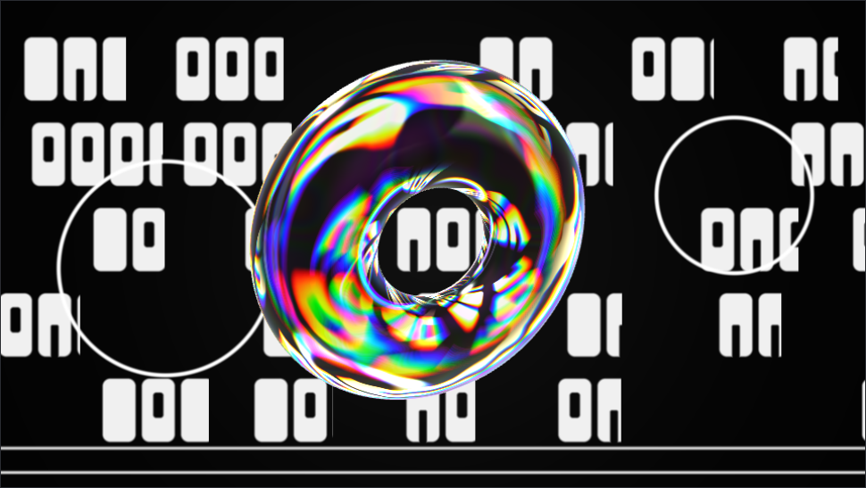

*The destination: the default look on the demo torus. This image is a WebGL preview of the same GLSL files, not a TouchDesigner capture.*

This tutorial builds a glass material for any 3D object in TouchDesigner that treats light more like real glass does. Light bends where it enters the object and again where it leaves. Each colour bends by its own amount at both surfaces, so edges seen through the glass break into a wide, correctly ordered rainbow. Where the far side is too steep, light cannot leave at all and is reflected back inside: total internal reflection, the bright bands you see in cut glass. An optional glow imitates light the glass focuses.

It is written for TouchDesigner users who have not written shaders before. It builds on the core [Liquid Glass](../liquid-glass/) study (commit a6f95c6, synced with its later state in November 2026), which bends light once. The colour, tint, reflection, highlight, liquid and film controls work exactly as there, and its tutorial explains them. This one covers what changes when light crosses two surfaces. Every code block below is copied automatically from the delivered files.

The grounding is Maxime Heckel's [Refraction, dispersion, and other shader light effects](https://blog.maximeheckel.com/posts/refraction-dispersion-and-other-shader-light-effects/), especially its backside rendering section, and his [caustics article](https://blog.maximeheckel.com/posts/caustics-in-webgl/). His backside section points to a Codrops article on multiside refraction, which builds on research by Chris Wyman (2005). Each adaptation is named where it happens.

## Open the study

Build the component from the Textport, keeping it in a variable named `component` so the experiment commands below work:

```python
import runpy
component = runpy.run_path('/path/to/liquid-glass-prism/build.py')['build']()
```

Open the component's viewer. Each experiment below fixes time and every unrelated control, then changes one thing. `component.op('study_tools').module.apply(component, id)` first returns every look control (presets, Morph, Samples, light direction, the back-face pass, the Study page, the demo backdrop) to its default, so the experiments can run in any order; your own inputs, Object size and the other setup controls stay as they are. The experiments change the component's shared material, so run them on a second component if your scene uses the first. The **Study > Teaching stage** menu shows one ingredient of the material at a time; most experiments use it.

The pictures come from a WebGL preview that runs the same shader files in a browser. They show what the code does. They are not proof of how TouchDesigner renders it. When you run an experiment natively, compare against the stated prediction.

A shader is a small program the graphics card runs for you. A GLSL MAT holds two. The **vertex shader** runs once per corner of the mesh and decides where it lands on screen. The **pixel shader** runs once per pixel the object covers and decides its colour. All the optics happen in the pixel shader.

## Make the object see-through

How can an object show what is behind it, when a shader only knows its own surface?

It can't see the scene, so we hand it a picture of the scene: a render of everything *except* the glass, from the same camera. This is the **Refraction TOP**. If each glass pixel copies the pixel at the same screen position from that picture, the object becomes invisible. Every effect after this changes *where* we look in that picture. Heckel does the same with a frame buffer rendered each frame in the web page.

The vertex shader passes on what the pixel shader needs: the surface position and normal in world space, the position in the object's own space (so ripples stick to the object), and which camera is rendering. A Render Pick DAT or CHOP draws the object once more to find what is under the mouse. For that pass TouchDesigner defines `TD_PICKING_ACTIVE`, and the shader uses the form from Derivative's Write a GLSL MAT page: every render places the point, and while picking only the `#else` block runs, which calls `TDWritePickingValues()` and writes none of the four outputs (unit test `test_g6_pick_render_runs_only_the_documented_picking_block`).

{{code:liquid_prism.vert:transforms}}

In the pixel shader, `screenUV()` turns the pixel's position into 0..1 coordinates across the render. The core study stops there. This study follows light to points inside and behind the glass, so it also needs to know where a 3D point lands on screen. `projectOffset()` projects two points with the camera's own matrices and returns the difference. Working with differences has a useful property: two points on the same camera ray land on the same spot, so light that is not bent comes back to exactly its own pixel. It has two safeguards. A point near or behind the camera would land at a huge or mirrored offset, so it is first pulled back until it is at least half as far from the camera as the surface. And `screenSign()` makes the offset run the same way as the screen does, whatever the build's convention. It compares where the camera projects this pixel's own point with where the pixel actually sits on the render: the same way round, or mirrored. An earlier version took the sign of screen derivatives instead, which came out wrong on about one silhouette pixel per frame; the comparison needs none (test `screen_orientation_has_no_wrong_pixels`). One row and one column are the exception: in a render with an odd width or height they sit exactly on the centre line, where both positions are 0 and there is nothing to compare. There the sign of a screen derivative decides, unless the surface is nearly edge-on (then the next pixel's position is a poor guess, and the tie gives +1). Offsets in camera space need one more factor. The flat-image reflection moves by a direction as the camera sees it, not by a difference of projected points, so a projection matrix that is itself mirrored would turn it the wrong way. `cam.viewSign` adds the matrix's own sign for it (test `mirrored_projection_keeps_offsets_the_right_way`). `eyeDistance()` measures how far a point is from the camera, in a way that also works for orthographic cameras. `footprintLod()` comes back in "A rainbow through both surfaces".

{{code:liquid_prism.frag:screen}}

{{experiment:see_through}}

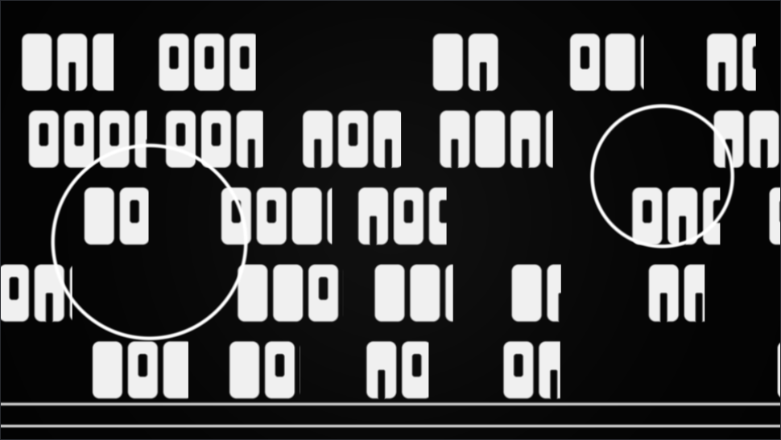

*Preview:* the torus disappears. Automated tests compare such renders with the backdrop alone: the largest difference is 1/255 on the torus and on a knot, with and without the back-face pass, and with an orthographic camera (`ior1_invisible_*` in [the preview tests](checks/preview_tests.cjs)). That matters more here than in the core study, because the light now takes a long detour through the object and must still come back to the same pixel.

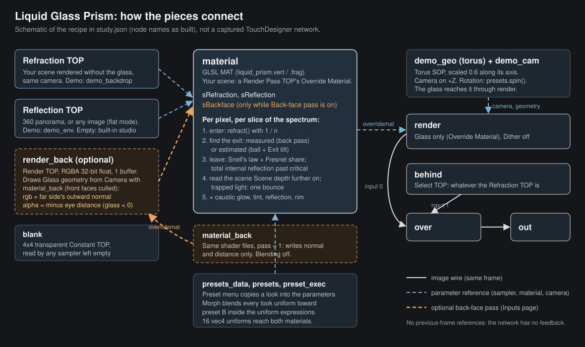

The diagram is a schematic of the recipe, not a captured network. Solid lines carry images, dashed lines are parameter references, and the orange path is the optional back-face pass.

## Bend twice: in and out

What does light do when it bends going into the glass and again coming out?

Light changes direction where it enters a denser material. The **index of refraction** (IOR) says how much: 1.0 is air, water is 1.33, glass about 1.5. Leaving the glass, light bends again, away from the surface normal this time. What you see through a piece of glass depends on both surfaces. A flat window has two parallel surfaces: the second bend exactly undoes the first, so the view through it is shifted but not turned. A lens or a prism has surfaces at different angles, so the bends add up.

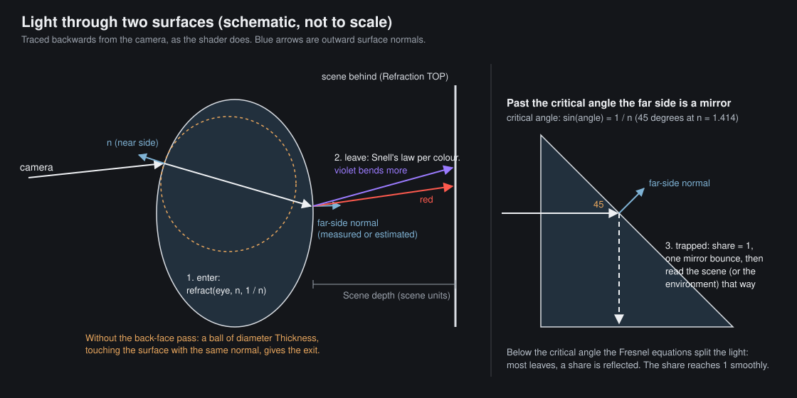

The shader follows a ray backwards from the camera, as the figure shows. `enterGlass()` is GLSL's `refract()` with the ratio 1 / IOR. `leaveGlass()` is Snell's law for the way out, written out by hand because it also has to report how much light the far surface reflects back inside. We return to that share in "Trapped light". For now, note the special case: past a certain angle nothing gets out.

{{code:liquid_prism.frag:interfaces}}

After the second bend the ray travels **Scene depth** further, in units of Object size, and the shader reads the Refraction TOP where that point lands on screen. Treat Scene depth as a lens strength: roughly how far behind the glass the scene sits, but one number for the whole picture, not the literal distance to your background. The core study slides the view sideways by a thickness instead. Here the slide comes out of the geometry: where the ray leaves, in which direction, and how far it then travels.

The main function first gathers, once per pixel, the facts everything else uses: the camera, the eye direction, distances, the screen position, the normal and the fresnel term. It starts with screen derivatives (how a value changes from one pixel to the next) of the surface position and of its projected position. GLSL only defines them where neighbouring pixels run the same code, so they come before any branch; they give a faceted normal for geometry without normals, and the screen orientation on a centre line. `TDCheckDiscard()` lets TouchDesigner drop a pixel, for example for order-independent transparency. A dropped neighbour would leave later derivatives undefined, so each pass calls it only after its last one. Note the early `return`: the back-face pass uses the same file, and it stops here. That pass comes in "Measure the far side". The liquid ripples tilt the normal last, so it is turned toward the camera once more after them.

{{code:liquid_prism.frag:setup}}

The near side's normal comes from `facingNormal()`, kept from the core study. Near silhouettes a blended normal can tilt slightly away from the camera, and `refract()` would then bend even at IOR 1, so `faceCamera()` lays such normals back into the view plane. `safeNormalize()` turns a vector into a unit vector without dividing by zero, and `facetedNormal()` builds a normal from the screen derivatives when the mesh has none; its test for a degenerate triangle is relative, so it works the same on a tiny and a huge object.

{{code:liquid_prism.frag:surface}}

{{experiment:bend_twice}}

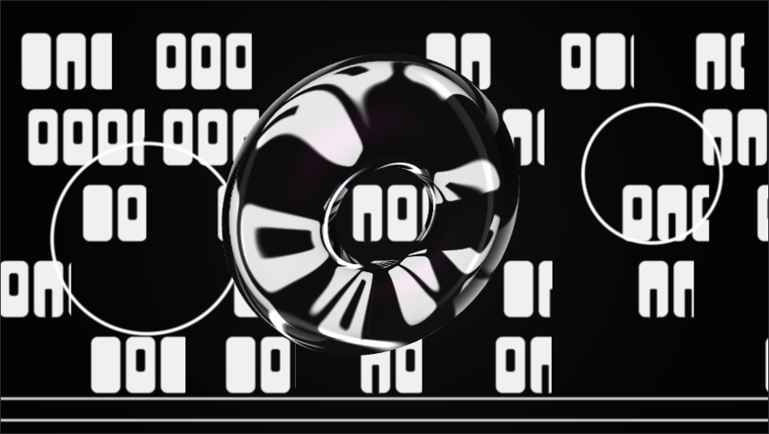

*Preview (Refraction stage):* the type behind the tube appears upside down and squeezed toward the tube's middle; near the rims it stretches into streaks.

{{experiment:scene_depth}}

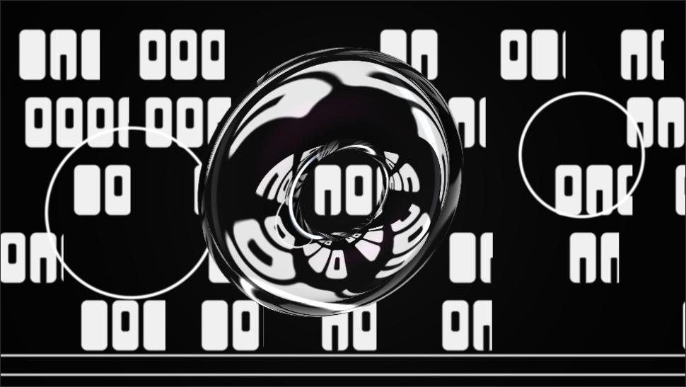

*Preview:* the flipped type is pushed further and looks more magnified; near the rims the letters smear into long arcs.

A test checks the window case directly. A flat slab, tilted 35 and 20 degrees, is rendered with the back-face pass and a stage that shows how far the light's direction turned. Across 49 points on its face the turn is 0 (out of 255, for red, middle and violet). The same slab without the back-face pass, where the shader can only guess the far side, does turn the light, so the test is able to fail (`slab_zero_net_deviation`).

## Guess the far side

Without seeing the back of the object, where does the shader think light leaves?

A material only knows the surface it is drawing. To bend light a second time it needs the far side's position and tilt. By default the study guesses, so it works on any object with nothing else connected.

The guess is a ball. Imagine a ball of diameter **Thickness** that touches this pixel's surface with the same normal. For a ray that enters a ball at refraction angle *a*, two short formulas give where it leaves: it travels Thickness × cos(*a*), and the ball's normal there is *n* + 2 cos(*a*) × *ray*. Both are always finite, and the normal is always unit length, so the guess can never produce a broken pixel. On a real ball of that size the guess is exact.

A ball has one more property: the angle at which light meets the far wall always equals the angle at which it entered. So light never gets trapped in a ball, at any wavelength. Real flattened or twisted shapes do trap light at their rims. **Exit tilt** bends the guess both ways. Toward 1 it blends the ball's far normal toward a steeper wall (the near normal mirrored through the view direction), so the rims can trap light too. Toward -1 it blends toward a far wall parallel to the near one: a flat sheet of thickness Thickness, like a window or a thin ribbon, which shifts the view but does not turn it. The path changes with it: in a ball a tilted ray travels less (Thickness × cos(*a*)), in a sheet more (Thickness / cos(*a*)). A ball bends light however small it is, so thin glass needs this setting. Exit tilt is a look control for the guess, not a measurement.

{{code:liquid_prism.frag:exit}}

{{experiment:exit_ball}}

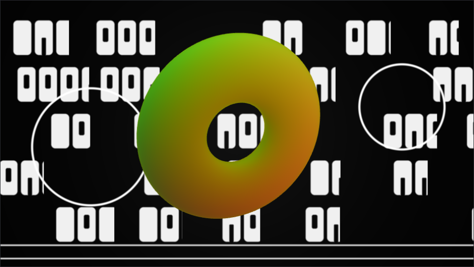

*Preview (Exit normal stage, normals shown as colours):* a smooth green-to-orange gradient across the torus, changing steadily from rim to rim, with no seams.

{{experiment:exit_flat}}

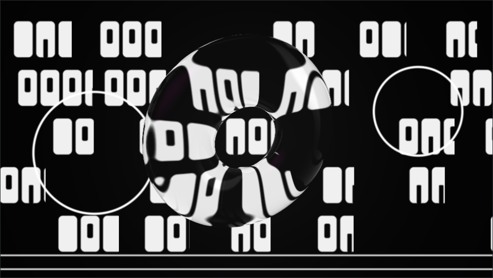

*Preview (Refraction stage, Exit tilt -1):* the letters behind the torus read upright and close to their place, shifted a little in the middle and more toward the rims, where light crosses the guessed sheet at a slant and travels further inside it. In `bend_twice` the same letters are flipped and squeezed.

Four tests check the guess. On a unit sphere with Thickness 2 and Exit tilt 0, the guessed exit normal matches the measured one from the next section within 1/255 at 81 points, from the middle out to 0.97 of the sphere's radius on screen (`fallback_ball_matches_measured_on_sphere`). On the tilted slab, Exit tilt -1 gives zero net deviation, like the measured exit (`slab_zero_net_deviation`), and with Thickness set to the slab's 0.4 it lands every lookup within 0.04 pixel of the measured image (`flat_guess_matches_measured_slab`). And across 5 shapes, 5 extreme settings and 8 stages, read back as 32-bit floats, no output value is NaN or infinite (`fallback_without_backpass_stays_finite`).

## Measure the far side

How can the shader see the back of the object, and what does it store?

Heckel renders the back side of his mesh first, then the front side over it. In his caustics article he swaps in a material that writes normals instead of colour, so another shader can read them. This study combines the two ideas. The optional **back-face pass** renders the glass once more into `render_back`, keeping only the far side (front faces culled), with `material_back`: the same shader files, with the pass switch set. For each pixel it stores two facts in one RGBA 32-bit float image: the far side's outward normal in red, green and blue, and its distance from the camera in alpha, stored as a negative number. Glass is alpha below 0, so any background, whatever a camera's background colour adds, reads as no glass.

Why one image and not several? TouchDesigner can write several colour buffers at once, but the shader then has to match the Render TOP's buffer count, and writing a buffer that is not there can crash the GPU. A normal and a distance fit in four channels, so one ordinary float image is the most portable choice. The comparison is in [decisions.json](decisions.json).

The far side's normal must point out of the glass, away from the camera. `faceAway()`, the mirror image of `faceCamera()`, lays a normal that tilts toward the camera back into the view plane; it runs again after the liquid ripples, as on the near side.

{{code:liquid_prism.frag:backnormal}}

The front pass then has to find where the bent ray meets that far side. The view ray's thickness is only right at IOR 1, because the bent ray reaches the far side somewhere else on screen. Near the silhouette it also shrinks to nothing. So `measureExit()` starts from the longer of that thickness and the ball guess's path, then corrects the guess up to four times: see where the guess lands on screen, read the far side's distance there, and move the guess onto it. It stops early once a step is tiny. `backSample()` reads the four nearest texels itself and skips empty ones, so the silhouette never mixes in garbage. If the pass has nothing at this pixel, the pixel falls back to the ball.

{{code:liquid_prism.frag:backpass}}

{{experiment:backface}}

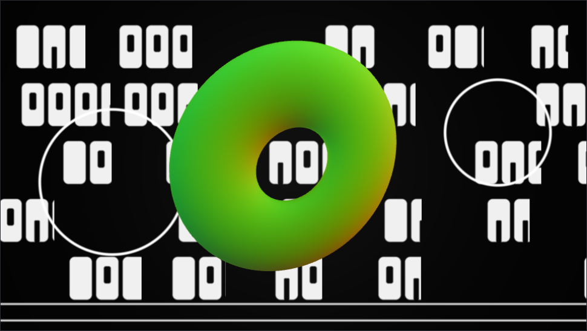

*Preview (Exit normal stage):* a flatter, mostly olive-green field. The far side of the flattened torus mostly faces straight away from the camera, tilted by the demo's 20-degree tilt; the colour changes only toward the rims. Compare it with the ball guess above.

{{experiment:backface_path}}

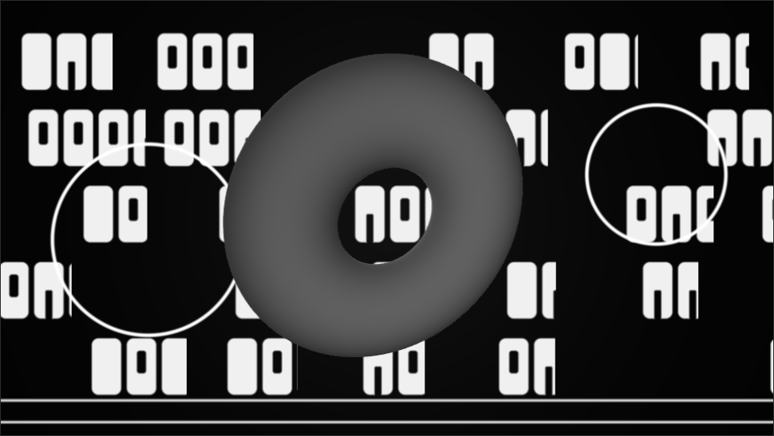

*Preview (Thickness stage):* along the centre row one tube section reads 73, 96 and 65 out of 255, about 0.5, 0.66 and 0.45 scene units of glass (the stage shows path / (2 x Thickness x Object size)), brightest mid-tube. On a unit sphere a test compares the measured path with the exact chord of the refracted ray at four points, at IOR 1 and 1.5: all within 3/255 (`backpass_path_matches_sphere_chord`).

Turn it on with **Inputs > Back-face pass**, then point **Camera** and **Glass geometry** at your camera and glass objects. It costs one extra render and only cooks while the toggle is on. With it on, Exit tilt only affects pixels where the pass has no data, mainly near silhouettes.

## Trapped light

When does light fail to leave the glass?

Leaving glass, light bends away from the normal. The steeper it meets the surface, the more it bends, until at the **critical angle** it would skim along the surface. Past that angle no light gets out: the surface becomes a perfect mirror from inside. This is **total internal reflection**. The critical angle depends only on the IOR: sin(angle) = 1 / IOR, so 42 degrees for glass of 1.5 and 24 degrees for diamond.

Below the critical angle the surface still reflects a share of the light back inside. The **Fresnel equations** give that share; it is a few per cent for light meeting the surface head-on and climbs steeply, but smoothly, to 100% at the critical angle. `leaveGlass()` computes it exactly, and the shader splits each slice of light between the way out and the way back by that share. Because the share reaches 100% smoothly, the trapped bands appear without a hard edge.

The **Trapped share** stage shows it for red, middle and violet:

{{code:liquid_prism.frag:diagnostics}}

{{experiment:critical_low}}

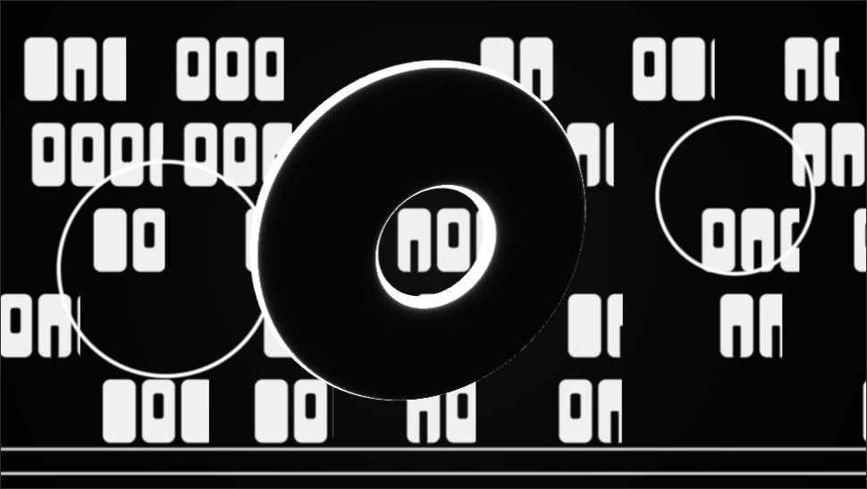

*Preview (Trapped share stage, back-face pass):* nearly black, with thin white lines only along the outer rim and around the hole.

{{experiment:critical_high}}

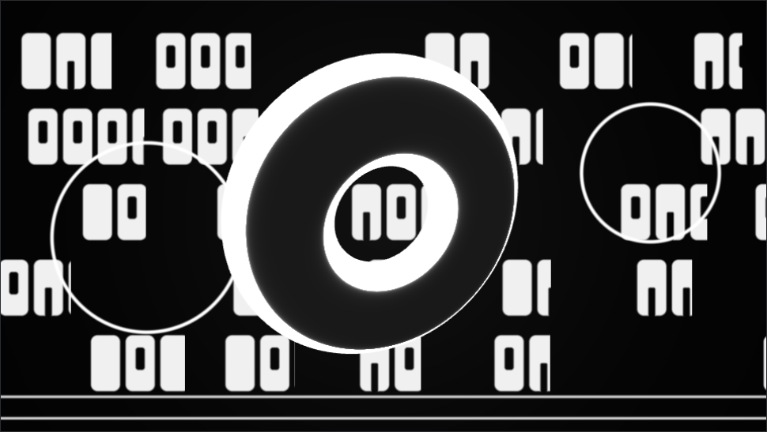

*Preview:* the white bands along both rims widen; the middle of the tube stays dark.

A test makes this exact. Behind a 45-degree prism face, light meets the far side at 45 degrees, so it is trapped from IOR 1.4142 up. At the pixel tested, the share matches the Fresnel equations within 3/255 at IOR 1.30, 1.36, 1.40 and 1.41, and is 255 (total) at 1.42, 1.43, 1.50 and 1.60, rising steadily in between (`tir_beyond_critical_angle_only`). One detail from building that test: just below the critical angle the share changes so fast that the 0.03-degree tilt of the ray through a pixel centre moved it by 7/255. The test now follows the exact ray.

{{experiment:exit_tilt}}

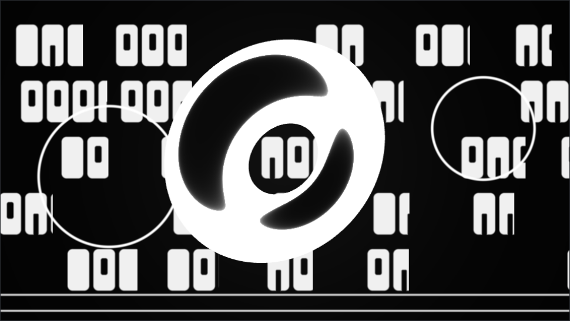

*Preview (no back-face pass, Exit tilt 1):* a wide white band covers the outer rim and circles the hole. At Exit tilt 0 the same view has no white at all: a ball never traps light.

## One bounce inside

Where does trapped light go, and what do we see there?

Trapped light keeps travelling inside the glass, bouncing until it finds a way out. Following every bounce would cost an unknown number of steps per pixel. `bounceLight()` follows one mirror bounce off the far wall, then looks up what lies in that direction without a second exit. If the bounced ray heads away from the camera or sideways, it meets the scene behind: the shader reads the Refraction TOP there and you see a mirrored fragment of the scene. If it heads back toward the camera, it meets whatever is in front of the object, so the shader reads the reflection environment. A smooth blend joins the two.

The first version only looked up the environment. In the preview the trapped bands then read dark, because the studio environment is mostly dark, while reference 1 shows bright bands. After one bounce most rays head sideways, so they should see the scene. **Inner reflection** scales the result, and the bounced light is tinted over twice the path.

{{code:liquid_prism.frag:bounce}}

{{experiment:bounce}}

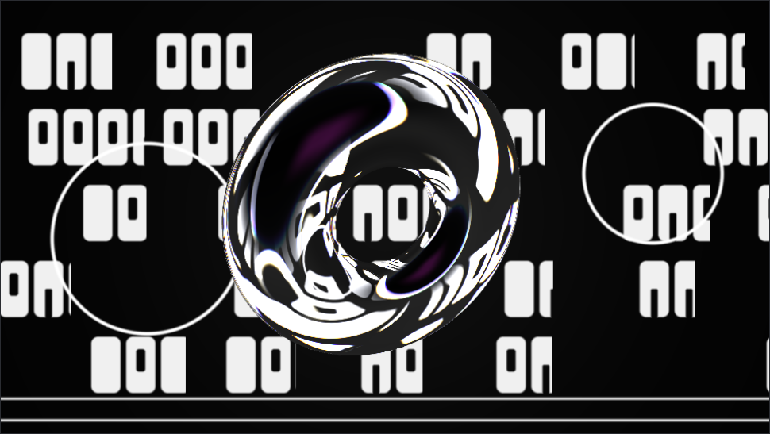

*Preview (Inner bounce stage, Trapped Light preset):* bright, mirrored pieces of the white type and thin studio strips fill the rim bands; the middle of the tube, where little is trapped, stays dark.

## A rainbow through both surfaces

Why does each colour leave at a different angle, and in which order?

In glass the IOR depends on the colour of light: violet bends more than red. This is **dispersion**. A prism splits white light because both of its surfaces bend each colour by a different amount, and the second surface adds to the first.

The shader samples the spectrum in slices, from red (680 nm) to violet (400 nm). `sliceIor()` gives each slice its IOR with **Cauchy's law**, IOR = A + B / wavelength². That spreads the violet end more than the red end, as in real glass. The 530 nm wavelength keeps the Ior control's value; the diagnostic stages show it as their middle channel. Dispersion keeps the core's scale: at 1 the slices span 0.3 IOR. `spectrum()` turns each slice into red, green and blue weights, as in the core study.

{{code:liquid_prism.frag:spectrum}}

Heckel splits light into R, G and B, then six bands, each with its own IOR, and reads the picture several times per band. Here each slice reads the picture once, and each slice now crosses both surfaces with its own IOR. The exit point is traced once, with the 530 nm IOR, and shared. The far side's tilt is not shared: a violet slice enters more steeply bent, so it reaches the far side at a different point, where the wall faces another way. With one shared normal, violet would meet the wall more steeply than its own path does and be trapped even in a ball, where nothing can be trapped. `sliceExitNormal()` gives each slice its own: the ball formula for its own ray, or, with the back-face pass, a second reading of the far side where that slice arrives.

{{code:liquid_prism.frag:sliceexit}}

**Frost** reuses the same loop, as in the core study: it spreads the lookups over a small disc and reads a pre-blurred mipmap level, so the blur stays continuous without random jitter. The disc points come from the "R2" sequence (`discPoint()`), whose angle and area use two different steps, so the points never line up on one spiral arm and their average stays near the centre: frost blurs the view without moving it (test `frost_does_not_shift_the_image`). Each lookup also reads a mipmap level that rises once it sweeps across more than 4 texels of the picture from one pixel to the next (`footprintLod()`). Where the glass squeezes a large part of the scene into a few pixels, for example at a large Scene depth, neighbouring pixels then read a smooth average instead of unrelated texels, which would look like grain. Why 4 texels and not 1: compared with a supersampled render, a level as wide as the whole footprint blurred the ordinary squeeze at the rims more than the true image is blurred (test `large_scene_depth_stays_smooth`; numbers in [decisions.json](decisions.json)). The same loop also averages the Refraction TOP's alpha at the lookups, `covered`, which the next sections use.

{{code:liquid_prism.frag:trace}}

{{experiment:dispersion}}

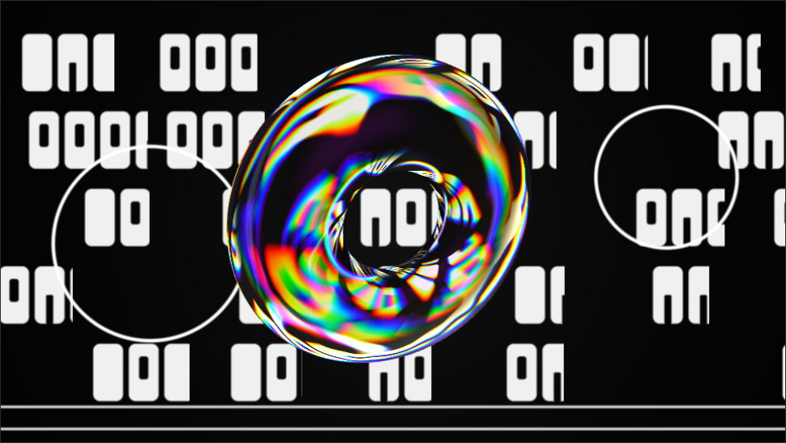

*Preview (Refraction stage, Spectral Prism):* every edge of the type seen through the glass carries a full red-to-violet fringe, widest where the glass bends most.

{{experiment:deviation}}

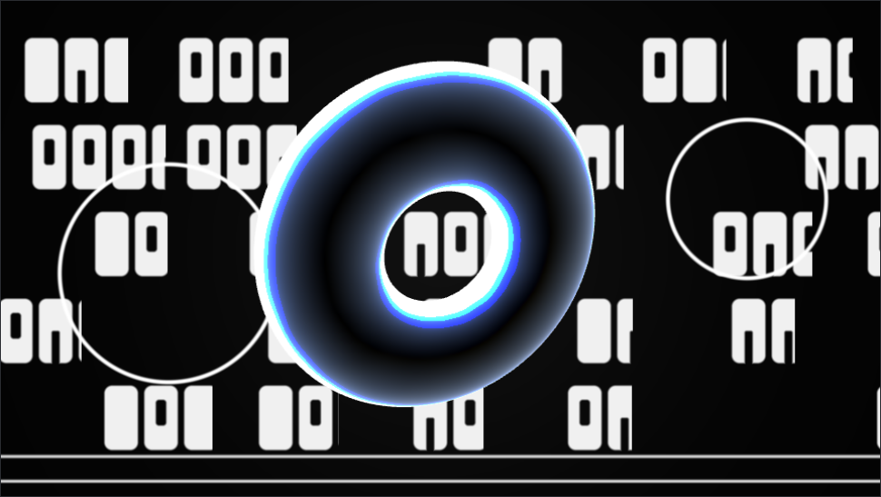

*Preview (Exit deviation stage, back-face pass):* dark blue across the tube, because the violet slice (blue channel) turns furthest; white rings along the rims, where slices are trapped. A test measures it through the 45-degree prism at IOR 1.3 and Dispersion 0.3: red turns 18.7 degrees, the middle (530 nm) 21.9 and violet 28.9, matching Snell's law with the Cauchy curve within 2/255 of 90 degrees (`dispersion_violet_deviates_more`).

That stage is a diagnostic. Two more tests check the picture itself, over a test backdrop that stores its own screen position, so a colour read back says where a lookup landed. Through the same prism, every lookup lands within 0.25 pixel of an independent trace (Snell's law in, the far face, Snell's law out, Scene depth further, the camera's projection), for a sideways and an up-and-down bend (`refraction_lookup_follows_snell`). With Dispersion 0.3, each colour channel equals the traced 16-slice spectrum within 0.0001, with violet on the side Snell's law predicts (`rainbow_in_the_image_follows_snell`). On a unit sphere at Dispersion 1, no wavelength is trapped anywhere out to 0.97 of its radius, with the ball guess or the back-face pass (`ball_never_traps_any_wavelength`).

## Focused light

Where does the glass gather light into a bright spot?

A glass ball in sunlight throws a bright spot: rays that entered across the whole ball meet in a small area. Heckel's caustics article measures this as a ratio of areas: the area a bundle of light covers before refraction, divided by the area after. A smaller area afterwards means brighter light. He computes the areas with screen derivatives on a separate plane.

In a material, screen derivatives are only constant over blocks of 2 × 2 pixels and change per triangle, which would show as blocks or facets. For a ball the ratio has a closed form instead. Parallel light focuses at *f* = *n R* / (2 (*n* − 1)) from the centre. On the far wall the bundle has then shrunk to an angle of |2 − *n*| / *n* around the point that faces away from the light. `causticGlow()` draws a soft spot of that size, as bright as the area shrank, with a floor so the spot never becomes a pin-point. Violet focuses sooner than red, so the spot has coloured edges. **Caustic spread** widens the spot without dimming it.

{{code:liquid_prism.frag:caustic}}

{{experiment:caustic}}

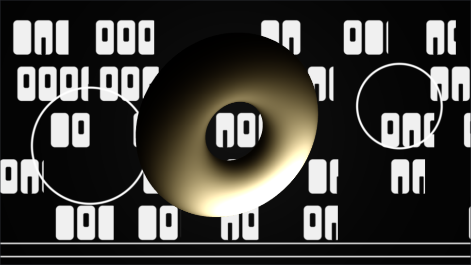

*Preview (Caustic glow stage, Caustic Heart):* a warm glow grows from the lower-right part of the torus and fades toward the upper left; the rest is black. With the default light up and to the front-left, the far wall facing away from it is at the lower right. Move the light and the glow moves. A light behind the object would focus onto the near wall, which this model does not draw.

## Put it together: twelve looks and a morph

How do the pieces combine, and how do presets reach the shader?

The composition traces one exit, runs the spectral loop, and adds the bounced and focused light inside the glass. From there it is the core study's recipe: tint by Beer-Lambert absorption over the measured or guessed path, mix with the glass body by **Translucency**, add reflections and highlights, and scale everything by **Opacity**. Output is premultiplied alpha, which TouchDesigner's blending and Over TOP expect.

One formula covers every scene. `covered` says how much of the view through the glass the Refraction TOP actually holds: 1 over an opaque scene render, 0 where its background is transparent or nothing is connected. Where it is 1, the bent scene passes through and alpha is 1. Where it is 0, there is nothing to bend, so the glass lets the real background behind it in the render show through by blending, and alpha drops by the share that passes. Bounce and glow do not need the Refraction TOP, so they stay. **Energy conserving** (`keep`) removes the reflected share from what passes through, so Mirror 1 becomes a true mirror. Last, the Camera COMP's fog: TDFog changes nothing while fog is off, and with fog on the glass adds only its own alpha's share of the fog colour. The colour is capped at 1024 before it is written, so a very bright highlight never becomes infinity in a 16-bit float render. `TDCheckDiscard()` sits right after the spectral loop: the loop's blur levels are the glass pass's last screen derivatives.

{{code:liquid_prism.frag:compose}}

The shader itself never sees presets: only sixteen sets of four numbers (**uniforms**). Each component parameter feeds one of them through an expression on the GLSL MAT's Vectors page. The lengths (Thickness, Scene depth, Frost, Tint density, the ripple and film patterns) are converted with **Object size** on the way, so a preset looks the same on a small and a large object. Object size means the same in every Liquid Glass study: the object's radius in the world over 1.45, the radius of the core study's demo torus. This study's demo torus is a little wider than the core's (half its largest side is 1.5), but its Geometry COMP flattens it to 0.6 in depth. Fit counts a non-uniform scale as its average, the cube root of 0.6 (0.843), so it measures 1.5 x 0.843 = 1.265 and sets 0.872517, the default. A Geometry COMP's scale counts too. Fit to Glass geometry includes it in the size it measures, and `worldScale()` multiplies the ripple and film lookups by it, so an object scaled by its COMP shows the same pattern at its fitted size as one built at that size (preview test `fit_size_carries_presets_over_comp_scale`). `uPhase` is the ripples' and film's drift, added up frame by frame in Python, so changing Wobble speed or morphing never makes the pattern jump, even after days of running.

{{code:liquid_prism.frag:uniforms}}

Choosing a **Preset** runs a small script ([preset_exec.py](preset_exec.py)) that copies the look's values from [presets.json](presets.json) into the parameters, so you can keep adjusting. **Morph** blends every look value toward the **Morph target** preset inside the uniform expressions ([presets.py](presets.py), the core study's module). Six presets are new prism looks. They were tuned on this demo when Object size 1 still meant the demo itself; since the family rule their lengths are 1.146 times larger, so that at the demo's 0.872517 they look as they did. Six are core looks with their exact core values, so they mean the same object size here as in the core; they look different here because the optics are different.

{{experiment:morph}}

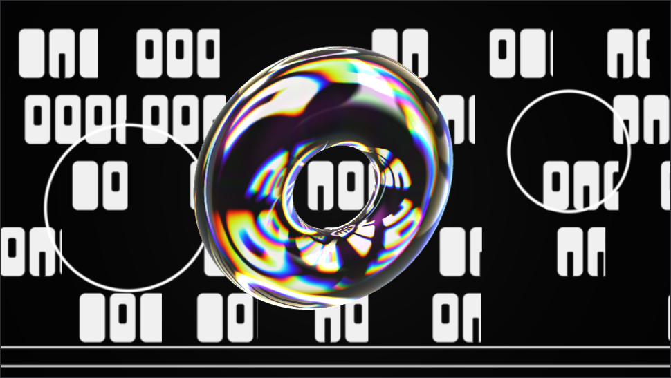

*Preview:* thinner fringes than Spectral Prism and stronger reflections. Tests confirm Morph 1 renders exactly the target preset and Morph 0 changes nothing.

{{experiment:final}}

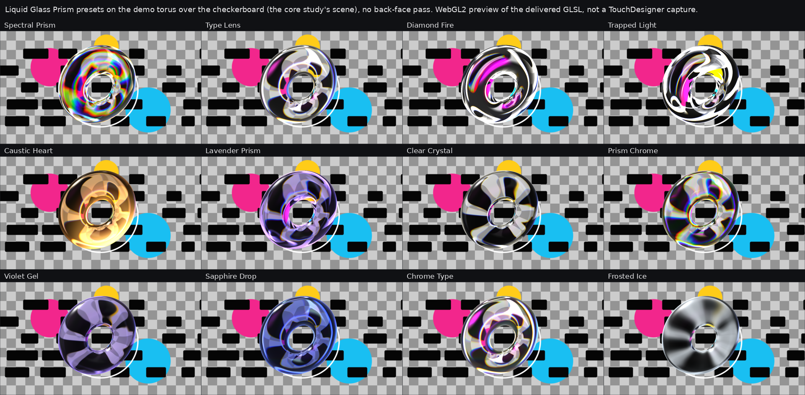

*Preview of all twelve presets on the demo torus without the back-face pass, over the core study's checkerboard (Study > Demo backdrop > Checkerboard), so they compare with the rest of the family. [The same presets over bold type](captures/presets-sheet-type.png), this study's default scene, and [on a knot with the back-face pass](captures/presets-sheet-backpass.png).*

## Use it in your own scene

The [README](README.md) has the steps. In short: render your scene without the glass and use it as the Refraction TOP. Add a Render Pass TOP on that render with your camera and the glass objects, Clear Depth Buffer and Clear to Camera Color off, and the component's `material` as its Override Material (the build prints its full path). The pass keeps the scene's depth, so objects in front of the glass stay in front, with nothing extra to list. Turn Dither off on both renders. Press **Fit to Glass geometry** so presets match your object's size, and set **Scene depth**, the lens strength, to roughly how far your scene sits behind the glass. For exact exits, turn on the back-face pass and point it at your camera and glass objects.

## Limits

- **Only what the camera sees can appear through the glass.** Light that leaves toward something off screen or hidden reads a folded copy of the picture instead.
- **The far side is the nearest back face.** With the back-face pass, a ray that passes through two separate glass parts sees only the first far wall. Without it, the far side is a ball-shaped guess, exact only for balls.
- **One bounce.** Trapped light is followed for one mirror reflection, then looked up without a second exit. Further bounces are ignored.
- **One exit point for all colours.** Slices share the exit point and path traced at 530 nm; each gets its own far-side normal, so only the small spatial spread inside the glass is missed. With the back-face pass, within about 2 pixels of a silhouette the exit search can still miss and report total reflection where the exact share is up to 0.94.
- **The caustic glow is a closed-form ball-lens estimate**, not a light simulation. It sits on the far wall and cannot show focus onto the near wall or onto other objects.
- **Scene depth is one number** for the whole picture behind the glass, not a depth per pixel. Very large values squeeze the scene into a blurred average.
- **Objects in front of the glass** stay in front with the Render Pass TOP route, but they are also in the Refraction TOP, so they can appear bent inside the glass. Whether a Render Pass TOP may sample the render it builds on is a native check; the Over TOP fallback paints the glass over them.
- **Partly transparent scene pixels** (alpha between 0 and 1) are counted twice behind the glass and look slightly brighter.
- **Not supported:** Fish-Eye, Cube Map and Dual Paraboloid render modes; several cameras in one Render TOP. Quad Reproject cameras are untested.
- **One Object size per component.** Fit measures when you press it and takes the largest object. A smaller object, a Geometry COMP whose Scale changes after Fit, and an instance with its own scale all keep that one Object size. At a fifth of the size the glass bends and tints as if it were five times larger; scaled up three times without a new Fit, as if it were three times smaller. On an instance the ripples and film bands grow with it, but their tilt ignores its rotation. The README lists the workarounds; a change that would let all three follow is recorded in [decisions.json](decisions.json) and waits for the user's decision.
- **Cost** grows with Samples (two refractions, one to three texture reads and a Fresnel term per slice), Reflection blur, and the back-face pass (one extra render plus up to sixteen texel reads per pixel).
- **Colour values are converted only along the sRGB curve.** Colour parameters (Auto) converts them in linear working spaces; wide gamut is not converted. The presets were tuned in the Pass Through working colour space.
- **Antialiased edges near the centre lines.** With antialiasing, a few silhouette pixels near the render's centre row or column still bend the wrong way: each is shaded at its centre, outside its own triangle, and its point projects to the other side of the centre line. In the preview they change at most 7 pixels in twelve frames, by up to 20/255. Whether that shows in TouchDesigner is an open family question, with a native check pending. A centroid-sampled position removed most of them in the usual raster in the Liquid Glass Lit study's preview, but no TouchDesigner build has run one.
- **Not yet run in TouchDesigner.** The shaders compile as GLSL 4.60 against stand-ins for TouchDesigner's built-ins, and the preview passes its 54 property tests. Native compile, render, the preset callback, the back-face pass and export are still to be checked on a real host; see [validation.json](validation.json).

## Credits

Screen-space refraction through a render of the scene, multi-sample dispersion, saturation, the squared Blinn-Phong highlight, the fresnel glow and back-side rendering come from Maxime Heckel, [Refraction, dispersion, and other shader light effects](https://blog.maximeheckel.com/posts/refraction-dispersion-and-other-shader-light-effects/). That article credits the sampling technique to the open-source Junni site by @ore_ukonpower and the colour split to research by Ravishankar Sundararaman. Its backside section points to Jesper Vos's [Real-time Multiside Refraction in Three Steps](https://tympanus.net/codrops/2019/10/29/real-time-multiside-refraction-in-three-steps/) (Codrops, 2019), which stores back-face normals in a texture. Refraction through two surfaces in image space goes back to Chris Wyman, *An Approximate Image-Space Approach for Interactive Refraction* (SIGGRAPH 2005). The area-ratio idea for caustics and the normal render pass come from Heckel's [Shining a light on Caustics](https://blog.maximeheckel.com/posts/caustics-in-webgl/), which credits Evan Wallace's caustics technique. Snell's law, the Fresnel equations, Cauchy's law and the ball-lens focal length are standard optics. The frost disc uses Martin Roberts' R2 sequence. The TouchDesigner material, its two-surface tracing, the exit search, the ball-plus-tilt fallback, the bounce lookup, the closed-form caustic glow and the presets are new for this study; [sources.json](sources.json) lists each source's lines and what changed. This study is not authored or endorsed by Maxime Heckel.
