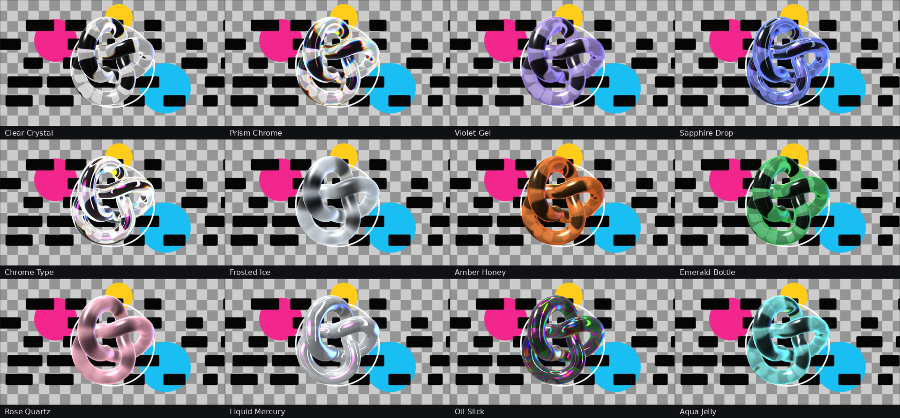
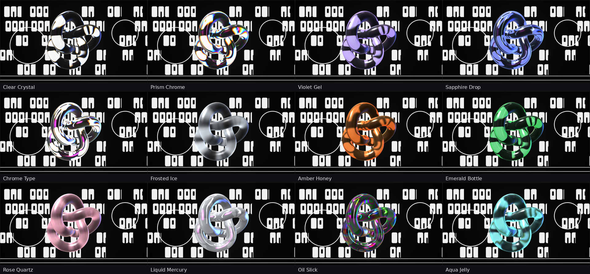

# Liquid Glass for TouchDesigner

A liquid-glass material you can put on any 3D object. It bends and splits what is behind the object into rainbow fringes, tints it with the glass's own colour, reflects a panorama or image, and can ripple like liquid. Twelve presets get you started; every value stays editable.

[Tutorial: how it works](article.md) · [Research](research.md) · [Decisions](decisions.json) · [Review](review.md) · [Validation status](validation.json)





*WebGL previews of the delivered GLSL on a knot shape, over the two demo backdrops (**Study > Demo backdrop**: Checker and Type). TouchDesigner has not rendered this material yet; see [Status](#status).*

*This study moved from `studies/liquid-glass/` to `examples/liquid-glass/` in commit 66b4eb8. Records written before the move (sources.json and co-design.json) cite the old path.*

## What you get

| File | What it is |
| --- | --- |
| `liquid_glass.vert`, `liquid_glass.frag` | **The shader.** Vertex and pixel code for a GLSL MAT. |
| `build.py`, `builder.py` | Builds a ready `liquid_glass` component in your project from the Textport. |
| `presets.json`, `presets.py`, `preset_exec.py` | The twelve looks, the preset loader and the morph. |
| `backdrop.frag`, `env.frag` | Demo inputs: a high-contrast backdrop and a studio panorama. |
| `study.json` | The recipe the builder follows: every node, parameter and uniform binding. |
| `article.md` | The tutorial, with experiments you can load. |
| `checks/` | Compile check, preview renderer and tests (run outside TouchDesigner). `checks/reference/` keeps the shaders of commit 6a58487 so tests can compare old and new. |

## Quick start

1. Download or clone this repository and note where this folder is. (The 0.3.0 release ZIP predates this study and does not contain it.)
2. In TouchDesigner, open the Textport (Dialogs > Textport and DATs) and run, with your own path:

   ```python
   import runpy
   component = runpy.run_path('/path/to/liquid-glass/build.py')['build']()
   ```

3. A `liquid_glass` component appears in `/project1`. Open its viewer: you should see a glass torus over the demo backdrop. Pick a look from **Glass > Preset**.

If the build prints warnings, they are grouped by what they affect, and stored in `component.fetch('build_warnings')`:

- **material**: a sampler filter or extend setting failed. The material works, but frost and reflection blur may look stepped, or blurred panorama reflections may show a seam. Set them by hand (see [Using the shader files by hand](#using-the-shader-files-by-hand), step 2).
- **inputs**: an Inputs field kept a Python expression instead of a path (see below).
- **dither**: a render's Dither switch could not be turned off. Turn it off by hand (Render TOP, Advanced page), so the image stays continuous.
- **optional**: the back-face pass could not be switched off with its toggle; it may cost render time while off.
- **demo** or **setup**: cosmetic; the material itself is fine.

## Use it on your own objects

The material needs to see what is behind the glass. So you render your scene once without the glass and hand that image to the material. Then you draw the glass into that same render, so objects in front of the glass still cover it.

1. **Scene without glass.** Make a Render TOP (here `render_scene`) with your camera and every object except the glass. Drag it onto **Inputs > Refraction TOP** on the `liquid_glass` component. Its background may be transparent: where it is, the glass lets whatever is behind it show through (see the notes).
2. **Reflections.** Drag a TOP onto **Inputs > Reflection TOP**: a 360 panorama (HDRI, Movie File In) with **Reflection map** = *360 panorama TOP*, or any image or render with *Flat image TOP*. For the built-in studio, set **Reflection map** to *Built-in studio*.
3. **Draw the glass into the scene.** Add a Render Pass TOP and wire `render_scene` into it. Set its **Camera** to your camera and its **Geometry** to the glass objects only. Turn off **Clear Depth Buffer** and **Clear to Camera Color**, so it keeps the scene's depth and colour. On its Advanced page, set **Override Material** to the component's material: drag the `material` node inside `liquid_glass` onto the field, or type its absolute path (for example `/project1/liquid_glass/material`). Keep its resolution, pixel format and anti-aliasing the same as `render_scene`.
4. The Render Pass TOP's output is the finished image. The glass bends the scene behind it, and anything in front of the glass still covers it, because the scene's depth is kept. The preview tests this route with an opaque ball in front of the glass (`render_pass_keeps_foreground_in_front`); TouchDesigner's own Render Pass TOP is still a native check.
5. **Turn Dither off** on `render_scene` and the Render Pass TOP (Advanced page). The material never dithers, and the component's own renders have Dither off; this keeps the whole image free of dithering noise. (The documentation does not state the default; this is a precaution.)
6. **Object size.** Point **Inputs > Glass geometry** at your glass objects and press **Inputs > Fit to Glass geometry**. It measures them and sets **Object size**: how big they are compared with the demo torus the presets were tuned on (1 = the same size, about 1.45 units from the centre to the outer edge). Thickness, Frost, Tint density and the ripple and film patterns then look the same on your object as on the torus, whether it is ten times smaller or larger, and whether you sized it in its SOP or with its Geometry COMP's Scale. Presets and experiments never change Object size. If you press nothing, Object size stays 1 and every length works in scene units, as before.

Notes:

- Never put the glass itself in `render_scene`: the material would sample its own output.
- Override Material puts the glass on every object in that pass, nested ones included, and leaves your Geometry COMPs untouched. One pass shows one look; for a second look, copy the component and add a second Render Pass TOP after the first.
- You can instead set each glass Geometry COMP's **Material** to the `material` node (drag it, or type the absolute path) and leave Override Material empty. With the back-face pass on, that creates a loop of parameter references (glass object, material, `render_back`, glass object), which TouchDesigner may report as a dependency loop; Override Material avoids it. Not yet checked natively.
- Not yet checked natively: that the material may sample `render_scene` while the Render Pass TOP draws on top of it. The Render Pass TOP documentation describes the TOP's image as a copy of its render buffer, so this should be safe. If TouchDesigner reports a problem, render the glass alone in its own Render TOP with a transparent background and lay it over `render_scene` with an Over TOP, as the demo inside the component does. That loses occlusion: objects in front of the glass are then painted over.
- **Transparent scene renders.** The material reads the Refraction TOP's alpha. Where the scene render is empty (alpha 0), the glass bends nothing there and blends with what is behind it instead, so a glass layer over a transparent background stays transparent, ready to lay over a plate later. This holds with the back-face pass on too; the inner surface's own reflections then show over the empty background, like the outer ones. Limit: where the scene is only partly covered (alpha between 0 and 1, as on antialiased edges or a half-transparent object), that part of the scene is counted twice and looks slightly brighter and more opaque behind the glass. With the back-face pass on, the coverage there is read where the view first bends, while the inner surface's colour comes from a second bend, so at the edge of a scene object the two can disagree slightly (not measured).
- **Object size and a scaled Geometry COMP.** Object size is the object's size in the world. Fit to Glass geometry multiplies the SOP's size by the Geometry COMP's scale (its parents' included), and the shader multiplies the ripple and film lookups by the same scale. So a preset looks the same on an object scaled by its COMP as on one built at that size in its SOP. This is the rule for the whole Liquid Glass family ([Liquid Glass Lit's decisions.json](../liquid-glass-lit/decisions.json), `family_rule`). A non-uniform scale counts as its average (the cube root of the volume change). For instances, see the next note.
- **One Object size per component.** Fit to Glass geometry measures when you press it, and its one Object size serves every object the component draws. Three setups break that. The numbers come from this study's own Fit code and uniforms ([review.md](review.md#family-critic-native-runs-and-one-object-size)):
  - *Objects of different sizes.* Fit takes the largest. An object a fifth of its size bends and tints as if it were five times larger, with ripples and film bands five times larger. Give each size its own copy of the component and its own Render Pass TOP.
  - *A Geometry COMP Scale that changes or is animated.* Thickness, Frost, Tint density and the ripples and film bands keep the world size Fit measured. Scaled up three times without a new Fit, the glass bends and tints as if it were three times smaller and shows three times as many ripples and film bands. Press Fit again after a scale change. For an animated scale, animate Object size by the same factor.
  - *Instances.* Positions and normals go through `TDDeform`, so each instance is placed, turned and scaled. Fit and the shader see the Geometry COMP's scale, not each instance's. On an instance scaled 3 the ripples and film bands grow with it, but it bends and tints as if it were three times smaller. The ripples' tilt also ignores each instance's rotation, so on a turned instance they tilt the wrong way. For instances of different sizes, use one Geometry COMP and one copy of the component per size.

  A change that would let all three follow by themselves is proposed and waits for your decision ([decisions.json](decisions.json), *Family critic: one Object size per component*). None of this has run in TouchDesigner.
- **Fog.** The glass takes the Camera COMP's fog (TDFog): it adds only its own share of the fog colour, because the scene behind it is fogged in its own render. Not yet checked natively.
- **Render Pick DAT/CHOP and extra colour buffers.** The vertex shader uses the picking form on Derivative's *Write a GLSL MAT* page: in a Render Pick DAT or CHOP pass the point is still placed, and of the branch only the `#else` block runs, which calls `TDWritePickingValues()` (TouchDesigner's defaults are right, since the points only move through `TDDeform`). In a render with several colour buffers, the glass writes zeros into buffers 1 and up, which leaves them as they were. Both are compile-checked only; native checks pending.

**The Inputs fields** start out pointing at the demo nodes. Drag a node onto a field or type its path to use your own; clear the field to leave it empty; right-click > Reset to Default brings the demo back. If the build printed an *inputs* warning, that field holds a Python expression instead of a path: switch it to constant mode first (click the field's mode indicator on its left), then edit it.

**Without a Refraction TOP** (field cleared), the glass can't bend anything. It then blends with whatever is behind it, using alpha: clear parts are see-through, tint and reflections stay. You lose refraction and dispersion. The glass must be drawn after the objects behind it: the Render Pass TOP above does that. In a single Render TOP, give the glass Geometry COMPs a lower **Draw Priority** than the opaque ones (Draw Priority only orders the sibling COMPs listed in that render).

**Opacity below 1, or no Refraction TOP:** the glass writes depth, so the parts of one self-overlapping object (a knot, a tilted torus) can hide each other depending on triangle order. Set the render's **Transparency** to *Order Independent Transparency* in those cases. With a Refraction TOP and Opacity 1 this is not needed.

### Optional: back-face pass

Turn on **Inputs > Back-face pass** for thick or complex shapes. Point **Camera** at your camera and **Glass geometry** at your glass objects; for several, type their paths separated by spaces (for example `/project1/geo1 /project1/geo2`). The component then renders the inside of the glass once more (`render_back`). That gives measured thickness (deeper tint where the glass is thicker) and visible inner surfaces.

- It costs one extra render, into a 32-bit float image: the distances it stores need that precision once the camera is tens of units away. It only renders while the toggle is on.
- With the default fields it renders the demo torus and camera, so repoint both before you turn it on in your own scene.
- `render_back` takes the Refraction TOP's resolution (1280x720 without one). Keep your glass render at the same aspect ratio, or the thickness lookup drifts.

## Controls

**Glass page**

| Control | What it does |
| --- | --- |
| Preset | Loads one of the twelve looks into all the sliders. *Custom* keeps your values. |
| Apply preset again | Reloads the chosen preset after you changed sliders. |
| Morph target, Morph | Blends every look-related value toward a second preset (0 = sliders, 1 = preset B). Animate Morph for transitions. |
| Glass colour | The colour of the glass itself (white = clear). Values above 1 brighten the body; the tint itself never goes above 1, so the glass never amplifies what is behind it. |
| Tint density | How strongly the glass colour builds up with thickness. 0 = no tint. |
| Edge tint | Extra tint toward the silhouette, for deep-coloured rims. |
| Translucency | 1 = see-through, 0 = solid, milky body in the glass colour. |
| Opacity | Fades the whole object, reflections included. |
| Frost | Blurs the view through the glass, from clear to frosted. |

**Optics page**

| Control | What it does |
| --- | --- |
| Index of refraction | How much the glass bends light (1 = not at all, water 1.33, glass 1.5, diamond 2.4). |
| Thickness | Glass depth, in units of Object size (scene units while Object size is 1). More thickness, stronger bend and tint. |
| Dispersion | Splits light into rainbow fringes along edges. |
| Saturation | Colour intensity of what you see through the glass. |
| Samples | Quality vs speed for dispersion and frost (default 12; raise for heavy dispersion). |

**Reflection page**

| Control | What it does |
| --- | --- |
| Reflection map | 360 panorama TOP, flat image TOP (screen-mapped), or the built-in studio. |
| Reflection colour, Reflection amount | Tint and strength of reflections. |
| Mirror | 0 = glass-like (reflects mostly at the edges), 1 = reflects everywhere. |
| Energy conserving | Off (default, all presets): reflections add on top of the see-through view, as in Heckel's glow. On: what the surface reflects no longer also shows through, so Mirror 1 is a true mirror (liquid metal). |
| Reflection blur | Rough, blurry reflections. |
| Panorama rotation | Turns the panorama around the vertical axis. |
| Flat image warp | How far the flat image shifts with the surface. |
| Fresnel falloff | How tightly reflections and rim hug the silhouette (higher = thinner). |
| Rim colour, Rim glow | A glowing edge. |

**Light page:** Light direction (where the light comes from; 0, 0, 0 counts as straight up), Light colour, Specular (highlight strength), Shininess (higher = smaller, sharper highlight), Diffuse (soft lighting on the body).

**Liquid page:** Iridescence (oil-film rainbow sheen), Film thickness (shifts its colours), Film variation (how much the film swirls), Wobble (liquid ripples on the surface; the silhouette stays the same), Wobble scale (ripples per Object size, laid out on the object; scaling the Geometry COMP never changes the ripples' strength), Wobble speed (changing or morphing it changes how fast the ripples and film drift, never where they are; 0 holds them still and stops the per-frame updates).

**Inputs page**

| Control | What it does |
| --- | --- |
| Refraction TOP, Reflection TOP | The scene behind the glass, and what it reflects. |
| Faces | Front only for closed objects, both sides for open surfaces like ribbons. |
| Back-face pass, Camera | Optional measured thickness (see below). |
| Glass geometry | Your glass objects: for the back-face pass and for Fit to Glass geometry. |
| Object size | How big your glass object is in the world compared with the demo torus (1 = the same size, about 1.45 units in radius; a Geometry COMP's scale counts). Thickness and Frost are multiplied by it, Tint density and the ripple and film patterns divided by it, so presets carry over between small and large objects. Presets and experiments never change it. |
| Fit to Glass geometry | Measures Glass geometry (half the largest side of its SOP's bounds, times the Geometry COMP's scale) and sets Object size; the demo torus measures exactly 1. Scripts call it `Fitglass`, as in every family member ([names across the family](#names-across-the-family)). |
| Flip screen V | Escape hatch if the inputs arrive upside down (see troubleshooting). |
| Colour parameters | *Auto* follows the project's working colour space (see troubleshooting). |

**Study page:** Pause and Fixed time (for repeatable looks; unpausing continues the motion from that frame), Teaching stage (shows one ingredient at a time: normal, refraction, body, reflection, fresnel, thickness, film, screen UV), Demo spin, Demo backdrop (the demo scene behind the glass: *Checkerboard* or *Bold type on black*, the backdrop of the Liquid Glass Prism study, so contact sheets of the family compare), Demo render (turn it off once the material is on your own objects).

**From a script,** load a look with `component.op('presets').module.apply(component, 'violet_gel')` and set any overrides after it; the values are written at once. Setting the Preset menu from a script goes through its callback instead, which may apply the look at the end of the frame, over overrides set in the same script.

**Tutorial experiments:** `component.op('study_tools').module.apply(component, 'dispersion')` first returns these controls to their defaults, so experiments can run in any order: every preset value, Morph and Morph target, Samples, Energy conserving, Panorama rotation, Flat image warp, Light direction, Back-face pass, and Pause, Fixed time, Teaching stage, Demo spin and Demo backdrop. It leaves your setup alone: Refraction TOP, Reflection TOP, Reflection map, Faces, Camera, Glass geometry, Object size, Flip screen V, Colour parameters and Demo render (the component's viewer only shows experiments while Demo render is on). Experiments change the component's `material`, which your own glass objects share, so they change in your scene too; to keep a tuned look, run the tutorial on a second component. `apply(component, 'final')` brings back the default look, paused at 2 seconds with Preset on *Custom*: turn off **Study > Pause** to let it move again.

## Names across the family

Four studies grew from this one: [Liquid Glass Flow](../liquid-glass-flow/README.md), [Blobs](../liquid-glass-blobs/README.md), [Prism](../liquid-glass-prism/README.md) and [Lit](../liquid-glass-lit/README.md). A control that does the same job has the same parameter name in all five, and a label that starts the same way. This table lists the two controls whose page, behaviour or name still differ somewhere, and how.

| Study | Fit pulse | Its page | What Fit measures | What Fit sets | Demo backdrop menu | Its default | Experiments reset it | Difference |
| --- | --- | --- | --- | --- | --- | --- | --- | --- |
| [Liquid Glass](README.md) (this study) | `Fitglass` | Inputs | Inputs > Glass geometry | Object size | `Backdrop` | Checker | yes | none |
| [Liquid Glass Flow](../liquid-glass-flow/README.md) | `Fitglass` | Flow fit | Inputs > Glass geometry | Flow centre, Flow size and Object size | `Backdrop` | Checker | yes | Fit sits on the Flow fit page, next to the three values it sets. |
| [Liquid Glass Blobs](../liquid-glass-blobs/README.md) | `Fitglass` | Inputs | its own `blobs_geo`, the blobs' box | Object size | `Demobackdrop` | Checker | yes | `Backdrop` is taken: it is Optics > Backdrop distance, a preset value. Its Checker is the study's own image. |
| [Liquid Glass Prism](../liquid-glass-prism/README.md) | `Fitglass` | Inputs | Inputs > Glass geometry | Object size | `Backdrop` | Type | yes | none |
| [Liquid Glass Lit](../liquid-glass-lit/README.md) | `Fitglass` | Inputs | every Geometry COMP that wears the material; Lit has no Glass geometry field | Object size | `Backdrop` | Checker | yes | none |

- **Fit.** Every label starts with **Fit to Glass geometry**; the part in brackets says what it sets. From a script, `component.par.Fitglass.pulse()` should run it in any member (the Par class documents `pulse()`; that it fires the component's callback is not yet checked natively).
- **Demo backdrop.** Every label is **Demo backdrop**, with the entries *Checker* and *Type*. Type is the same bold-type page in all five, so contact sheets compare. Experiments return it to its default, because their captures use it. Only the parameter name differs, in Blobs.
- **Object size** has the same name everywhere, but not yet one meaning in all five. The family rule in [Liquid Glass Lit's decisions.json](../liquid-glass-lit/decisions.json) (`family_rule`) gives it one: the object's radius in the world over 1.45, the demo torus's, for the lengths and the ripple and film patterns alike. This study, Lit, Prism and Flow follow it (this study, Prism and Flow since their family close; see this study's [review](review.md#family-close)). Flow also keeps a separate **Flow size**, in SOP units, for its motion; its Fit sets both. Blobs draws raymarched blobs inside a proxy box; [its README](../liquid-glass-blobs/README.md) says how its Object size compares with the rule. Lit's [Object size across the family](../liquid-glass-lit/README.md#object-size-across-the-family) lists the measured values.

These names are pinned by each member's unit tests (`FamilyNames` in `checks/test_study.py`); this study's tests also compare the table with each member's `study.json`.

## The twelve presets

| Preset | Idea |
| --- | --- |
| Clear Crystal | Colourless, crisp glass with gentle dispersion. |
| Prism Chrome (default) | Clear glass with strong rainbow dispersion, oil-film sheen and bright rims (reference 1). |
| Violet Gel | Pale lavender gel with deep violet rims (reference 2). |
| Sapphire Drop | Blue-violet magnifying drop with cool rim light (reference 3). |
| Chrome Type | Near-colourless, highly reflective glass with sharp colour fringes over type (reference 4). |
| Frosted Ice | Milky, blurred ice-blue glass. |
| Amber Honey | Dense warm amber with slow liquid movement. |
| Emerald Bottle | Green bottle glass, saturated at the edges. |
| Rose Quartz | Soft pink, half-frosted and milky. |
| Liquid Mercury | Almost opaque liquid metal with a moving surface. |
| Oil Slick | Dark glass under a swirling rainbow film. |
| Aqua Jelly | Wobbly cyan jelly with water-like refraction. |

Presets set the look values only. They leave light direction, panorama rotation, reflection map, inputs, Object size and samples alone.

## Using the shader files by hand

You can skip the builder and wire a GLSL MAT yourself:

1. Two Text DATs with `liquid_glass.vert` and `liquid_glass.frag`; set the GLSL MAT's Vertex Shader and Pixel Shader to them; GLSL Version 4.60.
2. **Samplers page:** `sRefraction` (scene behind; Filter *Mipmap Linear*, Extend U and V *Mirror*), `sReflection` (panorama or image; Filter *Mipmap Linear*, Extend U *Repeat*, Extend V *Hold*), `sBackface` (Filter *Nearest*; when you don't use the back-face pass, point it at a small transparent Constant TOP and set `uInputs.z` to 0). Mipmap Linear gives smooth frost and reflection blur.
3. **Common page:** Blending on, Source Color = One, Destination Color = One Minus Source Alpha (the shader outputs premultiplied alpha), Separate Alpha Function off, Post-Mult Color by Alpha off. Cull Face = Back Faces for closed objects.
4. **Vectors page:** fourteen vec4 uniforms. Lengths are in scene units: for an object `size` times as big as the demo torus in the world (its Geometry COMP's scale included), use Thickness x size, Frost x size, Tint density / size, Wobble scale / size and a film swirl frequency of 2.5 / size (size 1 gives the preset values as they are). The shader itself multiplies the ripple and film lookups by the Geometry COMP's scale.

| Uniform | x | y | z | w |
| --- | --- | --- | --- | --- |
| `uGlass` | glass R | glass G | glass B | tint density (per scene unit) |
| `uBody` | translucency | frost (scene units) | opacity | edge tint |
| `uOptics` | IOR | thickness (scene units) | dispersion | saturation |
| `uReflect` | reflection R | reflection G | reflection B | reflection amount |
| `uEnv` | map mode (0 panorama, 1 flat, 2 studio) | rotation (radians) | reflection blur | flat image warp |
| `uSurface` | mirror | fresnel falloff | diffuse | energy conserving (1/0) |
| `uRim` | rim R | rim G | rim B | rim glow |
| `uLight` | direction x | direction y | direction z | specular |
| `uLightColor` | light R | light G | light B | shininess |
| `uFilm` | iridescence | film thickness (nm) | film variation | film swirl frequency (2.5 / size; 0 = one film thickness over the whole object, no swirl; Wobble speed 0 stops the drift) |
| `uWobble` | wobble | scale (ripples per scene unit, laid out on the object) | speed | 0 |
| `uPhase` | drift at 0.6 x speed per second | drift at 0.4 x speed per second | drift at -0.3 x speed per second | drift at 0.15 x speed per second |
| `uState` | teaching stage (0 = final) | pass (0) | samples | flip V (0) |
| `uInputs` | refraction TOP connected (1/0) | reflection TOP connected (1/0) | use back-face TOP (1/0) | convert colours from sRGB (1/0) |

Wrap each `uPhase` value to 0..256: the noise repeats every 256 units, so the wrap is invisible, and small values keep the motion smooth after days of running. With a speed that never changes while it runs, `(0.6 * speed * absTime.seconds) % 256` is enough. If the speed changes or is animated, add `0.6 * speed * absTime.stepSeconds` to the previous value every frame instead; multiplying by `absTime.seconds` makes the pattern jump by the change in speed times every second since TouchDesigner started. `presets.py` `phase()` adds it up. Values for each preset are in `presets.json`.

5. **Back-face pass by hand (optional):** a second GLSL MAT with the same shaders and uniforms, but `uState.y` = 1, Blending off and Cull Face = Front Faces. A Render TOP with your camera and the glass objects, Override Material = that second MAT, Pixel Format 32-bit float RGBA, Background Color alpha 0 and Pre-Multiply RGB by Alpha off, at the aspect ratio of your glass render. Point the first material's `sBackface` at it and set `uInputs.z` to 1.
6. **Dither off:** in each Render TOP that draws the glass, the back-face pass included, turn Dither off (Advanced page) to keep the image free of dithering noise.

## Troubleshooting

- **The glass looks black or shows itself.** The Refraction TOP is empty, or it includes the glass object. Render the scene without the glass.
- **Objects in front of the glass disappear behind it.** The glass is rendered on its own and laid over the scene. Draw it with the Render Pass TOP from [Use it on your own objects](#use-it-on-your-own-objects), step 3.
- **Refraction looks upside down.** The material measures which way the screen runs at every pixel (it compares where the pixel's point projects with where the pixel sits), so a build whose screen runs the other way should still bend light correctly. On the centre row or column of a render with an odd width or height, where both positions are 0, the way the projected position changes to the next pixel decides. If the Refraction TOP itself arrives upside down relative to the render, turn on **Inputs > Flip screen V**: it flips the screen position and every vertical offset together. It shouldn't be needed; if it is, please note your build.
- **A single pixel on a glass edge near the middle of the render looks too bright or too dark.** With antialiasing, a silhouette pixel that the glass only partly covers is shaded at its centre, outside its own triangle. Near the render's centre row or column its point can project to the other side, so it takes the wrong screen orientation and bends the wrong way. In the preview this changes at most 6 pixels in twelve frames, by up to 43/255, only in an emulated build whose raster runs the other way. Whether you can see it in TouchDesigner is an open family question; if you do, please note your build and where the pixel is (validation.json, check `centre_line_residual`).
- **Frost or blurry reflections look stepped.** The build printed *material* warnings, or the sampler filter isn't Mipmap Linear (check `material`'s Samplers page). Raising Samples also helps frost.
- **Blurred panorama reflections show a seam.** `sReflection`'s Extend U isn't Repeat (check `material`'s Samplers page).
- **Rainbow fringes look banded.** Raise Samples (16–24). At the default 12, Dispersion 1 already matches a 64-sample render within 1/255 on average at the presets' own Thickness in the preview (within 2/255 at Thickness 2.5), but very thick glass on a large, sharp-edged scene can still show steps.
- **The glass turns a transparent scene background black or opaque.** Components built before the family sync ignored the Refraction TOP's alpha. Build a new component.
- **Ripples or oil-film bands jump while Morph or Wobble speed changes.** Components built before audit round 3 multiplied the speed by the time since TouchDesigner started. Build a new component, or paste the current `presets.py` into the component's `presets` DAT.
- **Slow.** Lower Samples, set Reflection blur and Wobble to 0, keep the Refraction TOP at the render's resolution, and leave the back-face pass off. Once the material is on your own objects, turn off **Study > Demo render** and close the `liquid_glass` component's viewer: a visible viewer keeps the demo render cooking every frame.
- **Colours look different from the preview.** Check **Inputs > Colour parameters**. *Auto* keeps colours as typed in a pass-through project (the default) and converts them from sRGB to linear when the project uses a linear working colour space, as TouchDesigner does for its own colour parameters. The conversion covers the sRGB curve only, so in ACEScg, P3 or Rec.2020 projects colours look slightly more saturated. *As typed* and *sRGB* force either behaviour. Not yet checked natively.
- **Geometry without normals looks flat or wrong.** The shader should then build faceted normals itself (not yet checked natively). If it doesn't, add normals in the SOP chain, for example with a Facet SOP (Compute Normals).
- **Errors after building.** Look at the `info_material` DAT inside the component for compile messages, and at `info_render` and `info_render_back`: each render compiles its own copy of the material, so errors can show there instead. `component.op('study_tools').module.inspect(component)` also lists script errors (for example from the preset callback), the errors and warnings of the TOPs and COMPs your Inputs fields point at, and under `render_diagnostics` those of every Render and Render Pass TOP in the project that draws the material (through Override Material or a Geometry COMP's Material).
- **Fit to Glass geometry does nothing.** Set **Inputs > Glass geometry** first; the Textport shows what it measured.
- **Ripples or film bands changed size on an object scaled by its Geometry COMP.** Since the family close the ripple and film patterns count the COMP's scale, as Fit always did, so Object size means the same world size for them as for Thickness and Frost. An object scaled k times by its COMP but left at Object size 1 now shows k times as many ripples and film bands as before: finer if you scaled it up, coarser if you scaled it down. Press **Fit to Glass geometry**. An object you had already fitted now shows the preset's ripples and film bands; before the family close it showed 1/k as many, because the patterns stayed on the object alone.

## Status

Verified here (see [validation.json](validation.json)): GLSL 4.60 and Vulkan SPIR-V compile with glslang against stand-ins for TouchDesigner's built-ins, also with picking active and with three colour buffers; a WebGL2 render of the same files with thirty-five property tests (for example, "IOR 1 makes the glass invisible, with or without ripples", "measured thickness equals the exact chord through a sphere, also 50 units away and with an orthographic camera", "invisible glass over a transparent scene leaves it transparent, with or without the back-face pass", "a preset looks the same on a 0.1-unit and a 10-unit object, sized in its SOP or by its Geometry COMP (within 2/255 at every pixel for the COMP)", "an object scaled k times by its COMP but left at Object size 1 shows k times as many ripples and film bands", "a build whose screen runs the other way renders the mirror image", "the measured screen orientation is right on the centre lines of an odd-sized render" and "an object in front of the glass still covers it with the Render Pass TOP route"); seventy-five unit tests of the preset module, the preset callback, the tutorial experiments run in every order with the user's setup kept, the recipe (sampler extend modes, menus read through `presets.menu()`), the builder (Inputs fields as constant paths, every build warning in a printed category), the shader source (no dithering, extra colour buffers, the documented picking form, the ripple and film lookups in world-sized steps, the centre-line tie-break, the scene's alpha behind the back-face pass, increasing `smoothstep` edges, no `atan(0, 0)`, derivatives before any discard, sample IOR never below 1), the native helpers (Fit to Glass geometry, render diagnostics, script and blocking errors in `inspect()`) on fake objects and these docs (every table row inside its table, the hand-wiring table listing all fourteen uniforms, the dispersion claims matching their test, the family close records saying which way the ripples change and what merging means for Liquid Glass Flow, the tutorial's pointers naming the section that shows the code), the COMP-scale preview test's 2/255 bound and the records of the open centre-line question; the plugin's static checker. Over an opaque scene, each of the twelve presets renders exactly as it did before the family sync (`opaque_scene_matches_pre_sync`). One preview test, `screen_uv_matches_pixel`, checks the preview's own stand-in for TouchDesigner's viewport, not TouchDesigner.

**Not yet run in TouchDesigner:** native compile, render, the builder (including the Inputs fields' links to the demo and the renders' Dither switch), the preset callback, the frame-by-frame drift, the back-face pass, the Render Pass TOP workflow and its occlusion, Colour parameters *Auto*, Render Pick (a pick render places the point, then runs only the `#else` block of the branch), extra colour buffers, fog, Fit to Glass geometry and the patterns on a scaled Geometry COMP, instancing, the screen orientation on your build, the antialiased centre-line residual (an open family question), export to `.tox`, and performance. Run the Quick start on your machine and check `info_material`.

## Credits

Refraction through a render of the scene, multi-sample dispersion, saturation, squared Blinn-Phong specular, fresnel and back-face rendering follow Maxime Heckel, [Refraction, dispersion, and other shader light effects](https://blog.maximeheckel.com/posts/refraction-dispersion-and-other-shader-light-effects/) (2023), which credits the Junni sample technique and Ravishankar Sundararaman's colour-channel work. The TouchDesigner material, its projection of the bend, the spectral sampling, mipmap frost (on Martin Roberts' R2 quasirandom sequence), absorption, thin film, liquid ripples, presets and builder are new for this study. The family sync brought in ideas from this study's family members: the Refraction TOP's alpha and fog from Liquid Glass Blobs, the measured screen orientation and the type backdrop from Liquid Glass Prism, picking and extra colour buffers from Liquid Glass Flow, Lit and Prism, Dither off, the output cap and render diagnostics from Liquid Glass Lit, and Fit to Glass geometry from Liquid Glass Flow. The family close then took the family rule for Object size and the centre-line tie-break of the screen orientation from Liquid Glass Lit (the tie-break started in Liquid Glass Prism), the documented picking form from Liquid Glass Blobs and Prism, and the occlusion and film-swirl tests from Prism and Flow. See [sources.json](sources.json). This study is not authored or endorsed by Maxime Heckel; the repository's [NOTICE.md](../../NOTICE.md) covers licensing.
