# Liquid Glass: a refracting, colour-splitting glass material for any object

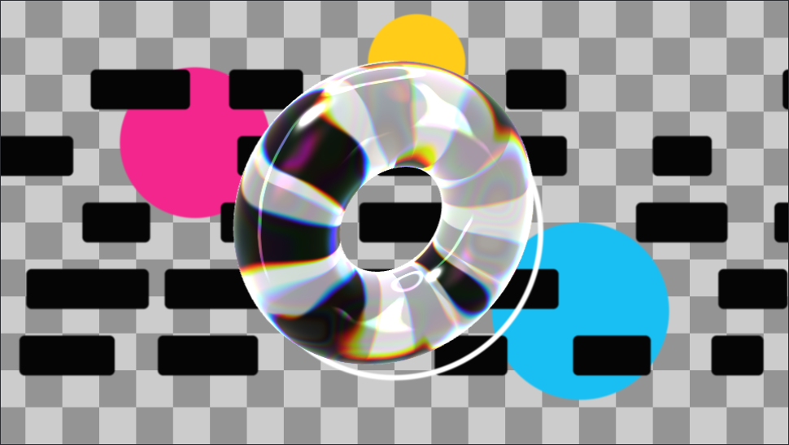

*The destination: the default look on the demo torus. This image is a WebGL preview of the same GLSL files, not a TouchDesigner capture.*

This tutorial builds a glass material you can put on any 3D object in TouchDesigner. Seen through it, the scene shifts and flips. Bright edges break into rainbow fringes, and the glass can be tinted, frosted, mirrored or rippled like liquid. It is written for TouchDesigner users who have not written shaders before. Every code block below is copied automatically from the delivered files, so what you read is what runs.

The core idea comes from Maxime Heckel's article [Refraction, dispersion, and other shader light effects](https://blog.maximeheckel.com/posts/refraction-dispersion-and-other-shader-light-effects/). His version is a web scene you can orbit around; this one is a reusable TouchDesigner material. The adaptation changes how the bend is measured, how colours are split and how blur works, and adds tint, reflections, liquid ripples, a thin oil film and presets. Each change is pointed out where it happens.

## Open the study

Build the component from the Textport, keeping it in a variable named `component` so the experiment commands below work:

```python
import runpy
component = runpy.run_path('/path/to/liquid-glass/build.py')['build']()
```

Open the component's viewer. Each experiment below is a named preset that fixes time and every unrelated control, then changes one thing. Running an experiment first returns the look to its defaults: every preset value, Morph, Samples, Energy conserving, the light direction, panorama rotation and flat image warp, the back-face pass and the Study page (including Demo backdrop, since the predictions describe the checkerboard). So you can run the experiments in any order. Your setup stays as it is: the Refraction and Reflection TOPs, Reflection map, Faces, the back-face camera and glass geometry, Object size, Flip screen V, Colour parameters and Demo render. `component.op('study_tools').module.apply(component, 'final')` brings back the default look, paused at 2 seconds with the Preset menu on *Custom*; turn off **Study > Pause** to let it move again. Experiments change the component's `material`, so glass in your own scene that uses it changes too: if you have tuned this component, build a second one for the tutorial. The **Study > Teaching stage** menu shows one ingredient of the material at a time; most experiments use it.

The pictures under each experiment come from a WebGL preview that runs the same shader files in a browser. They show what the code does; they are not proof of how TouchDesigner renders it. When you run an experiment natively, compare against the stated prediction.

A shader is a small program the graphics card runs for you. A GLSL MAT holds two of them. The **vertex shader** runs once per corner of the mesh and decides where it lands on screen. The **pixel shader** runs once per pixel the object covers and decides its colour. Almost all of the glass happens in the pixel shader.

## Make the object see-through

How can an object show what is behind it, when a shader only knows about its own surface?

It can't see the scene, so we hand it a picture of the scene: a render of everything *except* the glass, from the same camera. This is the **Refraction TOP**. If each glass pixel copies the pixel at the same screen position from that picture, the object becomes invisible. That sounds useless, but it is the foundation: every effect after this is a change to *where* we look in that picture, or what we do with the colour we find. Heckel does the same with a frame buffer rendered each frame inside the web page.

The vertex shader places each point on screen (its `main()` comes back in "Use it in your own scene") and passes along what the pixel shader needs. `passToPixelStage()` writes it: the surface position and normal in world space, the position in the object's own space (so ripples later stick to the object), and which camera is rendering.

{{code:liquid_glass.vert:transforms}}

In the pixel shader, `screenUV()` turns the pixel's position into 0..1 coordinates across the render. `uTDGeneral.viewport` is TouchDesigner's built-in description of the render size. `mirrorUV()` folds coordinates that leave the picture back inside it, so strong bending near the frame edge doesn't smear the border. `unitsToUV()` answers a question we need in the next section: how far does one scene unit move on screen at this pixel's depth?

`screenSign()` answers a quieter question: does the screen run the same way as the camera? In TouchDesigner's usual setup it does, and the function returns +1 for both directions. A build whose screen rows run the other way would otherwise bend every view upside down. So the shader checks, at every pixel, where the pixel's own point lands when the camera's projection maps it, against where the pixel actually sits on the render. Same side: +1; mirrored: -1. A first version used screen derivatives everywhere instead (how a value changes from one pixel to the next); on a few sliver triangles along silhouettes their neighbours are made-up values, and those pixels flipped (up to 50/255 on the knot). So the comparison uses the pixel's own values, with one exception. On the centre row or column of a render with an odd width or height, the pixel sits exactly at 0 and so does its projected point, and the comparison cannot tell the two cases apart. There, and only where the surface is not nearly edge-on, the derivative of the projected position decides (the tie-break of the Liquid Glass Prism and Lit studies). Without it, a mirrored build bent the whole centre row of a 481 x 271 preview the wrong way: about 1,500 pixels per twelve renders. **Flip screen V** stays as the manual escape hatch for inputs that arrive upside down: it flips the screen position and the measured direction together.

{{code:liquid_glass.frag:screen}}

{{experiment:see_through}}

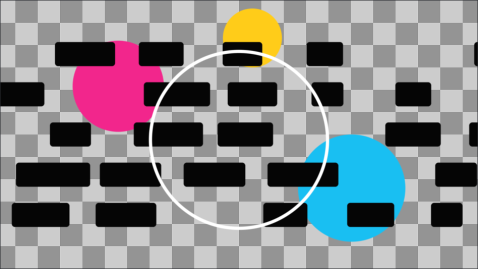

*Preview:* the torus disappears completely. An automated test compares this render with the backdrop alone; the largest difference is 1/255 (`ior1_is_invisible` in [the preview tests](checks/preview_tests.cjs)).

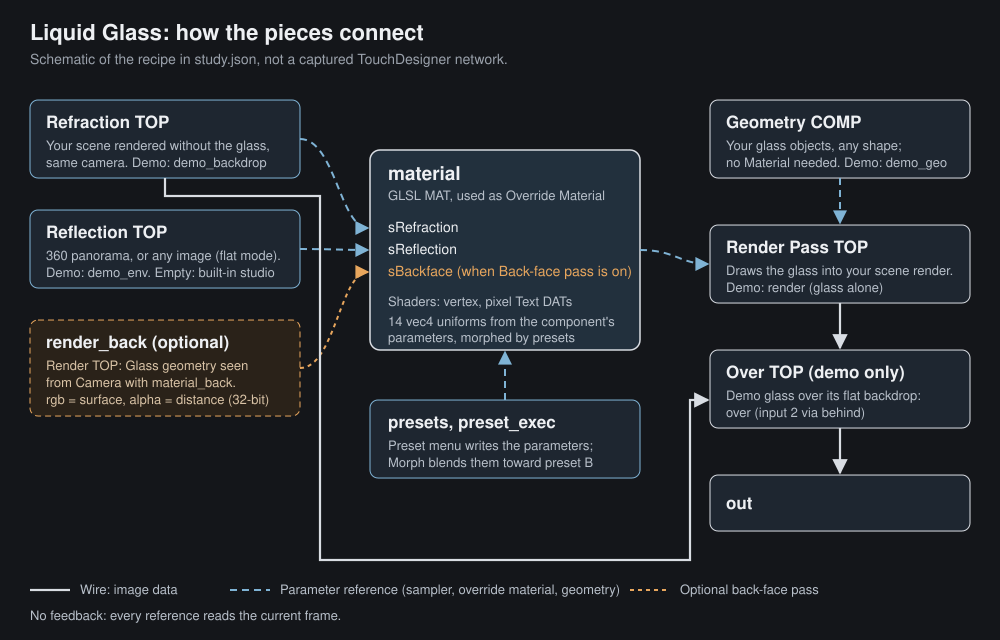

The diagram is a schematic of the recipe, not a captured network. Solid lines carry images, dashed lines are parameter references, and the orange path is the optional back-face pass. In your own scene the Render Pass TOP's output is the final image; the Over TOP belongs to the demo, whose backdrop is a flat picture.

## Bend the light

Why does glass shift and flip what is behind it?

Light changes direction when it enters a denser material. The **index of refraction** (IOR) says how much: 1.0 is air (no bend), water is 1.33, glass about 1.5. GLSL has a built-in `refract()` that takes the viewing direction, the surface normal and the ratio of the two IORs, and returns the bent direction. The bend is largest where the surface tilts away from you. That's why the edges of a glass ball distort most and its middle least.

We need a shift on screen, not a direction. `bendOffset()` subtracts the unbent direction from the bent one, which leaves the sideways part of the bend. It multiplies that by **Thickness**, how far the light travels inside the glass in scene units. Then it converts the result into screen units with the camera's own projection. Heckel's code adds the refracted direction's x and y straight to the screen coordinates without projecting them through the camera, so the shift's on-screen direction and size don't follow the camera's distance, lens or orientation. Projecting it with the camera's own matrices makes the effect behave the same at any distance and with any lens.

{{code:liquid_glass.frag:bend}}

The main function first works out, once per pixel, the facts everything else uses. These are the screen derivatives of the position and of its projection (taken first, because inside a branch they are undefined), the camera position and direction, the depth, the distance along the view ray, the screen position, the surface normal and the **fresnel** term (how close to edge-on we see the surface; it returns in the reflection section). A Light direction of 0, 0, 0 points nowhere, so it counts as straight up.

{{code:liquid_glass.frag:setup}}

{{experiment:bend}}

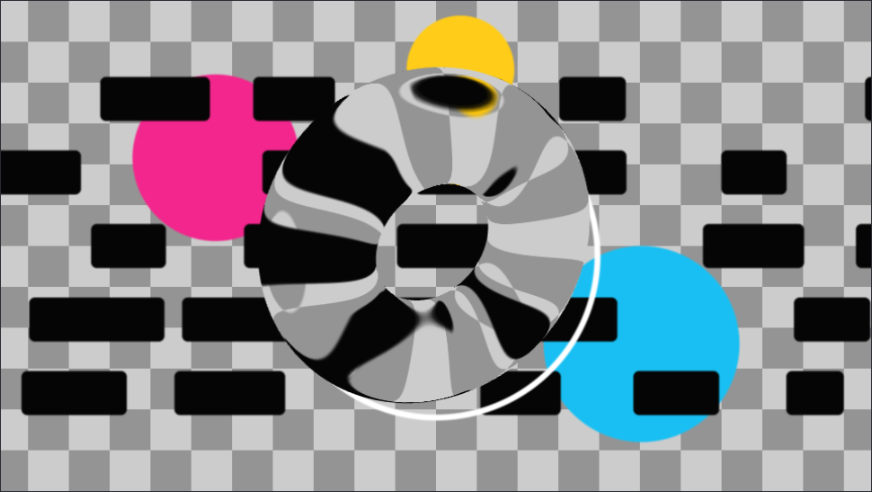

*Preview:* the checkerboard and black bars appear shifted and upside down inside the tube, most strongly near its edges.

{{experiment:thick}}

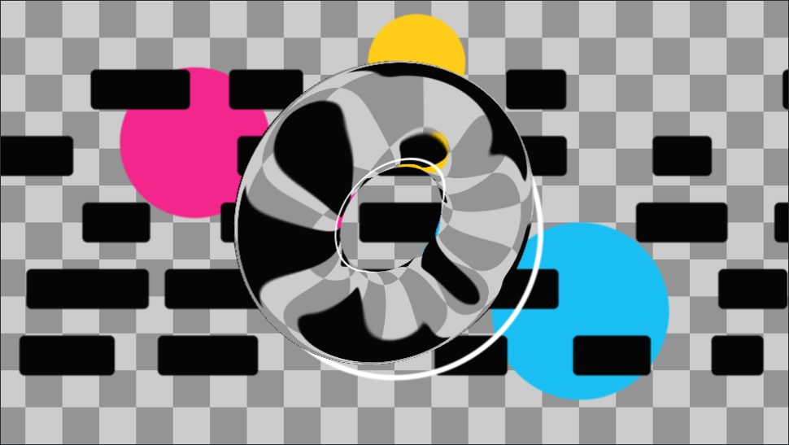

*Preview:* the same picture pushed about twice as far, so different bars land inside the tube.

The normal matters as much as the IOR. A mesh only stores normals at its corners. Between corners they are blended, and right at the silhouette a blended normal can tilt slightly *away* from the camera. `refract()` then bends even at IOR 1. The first version of this shader failed the invisibility test along every silhouette for exactly this reason. `faceCamera()` lays any such normal back into the view plane. It runs twice: inside `facingNormal()`, and again after the liquid ripples (a later section), which can tilt a normal away once more. A review found thin streaks along the outline of every rippled preset before the second call was added; a test now checks that rippled glass at IOR 1 is still invisible. When the geometry has no normals at all, `facingNormal()` should build faceted ones from screen derivatives (not yet checked in TouchDesigner). Its test compares the facet's size with the pixel's size, so it works at any scene scale.

{{code:liquid_glass.frag:surface}}

## Split the colours, then frost them

Where do rainbow fringes come from, and how does the same loop make frosted glass?

In real glass the IOR depends on the colour of light: violet bends a little more than red. This is **dispersion**. A white edge seen through glass splits into a small rainbow. To imitate it, the shader looks up the picture behind the glass many times, each time for a different slice of the spectrum. Each slice has its own IOR and its own red, green and blue weight. Adding the samples and dividing by the total weight per channel gives the final colour. With Dispersion at 0 every slice bends equally, and the result is exactly the plain bend from "Bend the light".

Heckel splits light into red, green and blue, then six bands (adding yellow, cyan and violet) with their own IORs. That reads the picture twelve times per loop step in his final scene. Here each step is one spectrum slice and one read, so 12 samples cost 12 reads. **Samples** sets the count; raise it if strong dispersion shows colour steps. Because neighbouring slices share colour (their red, green and blue weights overlap), 12 slices already come close to many: at Dispersion 1, a 12-sample render differs from a 64-sample one by less than 1/255 on average at the presets' own Thickness in the preview, and by less than 2/255 at Thickness 2.5 (`dispersion_converges_with_samples`). A sibling study, Liquid Glass Blobs, blurs each slice by a mipmap level as wide as the gap between neighbouring slices. Tried here, it doubled the difference from the 64-sample render, because a mipmap blurs across the rainbow as well as along it; so it was left out.

Each sample's IOR is kept at 1 or above. Below 1 the bend flips direction and snaps to zero past a critical angle, which drew hard rings at very low IOR with strong dispersion.

**Frost** reuses the same loop. `discPoint()` spreads the samples over a small disc. Angle and area come from two different irrational steps (Martin Roberts' *R2* sequence), so the disc fills evenly for any sample count and the samples' average stays near the centre: frost blurs the view without shifting it. An earlier version took both from one golden-ratio sequence, which lines every sample up on a single spiral arm and shifted the image by about a tenth of the blur radius. Many sideways looks averaged together give a blur. With only 12 samples the first preview showed separate ghost copies instead of a smooth blur. Random jitter would have hidden that as grain, but the brief asked for a continuous look without dithering. So each sample now reads a **mipmap** level, a pre-shrunk copy of the picture, as wide as the gap between neighbouring samples. The builder sets the sampler filter to *Mipmap Linear* so TouchDesigner provides those levels. `saturateColour()` is Heckel's saturation: mix the colour with its own grey to make it duller or stronger.

{{code:liquid_glass.frag:dispersion}}

{{experiment:dispersion}}

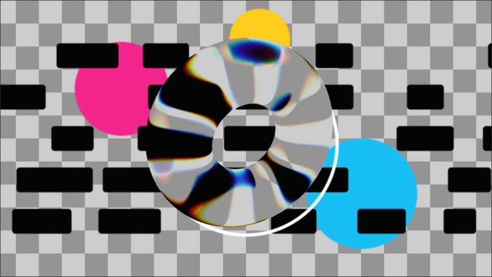

*Preview:* the same bend as in `bend`, but each black/white edge seen through the glass now carries a red-to-violet fringe, widest near the silhouette.

{{experiment:frost}}

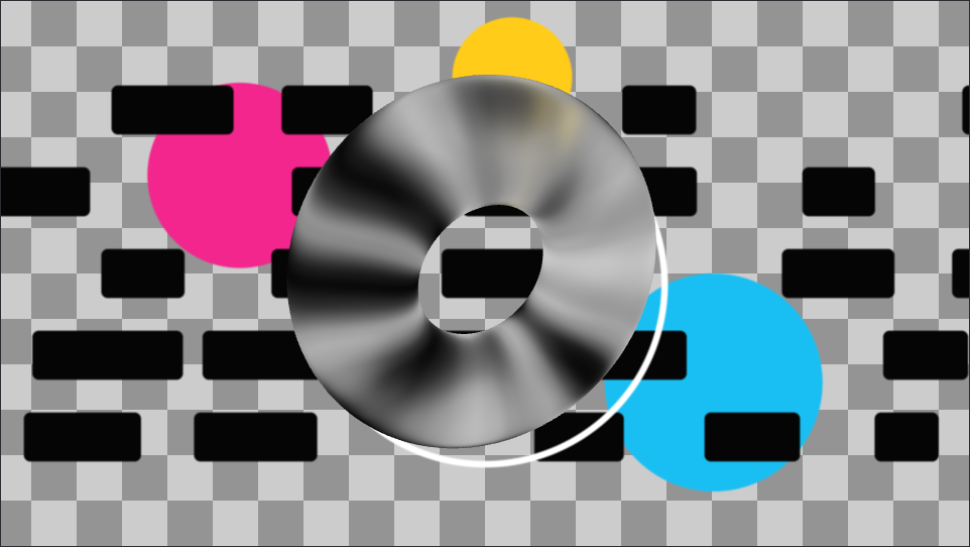

*Preview:* a continuous blur. Automated tests check that 12 and 32 samples agree within 16/255 at every pixel (`frost_converges_with_samples`; with the mipmap widening switched off, ghost copies make them differ by up to 31/255), and that the sample count changes nothing when dispersion and frost are both off (`samples_invariant_without_dispersion`).

## Give the glass its own colour

Why is coloured glass pale in the middle and deep at the edges?

Coloured glass is coloured because it absorbs some colours of the light passing through it. The further light travels inside, the more it loses: violet glass removes more red and green over a long path than over a short one. This is the **Beer-Lambert law**: what survives drops off exponentially with distance. `absorption()` applies it with the **Glass colour** (the colours that pass) and **Tint density** (how quickly the others are lost). **Edge tint** lengthens the path where you look at the surface edge-on. That gives the deep rims of reference image 2 while the middle stays pale. The glass colour is capped at 1 inside `absorption()`: a value above 1 can brighten the body, but the glass never amplifies the light passing through. `paramColour()` converts colour parameters from sRGB to linear when the project works in a linear colour space (**Inputs > Colour parameters**); in a default, pass-through project it changes nothing.

Not all glass is clear. **Translucency** mixes between the bent, tinted view (1) and the glass's own colour lit by the light (0), for milky, jelly-like or almost solid looks. `bodyColour()` uses soft, wrapped lighting so the body never goes fully black.

{{code:liquid_glass.frag:body}}

The composition puts the pieces together. The order matters: tint applies only to light that passed through, reflections sit on top, and **Opacity** scales everything, reflections included. The output is **premultiplied alpha**: the colour is already multiplied by its coverage, which is what TouchDesigner's Over TOP and the material's One / One Minus Source Alpha blending expect. By default reflections simply add on top of the see-through view, like Heckel's glow. **Energy conserving** (off by default) multiplies the see-through part by `keep`, what the surface does not reflect.

One formula covers every scene behind the glass. `covered` is the Refraction TOP's own alpha where the bent view lands: 1 over an opaque scene, 0 over a transparent background or with no Refraction TOP at all. Where it is 1, the glass shows the bent, tinted scene and writes alpha 1, exactly as it did before this formula existed (a preview test compares all twelve presets with the earlier shader). Where it is 0, there is nothing to bend, so the glass lets the real background through by blending: its alpha drops by the share that passes. A render of your scene with an empty background therefore stays empty behind clear glass, ready to lay over a plate. The back-face pass (see "Measure thickness with the back-face pass") stores a distance in its alpha, not coverage, so where it covers the view `sampleBehind()` takes the inner surface's colour from it and `covered` still from the Refraction TOP at the same spot. Clear glass with the pass on keeps an empty background empty too. Last comes the Camera COMP's fog: `TDFog()` does nothing while fog is off, and with fog on the glass adds only its own share of the fog colour.

{{code:liquid_glass.frag:compose}}

{{experiment:tint}}

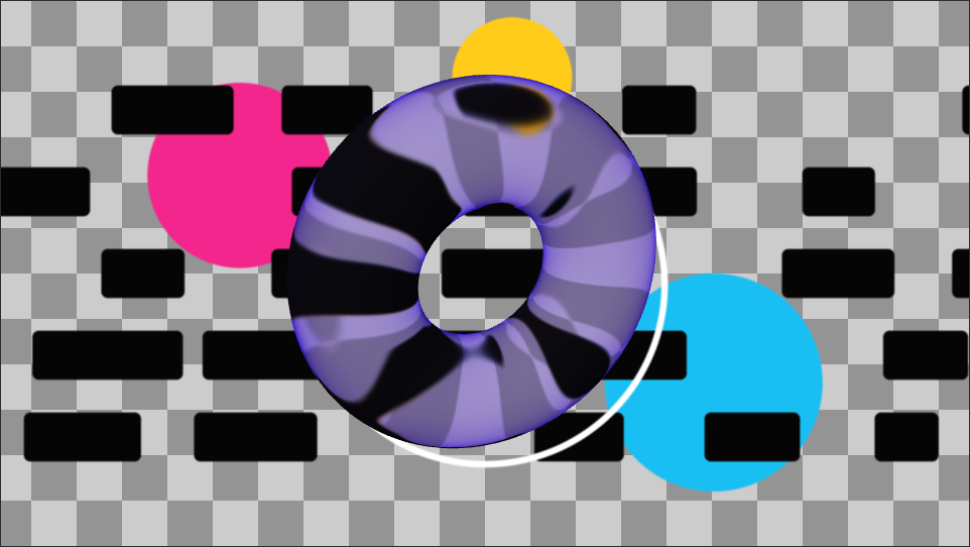

*Preview (Glass body stage, which hides reflections and highlights):* the view through the gel turns violet, deepest along the silhouette. Without the back-face pass, thickness is one number for the whole object, so this colour change comes from Edge tint alone; the back-face section measures real thickness.

{{experiment:milky}}

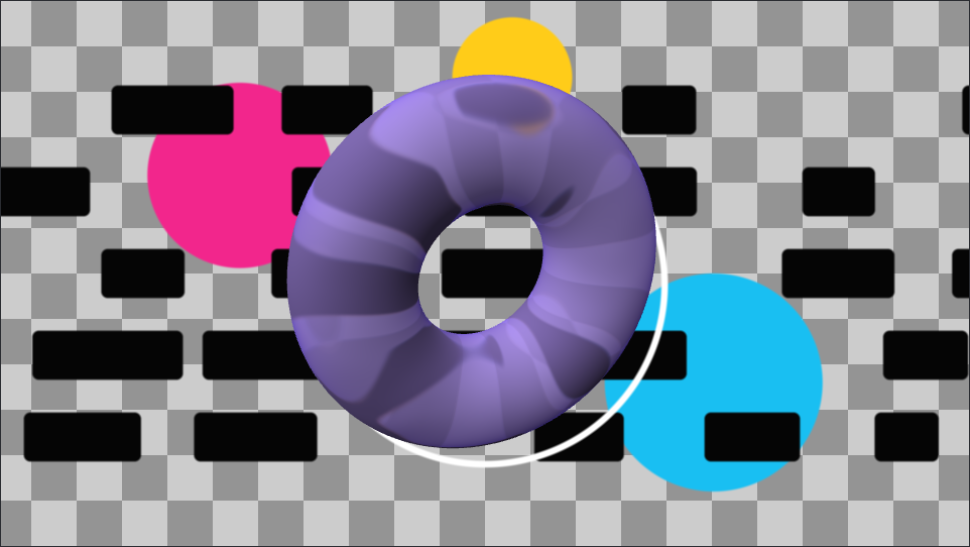

*Preview (Glass body stage, as in `tint`):* the lavender body covers most of the background; only a faint bent image remains.

## Reflect the world

What does glass reflect, and why mostly at the edges?

`reflect()` mirrors the viewing direction around the normal. Where that reflected direction points decides what the glass shows. The material offers three sources. A **360 panorama TOP** is read by direction, in an equirectangular layout, and can be rotated. (This study's convention puts u = 0 toward +X, then +Z. It has not yet been compared with TouchDesigner's own environment lighting; Panorama rotation corrects an offset.) A **flat image TOP** suits plain images, movies or other renders; it is shifted across the screen by the reflected direction. The **built-in studio** is a dark room with soft white light strips. The studio is also the fallback when no Reflection TOP is connected. **Reflection blur** averages eight nearby directions, again with mipmaps, and widens the studio's light edges. A flat image moves further per direction (by Flat image warp), so it reads a correspondingly wider mipmap level; before that fix, strong warps showed eight stacked copies instead of a blur ([before and after](captures/review-flat-blur.png)).

How much glass reflects depends on the angle (the **fresnel effect**). Facing a window you see through it; at a grazing angle it turns into a mirror. Heckel adds fresnel as a glow. Here it also weights the reflection between the glass's base reflectance (from the IOR, 4% for 1.5) and 100% at the silhouette. **Mirror** raises that to 100% everywhere. Because reflections add on top of the see-through view by default (as in all twelve presets), Mirror 1 alone gives clear glass under a strong reflection. Turn on **Energy conserving** for a true mirror or liquid metal: the reflected share then no longer also passes through.

{{code:liquid_glass.frag:reflection}}

{{experiment:reflection}}

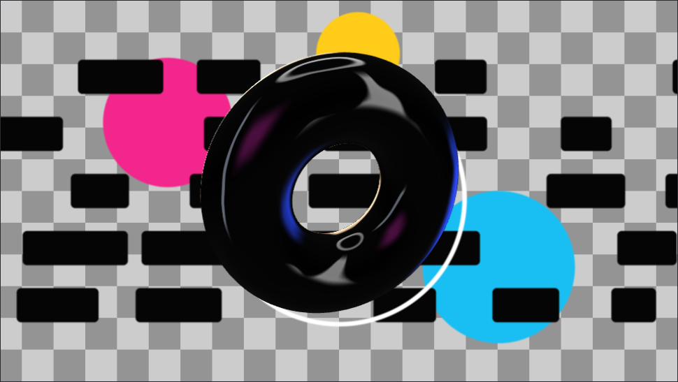

*Preview (Reflection stage, Iridescence off so the film does not colour it):* thin white strips and faint magenta and blue patches from the panorama's gels curve around the torus, brightest at its edges.

{{experiment:fresnel}}

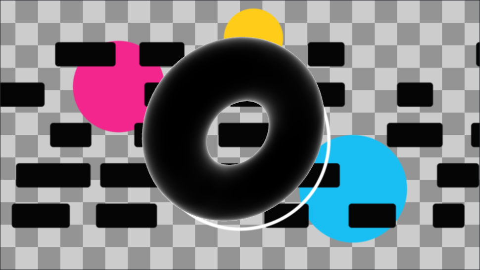

*Preview:* black across the face of the torus, white around its outline and hole.

## Highlights and a glowing rim

What makes glass look shiny?

A highlight is the light source reflected in the surface. **Specular** sets how bright it is, **Shininess** how small and sharp. Heckel squares the usual Blinn-Phong term for a tighter, glassier highlight, and that is kept. The **rim** is a coloured glow that follows the fresnel term, as in his article. **Diffuse** adds soft light on the side facing the light.

{{code:liquid_glass.frag:light}}

{{experiment:highlights}}

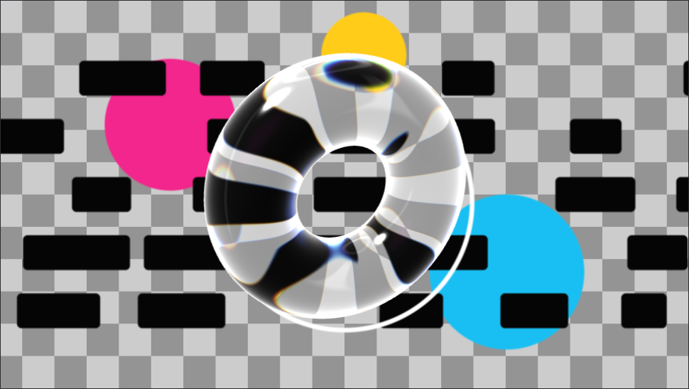

*Preview:* a white glow outlines the torus and small hard highlights sit on its upper curves.

## Make it liquid

How does a solid mesh start to look like liquid?

Liquid surfaces are never perfectly smooth; they ripple. **Wobble** lays a smooth, drifting noise pattern over the object and tilts each normal along the pattern's slope, like ripples on a liquid skin. Because refraction, reflection and highlights all follow the normal, the whole look starts to flow. The silhouette stays the same: this changes shading, not geometry. The noise lives in the object's own space, so the ripples move with the object instead of sliding across it. Their strength doesn't depend on the Geometry COMP's scale either: TouchDesigner's normal matrix divides by that scale, so the slope is multiplied back by it. Their size follows **Object size**, the object's size in the world: the component divides Wobble scale by it before it reaches `uWobble.y`, and `worldScale()` multiplies the lookup by the Geometry COMP's scale. So an object ten times larger gets the same number of ripples, whether it was built larger in its SOP or scaled up by its COMP. (Before the family close the lookup skipped the COMP's scale, which Fit counts, so the ripples on a scaled COMP grew with the scale.)

The noise drifts over time, and the two obvious ways to write that drift both fail. Adding the time in seconds inside the shader fails in long installations: after a week, a 32-bit float only holds time in steps of 1/16 s and the ripples turn grainy. Multiplying the speed by the time fails as soon as the speed changes: the drift then jumps by the change in speed times every second since TouchDesigner started. A review found that after an hour, a single frame of an A/B morph threw the ripples and the film bands across the object. So [presets.py](presets.py) adds the drift up instead. Every frame, each offset in `uPhase` grows by its rate times Wobble speed times the frame's duration. Python does this in double precision and wraps the result to 0..256. The noise lattice repeats every 256 units, so the wrap is invisible, and changing or morphing Wobble speed only changes how fast the ripples move. While **Pause** is on, the offsets come from Fixed time instead, so experiments look the same every time, and unpausing continues from there. With Wobble speed 0 the offsets hold still and the material does not need to update every frame. The demo torus's spin is added up the same way.

{{code:liquid_glass.frag:liquid}}

The rainbow sheen of a soap bubble or an oil slick is **thin-film interference**. Light reflects from both the top and the bottom of a very thin film. Depending on the film's thickness and the viewing angle, some colours reinforce and others cancel. `thinFilm()` computes that for red, green and blue wavelengths. The film thickness swirls over the object (**Film variation**), about 2.5 swirls per Object size (`uFilm.w`), counted in world-sized steps like the ripples, so the colours form moving bands. Set by hand to 0, `uFilm.w` gives one film thickness over the whole object, with no swirl; that one thickness still drifts, and Wobble speed 0 stops it. **Iridescence** sets how strongly the film colours the reflections and adds a sheen.

{{code:liquid_glass.frag:film}}

{{experiment:wobble}}

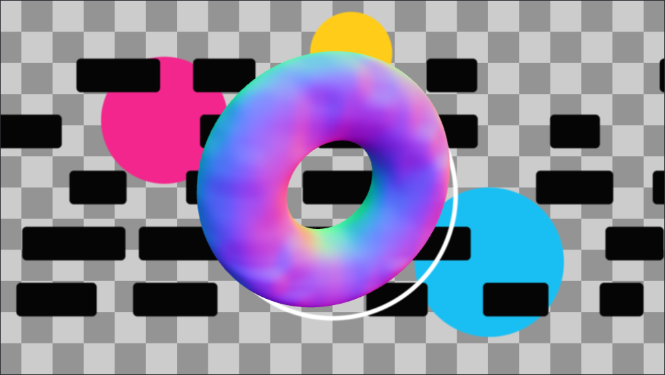

*Preview (Normal stage, which shows normal directions as colours):* soft colour waves cover the torus while its outline stays round.

{{experiment:film}}

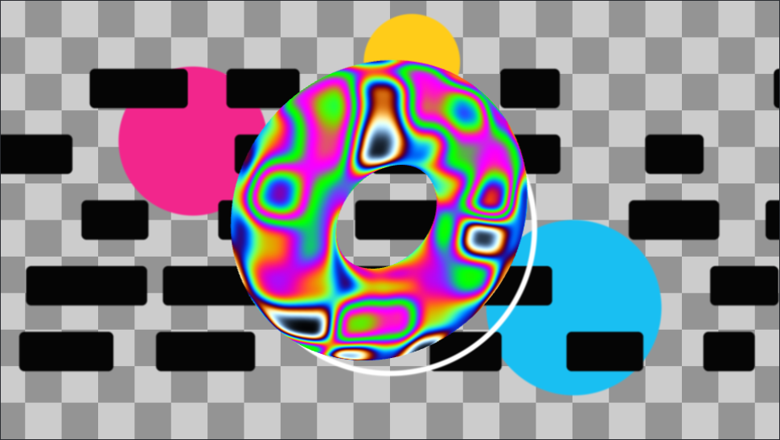

*Preview (Iridescence film stage):* saturated magenta, green and gold bands following the swirl. In the final look this colour is mixed in far more gently.

## Measure thickness with the back-face pass

How can the shader know how thick the object really is?

Until now, Thickness is one number for the whole object. Real objects are thicker in some places than others. The optional **back-face pass** renders the glass a second time, showing only its far side, into `render_back`. That render stores the inner surface's colour, and in its alpha channel how far that surface is along the view ray, as a 32-bit float: 16-bit floats step visibly once the camera is tens of units away. The front surface knows its own distance, so the difference is the real thickness at that pixel. For an orthographic camera the distance is the depth along the parallel rays. `backfaceAt()` reads the pass with a bilinear filter written out by hand that only blends the texels the back faces cover, so the empty background around the object neither darkens the colour nor shortens the distance. This also brings back Heckel's backside trick: the far side is drawn with the same material, so its reflections and fringes are themselves bent by the front surface.

{{code:liquid_glass.frag:backface}}

{{experiment:backface}}

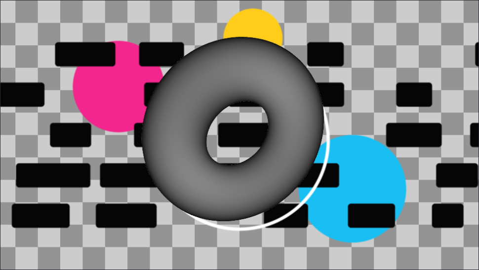

*Preview (Thickness stage):* brighter across the middle of the tube, darker toward its edges. On a unit sphere, an automated test compares the measured thickness with the exact distance through the sphere along each pixel's ray. At five points, from the centre (2.0 units) to near the edge (0.5 units), they agree within 1/255 (`backface_thickness_matches_chord`). The same holds 50 units from the camera and with an orthographic camera off axis. Over a flat grey scene, clear glass with the pass on stays exactly grey (`backface_pass_adds_no_dark_fringe`).

It is optional because it costs a second render and needs to know your camera and glass objects (**Inputs** page). It only renders while the toggle is on.

## Twelve looks and a morph

How do presets and morphing reach the shader?

The shader only sees fourteen sets of four numbers (**uniforms**). It doesn't know about presets. Each parameter on the component feeds one of those numbers through an expression on the GLSL MAT's Vectors page.

{{code:liquid_glass.frag:uniforms}}

Choosing a **Preset** runs a small script ([preset_exec.py](preset_exec.py)). It copies that look's values from [presets.json](presets.json) into the parameters, so you can keep adjusting from there. Presets leave the light direction, panorama rotation, inputs and quality settings alone. **Morph** works one step later: each look-related uniform expression calls `u()` in [presets.py](presets.py). It returns the parameter's value blended toward the same value in the **Morph target** preset. At Morph 0 you get your sliders, at 1 the target, and anything in between can be animated. Wobble speed is morphed too, and because the drift is added up frame by frame (see *Make it liquid*), an animated morph changes how fast the ripples move, never where they are. From a script, load a look with `component.op('presets').module.apply(component, 'violet_gel')`, then set any overrides: that writes the values at once, while changing the menu goes through the callback.

{{experiment:morph}}

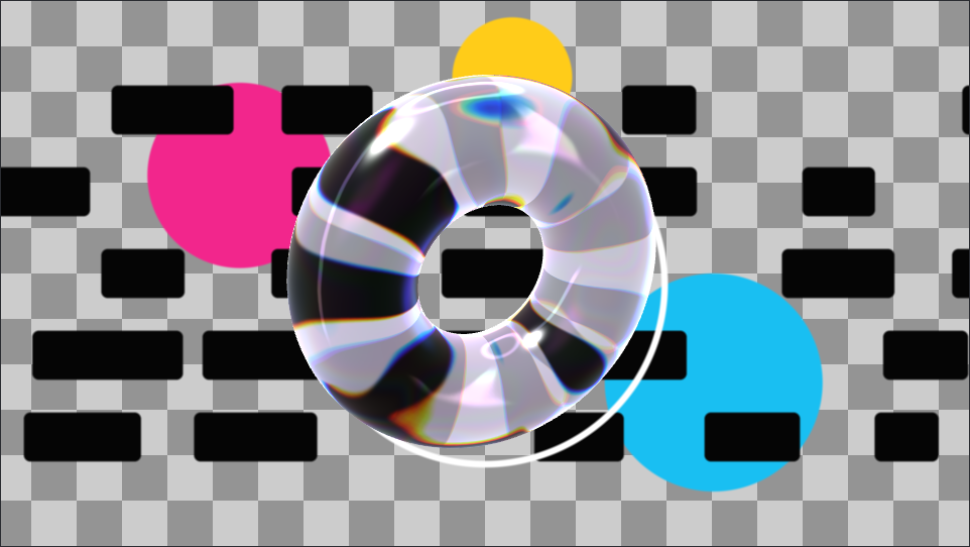

*Preview:* a faintly violet glass with softer fringes than Prism Chrome. Unit tests check the morph maths in `presets.py`; preview tests check that the shader, given those values, renders exactly the target preset at Morph 1 and changes nothing at Morph 0. Another preview test plays one frame of a 100-frame morph after an hour of running: it changes the image no more than the same frame after two seconds (`morph_frame_is_smooth_after_an_hour`).

{{experiment:final}}

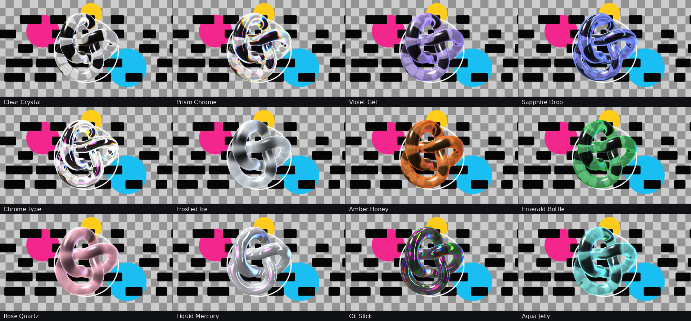

*Preview of all twelve presets on a knot shape (the knot exists only in the preview; the TouchDesigner demo uses a torus).*

## Use it in your own scene

The [README](README.md) has the full steps. In short: render your scene without the glass and use it as the Refraction TOP; its background may be transparent. Give the Reflection TOP a panorama or an image. Then add a Render Pass TOP after the scene render: it draws only the glass objects, with Override Material set to the component's `material`, on top of the scene's colour and depth. Objects in front of the glass then still cover it. A preview test puts an opaque ball in front of the glass to check this route; TouchDesigner's own Render Pass TOP is still to be checked. (The demo inside the component lays the glass over a flat backdrop with an Over TOP instead; that only works when nothing stands in front of the glass.) Turn Dither off on both renders, so nothing adds dithering noise to the continuous glass.

Your object is probably not the size of the demo torus. Thickness, Frost and Tint density are lengths, and so are the ripple and film patterns, so a preset tuned on the demo torus would bend ten times too little on an object ten times larger. Point **Inputs > Glass geometry** at your objects and press **Fit to Glass geometry**: it measures them against the demo torus and sets **Object size** (the torus itself measures 1), and the component converts every length by it. Object size is a size in the world, so it does not matter whether you sized your object in its SOP or with its Geometry COMP's Scale. Presets and experiments never touch Object size, and at 1 nothing changes.

The glass can only show what your scene puts behind it. The demo has a second backdrop for exactly this reason: **Study > Demo backdrop** switches the checkerboard for heavy white type on black, the backdrop of the sibling study Liquid Glass Prism, so looks from the two studies can be compared on the same scene.

{{experiment:type_backdrop}}

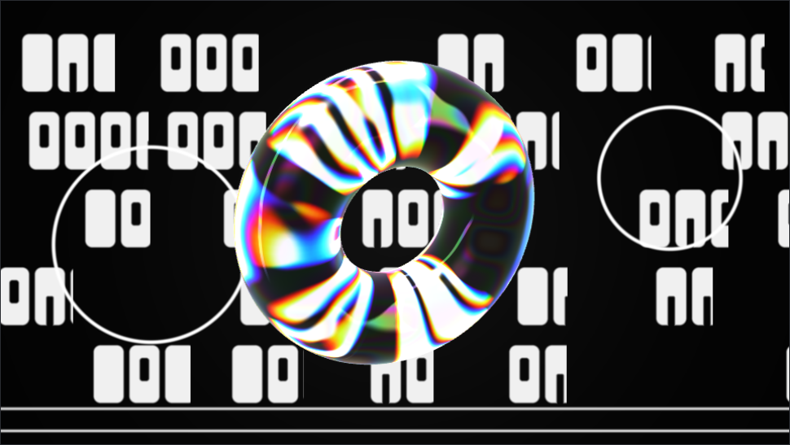

*Preview:* the same Prism Chrome glass now shows bent, upside-down white letters with coloured edges, and its clear parts read dark. All twelve presets over this backdrop are in [the second contact sheet](captures/presets-sheet-type.png).

The material also fits into larger TouchDesigner setups. The vertex shader's `main()` is ready for Render Pick DAT and CHOP passes. It places the point first, which every render needs. Then it follows the form printed on Derivative's *Write a GLSL MAT* page: for a pick render TouchDesigner defines `TD_PICKING_ACTIVE`, so of the branch only the `#else` block runs, where `TDWritePickingValues()` writes what the pick reads. An ordinary render runs the other block and calls `passToPixelStage()`. In a render with several colour buffers, the glass writes zeros into the extra ones (`fragColor[1]` and up), which leaves them as they were.

{{code:liquid_glass.vert:picking}}

## Limits

- **Only what the camera sees can be refracted.** The glass can't show things outside the frame or hidden behind other objects; mirror-repeat hides the frame edge but invents nothing. Glass behind other glass is not seen through the nearer glass, and an object in front of the glass also shows up, refracted, inside it, because both come from the same scene render.
- **The bend is an approximation.** Light is bent once, at the front surface, and slid sideways by Thickness. Exit refraction, multiple internal bounces and total internal reflection are not modelled. The back-face pass improves thickness, not the light path.
- **Wobble changes shading only.** For a real liquid silhouette, deform the geometry (the plugin's *Resonant Foil* example shows how, with matching normals).
- **Partly transparent scenes.** Where the Refraction TOP is only partly covered (alpha between 0 and 1, as on antialiased edges), that part of the scene is counted twice behind the glass, so it looks slightly brighter and more opaque there. With the back-face pass on, `covered` is read where the view first bends, while the inner surface's colour comes from a second bend; at the edge of a scene object over a transparent background the two can disagree slightly (not measured).
- **Fog is approximate.** The bent scene was fogged in its own render and gets the glass's fog on top. Not yet checked natively.
- **Object size averages a non-uniform scale.** Fit and the ripple and film lookups use the cube root of how much the Geometry COMP's transform changes a volume, so a COMP stretched along one axis counts as its average size.
- **One Object size per component.** Fit measures when you press it and takes the largest object. A smaller object, a Geometry COMP whose Scale changes after Fit, and an instance with its own scale all keep that one Object size. At a fifth of the size the glass bends and tints as if it were five times larger; scaled up three times without a new Fit, as if it were three times smaller. On an instance the ripples and film bands grow with it, but their tilt ignores its rotation. The README lists the workarounds; a change that would let all three follow is recorded in [decisions.json](decisions.json) and waits for the user's decision.
- **Colour management is partial.** With Colour parameters on *Auto*, colours are converted from sRGB to linear in a linear working colour space; wide-gamut primaries (ACEScg, P3, Rec.2020) are not converted, so colours there look slightly more saturated. Not yet checked natively.
- **Opacity below 1, or no Refraction TOP:** the glass writes depth, so parts of one self-overlapping object can hide each other depending on triangle order. Use the render's Order Independent Transparency for those cases.
- **Instanced geometry:** position and normals go through `TDDeform`, so instances should work (not yet checked natively); see the previous point for their size.
- **Cost** grows with Samples (dispersion and frost), Reflection blur (8 extra lookups) and the back-face pass (a second render, plus 4 texel reads per sample).
- **Antialiased edges near the centre lines.** With antialiasing, a few silhouette pixels near the render's centre row or column still bend the wrong way: each is shaded at its centre, outside its own triangle, and its point projects to the other side of the centre line. In the preview they change at most 6 pixels in twelve frames, by up to 43/255. Whether that shows in TouchDesigner is an open family question, with a native check pending. A centroid-sampled position removed most of them in the usual raster in the Liquid Glass Lit study's preview, but no TouchDesigner build has run one.
- **Not yet run in TouchDesigner.** The shaders compile as GLSL 4.60 against stand-ins for TouchDesigner's built-ins (also with picking active and with three colour buffers), and the preview passes its tests. Native compile, render, the preset callback, the Render Pass TOP workflow and its occlusion, picking, extra colour buffers, fog, the screen orientation, Fit to Glass geometry and export are still to be checked on a real host; see [validation.json](validation.json).

## Credits

Screen-space refraction through a render of the scene, multi-sample dispersion, saturation, the squared Blinn-Phong specular, fresnel glow and back-face rendering come from Maxime Heckel, [Refraction, dispersion, and other shader light effects](https://blog.maximeheckel.com/posts/refraction-dispersion-and-other-shader-light-effects/). His article credits the sampling technique to the open-source Junni site by @ore_ukonpower, and the colour-channel split to research by Ravishankar Sundararaman. The frost disc uses Martin Roberts' R2 quasirandom sequence. The Refraction TOP's alpha and the fog handling come from the Liquid Glass Blobs study, the measured screen orientation and the type backdrop from Liquid Glass Prism, picking and extra colour buffers from Liquid Glass Flow, Lit and Prism, Dither off and the output cap from Liquid Glass Lit, and Fit to Glass geometry from Liquid Glass Flow. The TouchDesigner implementation is newly written; [sources.json](sources.json) lists each idea's source lines and how it was adapted. TouchDesigner API details follow Derivative's documentation (Write a GLSL MAT, GLSL MAT, Render TOP).
