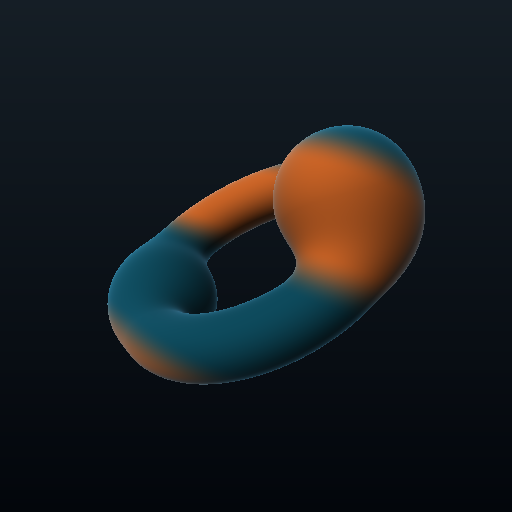
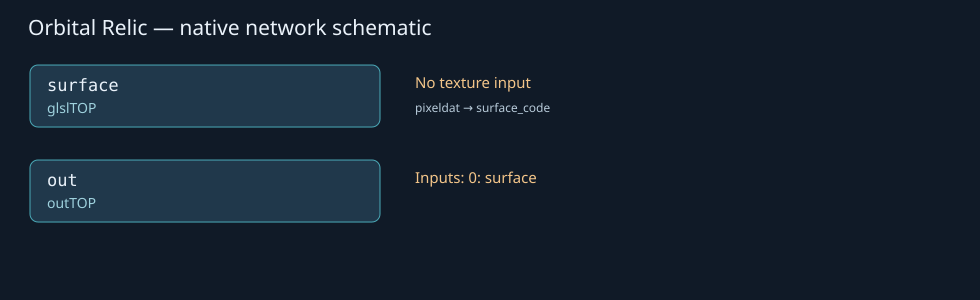

# Orbital Relic

Build a slowly rotating, fused ring-and-satellite sculpture. Reveal hit coverage, marching cost and normals separately. Test distance-based rendering rather than merely producing a shaded circle.

This is an original TouchDesigner study grounded in the cited archive. It separates the published technique, the new native implementation, and observations from actual tests. The source tutorial and excerpts are generated together so the explanation stays tied to the delivered shader.

## Open the study

Drag [the native component](native/study.tox) into TouchDesigner, or run `build.py` inside its Python Textport with `runpy`. Keep the returned component in a variable named `component` for the experiment commands below. Open its `out` viewer and use the Study parameter page. Presets fix unrelated controls; Pause and Time make comparisons reproducible. Any reset or warmup requirement is stated beside its experiment.

The recipe is [study.json](study.json), the source trail is [research.md](research.md), and native results are summarized in [review.md](review.md). The tested host is TouchDesigner 2025.33230 on macOS. Browser copies of these algorithms would require their own validation.

## A sculpture described by distance

The object is a tilted ring joined to two unequal satellites. No triangle mesh describes that silhouette: every point in the scene is answered by a distance query. The torus query first collapses the radial XZ distance into a two-dimensional vector, then measures the distance to its tube. Each sphere is simply the length from its center minus its radius. Rotation happens before these queries and preserves length.

A hard minimum chooses the nearer surface. The smooth join changes only the neighborhood where two distances are close, letting the ring flow into its satellites. Blend is measured in scene units, not a generic percentage. At zero Blend we use the ordinary minimum explicitly so the polynomial formula never divides by zero. This choice also gives the reader an honest baseline: sharp seams are a property of the chosen operation, not a failed renderer.

The underlying primitives and smooth-minimum construction are familiar tools from the source references. The ring placement, unequal satellites, controlled camera and teaching fixtures form this new study. We deliberately avoid an arbitrary noise displacement here: moving the distance field without controlling its gradient can let a ray step across a surface.

{{code:surface.frag:scene}}

{{experiment:hard}}

The diagram is a schematic of the recipe, not a captured network screenshot. Texture wires and parameter references are labeled separately.

## A distance estimate is not a hit

Each fragment constructs a ray from a camera at Z=3.1 through an aspect-correct image plane. Distance traveled begins at zero. At each iteration we query the scene and either accept a surface within 0.001 scene units or advance by 85% of the returned distance. The multiplier leaves a conservative margin; it does not make arbitrary non-distance functions safe.

The function returns a boolean hit independently from the distance and iteration counter. That distinction matters. A loop can stop because it found a surface, exceeded its travel bound, or exhausted its iteration budget. Treating all three outcomes as hits produces phantom surfaces. In this shader, every non-hit falls through to the background.

The white mask is an intentionally unstyled measurement. We temporarily replace the entire scene with a sphere and compare this mask with a CPU ray/sphere intersection. The small residual difference at its boundary comes from accepting an epsilon-thick surface. The exact measured agreement is in the native report; the image alone does not establish it.

{{code:surface.frag:march}}

{{experiment:hit}}

## Normals reveal the hidden shape

A distance gradient points toward increasing distance and therefore away from a closed surface. We estimate its X, Y and Z components with symmetric samples, then normalize. The central difference spans 0.002 scene units on each axis. This is a numerical normal estimate, not a texture stored on the ring.

The diagnostic maps a normal component from [-1,1] into [0,1]. Blue indicates a component toward positive Z, while red and green encode X and Y. It is not meant to be a pleasing material. Look for a continuous change around the tube and a softened transition at the joins.

The analytic sphere fixture tests these directions away from grazing edges. Near a silhouette, hit tolerance and finite differences magnify small positional differences; excluding that boundary from the normal comparison is a stated test condition, not evidence of perfect accuracy everywhere.

{{code:surface.frag:normal}}

{{experiment:normals}}

## Make the computational limit visible

Budget changes the maximum number of distance queries per pixel. The loop has a hard compiled ceiling of 192; the control selects an integer count inside that ceiling. Early exits keep easy background and front-facing rays from using every iteration.

Grazing rays often make slow progress because the nearest surface remains close while the ray runs almost parallel to it. The iteration view divides the used count by the chosen budget. A saturated value therefore means a different absolute cost at 16 and 128 steps: read the control alongside the image.

Compare the low-budget view with the final preset at fixed Time and Turn. Increasing the budget can recover coverage, but it should never turn a low-budget false surface into a legitimate modeling decision. The test checks that low-budget hits are contained in the high-budget result. Resolution changes are tested separately because image-plane aspect must follow the actual output dimensions.

{{code:surface.frag:march}}

{{experiment:budget}}

## Compose without hiding the mechanism

The final material combines a world-scene pigment function, diffuse response and a restrained rim term. These are artistic choices; the shader does not implement a calibrated metal BRDF. The blue/copper split follows position rather than the ray iteration count, keeping material changes independent of computational effort.

A slowly changing rigid rotation supplies motion while preserving the distance construction. Pause selects the explicit Time parameter, making still comparisons reproducible. Turning Pause off animates the preview; it does not change the geometry formula.

The resulting component is useful as a starting point for a new distance composition, but modifying its primitives requires reviewing the bound again. The test succeeded for these shapes and parameters. It cannot certify every function later pasted into scene().

{{code:surface.frag:shade}}

{{experiment:final}}

## Evidence, tradeoffs and next experiments

The [review record](review.md) lists the actual checks and their limits. Captured presets establish those states; shader compilation establishes accepted code; mathematical fixtures test specific relationships. None alone establishes artistic acceptance or performance on another device. Native CPU cook observations are not labeled GPU execution time.

Change one mechanism at a time, preserve a fixed baseline, and explain why the new choice helps the intended image. The presets are teaching tools, not a restriction on new compositions. Shader approval and tutorial approval remain separate.

## Sources and credit

[Maxime Heckel’s article](https://blog.maximeheckel.com/posts/painting-with-math-a-gentle-study-of-raymarching/) and its matching archived demo informed the mechanism and teaching structure. [Exact source records](sources.json) preserve the relevant lines, hashes and adaptation notes. Credit for underlying algorithms remains with the researchers named in those sources. New prose, diagrams and native code are authored for this toolkit. See [the package attribution](../../ATTRIBUTION.md) for original source terms.

Native host contracts: [GLSL TOP](https://docs.derivative.ca/Write_a_GLSL_TOP), [GLSL MAT](https://docs.derivative.ca/Write_a_GLSL_MAT), and [Feedback TOP](https://docs.derivative.ca/Feedback_TOP), as applicable to the recipe. The live host provides the parameter and compile evidence.
