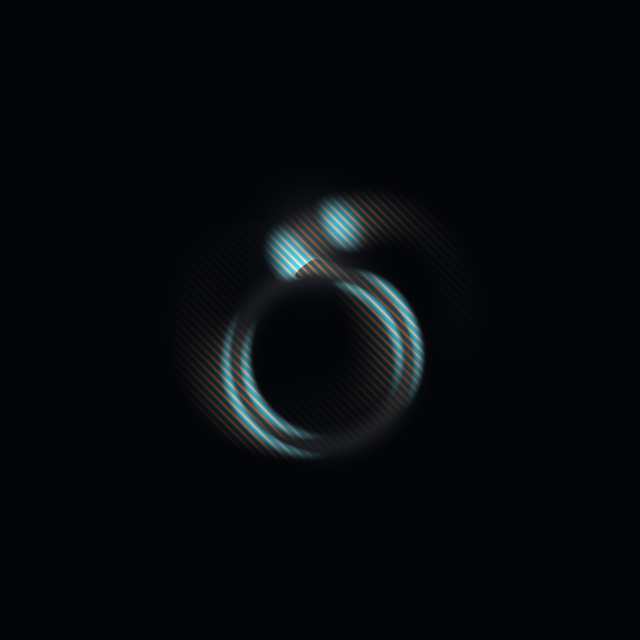
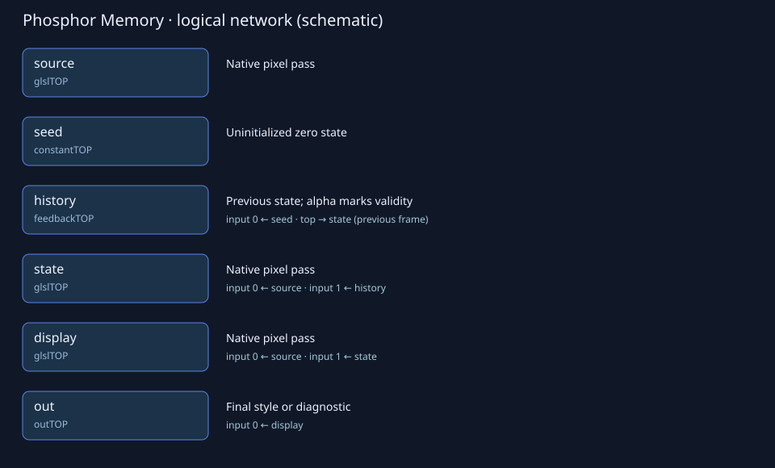

# Phosphor Memory: giving image change a material

Captured in TouchDesigner 2025.33230; see the stage receipts for settings.

Imagine a moving light leaving an engraved afterimage: fresh changes look cool,
while older motion settles into warm diagonal hatching. The shader uses a
measured change signal and a stored trail, then gives them separate visual roles.
It is an artistic persistence effect, not a model of a physical phosphor.

The foundation comes from Maxime Heckel's [Shading Motion](https://blog.maximeheckel.com/posts/shading-motion/):
compare frames, retain useful history and style the resulting signal in another
stage. That article implements these ideas with WebGPU. Here the native
adaptation uses GLSL TOPs and a Feedback TOP, with a time-unit decay rule and an
explicit initialization channel.

Build with `runpy.run_path('/path/to/build.py')['build']()` in TouchDesigner.
The returned `component` contains source, seed, history, state, display and out.
The Study page provides threshold, lifetime, pitch, stage, Pause and Reset.

## What do we mean by motion?

A moving Gaussian disc and thin ring make a deterministic input. This removes
camera permissions, file dependencies and exposure changes from the first test.

{{code:source.frag:source}}

{{experiment:source}}

We will compare brightness at the same pixel in two frames. A moving edge
usually changes that value. A uniformly colored region can move without a
visible change inside it; an exposure jump can change every pixel without any
object moving. Frame difference therefore measures image change. It provides
neither a reliable direction nor a speed.

## Why must the first frame be special?

The history stores four data channels: current luma, accumulated trail, raw
motion mask and an initialized flag. The all-zero seed has alpha zero. On the
first valid input, the shader stores luma and marks the state initialized,
while leaving both masks empty. Otherwise the first scene would be compared
with black and could flash as false motion.

{{code:state.frag:initialize}}

{{code:state.frag:motion}}

{{experiment:motion}}

The luminance weights assume the intended linear input interpretation; they
are a stated adaptation from the source article's example weights. The supplied
test input is grayscale, so this distinction does not affect the initial test.
For external media, inspect actual input/working spaces first.

The threshold maps small differences to zero and larger differences smoothly
to one. It must remain positive so the smoothing interval has ordered, distinct
edges. Raising it rejects more noise but also misses subtle motion.

## How can an image remember?

{{code:state.frag:decay}}

{{experiment:trail}}

The previous trail is multiplied by `exp(-dt / lifetime)`. With no fresh motion,
after one lifetime it retains about 36.8% of its initial value. We then keep
the larger of the new motion and the decayed trail. The rule stays bounded
when the inputs lie in [0,1].

Unlike a fixed multiplier per frame, this equation has an explicit time unit.
The example's dt is a **fixed simulation step**, supplied by the Step control.
It is not a measurement of wall-clock time. Skipped cooks change wall-clock
persistence. A live installation should define timestamp, gap and reset policy
for its actual input.

The Feedback TOP targets `state`, never the styled output. This is a delayed
dependency: the state shader samples the previous frame while writing the
current one. Hold Reset for a frame and release it to reinitialize; reset after
source changes, seeks or resizing. Pause freezes both time and valid history.

To compare lifetimes fairly, start from the same input sequence and reset for
each run. Do not compare unrelated live moments and call the difference an
isolated decay experiment.

## How does memory become hatching?

{{code:display.frag:representation}}

{{code:display.frag:diagnostics}}

{{experiment:final}}

The display pass reads the stored channels but never updates them. Diagonal
lines are defined in output pixels, with a derivative transition around each
line. The trail controls warm coverage and the raw mask adds a cooler signal.
Changing pitch or palette should leave the state texture unchanged.

This is the new composition: the age relationship drives a material-like
representation. It is more than a palette swap of a motion demo because the
state/display contract, timing rule and hatch interpretation are explicit and
independently testable.

## Evidence and limits

Check `validation.json` for actual native compile, render, reset, hold and decay
tests. Capture receipts identify the controls and host. A still cannot prove
temporal behavior. This study does not implement optical flow or blob tracking,
and it does not guarantee robustness to camera noise, exposure or frame loss.
The procedural source makes the basic mechanism reproducible before those
additional problems are introduced.

For temporal playback, open the output TOP viewer (right-click `out` → View) or connect a consuming output. TouchDesigner cooks on demand; a hidden, unused branch does not advance history merely because time advances. The validation driver deliberately cooks once per frame and is not embedded in exported components.
