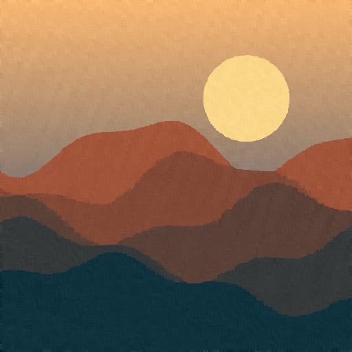
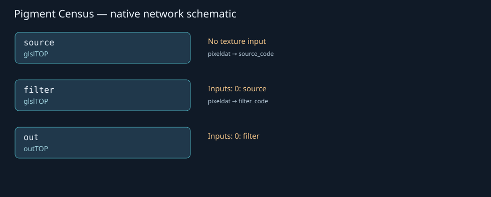

# Pigment Census

Turn an original grainy, layered landscape into broader pigment patches. Compare variance-selected quadrants with ordinary box averaging on a controlled edge and constant image.

This is an original TouchDesigner study grounded in the cited archive. It separates the published technique, the new native implementation, and observations from actual tests. The source tutorial and excerpts are generated together so the explanation stays tied to the delivered shader.

## Open the study

Drag [the native component](native/study.tox) into TouchDesigner, or run `build.py` inside its Python Textport with `runpy`. Keep the returned component in a variable named `component` for the experiment commands below. Open its `out` viewer and use the Study parameter page. Presets fix unrelated controls; Pause and Time make comparisons reproducible. Any reset or warmup requirement is stated beside its experiment.

The recipe is [study.json](study.json), the source trail is [research.md](research.md), and native results are summarized in [review.md](review.md). The tested host is TouchDesigner 2025.33230 on macOS. Browser copies of these algorithms would require their own validation.

## A source with known structure

An original procedural landscape provides broad colored hills, a circular sun and small grain. This choice removes missing-image downloads and lets us produce the same clean source for a quantitative comparison. Grain is a deterministic pixel hash; Time moves the hill contours slowly and is frozen for filter experiments.

The first draft painted the hill layers in an order that allowed the final layer to cover the earlier ones. Inspecting the actual output revealed the issue. Reversing that layer order exposes the separate bands without changing the filter. This is a composition correction, not a statistical improvement attributed to Kuwahara.

Two other Input modes create a binary vertical edge and a constant RGB image. They are deliberately simple. A complicated painting can hide a broken boundary rule or a divide-by-zero, whereas these fixtures make expected behavior obvious.

{{code:source.frag:fixture}}

{{experiment:source}}

The diagram is a schematic of the recipe, not a captured network screenshot. Texture wires and parameter references are labeled separately.

## Summarize four neighborhoods

For every output pixel we examine four axis-aligned quadrants. Each contains (radius+1)^2 samples, including the center. We accumulate the first moment, sum(color), and second moment, sum(color*color), then compute channel variance as E[c²]-E[c]².

Tiny negative variances can appear through floating-point subtraction even when the mathematical value is nonnegative. Clamping that residual to zero protects selection without changing the intended statistic. Radius zero contains one sample and is therefore a valid identity case.

The three channel variances are combined with fixed weights to produce one selection score. This is a weighted sum of channel variances. It is not the variance of scalar luminance, which would also involve channel covariance. The distinction matters when differently colored regions have similar brightness.

Integer texel fetches and explicit edge clamping keep radius measured in source pixels. They also make the boundary behavior inspectable: samples beyond the image repeat its outermost texel.

{{code:filter.frag:moments}}

{{experiment:variance}}

## Let an edge choose its own side

The filter selects the mean of the quadrant with the lowest variance. Near a clean edge, at least one quadrant lies entirely on the same side as the center pixel. Its samples agree, so its variance is zero and its average does not mix the two sides.

The binary-edge experiment makes this visible without grain, gradients or lighting. The native test compares the filtered result directly with its source. Ties are resolved deterministically by the order of the quadrant array; that is useful for reproducibility but can create directional artifacts in more complex images.

This is the basic Kuwahara mechanism explained in the archived article and matching module. The archive also includes circular sectors, improved weighting and tensor-driven anisotropy. They are available references for further work, but this sample intentionally isolates the first statistical decision.

{{code:filter.frag:select}}

{{experiment:edge-kuwahara}}

## Compare with a filter that cannot choose

The box-filter comparison averages every texel in a square extending radius pixels in each direction. At an edge, samples from both sides contribute and produce intermediate gray values. Nothing is broken: blurring across that boundary is what an unconditioned average means.

Switch between the two edge presets while keeping the same radius and source. The paired images explain why variance selection is useful more clearly than a final landscape alone. The quantitative comparison measures error against the binary source; it does not rely on declaring one image more painterly.

Cost differs too. The box filter visits (2r+1)^2 texels, while four inclusive quadrants visit 4(r+1)^2 with repeated boundaries. Both grow quadratically. This implementation prioritizes transparent teaching over eliminating redundant samples or using integral images.

{{code:filter.frag:comparison}}

{{experiment:edge-box}}

## Return to the painting with a measurable claim

With the full procedural landscape restored, the filter turns fine grain into larger local color patches while preserving stronger boundaries. In a fixed sky region we compare the noisy source and filtered output against the clean procedural image. The measured error reduction supports a specific denoising claim for that region.

It does not establish universal perceptual quality. Quadrant switching can produce blocks, gradients can bias selection, and larger radii can erase useful detail. The variance view reveals what drives selection; it is not a confidence probability or edge detector calibrated against ground truth.

For a new photographic input, revisit color space, source resolution, input loss and desired detail scale. This sample's artistic RGB values and deterministic source make its tests portable, but they do not certify an arbitrary camera pipeline.

{{code:filter.frag:select}}

{{experiment:final}}

## Evidence, tradeoffs and next experiments

The [review record](review.md) lists the actual checks and their limits. Captured presets establish those states; shader compilation establishes accepted code; mathematical fixtures test specific relationships. None alone establishes artistic acceptance or performance on another device. Native CPU cook observations are not labeled GPU execution time.

Change one mechanism at a time, preserve a fixed baseline, and explain why the new choice helps the intended image. The presets are teaching tools, not a restriction on new compositions. Shader approval and tutorial approval remain separate.

## Sources and credit

[Maxime Heckel’s article](https://blog.maximeheckel.com/posts/on-crafting-painterly-shaders/) and its matching archived demo informed the mechanism and teaching structure. [Exact source records](sources.json) preserve the relevant lines, hashes and adaptation notes. Credit for underlying algorithms remains with the researchers named in those sources. New prose, diagrams and native code are authored for this toolkit. See [the package attribution](../../ATTRIBUTION.md) for original source terms.

Native host contracts: [GLSL TOP](https://docs.derivative.ca/Write_a_GLSL_TOP), [GLSL MAT](https://docs.derivative.ca/Write_a_GLSL_MAT), and [Feedback TOP](https://docs.derivative.ca/Feedback_TOP), as applicable to the recipe. The live host provides the parameter and compile evidence.
