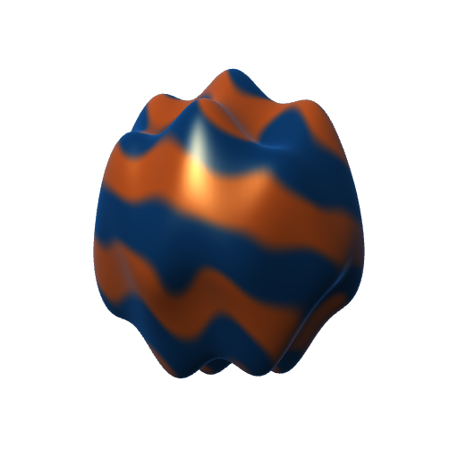
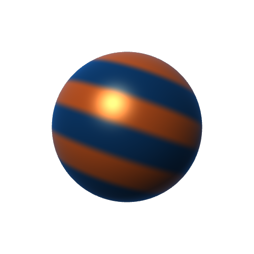
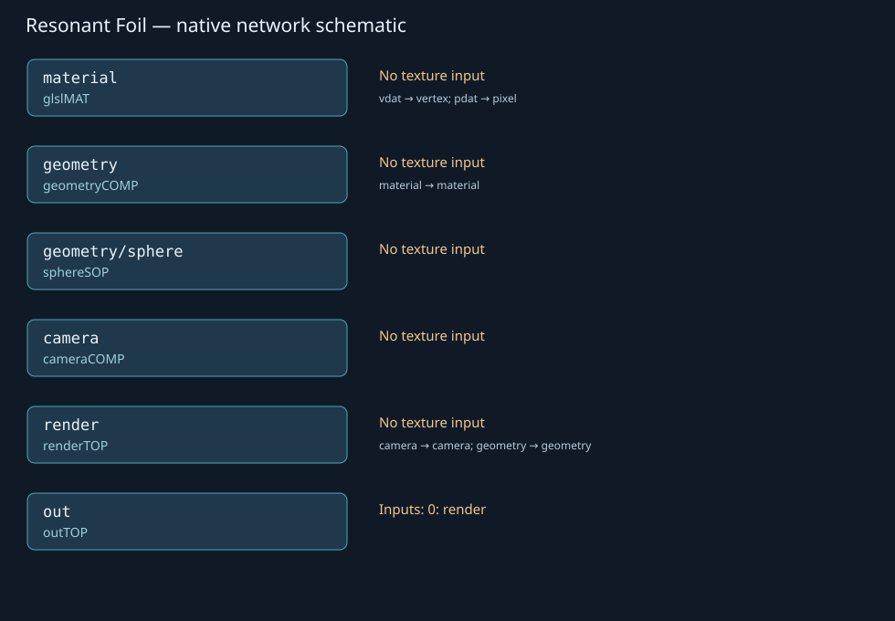
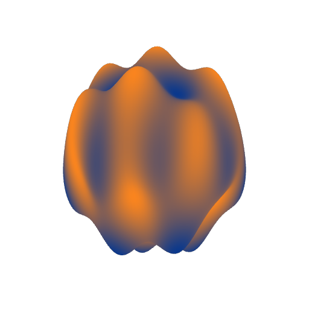
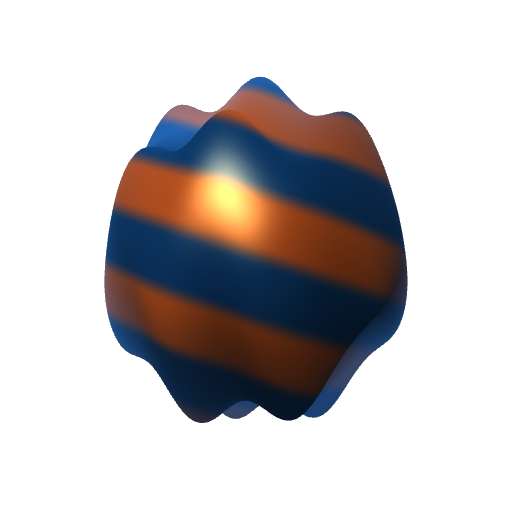
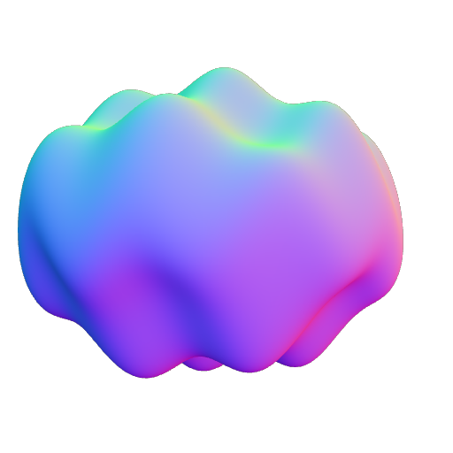

# Resonant Foil

Deform an actual sphere mesh into moving foil folds. Keep displacement, normal correction and lighting independently inspectable, including a deliberately uncorrected comparison.



This is an original TouchDesigner study grounded in the cited archive. It separates the published technique, the new native implementation, and observations from actual tests. The source tutorial and excerpts are generated together so the explanation stays tied to the delivered shader.

## Open the study

Drag [the native component](native/study.tox) into TouchDesigner, or run `build.py` inside its Python Textport with `runpy`. Keep the returned component in a variable named `component` for the experiment commands below. Open its `out` viewer and use the Study parameter page. Presets fix unrelated controls; Pause and Time make comparisons reproducible. Any reset or warmup requirement is stated beside its experiment.

The recipe is [study.json](study.json), the source trail is [research.md](research.md), and native results are summarized in [review.md](review.md). The tested host is TouchDesigner 2025.33230 on macOS. Browser copies of these algorithms would require their own validation.

## Move a surface before shading it

The baseline is a native sphere SOP rendered through a GLSL MAT. The vertex shader applies a map F(x,y,z)=(x,y+g(x,z),z), where g is a separable sine/cosine wave. Unlike a color effect or a normal map, this changes the projected silhouette.

Amplitude is measured in SOP object units; Frequency is radians per object unit. Time changes phase. A sufficiently tessellated sphere is needed because the fragment shader cannot invent the vertices required to represent a fine displacement. The default mesh is a test resolution, not an automatic guarantee for arbitrary frequencies.

The camera was moved back after the first native preview showed clipped folds. Its position and the pixel shader's view origin were changed together. Keeping those values aligned matters because a specular-looking highlight can otherwise use the wrong eye direction even when projection itself is correct.

From [vertex.vert](vertex.vert), lines 11–15:

```glsl
    float a=uSurface.x,f=uSurface.y,t=uClock.x;
    float sx=sin(f*p.x+t),cx=cos(f*p.x+t);
    float sz=sin(f*p.z-0.7*t),cz=cos(f*p.z-0.7*t);
    float wave=a*sx*cz;
    vec3 displaced=p+vec3(0.0,wave,0.0);
```

**Native experiment `flat`:** What is the undeformed baseline?

On the built component, run `component.op('study_tools').module.apply(component, 'flat')`.

Prediction: The sphere remains smooth with its original silhouette.

Parameters: Pause=True, Time=2, Stage=final, Amplitude=0, Frequency=7, Correct=True, Turn=25, Stretch=1. Time and unrelated controls are fixed by this preset.



Captured native stage; [capture conditions](captures/native-flat.png.json). Captured from the native component with no reported operator errors. Mechanism-specific comparisons are recorded in review.md.



The diagram is a schematic of the recipe, not a captured network screenshot. Texture wires and parameter references are labeled separately.

## Use a varying to expose displacement

The signed wave value travels from the vertex stage to the fragment stage as a varying. A blue-to-orange diagnostic shows negative and positive offsets. Interpolation across triangles explains why this view is smooth between the evaluated vertices; the wave is not re-evaluated per pixel in this diagnostic.

The archived blob study provides the idea of displacing geometry and making displacement visible in fragment color. Our separable wave is chosen for a different purpose: its derivatives can be written and independently checked exactly. This lets the tutorial connect shape changes to the normal transformation instead of treating noise as an opaque function.

The native test compares alpha coverage before and after displacement. A nonzero difference establishes that vertices actually moved in projection. It is stronger evidence than a changing RGB pattern, which could be produced without changing geometry.

From [vertex.vert](vertex.vert), lines 11–15:

```glsl
    float a=uSurface.x,f=uSurface.y,t=uClock.x;
    float sx=sin(f*p.x+t),cx=cos(f*p.x+t);
    float sz=sin(f*p.z-0.7*t),cz=cos(f*p.z-0.7*t);
    float wave=a*sx*cz;
    vec3 displaced=p+vec3(0.0,wave,0.0);
```

**Native experiment `displacement`:** Where are vertices moving?

On the built component, run `component.op('study_tools').module.apply(component, 'displacement')`.

Prediction: The varying encodes signed vertical displacement; the silhouette actually changes.

Parameters: Pause=True, Time=2, Stage=displacement, Amplitude=0.18, Frequency=7, Correct=True, Turn=25, Stretch=1. Time and unrelated controls are fixed by this preset.



Captured native stage; [capture conditions](captures/native-displacement.png.json). Captured from the native component with no reported operator errors. Mechanism-specific comparisons are recorded in review.md.

## A moved vertex needs a moved normal

A normal is perpendicular to the local tangent plane. After applying a map to the surface, transforming the old normal like a position does not generally preserve that perpendicular relationship. The correct linear rule is the inverse transpose of the map's Jacobian.

For this particular vertical shear, the Jacobian has unit diagonal and the derivatives gx and gz in its middle row. Its determinant is one. Applying its inverse transpose gives (nx-gx*ny, ny, nz-gz*ny), followed by normalization. This compact formula is specific to the stated map; it is not a universal displacement correction.

The deliberately wrong preset keeps the old sphere normal while using the same displaced positions. Compare the highlights, not the silhouette: the native test verifies that coverage stays identical. An early zero-amplitude comparison also found a tiny difference from normalizing an already normalized vector twice. The final shader selects the original normal directly at zero amplitude, giving an exact identity baseline.

From [vertex.vert](vertex.vert), lines 18–20:

```glsl
    float gx=a*f*cx*cz;
    float gz=-a*f*sx*sz;
    vec3 corrected=abs(a)<1e-8 ? n : normalize(vec3(n.x-gx*n.y,n.y,n.z-gz*n.y));
```

**Native experiment `wrong`:** What goes wrong if normals stay unchanged?

On the built component, run `component.op('study_tools').module.apply(component, 'wrong')`.

Prediction: Lighting follows the old sphere even though the geometry moved.

Parameters: Pause=True, Time=2, Stage=final, Amplitude=0.18, Frequency=7, Correct=False, Turn=25, Stretch=1. Time and unrelated controls are fixed by this preset.



Captured native stage; [capture conditions](captures/native-wrong.png.json). Captured from the native component with no reported operator errors. Mechanism-specific comparisons are recorded in review.md.

## Keep the normal in the lighting space

The corrected normal still lives in SOP object space. TDDeformNorm transforms it into world space using the native normal contract; TDDeform handles positions, and TDWorldToProj handles projection. The fragment stage renormalizes the interpolated normal before using it with world-space light and eye vectors.

Nonuniform scale makes this distinction visible. A position/vector transform would tilt a normal incorrectly when one axis is stretched. The diagnostic preset scales X by 1.5 and shows world normal components as color. Rotating the object should change that diagnostic while preserving its relationship to the surface.

A separate CPU test estimates transformed tangent directions with finite differences and compares their cross product with the analytic normal. That verifies the equation independently. Native control and render tests verify the actual host path; neither result is substituted for the other.

From [vertex.vert](vertex.vert), lines 23–29:

```glsl
    vec4 world=TDDeform(vec4(displaced,1.0));
    vWorldPosition=world.xyz;
    vCorrectNormal=normalize(TDDeformNorm(corrected));
    vOldNormal=normalize(TDDeformNorm(n));
    vWorldNormal=uSurface.z>0.5?vCorrectNormal:vOldNormal;
    vWave=wave;
    gl_Position=TDWorldToProj(world);
```

**Native experiment `normals`:** Does correction survive nonuniform scale?

On the built component, run `component.op('study_tools').module.apply(component, 'normals')`.

Prediction: World-space normals remain oriented with the deformed, stretched surface.

Parameters: Pause=True, Time=2, Stage=normals, Amplitude=0.18, Frequency=7, Correct=True, Turn=25, Stretch=1.5. Time and unrelated controls are fixed by this preset.



Captured native stage; [capture conditions](captures/native-normals.png.json). Captured from the native component with no reported operator errors. Mechanism-specific comparisons are recorded in review.md.

## A foil-like response with explicit limits

The final response combines diffuse shading, a narrow highlight and a cool rim with a blue/copper pigment pattern. It is a foil-like artistic material, not a measured conductor model. No reflection environment or physically calibrated roughness is claimed.

The corrected and uncorrected presets share this same lighting code. That control makes the normal's role visible: differences come from orientation, not from quietly changing the light or palette. Pause and fixed Time allow side-by-side comparisons without phase drift.

At higher frequencies the finite mesh can undersample the displacement even when the analytic normal is mathematically correct. A production extension should compare tessellation, frequency and performance together. The delivered test establishes correct behavior for the tested range and exposes the relevant controls for further investigation.

From [pixel.frag](pixel.frag), lines 18–25:

```glsl
        vec3 view=normalize(vec3(0.0,0.0,4.2)-vWorldPosition);
        vec3 light=normalize(vec3(-0.5,0.85,1.2));
        float diffuse=max(dot(n,light),0.0);
        float specular=pow(max(dot(n,normalize(light+view)),0.0),48.0);
        float rim=pow(1.0-max(dot(n,view),0.0),3.0);
        float stripe=0.5+0.5*sin(9.0*vWorldPosition.y+3.0*n.x);
        vec3 pigment=mix(vec3(0.045,0.21,0.39),vec3(0.7,0.3,0.11),smoothstep(0.25,0.8,stripe));
        color=pigment*(0.16+0.84*diffuse)+vec3(0.9,0.75,0.45)*specular+vec3(0.1,0.22,0.38)*rim;
```

**Native experiment `final`:** How do corrected normals shape the foil?

On the built component, run `component.op('study_tools').module.apply(component, 'final')`.

Prediction: Blue-to-copper reflection-like highlights follow the wave geometry.

Parameters: Pause=True, Time=2, Stage=final, Amplitude=0.18, Frequency=7, Correct=True, Turn=25, Stretch=1. Time and unrelated controls are fixed by this preset.


Captured native stage; [capture conditions](captures/native-final.png.json). Captured from the native component with no reported operator errors. Mechanism-specific comparisons are recorded in review.md.

## Evidence, tradeoffs and next experiments

The [review record](review.md) lists the actual checks and their limits. Captured presets establish those states; shader compilation establishes accepted code; mathematical fixtures test specific relationships. None alone establishes artistic acceptance or performance on another device. Native CPU cook observations are not labeled GPU execution time.

Change one mechanism at a time, preserve a fixed baseline, and explain why the new choice helps the intended image. The presets are teaching tools, not a restriction on new compositions. Shader approval and tutorial approval remain separate.

## Sources and credit

[Maxime Heckel’s article](https://blog.maximeheckel.com/posts/the-study-of-shaders-with-react-three-fiber/) and its matching archived demo informed the mechanism and teaching structure. [Exact source records](sources.json) preserve the relevant lines, hashes and adaptation notes. Credit for underlying algorithms remains with the researchers named in those sources. New prose, diagrams and native code are authored for this toolkit. See [the package attribution](../../ATTRIBUTION.md) for original source terms.

Native host contracts: [GLSL TOP](https://docs.derivative.ca/Write_a_GLSL_TOP), [GLSL MAT](https://docs.derivative.ca/Write_a_GLSL_MAT), and [Feedback TOP](https://docs.derivative.ca/Feedback_TOP), as applicable to the recipe. The live host provides the parameter and compile evidence.
