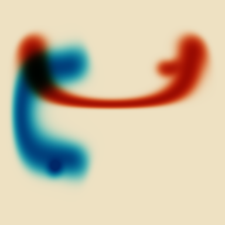
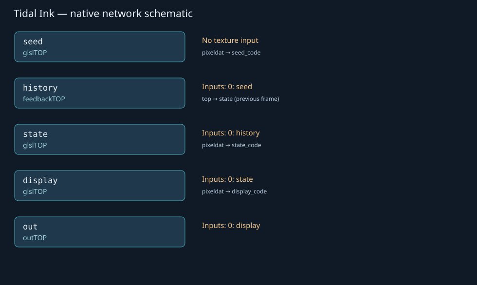

# Tidal Ink

Transport two pigment concentrations into interleaved curls. Test real persistent state, periodic sampling, initialization, pause/reset and simulated-time decay, using a prescribed field rather than a full fluid solver.

This is an original TouchDesigner study grounded in the cited archive. It separates the published technique, the new native implementation, and observations from actual tests. The source tutorial and excerpts are generated together so the explanation stays tied to the delivered shader.

## Open the study

Drag [the native component](native/study.tox) into TouchDesigner, or run `build.py` inside its Python Textport with `runpy`. Keep the returned component in a variable named `component` for the experiment commands below. Open its `out` viewer and use the Study parameter page. Presets fix unrelated controls; Pause and Time make comparisons reproducible. Any reset or warmup requirement is stated beside its experiment.

The recipe is [study.json](study.json), the source trail is [research.md](research.md), and native results are summarized in [review.md](review.md). The tested host is TouchDesigner 2025.33230 on macOS. Browser copies of these algorithms would require their own validation.

## A texture can hold pigment instead of a picture

The state texture stores two nonnegative pigment concentrations in R and G, reserves B, and uses A as an initialization marker. A separate display pass turns those numbers into color. This separation follows the archive's use of textures as data, while the specific advection mechanism is a new extension.

Reset restores a deterministic pattern of two intersecting pigment bands. Flat and empty fixtures support tests that would be difficult to interpret from the decorative pattern. Pause holds the stored state exactly; it does not merely freeze a time uniform while allowing the simulation to keep evolving.

Feedback TOP supplies the previous state to the current state pass. That temporal target is a previous-frame reference rather than an ordinary same-frame wire cycle. The output needs a consuming viewer or explicit cook driver to advance. A hidden unused network may remain unchanged even while the project timeline runs.

{{code:seed.frag:seed}}

{{experiment:seed}}

The diagram is a schematic of the recipe, not a captured network screenshot. Texture wires and parameter references are labeled separately.

## Prescribe a velocity with a known property

The velocity is S*(sin(2πx)cos(2πy), -cos(2πx)sin(2πy)), with S measured in normalized UV units per simulated second. Its X derivative and Y derivative cancel, so the continuous field has zero divergence. It is also periodic at the domain boundaries.

This is a prescribed transport field. It does not respond to pigment, solve pressure, conserve momentum or represent the full Navier–Stokes equations. The visible curls are useful for an advection test without claiming a complete fluid simulation.

The velocity diagnostic encodes signed components around a middle value of 0.5. It should remain unchanged when pigment concentrations change. That independence is a useful architectural check: the display image and state are not secretly feeding back into the velocity definition.

{{code:state.frag:velocity}}

{{experiment:velocity}}

## Follow the lookup backward

For each destination texel we trace backward through the velocity field to find where its pigment came from. A midpoint estimate samples velocity halfway along the step before choosing the departure location. The old texture is then sampled at that location.

The domain is periodic. Merely applying fract to UV coordinates would not guarantee correct interpolation at the seam if the sampler clamped its neighboring texels. The implementation therefore fetches four wrapped integer texels and blends them explicitly. Subtracting half a texel aligns the interpolation coordinates with texel centers.

This interpolation is stable in the sense that a convex combination of bounded values stays bounded, but it is diffusive and not exactly conservative. A native zero-velocity test detected small drift from repeated coordinate conversion and interpolation. The corrected implementation reads the previous texel directly when Speed is zero, preserving the identity case rather than relaxing the test.

{{code:state.frag:sample}}

{{experiment:backtrace}}

## Challenge the lifecycle with simple states

A uniform field should stay uniform under transport when decay and sources are disabled. An empty field should stay empty. Reset should replace the old pattern with the selected seed, and Pause should return the previous RGBA values exactly. These are different properties and are checked separately.

For decay alone, multiplying by exp(-rate*dt) gives a known answer after one simulated second. The native test compares sixty 1/60-second updates with thirty 1/30-second updates on a flat field. It does not expect those two step sizes to produce identical transported textures: interpolation introduces step-dependent numerical diffusion.

Step is simulated seconds per cook, not seconds measured from the wall clock. At a different presentation frame rate, the same fixed Step changes the rate of simulation relative to real time. That is intentional for repeatable testing. An installation that needs real-time synchronization should supply a bounded measured delta and revalidate its lifecycle.

{{code:state.frag:lifecycle}}

{{experiment:flat}}

## Display the transported state without changing it

After transport, an exponential factor removes pigment and two localized sources add new concentration proportional to dt. Concentration is bounded to [0,1]. Clamping is an artistic saturation rule; once active, it is an additional reason not to claim exact mass conservation.

The final display multiplies a paper color by an exponential of two chosen absorption vectors. Mixing the pigments therefore darkens different channels without feeding the styled RGB image back into the simulation. The palette is illustrative rather than a measured paint model.

The final capture is taken after 120 controlled updates from reset. To compare it exactly, use the same seed, step, source and decay values and count simulation cooks, not elapsed seconds. The accompanying test also measures approximate mass change with sources and decay disabled. Its small measured loss describes this run; a different resolution or velocity can diffuse more strongly.

{{code:state.frag:transport}}

{{experiment:final}}

The display pass reads those concentrations independently:

{{code:display.frag:pigment}}

## Evidence, tradeoffs and next experiments

The [review record](review.md) lists the actual checks and their limits. Captured presets establish those states; shader compilation establishes accepted code; mathematical fixtures test specific relationships. None alone establishes artistic acceptance or performance on another device. Native CPU cook observations are not labeled GPU execution time.

Change one mechanism at a time, preserve a fixed baseline, and explain why the new choice helps the intended image. The presets are teaching tools, not a restriction on new compositions. Shader approval and tutorial approval remain separate.

## Sources and credit

[Maxime Heckel’s article](https://blog.maximeheckel.com/posts/the-magical-world-of-particles-with-react-three-fiber-and-shaders/) and its matching archived demo informed the mechanism and teaching structure. [Exact source records](sources.json) preserve the relevant lines, hashes and adaptation notes. Credit for underlying algorithms remains with the researchers named in those sources. New prose, diagrams and native code are authored for this toolkit. See [the package attribution](../../ATTRIBUTION.md) for original source terms.

Native host contracts: [GLSL TOP](https://docs.derivative.ca/Write_a_GLSL_TOP), [GLSL MAT](https://docs.derivative.ca/Write_a_GLSL_MAT), and [Feedback TOP](https://docs.derivative.ca/Feedback_TOP), as applicable to the recipe. The live host provides the parameter and compile evidence.

For the supplemental backward-advection concept, see [Mark J. Harris, GPU Gems chapter 38](https://developer.nvidia.com/gpugems/gpugems/part-vi-beyond-triangles/chapter-38-fast-fluid-dynamics-simulation-gpu). The prescribed field and explicit midpoint implementation here are scoped in the research record.
